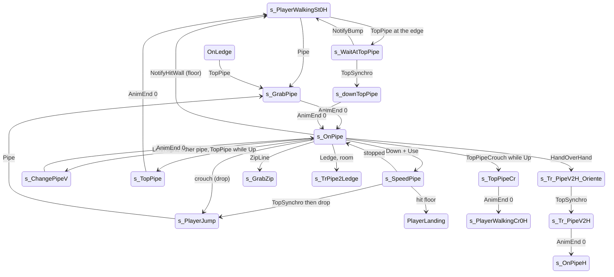

# Vertical pipe (PIPE GE)

Units:
- uc:SBase.SPlayerController:s_GrabPipe.HandOverHand
- uc:SBase.SPlayerController:s_GrabPipe.AnimEnd
- uc:SBase.SPlayerController:s_GrabPipe.EndState
- uc:SBase.SPlayerController:s_GrabPipe.PlayerMove
- uc:SBase.SPlayerController:s_ChangePipeV.AnimEnd
- uc:SBase.SPlayerController:s_OnPipe.BeginState
- uc:SBase.SPlayerController:s_OnPipe.PlayerMove
- uc:SBase.SPlayerController:s_OnPipe.ZipLine
- uc:SBase.SPlayerController:s_OnPipe.HandOverHand
- uc:SBase.SPlayerController:s_OnPipe.NotifyHitWall
- uc:SBase.SPlayerController:s_OnPipe.TopPipe
- uc:SBase.SPlayerController:s_OnPipe.TopPipeCrouch
- uc:SBase.SPlayerController:s_OnPipe.Ledge
- uc:SBase.SPlayerController:s_OnPipe.CanUseCam
- uc:SBase.SPlayerController:s_OnPipe.CanBeDropAttacked
- uc:SBase.SPlayerController:s_Tr_PipeV2H.AnimEnd
- uc:SBase.SPlayerController:s_Tr_PipeV2H_Oriente.TopSynchro
- uc:SBase.SPlayerController:s_Tr_PipeV2H_OrienteDown.TopSynchro
- uc:SBase.SPlayerController:s_SpeedPipe.EndState
- uc:SBase.SPlayerController:s_SpeedPipe.TopSynchro
- uc:SBase.SPlayerController:s_SpeedPipe.PlayerMove
- uc:SBase.SPlayerController:s_SpeedPipe.NotifyHitWall
- uc:SBase.SPlayerController:s_TopPipe.BeginState
- uc:SBase.SPlayerController:s_TopPipe.AnimEnd
- uc:SBase.SPlayerController:s_TopPipe.PlayerMove
- uc:SBase.SPlayerController:s_TopPipeCr.BeginState
- uc:SBase.SPlayerController:s_TopPipeCr.AnimEnd
- uc:SBase.SPlayerController:s_WaitAtTopPipe.NotifyBump
- uc:SBase.SPlayerController:s_WaitAtTopPipe.PlayerMove
- uc:SBase.SPlayerController:s_WaitAtTopPipe.TopSynchro
- uc:SBase.SPlayerController:s_downTopPipe.BeginState
- uc:SBase.SPlayerController:s_downTopPipe.AnimEnd
- uc:SBase.SPlayerController:s_downTopPipe.PlayerMove
- uc:SBase.SPlayerController:s_TrPipe2Ledge.BeginState
- uc:SBase.SPlayerController:OnLedge.TopPipe
- uc:SBase.SBasePawn:SetPipeZones
- uc:SBase.SBasePawn:SendZipPAndNormalToServer
- uc:SBase.SBasePawn:SendNewZipPToServer
- nat:SBase.SPlayerController.CheckForOtherPipeV
- nat:SBase.SPlayerController.CheckRoomToChangePipeV
- nat:SBase.SPlayerController.bCanTakeLedgeFromPipe
- uc:SBase.SPlayerController:s_GrabPipe.SwitchBinocularVision
- uc:SBase.SPlayerController:s_OnPipe.SwitchBinocularVision
- uc:SBase.SPlayerController:s_SpeedPipe.SwitchBinocularVision
- uc:SBase.SPlayerController:s_TopPipe.SwitchBinocularVision
- uc:SBase.SPlayerController:s_WaitAtTopPipe.SwitchBinocularVision
- uc:SBase.SPlayerController:s_downTopPipe.SwitchBinocularVision

## Purpose

Climbing a vertical pipe (GE kind PIPE, 32): grab from the ground or the air, climb up and down at a fixed speed,
slide down fast, switch to a neighbouring pipe, leave at the top onto the floor (standing or crouched), get on
from the top, change to a hand-over-hand pipe or a ledge, and drop. Spies only.

## Data

| Field | Owner | Notes |
|---|---|---|
| ZipP1, ZipP2 | SBasePawn | GE points of the current pipe (bottom and top for PIPE; see native-contracts.md) |
| NewZipP1, NewZipP2 | SBasePawn | candidate GE points (next pipe, hand-over-hand pipe, ledge) |
| m_geoNormal | SBasePawn | GE normal (the side point direction), sent x 1000 |
| bCanStop | SBasePawn | the climb may stop here: set (with bIsStopped and bBeginSpecial12Anim) by the hold actions SA_ON_PIPE (145), SA_ON_PIPE2 (151), SA_ON_PIPE2L (152) and SA_AFTER_CHANGE_PIPEV (248); cleared by the script on Up or Down; physOnPipe never touches it |
| iMove, iOldMove, iRealMove | SPlayerController | move mask (Up 16, Down 32, Left 1, Right 2) |
| bIsLeftPart | SBasePawn | which side of the top the spy came from (TopPipe(bLeft)) |
| bBlockControlForJump | SPlayerController | set true on entering s_OnPipe |
| m_PipeArmsZone / Radius | SBasePawn | (37, 0, 90.3) / 25.4 |
| Snd_TubSlide | SPlayerController | Sound_Persos.divers.TUBSLIDE_2 |
| SoundStopSpeedPipe | SBasePawn | Sound_Persos.divers.TUBSLIDE_2 |

## Rules

### Getting on

| From | Event / condition | Action, state |
|---|---|---|
| Mario walking (spy, also merc states that inherit it) | Pipe(loc, rot), not in weapon transit | SA_PIPE_GRAB, SendZipPAndNormalToServer, s_GrabPipe |
| s_PlayerJump / PlayerFalling | Pipe, spy, unarmed, not in transit | camera smooth, SA_PIPE_GRABFALL, SendZipPAndNormalToServer, s_GrabPipe |
| Mario walking, at the top edge | TopPipe(bLeft), not in transit | SendZipPAndNormalToServer, SetInfoForVandamme(m_geoNormal), SA_REPOS, bIsLeftPart = bLeft, s_WaitAtTopPipe |
| OnLedge (hanging) | TopPipe(bLeft) | SA_TR_LEDGEPIPE_L (bLeft) or SA_TR_LEDGEPIPE_R, SendZipPAndNormalToServer, s_GrabPipe |

The merc never gets a Pipe event in practice (RE+ measured: no pipe for mercs); the walking handler has no team
test, so the filter must be in the native GE query or the merc's states (see native-contracts.md).

### s_GrabPipe (ignores Bump, SeePlayer, HearNoise; binoculars disabled)

Each frame: clear bPressedJump and the crouch latch, ZoneHorsCrouch (stand up), view limited by the camera's
window around the pawn's yaw and pitch, zero-acceleration move. AnimEnd channel 0: SA_ON_PIPE, s_OnPipe.
HandOverHand (controlling side): camera ECM_NoTargetCol, bFindGE, SendNewZipPToServer, then
s_Tr_PipeV2H_Oriente if NewZipP1.Z > Location.Z else s_Tr_PipeV2H_OrienteDown. EndState stamps
m_LastSpecialMoveTime. s_ChangePipeV is the same state with AnimEnd -> SA_AFTER_CHANGE_PIPEV, s_OnPipe.

### s_OnPipe (climbing)

BeginState: crouch latch off, camera ECM_NoTargetCol, bBlockControlForJump = true, m_LastSpecialMoveTime = now.

PlayerMove, in order:
1. iRealMove = iMove. If `SBPawn.bCanStop` or `Velocity.Z == 0`, iMyMove = iMove, else iMyMove = iOldMove (a
   climb step started keeps going until the native says it can stop).
2. Up (iMyMove & 16): newAccel = (0, 0, 145), SBPawn.bCanStop = false.
   Down (iMyMove & 32): if Use is held (bUsing == 1), SA_SPEEDPIPE, crouch latch off, ChangeState('s_SpeedPipe');
   newAccel = (0, 0, -145), bCanStop = false.
3. If SBPawn.bCanStop (at rest): Left (iMyMove & 1) or Right (& 2): if `CheckForOtherPipeV(p1, p2, n)` (the
   nearest GE within 10 of the point m_PipeArmsZone.X + 16 in front, when it is a PIPE; n = SafeNormal(P3 - P1)) and
   `CheckRoomToChangePipeV(bToLeft)` (three clear (35, 35, 87.5) boxes round the pipe; natives2-traversal.md rules 4,
   5): crouch latch off, SA_CHANGE_PIPEV_L or _R, s_ChangePipeV, then set ZipP1 = p1,
   ZipP2 = p2, m_geoNormal = n and SendZipPAndNormalToServer.
4. iOldMove = iMyMove; clear bPressedJump; limited view around the pawn's yaw and pitch.
5. Drop: if the crouch latch is set (crouch pressed), clear it, `MyDoJump()`, SA_FALL_ST_0H, s_PlayerJump.
6. Send newAccel (zero when no key).

In PHYS_OnPipe (6) the native moves the pawn along the pipe (decoded, physics-traversal.md physOnPipe): the pawn is
held on the pipe line (snap at 500 uu/s, yaw turned toward -m_geoNormal at 16384 dt per call, world collision off
for the hold move). With `|Acceleration.X| <= 10`, Acceleration.Z (or Y) is a direct speed: 145 uu/s up or down
(measured 145). With `|Acceleration.X| > 10` (the slide), X is a vertical acceleration and Velocity.Z is kept in
[-450, 0]. NotifyHitWall is raised for any blocking hit with Normal.Z > 0 (floors and slopes). physOnPipe does not
touch bCanStop. Events while climbing:
- ZipLine(loc, rot): SendZipPToServer, SA_ZIP_GRAB, s_GrabZip (zip-line.md).
- HandOverHand: as in s_GrabPipe.
- NotifyHitWall (controlling side): clear jump and crouch latch, SA_WALK_ST_0H, s_PlayerWalkingSt0H, return true.
  This is how reaching the floor at the bottom ends the climb.
- TopPipe(bLeft) / TopPipeCrouch(bLeft): only while Up is pressed (iRealMove & 16): SA_TOPPIPE -> s_TopPipe, or
  SA_TOPPIPE_CR -> s_TopPipeCr.
- Ledge: if `bCanTakeLedgeFromPipe(true)` SA_TR_PIPELEDGE_R, else if `bCanTakeLedgeFromPipe(false)`
  SA_TR_PIPELEDGE_L; then s_TrPipe2Ledge (GrabLedge with the ledge's points copied from NewZipP1/NewZipP2 and sent
  to the server; ledge.md).

### Fast slide (s_SpeedPipe)

1. PlayerMove: Down not held: newAccel = (524, 0, -145) and, when Velocity.Z == 0 (stopped), SA_ON_PIPE,
   SBPawn.bCanStop = true, aForward = 0, s_OnPipe. Down held: newAccel = (-524, 0, -145). Limited view, clear
   jump. Crouch latch set: drop as in s_OnPipe. Send newAccel.
2. The X component is the slide's vertical acceleration (decoded: `Velocity.Z += Acceleration.X dt`, clamped to
   [-450, 0]; so -524 with Down held speeds the slide up to 450 uu/s, +524 brakes it to a stop). While sliding the
   bottom is reached when the hand-over-hand zone height above the lower pipe end drops below 210: TopSynchro.
3. TopSynchro (controlling side): set the crouch latch, which drops the spy on the next frame (the slide reached the
   bottom of the GE in the air).
4. NotifyHitWall (controlling side): SA_WALK_ST_0H, SA_LAND_ST_0H_LOW, PlayerLanding.
5. EndState: zero acceleration and velocity, stop the slide sounds (Snd_TubSlide, Snd_ZLine_Gliss).

### Leaving at the top (s_TopPipe, s_TopPipeCr)

s_TopPipe: camera ECM_OnLedge; view rotation, zero acceleration; AnimEnd channel 0: SA_WALK_ST_0H, smooth camera,
s_PlayerWalkingSt0H. s_TopPipeCr: camera ECM_SmoothTransitionCentered; AnimEnd: SA_WANTS_TO_CROUCH, SA_WALK_CR_0H,
s_PlayerWalkingCr0H. The climb-over clip is a root-motion move; which of the two the native offers depends on the
room above the top (TestTopPipe, decoded in physics-traversal.md): four box traces from Location + dz, right 30,
up 191.5 (crouched 156.9), right 15, forward 79.4 (crouched 92.7), with boxes (35, 35, 87.5) or (35, 35,
CrouchHeight). TopPipe when the standing set is clear, else TopPipeCrouch when the crouched set is clear, else an
LG near the pipe top gives Ledge; with none of these the spy stays at the top (the measured "stuck" case below).

### Getting on from the top (s_WaitAtTopPipe, s_downTopPipe)

1. s_WaitAtTopPipe: view rotation, zero acceleration; the SA_REPOS action makes the native reposition the pawn to
   the top attach point (PHYS_Repositionnal, 11). TopSynchro (controlling side, position reached):
   SA_DOWN_TOPPIPE2 if bIsLeftPart else SA_DOWN_TOPPIPE, s_downTopPipe. NotifyBump (controlling side): SA_EXIT_REPOS
   and GotoWaitingState (someone is in the way, abort).
2. s_downTopPipe: camera ECM_SmoothTransitionCentered; AnimEnd channel 0: smooth camera, crouch latch off,
   SA_ON_PIPE2L (bIsLeftPart) or SA_ON_PIPE2, s_OnPipe.
3. Measured: "Use at the edge over a flush pipe" starts this; a pipe that rises above the edge cannot be taken from
   above; walking off the edge never catches the pipe.

### To hand over hand (s_Tr_PipeV2H_Oriente / _OrienteDown, s_Tr_PipeV2H)

The two orient states (ignore Bump, AnimEnd, SeePlayer, HearNoise) wait for TopSynchro (repositioning done), then
play SA_TR_PIPEV_H (going up) or SA_TR_PIPEV_H_DOWN and go to s_Tr_PipeV2H. s_Tr_PipeV2H.AnimEnd: smooth camera,
SA_ON_PIPEH, s_OnPipeH (pipe-horizontal.md).

## States

Physics: s_OnPipe and s_SpeedPipe PHYS_OnPipe (6); grabs, top exits and the down-from-top clip are root-motion or
repositioning moves set by the actions (PHYS_RootMotion 5 or PHYS_Repositionnal 11); the measured pipe climb cycle
is unlocked and in place (PHYS 6).

## Constants

| Name | Value | Unit | Provenance | Source |
|---|---|---|---|---|
| Climb speed | 145 | uu/s | decoded and measured | s_OnPipe.PlayerMove; RE+ "pipe 145" |
| Slide accel term | 524 | uu/s^2 (native use) | decoded | s_SpeedPipe.PlayerMove |
| Slide speed limit | Velocity.Z in [-450, 0] | uu/s | decoded | physics-traversal.md physOnPipe 4 |
| Direct-speed threshold | `|Acceleration.X| <= 10` | uu/s^2 | decoded | same |
| Top room test | right 30, up 191.5 (crouched 156.9), right 15, forward 79.4 (crouched 92.7) | uu | decoded | physics-traversal.md TestTopPipe |
| Pipe arms zone | (37, 0, 90.3), r 25.4 | uu | decoded | def:SBase.SBasePawn |
| Top exit offsets (native) | C_DOWNTOPPIPE (96.3, 38.67, -181.7), C_DOWNTOPPIPE2 (97.3, -39.17, -186.15), _CR (82.7, +-35, -179.6) | uu | decoded | SBasePawn consts, used by native code |
| Ledge to pipe offsets (native) | C_TR_PIPE_LEDGE (14, -45, -27), C_TR_LEDGE_PIPE (-14, -45, 8) | uu | decoded | SBasePawn consts |
| Pipe climb times | 3.8 s for 400, 6.6 s for 800 (grab to standing on top) | s | measured | RE+ ClimbLabD |

## Network

- All transitions on the controlling side, sent with ChangeState. The GE points go to the server with
  ServerGetZipP / ServerGetZipPAndNormal / ServerGetNewZipP (reliable, normal x 1000) so the server's native pipe
  physics uses the same pipe.
- The climb itself is carried by the move stream (newAccel in MyServerMove), with traversal payloads in
  BigServerMove (netcode spec).

## Edge cases

- A climb step started with Up or Down continues (iOldMove) until bCanStop is set (by a hold action) or the
  vertical velocity is exactly 0, so tapping Up always climbs to the next rest position (open question 1).
- Switching pipes and the side moves are only possible at rest (SBPawn.bCanStop).
- s_OnPipe.BeginState sets bBlockControlForJump; see the wall-jump spec for why this may remove air control from
  every later jump.
- A pipe whose wall continues above it (a roof beside it, not ahead) leaves the spy stuck at the top: neither
  TopPipe nor TopPipeCrouch fires (measured).
- The PIPE top must be flush with the floor it leads to (3 below = the spy never leaves the pipe), measured.

## Evidence

- Decompiled: local/re-out/uc/SBase/SPlayerController.uc (s_GrabPipe, s_ChangePipeV, s_OnPipe, s_Tr_PipeV2H*,
  s_SpeedPipe, s_TopPipe, s_TopPipeCr, s_WaitAtTopPipe, s_downTopPipe, s_TrPipe2Ledge, OnLedge.TopPipe, Mario
  and jump Pipe/TopPipe events), SBase/SBasePawn.uc (SetPipeZones, SendZipP*).
- Natives: CheckForOtherPipeV game 0x10aa4110 (editor exec 0x111e92a0), CheckRoomToChangePipeV 0x10aa3e10,
  bCanTakeLedgeFromPipe 0x10ab1de0 (editor exec 0x111e81e0); editor APawn::physOnPipe 0x1120a470, ASBasePawn::
  TestTopPipe 0x111fe5e0, CheckPipeFeet 0x111ec970, physRepositionning 0x111fc7a0, EndPhysRepositionning
  0x111fcbc0.
- GE data: local/formats/ge/SteeE.json (6 PIPE GEs, bottom z -806/-1128/-1192, top z -168/152, side point 10 out).
- Measurements: RE+ docs/MapBuilderPatterns.md (pipe speed, top-out times, getting on from above) and
  docs/MapBuilderFacts.md (PIPE 3 points, flush top).

## Open questions

1. What ends a climb step started by one tap of Up: physOnPipe moves at Acceleration.Z while the script keeps
   sending iOldMove, and bCanStop is set only by the hold actions, so the rest positions come from the script or
   the clips (the per-step SA_ON_PIPE). Trace a climb with one tap of Up, logging Location.Z, Velocity.Z,
   bCanStop and the action ids.
2. s_SpeedPipe: the slide speed profile (the limit is decoded: 450 uu/s). Trace a slide down a 600 pipe with and
   without Down held.

### Resolved

1. (part) physOnPipe input use and NotifyHitWall. Resolved: Acceleration.Z (or Y) is a direct speed when
   `|Acceleration.X| <= 10`; with `|X| > 10` X is a vertical acceleration and Velocity.Z stays in [-450, 0];
   NotifyHitWall for any blocking hit with Normal.Z > 0; physOnPipe does not touch bCanStop. Evidence:
   physics-traversal.md physOnPipe (ANSWERS-physics 15).
3. TestTopPipe room test. Resolved: four box traces (right 30, up 191.5 or 156.9 crouched, right 15, forward 79.4
   or 92.7 crouched); TopPipe, else TopPipeCrouch, else a nearby LG gives Ledge. Rule "Leaving at the top".
   Evidence: physics-traversal.md TestTopPipe (ANSWERS-physics 16).
5. Who sets bCanStop on the pipe. Resolved: the hold actions SA_ON_PIPE (145), SA_ON_PIPE2 (151), SA_ON_PIPE2L
   (152), SA_AFTER_CHANGE_PIPEV (248) (and on ladders 155, 156, 302) set bIsStopped, bCanStop and
   bBeginSpecial12Anim. Evidence: execute-action.md cases 145 to 152, 248 (ANSWERS-actions 19).
4. CheckForOtherPipeV: search and orientation. Resolved: the nearest GE within 10 of the point m_PipeArmsZone.X + 16
   in front (query box +-5), if it is a PIPE: ZipP1/2 and normal SafeNormal(P3 - P1); any other kind: false.
   CheckRoomToChangePipeV: three (35, 35, 87.5) boxes round the pipe (aside zone.X + 8, forward 2 zone.X + 16, back
   to the centre line). Evidence: natives2-traversal.md rules 4, 5 (ANSWERS-natives2 4, 5).
