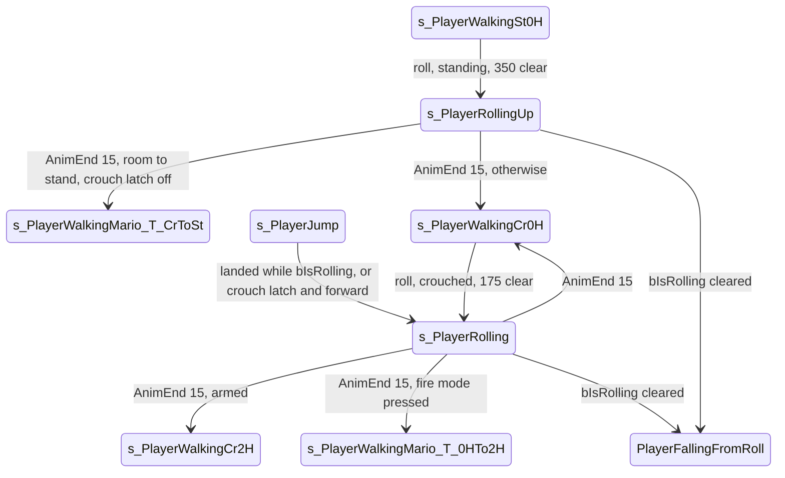

# Spy roll

Units:
- uc:SBase.SPlayerController:s_PlayerWalkingMario.PlayerMove (roll start block)
- uc:SBase.SPlayerController:s_PlayerRolling.BeginState
- uc:SBase.SPlayerController:s_PlayerRolling.PlayerMove
- uc:SBase.SPlayerController:s_PlayerRolling.AnimEnd
- uc:SBase.SPlayerController:s_PlayerRolling.MyFalling
- uc:SBase.SPlayerController:s_PlayerRolling.MyNotifyLanded
- uc:SBase.SPlayerController:s_PlayerRolling.DropAttack
- uc:SBase.SPlayerController:s_PlayerRolling.performDropAttack
- uc:SBase.SPlayerController:s_PlayerRolling.CanBeBlasted
- uc:SBase.SPlayerController:s_PlayerRolling.ExplosionHit
- uc:SBase.SPlayerController:s_PlayerRollingUp.AnimEnd
- uc:SBase.SPlayerController:PlayerFallingFromRoll.BeginState

## Purpose

The spy's roll (key Q, `bRoll`): from a crouch a forward roll at run speed; from a run a longer, faster dive roll
that ends crouched or standing. The roll keeps the direction it started with, can knock over a pawn it runs into, and turns
into a fall when the floor ends.

## Data

| Field | Type | Default | Notes |
|---|---|---|---|
| bRollAction | bool | false | request, from ComputeCrouchOrRoll (input-and-rotation.md) |
| aForwardRoulade, aStrafeRoulade | float | 0 | the roll's stick vector, kept for the whole roll |
| fDistanceToRoll | float | 350.0 | def:SBase.SPlayerController |
| fTimeBetweenTwoRolls | float | 0.5 | def:SBase.SPlayerController |
| m_LastRollingTime | float | -10.0 | set at the end of each roll |
| bRemindDrawWeapon | bool | false | fire mode pressed during the roll: draw at the end |
| SBasePawn.bIsRolling | bool | false | set by PlayRoll / PlayRollUp (actions 130, 131); cleared by the walk actions and the walk blender (rule "bIsRolling") |
| RunningSpeed | float | 385.0 | def:SBase.SBasePawn |

## Rules

### Start (inside s_PlayerWalkingMario.PlayerMove, after the stick scaling and the ceiling check)

1. Preconditions already checked by ComputeCrouchOrRoll: spy, PHYS_Walking, unarmed, fNormePadMove >= 0.3,
   speed >= 65, cooldown over. When crouched and the trace up 20 with extent (35, 35, 50) hits, bRollAction is
   cancelled.
2. Start only if `|Pawn.Velocity| > 65`, the stick is outside the dead square (`|aStrafe| >= 100` or
   `|aForward| >= 100`, strict comparisons against -100 and 100) and `m_LastRollingTime < now - 0.5`.
3. Clearance trace with the pawn's axes X, extent (35, 35, 50):
   - crouched: start = Location + (0, 0, 10), end = start + X * 175 (half of fDistanceToRoll);
   - standing: start = Location - (0, 0, 7.5), end = start + X * 350.
   If it hits and the velocity direction Y = normal(Velocity) satisfies `Y . X > 0.866`, trace again from the
   same start along Y with the same length (175 or 350), replacing the result.
4. If the final trace hits nothing:
   - clear bPressedJump;
   - crouched: action SA_ROLLING; `(aStrafeRoulade, aForwardRoulade) = 3000 * normal(aStrafe, aForward)`;
     ChangeState('s_PlayerRolling');
   - standing: action SA_WANTS_TO_CROUCH; `g = clamp(5.83 |Velocity| + 2625, 3500, 4700)`;
     `(aStrafeRoulade, aForwardRoulade) = g * normal(aStrafe, aForward)`; action SA_ROLLINGUP when g > 3500,
     else SA_ROLLING; in both cases ChangeState('s_PlayerRollingUp').
5. If it hits a Pawn, set bCantRollCuzColl (the Use step then passes it to FindPawnToElbowShotAndGoForIt). Any
   other hit: no roll, no effect.
6. bRollAction is cleared at the end of the block either way.

At a standing run of 423.5 uu/s, g = 5.83 x 423.5 + 2625 = 5094 which clamps to 4700, so a running dive roll
always uses SA_ROLLINGUP. A standing roll from a speed below 150.1 uu/s gives g = 3500 and SA_ROLLING.

### Rolling (s_PlayerRolling, also the parent of s_PlayerRollingUp)

1. BeginState: bRemindDrawWeapon = false; camera ECM_WalkingCr.
2. PlayerMove:
   - if `SBPawn.bIsRolling` is false, ChangeState('PlayerFallingFromRoll') (the native clears the flag when the
     roll is broken by leaving the floor: see the bIsRolling rule below);
   - if `bFireMode == 1` and not sticky-shocking: bRemindDrawWeapon = true and switch the weapon laser on
     (`ServerSwitchLaser(true)`);
   - `newAccel = UpdatePawnRotationMario(dt, int(aForwardRoulade), int(aStrafeRoulade))`. The roulade vector is
     in controller axes. The state never calls UpdateRotation, so the controller (and the view) keeps the yaw and
     pitch it had when the roll began: the mouse and the keys do not steer the roll, and the pawn turns toward the
     start direction at the Mario turn rate;
   - `GroundSpeed = RunningSpeed * |newAccel| / 3000` (no dead zone): 385 uu/s for a 3000 roll, 603.2 uu/s for a
     4700 dive;
   - send the move. There is no jump, use, crouch or GE check while rolling (the inherited Mario events stay
     active: Pipe, NarrowLadder, TopPipe, TopLadder and NotifyHitWall, but NotifyHitWall ignores rolls).
3. AnimEnd on channel 15 (the double-jump/roll channel), only where RemoteRole != AutonomousProxy:
   - m_LastRollingTime = now;
   - trace up 20 with extent (35, 35, 50): on a hit, bRemindDrawWeapon = false and holster (SetWeaponLoaded(0))
     if armed;
   - unarmed with bRemindDrawWeapon: actions SA_WALK_CR_0H, SA_WALK_CR_0Hto2H, ChangeState
     ('s_PlayerWalkingMario_T_0HTo2H');
   - unarmed: SA_WALK_CR_0H, ChangeState('s_PlayerWalkingCr0H');
   - armed: SA_WALK_CR_2H, ChangeState('s_PlayerWalkingCr2H').
4. s_PlayerRollingUp.AnimEnd (channel 15): m_LastRollingTime = now; then if `CanUnCrouch()` and not
   bCrouchWithRoll: SA_WANTS_TO_UNCROUCH and
   - unarmed with bRemindDrawWeapon: SA_WAIT_CR2ST_0H, SA_WALK_ST_0Hto2H -> s_PlayerWalkingMario_T_0HTo2H;
   - unarmed: SA_WAIT_CR2ST_0H -> s_PlayerWalkingMario_T_CrToSt;
   - armed: SA_WAIT_CR2ST_2H -> s_PlayerWalkingWeapon_T_CrToSt.
   Otherwise end crouched exactly as s_PlayerRolling step 3 (without its ceiling trace).
5. MyFalling (native callback when the floor is lost): only action SA_FALL_ST_0H where RemoteRole !=
   AutonomousProxy; the state change happens through bIsRolling on the next PlayerMove.
6. MyNotifyLanded: the global part (footprints, fTimeOfLastLanding, client move flush), then action SA_ROLL_LAND
   unless on the server copy of a remote player.
7. DropAttack(PawnToAttack) (native callback): performDropAttack, which on the server, with a target and a living
   spy, deals 17 damage of type SDamage_DropAttacked with pill tag 1 to the target, adds score type 16, and
   broadcasts SGameMessages switch 16 if the target survives. A roll runs in walking or root-motion physics, so the
   only natives that can raise it here are those modes' sites: physWalking when the spy stands on a pawn that can
   be drop-attacked, physFalling and physFallingInRootMotion (the server-side trigger and homing). Running into a
   standing pawn does not raise it (see Edge cases: the roll is blocked).
8. A blast while rolling: CanBeBlasted when |Momentum| < BlastDistMax (1000); ExplosionHit as in s_PlayerWalking
   (blast state, combat spec).
9. bIsRolling (native, execute-action.md cases 75 to 87, 130, 131, 316; anim.md rule 6.7): set by PlayRoll and
   PlayRollUp (actions 130 and 131). Cleared by the walk actions 75, 76 and 85 to 87 (then
   SetAnimSetAfterRolling), 81 and 84 (SetAnimSetAfterRollingUp), 316 (the charge knock-back), and by the walk
   blender while Falling once the c15 roll clip passes frame 0.65 and its alpha reaches 0, or at the clip end.

### Falling out of a roll (PlayerFallingFromRoll)

BeginState: if not bCrouchWithRoll, action SA_WANTS_TO_UNCROUCH; ResetZones. Then it behaves as PlayerFalling
(jump-fall-land.md). A jump landing with the crouch latch set and forward held (`iOldMove & cMoveForward`)
also starts a 3000 roll (jump-fall-land.md).

## States

Physics: PHYS_Walking during the roll; PHYS_Falling after the floor is lost.

## Constants

| Name | Value | Unit | Provenance | Source |
|---|---|---|---|---|
| Roll trace length | 350 standing, 175 crouched | uu | decoded | def fDistanceToRoll and the 0.5 factor |
| Roll trace start offset | -7.5 standing, +10 crouched | uu | decoded | s_PlayerWalkingMario.PlayerMove |
| Roll trace extent | (35, 35, 50) | uu | decoded | same |
| Velocity retrace cone | dot > 0.866 (30 degrees) | cosine | decoded | same |
| Crouched roll magnitude | 3000 | accel units | decoded | same |
| Dive roll magnitude | clamp(5.83 v + 2625, 3500, 4700) | accel units | decoded | same |
| Roll speed | 385 crouched roll, up to 603.2 dive | uu/s | decoded | 385 x magnitude / 3000 |
| Minimum speed to roll | 65 | uu/s | decoded | ComputeCrouchOrRoll, PlayerMove |
| Stick dead square | 100 | input units | decoded | PlayerMove |
| Roll cooldown | 0.5 | s | decoded | def fTimeBetweenTwoRolls |
| Roll knock damage | 17 | hit points | decoded | s_PlayerRolling.performDropAttack |
| Roll anim channel | 15 | channel | decoded | SBasePawn const DBLJUMPCHANNEL |

## Network

- Started and steered on the owning client. The state change goes to the server with ChangeState; the actions
  SA_ROLLING / SA_ROLLINGUP / SA_WANTS_TO_CROUCH reach the server and the other clients through the action
  stream (state-and-network.md).
- performDropAttack runs on the server only (Role == ROLE_Authority).
- aForwardRoulade and aStrafeRoulade are not replicated. The server moves the pawn from the client's moves (the
  acceleration carried by MyServerMove), so only the client's roll vector matters.

## Edge cases

- A pawn in the roll path blocks the roll but sets bCantRollCuzColl, which makes the same Use press look for an
  elbow target at that pawn.
- A dive roll is always SA_ROLLINGUP at normal run speed because the computed magnitude is clamped at 4700.
- Rolling off an edge: the native clears bIsRolling, the next PlayerMove leaves for PlayerFallingFromRoll, and
  the spy stands up there unless the crouch latch is set.
- The ceiling trace at the end of a roll forces a holster even if the weapon was drawn some other way.

## Evidence

- Decompiled: local/re-out/uc/SBase/SPlayerController.uc (s_PlayerWalkingMario.PlayerMove roll block,
  s_PlayerRolling, s_PlayerRollingUp, PlayerFallingFromRoll, s_PlayerJump.MyNotifyLanded).
- Natives: ASBasePawn::PlayRoll (editor 0x111fe260), PlayRollUp (0x111fe360), SetAnimSetAfterRolling
  (0x111ff7e0), SetAnimSetAfterRollingUp (0x111ff8f0); action cases 130/131/132 in ExecuteAction (game 0x10ad6800).
- Clip timing note: the roll clips are one-shot clips whose AnimEnd timing follows the UE2 channel frame rules
  (memory note scct-anim-channel-timing; RollStAlFdL 16 frames).

## Open questions

3. Roll clip lengths (RollStAlFdL and the dive) on channel 15 to time AnimEnd; read from the converted
   animation catalog (the end rule itself is decoded: AnimEnd when the frame reaches 1 - 1/N, anim.md rule 2;
   RollStAlFdL is 16 frames at 15 fps, 1.0 s, in the Bridge catalog).

### Resolved

1. When the native sets and clears bIsRolling. Resolved: rule 9 above (set by actions 130 and 131; cleared by the
   walk actions, 316, and the walk blender while Falling past frame 0.65 of the c15 roll clip or at its end).
   Evidence: execute-action.md cases 75 to 87, 130, 131, 316; anim.md rule 6.7 (ANSWERS-actions 7).
2. Which native raises DropAttack during a roll. Resolved: only the physics-mode sites (physWalking standing on a
   pawn, physFalling and physFallingInRootMotion, physLinear); a roll triggers it through walking or root-motion
   physics only. Rule 7 above. Evidence: physics-walking.md 0, physics-falling.md 4 (ANSWERS-physics 31).
