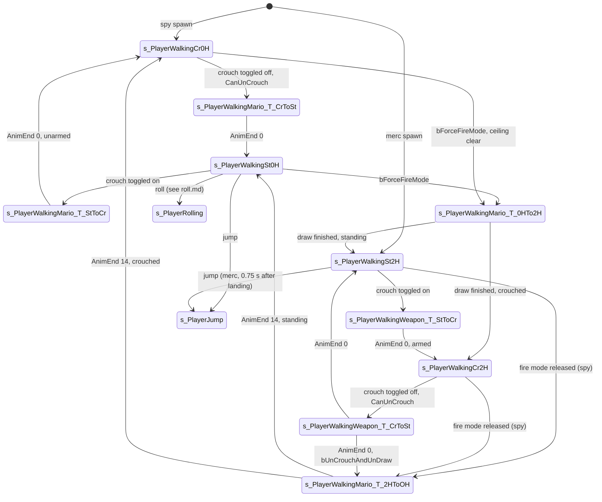

# Walking, crouching, stance and weapon transitions

Units:
- uc:SBase.SPlayerController:s_PlayerWalking.PlayerTick
- uc:SBase.SPlayerController:s_PlayerWalking.CanIUseBinocular
- uc:SBase.SPlayerController:s_PlayerWalking.CanUncrouchAndUndraw
- uc:SBase.SPlayerController:s_PlayerWalking.CanInteract
- uc:SBase.SPlayerController:s_PlayerWalking.CanElbowShock
- uc:SBase.SPlayerController:s_PlayerWalkingMario.CanCrouch
- uc:SBase.SPlayerController:s_PlayerWalkingMario.PlayerMove
- uc:SBase.SPlayerController:s_PlayerWalkingMario.ProcessWorldInteract
- uc:SBase.SPlayerController:s_PlayerWalkingMario.NotifyHitWall
- uc:SBase.SPlayerController:s_PlayerWalkingMario.Pipe
- uc:SBase.SPlayerController:s_PlayerWalkingMario.AutoFeetLedge
- uc:SBase.SPlayerController:s_PlayerWalkingMario.NarrowLadder
- uc:SBase.SPlayerController:s_PlayerWalkingMario.TopPipe
- uc:SBase.SPlayerController:s_PlayerWalkingMario.TopLadder
- uc:SBase.SPlayerController:s_PlayerWalkingMario.PerformCoopMvt
- uc:SBase.SPlayerController:s_PlayerWalkingWeapon.CanCrouch
- uc:SBase.SPlayerController:s_PlayerWalkingWeapon.PlayerMove
- uc:SBase.SPlayerController:s_PlayerWalkingWeapon.TopLadder
- uc:SBase.SPlayerController:s_PlayerWalkingWeapon.NarrowLadder
- uc:SBase.SPlayerController:s_PlayerWalkingMario_T_StToCr.BeginState
- uc:SBase.SPlayerController:s_PlayerWalkingMario_T_StToCr.PlayerMove
- uc:SBase.SPlayerController:s_PlayerWalkingMario_T_StToCr.AnimEnd
- uc:SBase.SPlayerController:s_PlayerWalkingMario_T_CrToSt.BeginState
- uc:SBase.SPlayerController:s_PlayerWalkingMario_T_CrToSt.AnimEnd
- uc:SBase.SPlayerController:s_PlayerWalkingWeapon_T_StToCr.BeginState
- uc:SBase.SPlayerController:s_PlayerWalkingWeapon_T_StToCr.PlayerMove
- uc:SBase.SPlayerController:s_PlayerWalkingWeapon_T_StToCr.AnimEnd
- uc:SBase.SPlayerController:s_PlayerWalkingWeapon_T_CrToSt.BeginState
- uc:SBase.SPlayerController:s_PlayerWalkingWeapon_T_CrToSt.PlayerMove
- uc:SBase.SPlayerController:s_PlayerWalkingWeapon_T_CrToSt.AnimEnd
- uc:SBase.SPlayerController:s_PlayerWalkingSt2H.BeginState
- uc:SBase.SPlayerController:s_PlayerWalkingSt2H.EndState
- uc:SBase.SPlayerController:s_PlayerWalkingSt2H.PlayerTick
- uc:SBase.SPlayerController:s_PlayerWalkingCr2H.BeginState
- uc:SBase.SPlayerController:s_PlayerWalkingCr2H.EndState
- uc:SBase.SPlayerController:s_PlayerWalkingCr2H.PlayerTick
- uc:SBase.SPlayerController:s_PlayerWalkingSt0H.BeginState
- uc:SBase.SPlayerController:s_PlayerWalkingSt0H.PlayerTick
- uc:SBase.SPlayerController:s_PlayerWalkingCr0H.BeginState
- uc:SBase.SPlayerController:s_PlayerWalkingCr0H.PlayerTick
- uc:SBase.SPlayerController:s_PlayerWalkingMario_T_2HToOH.PlayerMove
- uc:SBase.SPlayerController:s_PlayerWalkingMario_T_2HToOH.BeginState
- uc:SBase.SPlayerController:s_PlayerWalkingMario_T_2HToOH.AnimEnd
- uc:SBase.SPlayerController:s_PlayerWalkingMario_T_0HTo2H.PlayerMove
- uc:SBase.SPlayerController:s_PlayerWalkingMario_T_0HTo2H.BeginState
- uc:SBase.SPlayerController:s_PlayerWalkingMario_T_0HTo2H.AnimEnd
- uc:SBase.SPlayerController:s_PlayerWalkingMario_T_0HTo2H.SetCamMode1st
- uc:SBase.SPlayerController:s_PlayerHit.AnimEnd
- uc:SBase.SPlayerController:s_PlayerHit.PlayerMove
- uc:SBase.SPlayerController:ProcessCrouch
- uc:SBase.SPlayerController:CanCrouch
- uc:SBase.SPlayerController:ZoneHorsCrouch
- uc:SBase.SPlayerController:PlayerMove
- uc:SBase.SPlayerController:MyProcessMove
- uc:SBase.SPlayerController:EnterStartState
- uc:SBase.SBasePawn:ResetZones
- uc:SBase.SBasePawn:SetNormalZones
- uc:SBase.SBasePawn:ShouldCrouch
- uc:SBase.SPAWNDEFENSE:StartCrouch
- uc:Engine.Pawn:StartCrouch
- uc:Engine.Pawn:EndCrouch
- nat:SBase.SBasePawn.CanUnCrouch
- def:SBase.SBasePawn
- def:SBase.SPawnAttaque
- def:SBase.SPAWNDEFENSE
- uc:SBase.SPlayerController:s_PlayerWalking.CanActivateLaser
- uc:SBase.SPlayerController:s_PlayerWalking.CanBeElbowShocked
- uc:SBase.SPlayerController:s_PlayerWalking.CanBeDropAttacked
- uc:SBase.SPlayerController:s_PlayerWalkingMario.CanActivateLaser
- uc:SBase.SPlayerController:s_PlayerWalkingWeapon.BeginState
- uc:SBase.SPlayerController:s_PlayerWalkingWeapon.EndState
- uc:SBase.SPlayerController:s_PlayerWalkingWeapon.SwitchLaser
- uc:SBase.SPlayerController:s_PlayerWalkingWeapon.CanActivateLaser
- uc:SBase.SPlayerController:s_PlayerWalkingWeapon.GadgetQuickChoice
- uc:SBase.SPlayerController:s_PlayerWalkingMario_T_StToCr.CanInteract
- uc:SBase.SPlayerController:s_PlayerWalkingMario_T_CrToSt.CanInteract
- uc:SBase.SPlayerController:s_PlayerWalkingWeapon_T_StToCr.CanInteract
- uc:SBase.SPlayerController:s_PlayerWalkingWeapon_T_CrToSt.CanInteract
- uc:SBase.SPlayerController:s_PlayerWalkingSt2H.CanUseCam
- uc:SBase.SPlayerController:s_PlayerWalkingSt2H.CanBeGrabbed
- uc:SBase.SPlayerController:s_PlayerWalkingMario_T_2HToOH.SwitchBinocularVision
- uc:SBase.SPlayerController:s_PlayerWalkingMario_T_2HToOH.CanIUseBinocular
- uc:SBase.SPlayerController:s_PlayerWalkingMario_T_2HToOH.CanInteract
- uc:SBase.SPlayerController:s_PlayerWalkingMario_T_0HTo2H.CanIUseBinocular
- uc:SBase.SPlayerController:s_PlayerWalkingMario_T_0HTo2H.CanInteract
- uc:SBase.SPlayerController:s_PlayerWalkingSt0H.CanShortLadderHelp
- uc:SBase.SPlayerController:s_PlayerWalkingSt0H.CanUseCam
- uc:SBase.SPlayerController:s_PlayerWalkingSt0H.CanSwitchGoggleManually
- uc:SBase.SPlayerController:s_PlayerWalkingCr2H.CanBeGrabbed
- uc:SBase.SPlayerController:s_PlayerWalkingCr2H.CanUseCam
- uc:SBase.SPlayerController:s_PlayerWalkingCr0H.CanShortLadderHelp
- uc:SBase.SPlayerController:s_PlayerWalkingCr0H.CanUseCam
- uc:SBase.SPlayerController:s_PlayerWalkingCr0H.CanSwitchGoggleManually
- uc:SBase.SPlayerController:CanInteract
- uc:SBase.SPlayerController:CanIUseBinocular
- uc:SBase.SPlayerController:CanUncrouchAndUndraw
- uc:SBase.SPlayerController:CanSwitchGoggleManually
- uc:SBase.SPlayerController:CanBeDropAttacked
- uc:SBase.SPlayerController:CanBeGrabbed
- uc:SBase.SPlayerController:CanBeElbowShocked
- uc:SBase.SPlayerController:CanElbowShock
- uc:SBase.SPlayerController:CanUseCam
- uc:SBase.SPlayerController:CanActivateLaser

## Purpose

The ground movement of both teams. The spy has two walking families: unarmed "Mario" movement (the pawn turns
toward the stick and runs where it faces) and armed weapon movement (the pawn faces the view and strafes). The
merc always uses weapon movement. Six resting states name the stance and hands: St/Cr (standing/crouched) and
0H/2H (no weapon/weapon). Short transition states play the crouch, stand, draw and holster animations and leave
on AnimEnd. The walking states are also where every traversal is started (jump, GE events, barrier, wall jump,
roll, back to wall, use).

## Data

Pawn values (def: SBasePawn effective chain; spy = SPawnAttaque, merc = SPAWNDEFENSE):

| Field | Spy | Merc | Notes |
|---|---|---|---|
| CollisionRadius | 35.0 | 35.0 | standing and crouched (CrouchRadius 35.0) |
| CollisionHeight (half height) | 87.5 | 87.5 | standing |
| CrouchHeight (half height when crouched) | 50.0 | 68.0 | applied by the native crouch |
| CrouchedPct | 0.575 | 0.5 | spy value from SPawnAttaque, merc from SBasePawn |
| RunningSpeed | 385.0 | 385.0 | base for every computed GroundSpeed |
| GroundSpeed | 400.0 | 400.0 | overwritten every frame by the walking states |
| AccelRate | 2048.0 | 2048.0 | not used on the ground (MycalcVelocity has no acceleration clamp); only the air control clamp reads it |
| JumpZ | 610.0 | 495.0 | |
| BaseEyeHeight / EyeHeight | 55.5 / 54.0 | 55.5 / 54.0 | |
| BaseCrouchEyeHeight | - | 20.0 | merc only |
| fRunSpeedLimit, fWalkSpeedLimit | 250, 200 | 250, 200 | walk blender only (no physics effect); AnimateWalking rewrites them per action set (rule "Walk blender") |
| HighLimitForRunOnly, LowLimitForWalkOnly | 290, 110 | same | native animation blend limits (the unarmed limits of the walk blender) |
| HighLimitForFastCrouchOnly, LowLimitForSlowCrouchOnly | 160, 90 | same | native animation blend limits |
| fBlendCoeffWalkAnim, fBlendCoeffRunAnim | 120.6, 250.0 | same | blend rates of the walk and run clips; SA_RUN_ST_2H (87) sets fBlendCoeffWalkAnim to 327 with the JoggStAl* set |
| m_NormalArmsZone / Radius | (0, 0, 44.45) / 139.7 | same | GE search sphere for the hands, pawn space |
| m_NormalFeetZone / Radius | (39, 2, -85) / 60 | same | GE search sphere for the feet, standing |
| m_CrouchedFeetZone / Radius | (0, 0, -63.5) / 76.2 | same | feet sphere when crouched |

Controller values (def:SBase.SPlayerController): MinSpeedStand 100.0, MinSpeedInCrouch 40.0,
fHysteresisDiffSpeed 0 (runtime), fTimeBetweenLandAndJump 0.75, fTimeOfLastLanding -5.0, m_LastSpecialMoveTime
-10.0, fDistanceToRoll 350.0, fDistanceForContextualJump 500.0, fPadXMaxLu 500, fChargeSeuilPad 0.5.

## Rules

### Stick normalisation (every walking PlayerMove)

1. If `aForward^2 + aStrafe^2 > 36000000`, scale both by `6000 / sqrt(aForward^2 + aStrafe^2)`.
2. Mario movement (s_PlayerWalkingMario and its children):
   - adrenaline: while `fTimeWhenHit + AdrenalineTime >= TimeSeconds`, multiply both by AdrenalineFactor (1.2);
   - crouched: multiply both by `Pawn.CrouchedPct`; standing: multiply both by 1.1.
3. Weapon movement (s_PlayerWalkingWeapon and its children), applied in this order:
   - merc coughing in smoke (btoCought): standing `aForward *= 0.39` if aForward > 0 else `0.5`,
     `aStrafe *= 0.4`; crouched `aForward *= 0.7` if aForward > 0 else `0.65`, `aStrafe *= 0.66`;
   - input curve, with `u = aForward / 6000` (signed):
     crouched `k = (-0.02468 u + 0.05065) u + 0.3117`; standing `k = (-0.05 u + 0.15) u + 0.9`;
     multiply both aForward and aStrafe by k. At full forward k is 1.0 standing and 0.33767 crouched; at full
     back k is 0.7 standing and 0.26237 crouched; with no forward input k is 0.9 / 0.3117 (pure strafe).
   - spy: crouched, trace up 20 from Location with extent (35, 35, 50); a hit sets bForceExitFireMode; then
     multiply both by 0.8. Standing: `aForward *= 0.39` if aForward > 0 else `0.5`, `aStrafe *= 0.4`.
   - merc not coughing: `s = TimeSeconds - fLastChargingTime`; `k = 0.5` if s < 2 else
     `min(0.5 + (s - 2), 1)`; multiply both by `0.9 k`. Merc coughing: multiply both by 0.9.
4. The acceleration request passed to the pawn-rotation helper is `int(0.5 * aForward)`, `int(0.5 * aStrafe)`.

### Ground speed (every walking PlayerMove)

`GroundSpeed = RunningSpeed * |newAccel| / 3000` where newAccel is the vector returned by the rotation helper.

The native turns this into velocity (MycalcVelocity, decoded in physics-walking.md 2): ground friction is a
hard-coded 8; the velocity is turned toward the input direction, `V += Acceleration dt`, then capped at GroundSpeed
(times DesiredSpeed for non-human controllers). AccelRate is not used on the ground. With no input the native sets
GroundSpeed to 0, so the pawn stops on that frame. From rest the speed ramps by |Acceleration| dt per tick up to
GroundSpeed. Steps up to 34 are climbed (stepUp; a second step needs the near-vertical wall test) and floors with
Normal.Z >= 0.7 (45.6 degrees) are walkable; the floor probe reaches 36 below and the ideal floor gap is 1.39 to
1.42 (physics-walking.md 4, 5).

Mario movement:
1. Crouched and `|newAccel| > 700`: trace up 20 with extent (35, 35, 50); on a hit, `newAccel = 700 * normal(newAccel)`
   (a low ceiling caps crouched speed at 89.83 uu/s).
2. `|newAccel| < 1` gives newAccel = 0.
3. Dead zone with hysteresis: threshold `T = MinSpeedInCrouch` (40) when crouched, else `MinSpeedStand` (100). If
   `GroundSpeed < T - fHysteresisDiffSpeed`, GroundSpeed = 0 and fHysteresisDiffSpeed = 0; else
   fHysteresisDiffSpeed = 10. So once moving, the pawn keeps moving down to T - 10.
4. GroundSpeed == 0 forces newAccel = 0.

Weapon movement: `|newAccel| < 1` gives 0; only when `Pawn.Physics == PHYS_Walking` compute GroundSpeed and
zero it below 50 (crouched) or 75 (standing), and zero newAccel when GroundSpeed is 0. In other physics the
previous GroundSpeed is kept.

Resulting steady speeds (decoded formula, confirmed by RE+ measurements):

| Case | Formula | uu/s | Measured |
|---|---|---|---|
| Spy unarmed run | 385 x 6000 x 1.1 x 0.5 / 3000 | 423.5 | 423 |
| Spy unarmed slow (speed mode 0.4) | 0.4 x 423.5 | 169.4 | 169 |
| Spy unarmed crouched | 385 x 6000 x 0.575 x 0.5 / 3000 | 221.4 | 221 |
| Spy crouched slow | 0.4 x 221.4 | 88.6 | 89 |
| Spy crouched under a low ceiling | 385 x 700 / 3000 | 89.8 | - |
| Merc standing forward | 385 x 6000 x 1.0 x 0.9 x 0.5 / 3000 | 346.5 | 346 |
| Merc crouched forward | 385 x 6000 x 0.33767 x 0.9 x 0.5 / 3000 | 117.0 | 117 |
| Spy armed standing forward | 385 x 6000 x 1.0 x 0.39 x 0.5 / 3000 | 150.2 | - |
| Spy armed standing forward, slow (stick 3600, k 0.972) | 385 x 3600 x 0.972 x 0.39 x 0.5 / 3000 | 87.6 | - |
| Merc within 2 s after a charge | half of the above | 173.3 | - |

### Spy Mario walking (s_PlayerWalkingMario.PlayerMove)

Order of operations each frame:
1. If the pawn is dead and not in GameEnded: PlayAnimDeath, ChangeState('s_Dead').
2. `ProcessCrouch()`.
3. Stick normalisation (Mario rules). GroundPitch = 0. `UpdateRotation(dt, 1)`.
   `newAccel = UpdatePawnRotationMario(dt, int(0.5 aForward), int(0.5 aStrafe))`. Ground speed rules.
4. Edge-detect the toggles: when `bUsing != oldbUsing`, `bToggleUsing = bUsing`, `oldbUsing = bUsing`. The same
   for `bUseBackToWall` into `bToggleBTW`. So bToggleUsing is 1 only on the frame Use goes down.
5. Crouched with bRollAction or bToggleBTW: trace up 20 with extent (35, 35, 50); a hit cancels both.
6. Roll start (see roll.md) when bRollAction. Then bRollAction = false.
7. Use: if `bToggleUsing == 1` and not bPressedJump: `DiscardPickup()`, then, unless rolling, try in order and
   stop at the first that returns true: AskToGrabPawn, FindPawnToReanimate,
   FindPawnToElbowShotAndGoForIt(bCantRollCuzColl), DoInteraction. Else if `bToggleBTW == 1`:
   ProcessWorldInteract (back to wall, see back-to-wall.md).
8. Wall jump start: if bPressedJump and standing and `GroundSpeed > 335`: with the pawn's axes, if
   `CheckGEForWallJump(X, Y, Z, gz)` is true: when `130 < gz - Location.Z < 335`, clear bPressedJump, set
   fGEZLocation = gz, m_LastSpecialMoveTime = now, ChangeState('s_FirstWallJumpPrepareFromJump'); otherwise set
   m_LastSpecialMoveTime, clear bPressedJump, ChangeState('s_FirstWallJumpSaltoPrepareFromJump'). See
   wall-jump.md.
9. bToggleUsing = 0, bToggleBTW = 0, `ResetZones()`, bFindGE = false.
10. If bPressedJump: raise `fDateLaunchedLastQuickGadget` to at least `now - 1.6`; if `CheckBarrier()` (native):
    bFindGE = true; crouched and `CanUnCrouch()`: actions SA_WANTS_TO_UNCROUCH then SA_BARRIER_JUMP_DETECT,
    SendZipPToServer, ChangeState('s_BarrierJumpDetect'), clear bPressedJump (crouched and cannot stand: nothing,
    bPressedJump stays); standing: SA_BARRIER_JUMP_DETECT, SendZipPToServer, ChangeState('s_BarrierJumpDetect'),
    clear bPressedJump. See barrier-and-low-ledges.md.
11. If not bFindGE: `CheckArmsZone()` (native; may call GE events, see native-contracts.md). If still not bFindGE:
    `CheckFeetZone()`.
12. Jump: if bPressedJump and the pawn has a Base that is not an SBasePawn: crouched and CanUnCrouch:
    SA_WANTS_TO_UNCROUCH, `MyDoJump()`, SA_JUMP_ST_0H, bCrouchWithRoll = false, ChangeState('s_PlayerJump');
    crouched and cannot stand: no jump; standing: `MyDoJump()`, SA_JUMP_ST_0H, ChangeState('s_PlayerJump').
    A spy cannot jump while standing on another pawn.
13. bPressedJump = false. If bFindGE, newAccel = 0.
14. Send the move: `MyReplicateMove(dt, newAccel)` when Role < Authority, else `MyProcessMove(dt, newAccel)`
    (which only sets Pawn.Acceleration).

Events handled while in Mario walking (GE events come from CheckArmsZone/CheckFeetZone; each sets bFindGE):
- `Pipe`: unless bWeaponTransit: SA_PIPE_GRAB, SendZipPAndNormalToServer, ChangeState('s_GrabPipe').
- `AutoFeetLedge`: bFindGE = true and bPressedJump = true. A low ledge in front of the feet makes the spy hop by
  itself: the event is raised by a zone check in step 11, after the barrier test of step 10 and before the jump of
  step 12, so step 12 performs an ordinary jump that frame (it does not look at bFindGE), and step 13 then zeroes
  the acceleration because bFindGE is set.
- `NarrowLadder`: unless bWeaponTransit, and for a merc only if the weapon is not reloading: SA_LADDER_GRAB,
  SendZipPAndNormalToServer, ChangeState('s_GrabLadder').
- `TopPipe(bLeft)`: unless bWeaponTransit: SendZipPAndNormalToServer, SetInfoForVandamme(m_geoNormal),
  SA_REPOS, bIsLeftPart = bLeft, ChangeState('s_WaitAtTopPipe').
- `TopLadder`: unless bWeaponTransit (merc: not reloading): SetInfoForVandamme(m_geoNormal),
  SendZipPAndNormalToServer, SA_REPOS, ChangeState('s_WaitAtTopLadder').
- `NotifyHitWall(HitNormal, Wall)` (native callback): only when not bWeaponTransit, not rolling and unarmed; if
  RemoteRole == AutonomousProxy (server copy of a remote player) return false; if crouched and cannot stand
  return false; if `CheckFence(vNormalFence, Wall, Location) == 1`: SA_FENCEGRAB, ChangeState('GrabFence');
  return true. When armed, rolling or in weapon transit the function falls off its end and returns false.
- `PerformCoopMvt` (exec, key T): DoCoopInteraction (coop.md).
- `GadgetQuickChoice(i)`: spy quick gadget; launching a grenade launcher type sets bUnCrouchAndUnDraw = 1 and
  bQuickGadgetQuery; quick-use for a cloak. Not a movement rule; listed for the state's completeness.
- CanCrouch returns true; CanActivateLaser returns false.

### Weapon walking (s_PlayerWalkingWeapon.PlayerMove)

1. Death check as in Mario. `ProcessCrouch()`. Stick normalisation (weapon rules). GroundPitch = 0.
   `UpdateRotation(dt, 1)`. `newAccel = UpdatePawnRotationWeapon(dt, int(0.5 aForward), int(0.5 aStrafe))`.
   Ground speed rules (weapon).
2. Merc run/walk animation switch: if fBlendCoeffWalkAnim != 327 and GroundSpeed > 280: SA_RUN_ST_2H; if
   fBlendCoeffWalkAnim == 327 and 0 < GroundSpeed < 220: SA_WALK_ST_2H.
3. Merc charge, berserk, elbow, reanimate and interaction on BT_UseJusteAppuye (combat specs). When the reanimate
   or terminate search succeeds the move is sent and PlayerMove returns early.
4. Reload on bReload, rate of fire on a bROF edge (weapon specs).
5. `ResetZones()`, bFindGE = false, `CheckArmsZone()`, then `CheckFeetZone()` if not bFindGE.
6. A spy never jumps from weapon movement: bPressedJump is cleared for a spy.
7. Jump (merc): bPressedJump, a non-pawn Base, and `TimeSeconds - fTimeOfLastLanding >= fTimeBetweenLandAndJump`
   (0.75 s): if CanUnCrouch: SA_WANTS_TO_UNCROUCH, `MyDoJump()`, SA_JUMP_ST_2H, bCrouchWithRoll = false,
   ChangeState('s_PlayerJump').
8. Clear bPressedJump; zero newAccel when bFindGE; send the move.

Events: `TopLadder` (merc only, not in weapon transit, weapon not reloading): SendZipPAndNormalToServer,
SetInfoForVandamme(m_geoNormal), SA_FAST_REPOS, ChangeState('s_WaitAtTopLadder'). `NarrowLadder` (merc only,
same conditions): SA_LADDER_GRABW, SendZipPAndNormalToServer, ChangeState('s_GrabLadder'). An armed spy takes no
GE at all from weapon movement. CanCrouch true, CanActivateLaser true. GadgetQuickChoice is disabled.

### Crouch requests (ProcessCrouch)

Runs only when Physics != PHYS_Falling and not bTazered, and only if Pawn.bCanCrouch.
1. If the state's CanCrouch() is false: set bCrouchWithRoll = Pawn.bIsCrouched (the latch follows the real
   stance) and stop.
2. Want stand (bCrouchWithRoll false) while crouched: if `CanUnCrouch()` and
   `m_LastSpecialMoveTime < now - 0.5`: SA_WANTS_TO_UNCROUCH, m_LastSpecialMoveTime = now, clear bPressedJump,
   bFireMode, bForceFireMode; unarmed: SA_WAIT_CR2ST_0H then spy ChangeState('s_PlayerWalkingMario_T_CrToSt'),
   merc ChangeState('s_PlayerWalkingWeapon_T_CrToSt'); armed: SA_WAIT_CR2ST_2H then
   ChangeState('s_PlayerWalkingWeapon_T_CrToSt'). If the pawn cannot stand, set bCrouchWithRoll = true again
   (the request is dropped, the player must press again).
3. Want crouch while standing and `m_LastSpecialMoveTime < now - 0.5`: SA_WANTS_TO_CROUCH, clear bPressedJump,
   bFireMode, bForceFireMode, set m_LastSpecialMoveTime; unarmed: SA_WAIT_ST2CR_0H then spy
   ChangeState('s_PlayerWalkingMario_T_StToCr'), merc ChangeState('s_PlayerWalkingWeapon_T_StToCr'); armed:
   SA_WAIT_ST2CR_2H then ChangeState('s_PlayerWalkingWeapon_T_StToCr').

The actual cylinder change is done by the native action code (decoded, execute-action.md rule 5.6), instantly:
- SA_WANTS_TO_CROUCH (77, Crouch(false)): cylinder to (CrouchRadius, CrouchHeight), MoveActor down by the height
  change (37.5 spy, 19.5 merc) so the feet stay put, PrePivot = default + change, bIsCrouched, ZoneConfig 1, then
  event StartCrouch(change). A simulated proxy only sets bIsCrouched.
- SA_WANTS_TO_UNCROUCH (78, UnCrouch(false)): a box sweep with the current cylinder from Location up twice the
  change (flags 0x2DF) must be clear; then default PrePivot and cylinder, MoveActor up, clear bIsCrouched,
  ZoneConfig 0, event EndCrouch(change). The forced UnCrouch() (pipe and ladder descents) skips the sweep and
  moves with world collision off.
StartCrouch raises EyeHeight by HeightAdjust and lowers OldZ by it; Engine.Pawn sets `BaseEyeHeight =
min(0.8 CrouchHeight, CrouchHeight - 10)` (spy 40), SPAWNDEFENSE sets BaseEyeHeight = BaseCrouchEyeHeight (20).
EndCrouch reverses EyeHeight and OldZ and restores the default BaseEyeHeight.

### Walk blender (native animation, no physics effect)

fRunSpeedLimit, fWalkSpeedLimit and the *Limit* fields only drive the walk and run blend (execute-action.md rule
5.1, anim.md rule 6): between the two limits the run channel (c4) fades in by the speed fraction and the play rate
mixes fBlendCoeffWalkAnim and fBlendCoeffRunAnim; below a rate of 1 the walk plays at rate 1 with a reduced alpha.
AnimateWalking writes the limits per action set (for example spy armed 190 / 290, merc armed 1000 / 2000, unarmed
LowLimitForWalkOnly / HighLimitForRunOnly). SA_RUN_ST_2H (87) sets fBlendCoeffWalkAnim to 327 with the JoggStAl*
set, which is the value the merc run/walk switch above tests.

`ZoneHorsCrouch()` (used by jump states): if crouched, SA_WANTS_TO_UNCROUCH (forced) and bCrouchWithRoll = true.

### Transition and resting states

| State | Enter (BeginState) | Each frame | Leaves on |
|---|---|---|---|
| s_PlayerWalkingMario_T_StToCr | oldbUsing = bUsing; camera ECM_WalkingCr (unarmed) or ECM_SecondPersonCr | Mario walking with bPressedJump cleared first; CanInteract false | AnimEnd ch 0: unarmed SA_WALK_CR_0H -> s_PlayerWalkingCr0H, armed SA_WALK_CR_2H -> s_PlayerWalkingCr2H |
| s_PlayerWalkingMario_T_CrToSt | camera ECM_Walking | Mario walking; CanInteract false | AnimEnd ch 0: SA_WALK_ST_0H -> s_PlayerWalkingSt0H |
| s_PlayerWalkingWeapon_T_StToCr | spy camera ECM_SecondPersonCr | weapon walking, jump cleared | AnimEnd ch 0: unarmed -> Cr0H (SA_WALK_CR_0H), armed -> Cr2H (SA_WALK_CR_2H) |
| s_PlayerWalkingWeapon_T_CrToSt | spy camera ECM_SecondPerson | weapon walking, jump cleared | AnimEnd ch 0: bUnCrouchAndUnDraw > 0: SA_WALK_ST_2Hto0H -> s_PlayerWalkingMario_T_2HToOH; else SA_WALK_ST_2H -> s_PlayerWalkingSt2H |
| s_PlayerWalkingSt0H | ResetZones, camera ECM_Walking, clear bUnCrouchAndUnDraw, launch a pending quick gadget (SA_QUICK_THROW) | PlayerTick: bForceFireMode and not sticky-shocking: clear it, switch the laser on if bForceLaserFireMode, carrying a HandItem -> s_ThrowGoTo, else SA_WALK_ST_0Hto2H -> s_PlayerWalkingMario_T_0HTo2H; merc bob | - |
| s_PlayerWalkingCr0H | ResetZones, camera ECM_WalkingCr | PlayerTick: as St0H but only if a trace up 20 with extent (35,35,50) is clear, else clear bFireMode and bForceFireMode; SA_WALK_CR_0Hto2H | - |
| s_PlayerWalkingSt2H | camera ECM_SecondPerson, SA_WALK_ST_2H, merc bCanBeGrabbed = true | PlayerTick after Global: spy with (bForceExitFireMode or bTestBoutonLache with bFireMode 1), no input lock, not sticky-shocking, not bCrouchWithRoll: SA_WALK_ST_2Hto0H -> s_PlayerWalkingMario_T_2HToOH; merc CheckBob | EndState: merc bCanBeGrabbed = false; spy clears bForceFireMode, fDateFireMode |
| s_PlayerWalkingCr2H | spy camera ECM_SecondPersonCr; merc: if bBehindView ResetMercCam and reselect the weapon; bCanBeGrabbed = true | PlayerTick: spy holster as St2H but requires bCrouchWithRoll; SA_WALK_CR_2Hto0H | EndState as St2H |
| s_PlayerWalkingMario_T_2HToOH | camera ECM_WalkingCr or ECM_Walking by stance | Mario walking with bPressedJump cleared and bCrouchWithRoll forced to the current stance; no binoculars, no interact | AnimEnd on channel 14 (draw channel): crouched SA_WALK_CR_0H -> Cr0H, else SA_WALK_ST_0H -> St0H |
| s_PlayerWalkingMario_T_0HTo2H | bTransitionFinished = false, FindAttClosestTarget, clear bRollAction | own PlayerMove, below | AnimEnd channel 14 sets bTransitionFinished (and bForceExitFireMode if the ceiling trace hits) |
| s_PlayerHit | - | no input movement, view only | AnimEnd channel 17 (damage channel): back to the resting state for the stance and hands |

Merc and spy enter the resting states through `EnterStartState` at spawn: spy -> s_PlayerWalkingCr0H with
bCrouchWithRoll = true, actions SA_WANTS_TO_CROUCH and SA_WALK_CR_0H (both forced), camera ECM_WalkingCr; merc
-> s_PlayerWalkingSt2H with SA_WALK_ST_2H, camera ECM_FirstPerson, weapon loaded 2. Spawn protection ends 3.0 s
after (fSpawnProtectionEnd). The client enters the state locally (BeginState if already in it) and the server
mirrors it with MirrorState.

s_PlayerWalkingMario_T_0HTo2H.PlayerMove (drawing the spy's weapon):
1. Clear bPressedJump, `SetLocation(Pawn.Location)` on the controller.
2. Clamp the stick to 6000, multiply by CrouchedPct when crouched, then by 0.5. The acceleration is
   `aForward * normal(X) + aStrafe * normal(Y)` from the controller axes (no pawn turning, no 1.1 factor).
3. Ground speed as Mario, plus a crouched ceiling trace (up 20, extent 35,35,50) that zeroes GroundSpeed.
4. If a target was found (bAttTargetEnemy): until bTransitionFinished, turn the pawn yaw toward
   AttBestTargetRotation by at most 100000 x dt per frame and the view by at most 25000 x dt in yaw and pitch;
   when finished, snap both to the target rotation (pawn pitch 0), clear bAttTargetEnemy, set the 1st-person
   camera, and go to s_PlayerWalkingCr2H (SA_WALK_CR_2H) or s_PlayerWalkingSt2H (SA_WALK_ST_2H).
5. No target: if `|Normalize(Rotation - Pawn.Rotation).Yaw| > 300`, turn the pawn yaw toward the view by at most
   65000 x dt; otherwise when bTransitionFinished, set the camera and go to Cr2H or St2H as above.
6. Send the move.

### Permission predicates

Other systems ask the current state what the player may do. Global defaults (SPlayerController): CanInteract,
CanIUseBinocular, CanUncrouchAndUndraw, CanCrouch, CanSwitchGoggleManually, CanBeDropAttacked, CanBeGrabbed,
CanBeElbowShocked, CanElbowShock, CanUseCam, CanActivateLaser, CanShortLadderHelp, CanHoistClimbHelp and
CanBeBlasted all return false. Overrides in the walking family:

| State | Returns true | Other |
|---|---|---|
| s_PlayerWalking (and every child unless overridden) | CanInteract, CanUncrouchAndUndraw, CanActivateLaser, CanBeDropAttacked, CanBeBlasted (momentum under BlastDistMax 1000); CanIUseBinocular unless rolling; CanElbowShock unless on a wall or rolling; CanBeElbowShocked unless sticky-shocking | damage, blast and drop-attack handlers (combat specs) |
| s_PlayerWalkingMario | CanCrouch | CanActivateLaser false |
| s_PlayerWalkingWeapon | CanCrouch, CanActivateLaser | SwitchLaser toggles the spy laser; BeginState and EndState empty; GadgetQuickChoice disabled |
| the four crouch/stand transition states | - | CanInteract false |
| s_PlayerWalkingMario_T_2HToOH, _T_0HTo2H | - | CanInteract and CanIUseBinocular false; binoculars disabled in 2HToOH; 0HTo2H ignores AltFire, Fire, GadgetQuickChoice, SwitchBinocularVision |
| s_PlayerWalkingSt0H, s_PlayerWalkingCr0H | CanShortLadderHelp, CanUseCam, CanSwitchGoggleManually | - |
| s_PlayerWalkingSt2H, s_PlayerWalkingCr2H | CanUseCam; CanBeGrabbed for a merc only | - |

### Vents and crouch gaps

There is no vent or crawl state: vents, ducts and crouch gaps are crossed in the crouched walking states, with the
crouched cylinder (radius 35, half height 50 spy / 68 merc) deciding what fits. Rules that matter there:
- the crouched spy moves at 221.4 uu/s (88.6 slow); when the box trace up 20 (extent 35, 35, 50) hits, i.e. the
  ceiling is lower than about 120 uu above the floor, the acceleration is capped at 700 and the speed at 89.8 uu/s;
- standing up is refused while CanUnCrouch is false, and the jump and roll are refused crouched without room;
- RE+ measured: a crouched spy passes 104 high (not 96), a crouched merc 144 (not 136); a 112 x 128 gap is crawled
  in 1.6 s; a 128 high, 2400 long tunnel is crossed at 221 (89 slow); a merc stops at the mouth of a 128 high tunnel.

### Zones (ResetZones, SetNormalZones)

`ResetZones` sets the arms search sphere to the normal one (m_NormalArmsZone, radius 139.7) and the feet sphere
to the crouched one (m_CrouchedFeetZone, 76.2) when crouched, else the normal one (m_NormalFeetZone, 60).
SetNormalZones always uses the standing feet sphere. The traversal states switch the arms sphere to their own
(SetLedgeGrabZones, SetPipeZones, SetZipLineZones, SetFenceZones); see native-contracts.md for how the natives
read them.

## States

The 0H states extend s_PlayerWalkingMario; the 2H states extend s_PlayerWalkingWeapon; both extend
s_PlayerWalking (damage reactions, drop attack, blast, binocular and laser permissions).

Physics in every walking state is PHYS_Walking (1); the native switches to PHYS_Falling (2) when the floor is lost
and calls MyFalling (jump-fall-land.md).

## Constants

| Name | Value | Unit | Provenance | Source |
|---|---|---|---|---|
| Stick clamp | 6000 (squared 36000000) | input units | decoded | walking PlayerMove |
| Mario standing boost | 1.1 | factor | decoded | s_PlayerWalkingMario.PlayerMove |
| Accel request scale | 0.5 | factor | decoded | walking PlayerMove |
| Speed divisor | 3000 | accel units | decoded | GroundSpeed formula |
| RunningSpeed | 385.0 | uu/s | decoded | def:SBase.SBasePawn |
| CrouchedPct spy / merc | 0.575 / 0.5 | factor | decoded | def:SBase.SPawnAttaque, def:SBase.SBasePawn |
| MinSpeedStand / MinSpeedInCrouch | 100 / 40 | uu/s | decoded | def:SBase.SPlayerController |
| Speed hysteresis | 10 | uu/s | decoded | s_PlayerWalkingMario.PlayerMove |
| Weapon dead zones | 75 standing, 50 crouched | uu/s | decoded | s_PlayerWalkingWeapon.PlayerMove |
| Weapon curve standing | k = (-0.05 u + 0.15) u + 0.9 | factor | decoded | s_PlayerWalkingWeapon.PlayerMove |
| Weapon curve crouched | k = (-0.02468 u + 0.05065) u + 0.3117 | factor | decoded | s_PlayerWalkingWeapon.PlayerMove |
| Spy armed factors | standing fwd 0.39, back 0.5, strafe 0.4; crouched 0.8 | factor | decoded | same |
| Merc smoke factors | standing 0.39/0.5/0.4, crouched 0.7/0.65/0.66 | factor | decoded | same |
| Merc after-charge slow | 0.5 for 2 s then +1 per s to 1, all x 0.9 | factor | decoded | same |
| Merc run/walk switch | above 280 run, below 220 walk | uu/s | decoded | same |
| Low ceiling crouch cap | 700 accel (89.8 uu/s) | accel units | decoded | s_PlayerWalkingMario.PlayerMove |
| Ceiling probe | up 20, extent (35, 35, 50) | uu | decoded | several |
| Wall jump speed gate | GroundSpeed > 335 | uu/s | decoded | s_PlayerWalkingMario.PlayerMove |
| Wall jump GE height window | 130 < dz < 335 | uu | decoded | same |
| Stance change cooldown | 0.5 | s | decoded | ProcessCrouch |
| Merc land-to-jump delay | fTimeBetweenLandAndJump 0.75 | s | decoded | def:SBase.SPlayerController |
| Spawn protection | 3.0 | s | decoded | EnterStartState, const SpawnProtectionTime |
| Crouch height change | spy 37.5, merc 19.5 | uu | decoded | 87.5 - CrouchHeight |
| Passable heights | spy 192 standing, 104 crouched; merc 192, 144 | uu | measured | RE+ MapBuilderPatterns "Limits measured in game" |
| Step up | 34 (measured: 32 walked, 36 not) | uu | decoded and measured | physics-walking.md 5; RE+ MapBuilderPatterns |
| Walkable floor | Normal.Z >= 0.7 (45.6 degrees) | - | decoded | physics-walking.md 4 |
| Ground friction | 8 | - | decoded | physics-walking.md 2 (MycalcVelocity) |

## Network

- Walking PlayerMove runs on the owning client and on a listen or standalone host for the local player (PlayerTick
  is the viewport player's tick). On the server, a remote player's controller follows the client's state changes
  (ChangeState, state-and-network.md) and its pawn is moved by the client's moves: MyServerMove calls
  ScriptMyProcessMove, which runs the current state's MyProcessMove (Pawn.Acceleration = the client's
  acceleration), then the native autonomous physics. Stock UE2 does not call PlayerTick for a remote connection's
  controller; confirm for this build (ASPlayerController::Tick, editor 0x111f41b0). Every decision in this file is
  guarded for the controlling side (actions only execute where Controller.RemoteRole is not AutonomousProxy;
  AnimEnd and event transitions test RemoteRole != ROLE_AutonomousProxy).
- Stance and hand changes reach other players as actions (ChangeEnumAction, replicated through ServerMove action
  fields or ReplicateActionToServer), see state-and-network.md.
- `bCanBeGrabbed` (merc 2H states) is replicated reliably from the server.

## Edge cases

- Crouch toggled while the ceiling is too low to stand: the request is dropped and the latch reset, so the player
  stays crouched and must press crouch twice (once to re-arm the toggle, once to stand) after leaving the low
  area. The 0.5 s stance cooldown also drops presses made too soon.
- Mario jump from a crouch requires CanUnCrouch; without room the jump press is ignored but bPressedJump stays
  set until the end of the frame, then is cleared.
- An armed spy cannot jump at all, and takes no GEs.
- The weapon GroundSpeed is not recomputed while Physics is not PHYS_Walking, so the last walking value is used by
  the native air code for a weapon-state frame spent falling.
- `NotifyHitWall` in Mario walking returns no value on the armed/rolling/transit path (false by default), which
  tells the native not to treat the hit as handled.
- Merc stick values at full back give k = 0.7, so the merc backs up at 0.7 x 346.5 = 242.6 uu/s.

## Evidence

- Decompiled: local/re-out/uc/SBase/SPlayerController.uc states s_PlayerWalking, s_PlayerWalkingMario,
  s_PlayerWalkingWeapon, the six resting states, the five transition states, s_PlayerHit; global ProcessCrouch,
  ZoneHorsCrouch, EnterStartState, PlayerMove, MyProcessMove. SBase/SBasePawn.uc ResetZones, SetNormalZones,
  ShouldCrouch. SBase/SPAWNDEFENSE.uc StartCrouch. Engine/Pawn.uc StartCrouch, EndCrouch.
- Defaults: local/formats/classdefaults_effective.json (SBase.SBasePawn, SBase.SPawnAttaque, SBase.SPAWNDEFENSE,
  SBase.SPlayerController).
- Natives: SBasePawn.CanUnCrouch game 0x10acc930 (editor exec 0x11206900, ASBasePawn::UnCrouch 0x111fb750 /
  0x111fb920, ASBasePawn::Crouch 0x11206990); CheckArmsZone 0x10aa54d0, CheckFeetZone 0x10aa7a80,
  CheckBarrier 0x10aa5390, CheckGEForWallJump 0x10aa6250, SBasePawn.CheckFence 0x10acf300, MyDoJump 0x10ae00b0,
  ExecuteAction 0x10ad6800. Editor internals: ASBasePawn::physWalking 0x112025e0, physWalkingSimulated
  0x11202080, PhysWalkingWithChild 0x111f8be0, MycalcVelocity 0x111fc2d0, APawn::stepUp 0x1117d2a0,
  APawn::CanCrouchWalk 0x1117b110, UpdateMovementAnimation 0x112008a0, AnimateWalking 0x111fd360.
- Measurements: RE+ docs/MapBuilderPatterns.md "Limits measured in game" (MoveLabD, GapLabD, ClimbLabD).

## Open questions

5. The CanUnCrouch native body (game 0x10acc930) is not decoded; the port uses UnCrouch's decoded stand-up test.
   Trace: crouch and stand next to a 150 uu ceiling, record Location.Z and CollisionHeight per frame.

### Resolved

1. The native crouch: location shift, instant or not, the stand-up test. Resolved: instant; Crouch moves the pawn
   down by the height change and sets PrePivot, bIsCrouched and ZoneConfig 1 before StartCrouch; UnCrouch(false)
   needs a clear box sweep up twice the change (flags 0x2DF); the forced UnCrouch() skips it. Rules in "Crouch
   requests" above. Evidence: execute-action.md rule 5.6, cases 77 and 78 (ANSWERS-actions 2).
2. How MycalcVelocity combines GroundSpeed, AccelRate and the input. Resolved: custom, friction 8, turned toward the
   input and capped at GroundSpeed, AccelRate unused on the ground, no input stops the pawn on that frame, ramp
   +|Acceleration| dt per tick. Rules in "Ground speed" above. Evidence: physics-walking.md 2; editor 0x111fc2d0,
   game 0x10ace4d0 (ANSWERS-physics 1).
3. Native step height and floor slope. Resolved: step 34, walkable floor Normal.Z >= 0.7, floor probe 36, ideal gap
   1.39 to 1.42; the measured 32 climbs / 36 fails fits 34. Evidence: physics-walking.md 4, 5 (ANSWERS-physics 2).
4. fRunSpeedLimit, fWalkSpeedLimit and the *Limit* fields; SA_RUN_ST_2H and 327. Resolved: walk blender only, no
   physics effect; AnimateWalking writes them per action set; SA_RUN_ST_2H (87) sets fBlendCoeffWalkAnim 327 with
   the JoggStAl* set. Rule "Walk blender" above. Evidence: execute-action.md rule 5.1, anim.md rule 6
   (ANSWERS-actions 3).
