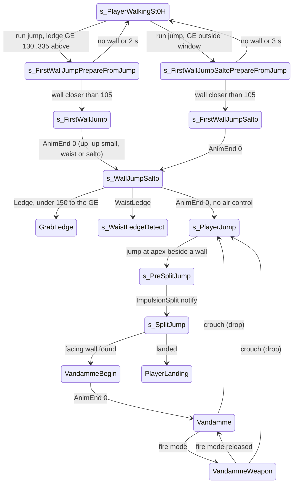

# Wall jump, split jump and Vandamme (split stance between two walls)

Units:
- uc:SBase.SPlayerController:s_FirstWallJumpPrepare.PlayerMove
- uc:SBase.SPlayerController:s_FirstWallJumpPrepareFromJump.PlayerMove
- uc:SBase.SPlayerController:s_FirstWallJumpSaltoPrepareFromJump.PlayerMove
- uc:SBase.SPlayerController:s_FirstWallJump.AnimEnd
- uc:SBase.SPlayerController:s_FirstWallJump.PlayerMove
- uc:SBase.SPlayerController:s_FirstWallJumpSalto.AnimEnd
- uc:SBase.SPlayerController:s_FirstWallJumpSalto.PlayerMove
- uc:SBase.SPlayerController:s_WallJumpSalto.WaistLedge
- uc:SBase.SPlayerController:s_WallJumpSalto.Ledge
- uc:SBase.SPlayerController:s_WallJumpSalto.AnimEnd
- uc:SBase.SPlayerController:s_WallJumpSalto.PlayerMove
- uc:SBase.SPlayerController:s_PlayerJump.PlayerMove (split jump trigger block)
- uc:SBase.SPlayerController:s_PreSplitJump.ImpulsionSplit
- uc:SBase.SPlayerController:s_PreSplitJump.PlayerMove
- uc:SBase.SPlayerController:s_SplitJump.PlayerMove
- uc:SBase.SPlayerController:VandammeBegin.BeginState
- uc:SBase.SPlayerController:VandammeBegin.AnimEnd
- uc:SBase.SPlayerController:VandammeBegin.PlayerMove
- uc:SBase.SPlayerController:Vandamme.BeginState
- uc:SBase.SPlayerController:Vandamme.PlayerMove
- uc:SBase.SPlayerController:Vandamme.CanUseCam
- uc:SBase.SPlayerController:VandammeWaitForWeapon.AnimEnd
- uc:SBase.SPlayerController:VandammeWaitForWeapon.PlayerMove
- uc:SBase.SPlayerController:VandammeWeapon.BeginState
- uc:SBase.SPlayerController:VandammeWeapon.PlayerMove
- uc:SBase.SPlayerController:VandammeWeapon.SwitchLaser
- uc:SBase.SPlayerController:VandammeWeapon.CanActivateLaser
- uc:SBase.SPlayerController:ImpulsionSplit
- uc:SBase.SPlayerController:ServerSetWallJumpDir
- uc:SBase.SPlayerController:ServerSetInfoForVandamme
- uc:SBase.SBasePawn:ImpulsionSplit
- uc:SBase.SBasePawn:SetWallJumpDir
- uc:SBase.SBasePawn:SetInfoForVandamme
- uc:SBase.SBasePawn:NotifyTakeArmControlForSplitJump
- uc:SBase.SBasePawn:ChangeAnimsForDrawUndrawSplitJump
- uc:SBase.SBasePawn:OrienteForVandamme
- nat:SBase.SPlayerController.CheckWallJump
- nat:SBase.SPlayerController.CheckGEForWallJump
- rep:SBase.SBasePawn.iYawPitchFromView
- uc:SBase.SPlayerController:VandammeWeapon.CanUseCam

## Purpose

Three spy-only wall moves. The wall jump runs at a wall under a ledge GE, kicks off the wall and grabs the ledge
or flips back. The split jump pushes off a side wall at the top of a jump. The Vandamme (named after the film
split) is the result of a split jump that reaches a second, facing wall: the spy hangs braced between both walls,
can draw the pistol and aim, and drops on crouch.

## Data

| Field | Owner | Default | Notes |
|---|---|---|---|
| vWallNormal | SPlayerController | (0,0,0) | wall normal from CheckWallJump |
| fGEZLocation | SPlayerController | -10.0 | Z of the ledge GE above the wall jump |
| fDistanceForContextualJump | SPlayerController | 500.0 | forward probe length |
| m_LastSpecialMoveTime | SPlayerController | -10.0 | timeout reference |
| bBlockControlForJump | SPlayerController | false | removes air control in s_PlayerJump |
| vWallJumpDir | SBasePawn | (0,0,0) | wall direction used by the native moves; on the server set from the client value / 1000 |
| vVandammePos | SBasePawn | (0,0,0) | Vandamme brace position, sent to the server |
| nJumpNumber | SBasePawn | 0 | 1 after a ground jump, 2 after the split impulse (native) |
| fLastRootMotionTimeCalled | SBasePawn | 0 | stamped by SetInfoForVandamme |
| bControlArmForVandamme | SBasePawn | false | arm IK on while the pistol is out |
| iYawPitchFromView | SBasePawn | 0 | low word view yaw, high word view pitch; replicated to simulated proxies |

## Rules

### Wall jump: trigger (in s_PlayerWalkingMario.PlayerMove, walking.md step 8)

A running jump (standing, GroundSpeed > 335) asks `CheckGEForWallJump(X, Y, Z, out gz)` with the pawn axes. When
true and `130 < gz - Location.Z < 335`, fGEZLocation = gz and the spy goes to
s_FirstWallJumpPrepareFromJump (kick up to the ledge). When true with the GE outside that window, it goes to
s_FirstWallJumpSaltoPrepareFromJump (kick and back flip). Both clear bPressedJump and stamp
m_LastSpecialMoveTime. When false, the normal jump code continues (barrier, ledge, jump).

CheckGEForWallJump (decoded, physics-ge-queries.md 12): walls are found by traces, not GEs; only LG GEs are
searched, above the far probe point, with a (60, 60, 300) box, near-perpendicular to the probe and more than 87.5
up. gz is that ledge's Z, or 200 above the probe point when there is none.

### Run-up states

s_FirstWallJumpPrepareFromJump and s_FirstWallJumpSaltoPrepareFromJump (both extend s_PlayerWalkingMario, so the
Mario GE events stay live) run each frame:
1. newAccel = 3000 X (full run along the pawn's facing, no steering). GroundSpeed = 385.
2. Trace from Location to Location + 500 X with zero extent; the prepare-from-jump state traces level geometry
   only (bTraceActors false), the salto version also actors.
3. Hit closer than 105: action SA_WLJP_JUMP1 and ChangeState to s_FirstWallJump (or s_FirstWallJumpSalto).
   No hit at all: ChangeState('s_PlayerWalkingSt0H').
4. Timeout: when `now - m_LastSpecialMoveTime` exceeds 2 s (prepare) or 3 s (salto prepare),
   ChangeState('s_PlayerWalkingSt0H'). This test runs after step 3 in the same frame.
5. UpdateRotation, bToggleUsing = 0, ResetZones, bFindGE = false, CheckArmsZone, bTestBackFeetGrab = false,
   CheckFeetZone when nothing found, clear bPressedJump, send the move.

s_FirstWallJumpPrepare is the same as the prepare-from-jump state except that it first faces the pawn into the
wall (`yaw = rotator(-vWallNormal)`, pitch and roll 0), traces actors off, has no abort and no timeout. No script
code enters it.

### Kick and climb

1. s_FirstWallJump (zero acceleration, view rotation only). AnimEnd channel 0 on the controlling side:
   - Use held (bUsing == 1): SA_WLJP_SALTO, s_WallJumpSalto (back flip off the wall);
   - else with `d = fGEZLocation - Location.Z`: d > 175 SA_WLJP_UP; d > 150 SA_WLJP_UPSMALL; otherwise
     SA_WLJP_UP_WAIST; then s_WallJumpSalto.
2. s_FirstWallJumpSalto: AnimEnd channel 0: SA_WLJP_SALTO, s_WallJumpSalto.
3. s_WallJumpSalto: each frame CheckArmsZone (so a ledge can be caught), clear bPressedJump, view rotation, zero
   acceleration. Events:
   - WaistLedge(bCanGoNoCrouch): spy, `ZipP1 != LastZipP`, unarmed: store bWaistLedgeCanGoUnCrouch,
     SA_WAISTLEDGE_DETECT, SendZipPToServer, s_WaistLedgeDetect.
   - Ledge: only when `fGEZLocation - Location.Z < 150`; read channel 0's clip and frame; accept unless the clip
     is WljpStAlUmL at frame <= 0.65 or the clip is WljpStAlUwL; then SA_LEDGE_GRAB, SendZipPToServer,
     bFindGE = true, GrabLedge (ledge.md).
   - AnimEnd channel 0: bBlockControlForJump = true, SA_LONG_FALL_ST_0H, s_PlayerJump (the spy falls without
     air control).
4. The wall-jump clips are root-motion moves (PHYS_RootMotion, mesh locked, the actor spins 180 degrees while the
   mesh stays put; root-motion lock note). The native moves the collision Location on its own schedule.

### Split jump

1. In the air (s_PlayerJump.PlayerMove step 5): on a jump press, a spy with nJumpNumber == 1 and
   |Velocity.Z| < 150 calls `CheckWallJump(X, Y, Z, vWallNormal)` with the pawn axes (decoded, natives2-traversal.md
   rule 11: with nJumpNumber 1 a picker probes 18 uu past R - 1 at -0.4 H along X, Y and -Y with a wall probe
   (zero-extent line, flags 0x1084, a PHYS_None hit that is not BSP with a bNoSplitJump material); exactly one side
   hitting gives that side's normal (Z = 0), neither side but X gives X's normal, both or none give false; then from
   153 - 0.4 H above Location, probes 200 along +-HitNormal must both hit with distances d1 + d2 in [182, 200) and not
   both at least R + 3). If true and `vWallNormal . X < 0.707`:
   - side = `vWallNormal.X * X.Y - vWallNormal.Y * X.X` (z of n x X);
   - `SetWallJumpDir(vWallNormal)` (sent to the server as n x 1000);
   - side < -0.1: SA_DBL_JUMP_L, face along `(n.y, -n.x, 0)` with n the normalised horizontal wall normal;
   - side > 0.1: SA_DBL_JUMP_R, face along `(-n.y, n.x, 0)`;
   - in both cases ChangeState('s_PreSplitJump'). Between -0.1 and 0.1 (wall almost straight ahead or behind)
     nothing happens.
2. s_PreSplitJump (ignores AnimEnd): zero acceleration, view only. The clip's notify calls SBasePawn.ImpulsionSplit,
   which calls the controller's ImpulsionSplit: on the controlling side bActionsSendWithVelocity = true (the next
   action packet carries the velocity), SA_DBL_JUMP_IMP, ChangeState('s_SplitJump').
3. SA_DBL_JUMP_IMP (110) is the push (decoded, execute-action.md case 110): it sets Falling and runs MyDoJump,
   which in Falling with nJumpNumber 1 sets `Velocity = 250 vWallJumpDir` with `Velocity.Z = 700` and nJumpNumber
   = 2. The split itself (SA_DBL_JUMP_L / _R, 108 and 109) sets PHYS_None with Velocity 0.
4. s_SplitJump (ignores AnimEnd; all s_PlayerJump events and landing stay active): while nJumpNumber == 2, test
   `CheckWallJump(X, Y, Z, w)` (with nJumpNumber 2: probes 200 along +-Y from 0.4 H below Location must both hit,
   180 < d1 + d2 < 198; the nearer wall within R + 3 gives w, the second probe winning when both are near; true sets
   vVandammePos to the midpoint of the two hits raised by 0.4 H); if the new wall faces the first one (`w.X vWallNormal.X + w.Y vWallNormal.Y < 0`),
   side = `w.X X.Y - w.Y X.X`: side < -0.1 SA_VANDAMME_LT, side > 0.1 SA_VANDAMME_RT, then VandammeBegin. Zero
   acceleration, view only.

### Vandamme

1. VandammeBegin: BeginState on a remote client calls `SetInfoForVandamme(vWallNormal)`: vWallJumpDir = wall
   normal, fLastRootMotionTimeCalled = now, and the server gets vVandammePos and the normal x 1000. AnimEnd
   channel 0: SA_VANDAMME_NT, Vandamme. PlayerMove: limited view (below), clear bPressedJump and the crouch latch,
   pack the view into iYawPitchFromView, zero acceleration.
2. Vandamme: camera ECM_SplitJump, crouch latch cleared. Each frame:
   - fire mode request (bForceFireMode, not sticky-shocking): laser on when bForceLaserFireMode; clear bFireMode
     and bForceFireMode; unless in weapon transit SA_VANDAMME_2H and VandammeWeapon;
   - `UpdateLimitedRotation(dt, -40000, 40000, -12000, 12000, Pawn.Rotation.Yaw, 0)`;
   - iYawPitchFromView = PackHW(PackLW(.., Rotation.Yaw), Rotation.Pitch);
   - drop: if the crouch latch became set (crouch pressed), clear it, `MyDoJump()`, nJumpNumber = 0,
     SA_VANDAMMEFALL, s_PlayerJump, clear bPressedJump;
   - zero-acceleration move.
3. VandammeWeapon: camera ECM_SplitJumpFP; laser allowed unless in transit; SwitchLaser toggles the spy laser.
   Each frame: holster on (bForceExitFireMode or bTestBoutonLache with bFireMode 1) when not sticky-shocking:
   clear the fire flags and, unless in transit, SA_VANDAMME_0H, Vandamme. View limited to yaw -12000..12000 and
   pitch -11500..6730 around the pawn yaw; the same pack, drop and move as Vandamme.
4. VandammeWaitForWeapon: AnimEnd channel 0 -> VandammeWeapon; otherwise as VandammeWeapon's limits and drop.
   No script code enters it.
5. Physics while braced: PHYS_Vandamme (10). SA_VANDAMME_* (120 to 124) set it and play SpltStAlBgL / BgR / Nt0
   (with the aim set and IK_Type 5) or the c14 weapon transition. physVandamme (decoded,
   physics-rootmotion-repositioning.md) moves the pawn in a straight line to vVandammePos at 87 uu/s (a literal,
   not fPhysReposLinearSpeed), turns the facing at 3000 per call toward the forward axis projected off
   vWallJumpDir, and sets Velocity to the displacement times dt (tiny).
6. Arm IK: NotifyTakeArmControlForSplitJump (clip notify) sets bControlArmForVandamme and camera ECM_SplitJumpFP
   when the draw clip on channel 14 plays forward, clears it when backward. ChangeAnimsForDrawUndrawSplitJump
   swaps the idle and aim clips: forward draw loops SpltStAlNt1 with RunAnim SpltStAlUL1, ForwardAnim
   SpltStAlUR1, LeftAnim SpltStAlDL1, RightAnim SpltStAlDR1; backward uses the ...0 set. OrienteForVandamme(Yaw,
   Pitch) turns the right upper arm bone toward (pitch -1190 + Pitch, yaw -240 + Yaw, roll -28075) at up to
   `150000 m_dT` per axis per frame (SetBoneDirection on 'B R UpperArm', alpha 1, space 1).

## States

Physics: run-up PHYS_Walking; s_FirstWallJump / s_FirstWallJumpSalto / s_WallJumpSalto PHYS_RootMotion (5);
split jump PHYS_Falling; Vandamme states PHYS_Vandamme (10). Physics changes are made by the native actions, not
by script.

## Constants

| Name | Value | Unit | Provenance | Source |
|---|---|---|---|---|
| Wall jump run speed gate | GroundSpeed > 335 | uu/s | decoded | s_PlayerWalkingMario.PlayerMove |
| Wall jump GE window | 130 < dz < 335 | uu | decoded | same |
| Run-up accel | 3000 | accel units (385 uu/s) | decoded | prepare states |
| Wall probe | 500 long, accept under 105 | uu | decoded | fDistanceForContextualJump, prepare states |
| Run-up timeouts | 2 / 3 | s | decoded | prepare states |
| Kick choice | > 175 up, > 150 up small, else waist | uu | decoded | s_FirstWallJump.AnimEnd |
| Ledge catch window | dz < 150; WljpStAlUmL after frame 0.65; never WljpStAlUwL | uu, frame | decoded | s_WallJumpSalto.Ledge |
| Split jump apex window | |Velocity.Z| < 150 | uu/s | decoded | s_PlayerJump.PlayerMove |
| Split wall facing limit | n . X < 0.707 | cosine | decoded | same |
| Side dead band | 0.1 | cross product | decoded | s_PlayerJump, s_SplitJump |
| Vandamme view (bare hands) | yaw -40000..40000, pitch -12000..12000 | rotator units | decoded | Vandamme.PlayerMove |
| Vandamme view (pistol) | yaw -12000..12000, pitch -11500..6730 | rotator units | decoded | VandammeWeapon.PlayerMove |
| Vandamme arm bone rate | 150000 x m_dT | rotator units per frame | decoded | SBasePawn.OrienteForVandamme |
| Vandamme arm base pose | pitch -1190, yaw -240, roll -28075 | rotator units | decoded | same |
| Net vector scale | x 1000 on send, x 0.001 on receive | factor | decoded | SetWallJumpDir, ServerSetWallJumpDir |
| Split impulse | 250 x vWallJumpDir, Velocity.Z 700, nJumpNumber 2 | uu/s | decoded | execute-action.md case 110 (MyDoJump) |
| Vandamme placement speed and turn | 87 (literal), 3000 per call | uu/s, rotator units | decoded | physics-rootmotion-repositioning.md |
| Wall-jump GE search | LG only, box (60, 60, 300), more than 87.5 up; 200 above the probe when none | uu | decoded | physics-ge-queries.md 12 |

## Network

- All decisions on the controlling side; states go to the server with ChangeState.
- SetWallJumpDir and SetInfoForVandamme are reliable client-to-server calls (ServerSetWallJumpDir,
  ServerSetInfoForVandamme). Unit vectors are multiplied by 1000 before sending because UE2 sends vector
  parameters as rounded integers; the server multiplies by 0.001. The port must apply the same rounding so the
  server's vWallJumpDir equals the client's to 3 decimals.
- The split impulse action (SA_DBL_JUMP_IMP) is sent with the pawn velocity (ReplicateActionToServerWithVelocity,
  velocity x 100) so the server copies the client's impulse.
- iYawPitchFromView (and iDesiredYawPitch) replicate reliably to simulated proxies only
  (`RemoteRole == ROLE_SimulatedProxy`) so other players see where a braced spy aims.

## Edge cases

- bBlockControlForJump is set by s_WallJumpSalto.AnimEnd (and by one pipe state) and no script code ever clears
  it. Unless a native clears it, every later jump of that controller has no air control. See open questions.
- In the prepare states the abort-on-timeout test runs after the success test, so on the frame where both hold
  the spy is sent to s_PlayerWalkingSt0H after s_FirstWallJump was entered (two state changes in one frame, the
  later one wins).
- The wall probe uses a zero-extent line from the pawn's centre; a wall that only blocks the cylinder edge is not
  seen.
- Side dead band: a wall within about 6 degrees of straight ahead or behind never gives a split jump.

## Evidence

- Decompiled: local/re-out/uc/SBase/SPlayerController.uc (s_FirstWallJump* states, s_WallJumpSalto, s_PlayerJump
  split block, s_PreSplitJump, s_SplitJump, Vandamme states, ServerSetWallJumpDir, ServerSetInfoForVandamme),
  SBase/SBasePawn.uc (ImpulsionSplit, SetWallJumpDir, SetInfoForVandamme, NotifyTakeArmControlForSplitJump,
  ChangeAnimsForDrawUndrawSplitJump, OrienteForVandamme).
- Natives: CheckWallJump game 0x10aa5a10 (editor exec 0x111ea780), CheckGEForWallJump 0x10aa6250 (editor exec
  0x111eaf20), editor ASBasePawn::physVandamme 0x111fb380, physRootMotion 0x112128c0, EndRootMotion 0x111fd160;
  action cases 108 to 110 (split), 120 to 125 (Vandamme), 234 to 238 (wall jump) in ExecuteAction 0x10ad6800.
- Root-motion lock for the wall jump: Bridge docs/handoff/traversal_2026-09-28.md (WljpStAlBg* lock 1, WljpStAlBk*
  lock 3, the actor spins 180 degrees).

## Open questions

4. Whether any native clears bBlockControlForJump. Trace: one wall jump, then a normal running jump with the stick
   released at take-off; compare the air path with a fresh spawn.
5. Root-motion Location schedule for each wall-jump clip (needed for collision during the move).

### Resolved

2. CheckGEForWallJump: GE kinds, distance, returned Z. Resolved: walls are traces; only LG GEs above the far point
   (box (60, 60, 300), near-perpendicular, more than 87.5 up); GEZPosition is that ledge Z or 200 above the probe
   point. Rule in "Wall jump: trigger". Evidence: physics-ge-queries.md 12; game 0x10aa6250 (ANSWERS-physics 23).
3. SA_DBL_JUMP_IMP and SA_VANDAMME_*: impulse, nJumpNumber, physVandamme placement. Resolved: 110 sets Falling and
   MyDoJump gives 250 vWallJumpDir with Z 700 and nJumpNumber 2; 108 and 109 set PHYS_None with Velocity 0; 120 to
   124 set Vandamme and play the split clips; physVandamme slides straight to vVandammePos at the literal 87 uu/s
   and turns at 3000 per call. Rules "Split jump" 3 and "Vandamme" 5. Evidence: execute-action.md cases 108 to 110,
   120 to 124; physics-rootmotion-repositioning.md (ANSWERS-actions 8, ANSWERS-physics 24).
1. CheckWallJump: traces, normal, vVandammePos. Resolved: rules "Split jump" 1 and 4 (picker 18 past R - 1 at -0.4 H;
   wall probes flags 0x1084, PHYS_None, no bNoSplitJump BSP; 200 uu side probes with d1 + d2 in [182, 200) for
   nJumpNumber 1 and (180, 198) for 2; vVandammePos written only for nJumpNumber 2, the midpoint raised by 0.4 H).
   CheckGEForWallJump's room boxes are in natives2-traversal.md rule 12. Evidence: natives2-traversal.md rules 11,
   12; game 0x10aa5a10 (ANSWERS-natives2 11, 12).
