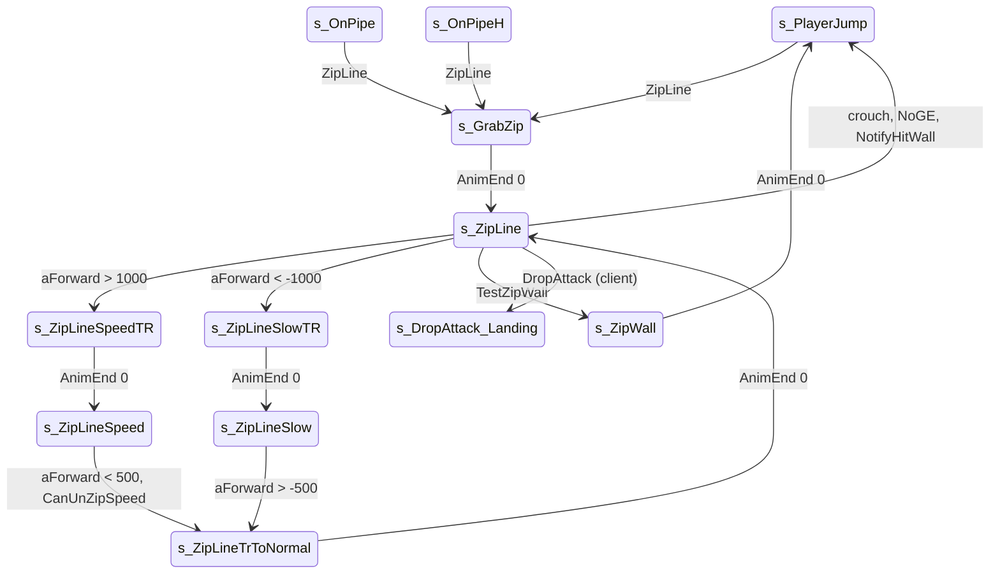

# Zip line (ZL GE)

Units:
- uc:SBase.SPlayerController:s_GrabZip.AnimEnd
- uc:SBase.SPlayerController:s_GrabZip.EndState
- uc:SBase.SPlayerController:s_GrabZip.NoGE
- uc:SBase.SPlayerController:s_GrabZip.PlayerMove
- uc:SBase.SPlayerController:s_ZipLine.CanBeDropAttacked
- uc:SBase.SPlayerController:s_ZipLine.DropAttack
- uc:SBase.SPlayerController:s_ZipLine.NoGE
- uc:SBase.SPlayerController:s_ZipLine.BeginState
- uc:SBase.SPlayerController:s_ZipLine.AnimEnd
- uc:SBase.SPlayerController:s_ZipLine.EndState
- uc:SBase.SPlayerController:s_ZipLine.NotifyHitWall
- uc:SBase.SPlayerController:s_ZipLine.PlayerMove
- uc:SBase.SPlayerController:s_ZipWall.BeginState
- uc:SBase.SPlayerController:s_ZipWall.AnimEnd
- uc:SBase.SPlayerController:s_ZipWall.EndState
- uc:SBase.SPlayerController:s_ZipWall.PlayerMove
- uc:SBase.SPlayerController:s_ZipLineSpeedTR.AnimEnd
- uc:SBase.SPlayerController:s_ZipLineSpeedTR.PlayerMove
- uc:SBase.SPlayerController:s_ZipLineSpeed.PlayerMove
- uc:SBase.SPlayerController:s_ZipLineSlowTR.AnimEnd
- uc:SBase.SPlayerController:s_ZipLineSlowTR.PlayerMove
- uc:SBase.SPlayerController:s_ZipLineSlow.PlayerMove
- uc:SBase.SPlayerController:s_ZipLineTrToNormal.AnimEnd
- uc:SBase.SPlayerController:s_ZipLineTrToNormal.PlayerMove
- uc:SBase.SPlayerController:ZipLine
- uc:SBase.SPlayerController:TestZipWall
- uc:SBase.SBasePawn:SetZipLineZones
- nat:SBase.SBasePawn.CanUnZipSpeed

## Purpose

The spy jumps at a zip line (GE kind ZL, 64: two points, the high end and the low end) and slides down it hanging
by the hands. Pushing forward speeds the slide up and tucks the legs (speed pose), pulling back slows it. He drops
with crouch, falls off at the end of the line, kicks a pawn he slides into, and hits the wall at the end with a
special clip.

## Data

| Field | Owner | Notes |
|---|---|---|
| ZipP1, ZipP2 | SBasePawn | GE points; ZipP1 - ZipP2 is the slide direction used by TestZipWall |
| m_geoNormal | SBasePawn | the line direction the native gives with the event (normalised, from CheckZipArms: always downhill); used as the move direction |
| ZipHeight | SBasePawn | 45.0: the speed-pose cylinder half height (SetZipSpeed) |
| bIsZipSpeed | SBasePawn | native, speed pose (collision ZC_ZipSpeed) |
| m_ZipLineArmsZone / Radius | SBasePawn | (0, 0, 116) / 60 |
| Snd_ZLine_Gliss | SPlayerController | Sound_Persos.divers.Zline_Gliss_Loop |

## Rules

### Getting on

| From | Event / condition | Action, state |
|---|---|---|
| s_PlayerJump / PlayerFalling | ZipLine(locationEnd, rot); not merc; not in weapon transit; unarmed; a trace with the pawn's own cylinder from Location to locationEnd hits nothing; `m_LastSpecialMoveTime < now - 2` | SendZipPToServer, bFindGE, SA_ZIP_GRAB, s_GrabZip |
| s_OnPipe (vertical pipe) | ZipLine | SendZipPToServer, SA_ZIP_GRAB, s_GrabZip (no other test) |
| s_GrabPipH, s_OnPipeH | ZipLine | same |

s_GrabZip and s_ZipLine ignore further ZipLine events. RE+ measured: caught by jumping forward at the high end from
a platform about 200 below the line, 0.85 s after the jump and about 275 along; a jump on the spot misses.

### s_GrabZip (ignores Bump, SeePlayer, HearNoise, ZipLine, SwitchBinocularVision)

PlayerMove: newAccel = 100 m_geoNormal; GroundSpeed = `RunningSpeed * 100 / 191` (201.6 uu/s);
`UpdateCamRotation(dt)`; crouch latch: latch off, clear jump, `MyDoJump()`, SA_ZIPFALL, s_PlayerJump. Send.
AnimEnd channel 0 (controlling side): SA_ON_ZIP, s_ZipLine. NoGE: latch off, clear jump, MyDoJump, SA_ZIPFALL,
s_PlayerJump. EndState stamps m_LastSpecialMoveTime.

### Sliding (s_ZipLine and the speed / slow children)

Common to all five slide states: `UpdateCamRotation(dt)`, the move direction is `m_geoNormal` and
`v = 210 + 0.015 aForward`; newAccel = v m_geoNormal; `GroundSpeed = RunningSpeed * v / 191`. With aForward in
-6000..6000: v from 120 to 300, GroundSpeed from 241.8 to 604.7, 423.3 uu/s with the stick centred (measured 407 to
424). aForward is not clamped in these states.

Native slide (PHYS_Linear, decoded in physics-traversal.md physLinear and physics-ge-queries.md 5): the pawn is held
under the cable by m_ZipLineArmsZone.Z (lowered by the speed-pose height change) and snapped at 500 uu/s. The speed
pose's hang point uses the actor transform without adding PrePivot again; the lowered zone already accounts for
the shorter cylinder (physics-traversal.md rule 1).
The speed
eases toward GroundSpeed: above it by 0.03 (GroundSpeed - s) per call, below it through MycalcVelocity. Motion
against the downhill direction is zeroed. NoGE is raised when the hold move is blocked by a non-pawn (a pawn gets
DropAttack instead); the low end is reached as a NotifyHitWall from the slide move. m_geoNormal from CheckZipArms
always points downhill, whichever end the GE lists first.

Speed pose (SetZipSpeed / UnZipSpeed, physics-traversal.md): SetZipSpeed sets the cylinder to (CrouchRadius,
ZipHeight 45) keeping the top (Location raised by H - 45), lowers PrePivot by the same and sets ZoneConfig 2.
UnZipSpeed restores the default cylinder by moving down; CanUnZipSpeed is the FarMoveActor test of that move.

s_ZipLine (normal pose): BeginState camera ECM_FSphere then the parent BeginState. PlayerMove, first match wins:
1. `TestZipWall()`: SA_ZIP_WALL, s_ZipWall.
2. aForward > 1000: SA_ON_ZIP_SPEED, s_ZipLineSpeedTR.
3. aForward < -1000: SA_ON_ZIP_SLOW, s_ZipLineSlowTR.
4. Crouch latch: latch off, clear jump, MyDoJump, SA_ZIPFALL, s_PlayerJump.
Then GroundSpeed and the move. AnimEnd on channel 15 (controlling side): SA_ON_ZIP again (restart the slide loop).

s_ZipLineSpeedTR (tucking into the speed pose): the latch is cancelled while `CanUnZipSpeed()` (native, room to
leave the speed pose) is false; ZipWall test; latch drop; AnimEnd channel 0: SA_ON_ZIP_END_TRSPEED, s_ZipLineSpeed.

s_ZipLineSpeed: same latch cancel rule; first match: ZipWall; `aForward < 500` and CanUnZipSpeed: SA_ON_ZIP_NORMAL,
s_ZipLineTrToNormal; latch drop.

s_ZipLineSlowTR: ZipWall; latch drop; AnimEnd channel 0: SA_ON_ZIP_END_TRSLOW, s_ZipLineSlow.

s_ZipLineSlow: `aForward > -500`: SA_ON_ZIP_SLOW2NORMAL, s_ZipLineTrToNormal (this change happens before the
ZipWall test, which can override it the same frame); then ZipWall; latch drop.

s_ZipLineTrToNormal: ZipWall; latch drop; AnimEnd channel 0: SA_ON_ZIP, s_ZipLine.

Common events (inherited from s_ZipLine; ignores Fire, SwitchBinocularVision, ZipLine):
- NoGE (the hold move under the cable is blocked by a non-pawn): latch off, clear jump, MyDoJump, SA_ZIPFALL,
  s_PlayerJump.
- NotifyHitWall (controlling side; this is how the low end of the line is reached): SA_ZIPFALL, s_PlayerJump,
  return true.
- DropAttack(P) (native, sliding into a pawn): on the server performDropAttack(P) (17 damage, rolling spec); on a
  client ChangeState('s_DropAttack_Landing') and the reliable TellServerForDropAttack(P).
- CanBeDropAttacked true. EndState stamps m_LastSpecialMoveTime.

TestZipWall: with d = normal(ZipP1 - ZipP2) (nothing when ZipP1 == ZipP2), trace from Location to Location + 60 d
with extent (35, 35, 20); true when something is hit and `HitNormal . d < -0.7` (a wall facing the slide).

### Wall at the end (s_ZipWall)

BeginState: stop the slide sound, camera ECM_Walking. Camera rotation, jump cleared, zero move. AnimEnd channel 0:
SA_ZIPFALL, s_PlayerJump. EndState stamps m_LastSpecialMoveTime.

## States

Physics: PHYS_Linear (7) while on the line (ZippStAlBg0 / ZippCrAlBg0 measured on PolaD, unlocked).

## Constants

| Name | Value | Unit | Provenance | Source |
|---|---|---|---|---|
| Grab move | 100 along the line, GroundSpeed 385 x 100 / 191 = 201.6 | uu/s | decoded | s_GrabZip.PlayerMove |
| Slide speed | 385 x (210 + 0.015 aForward) / 191 | uu/s | decoded | s_ZipLine.PlayerMove |
| Slide speed, stick centred | 423.3 | uu/s | decoded and measured | RE+ "zip line 407 to 424" |
| Speed pose thresholds | in > 1000, out < 500 | aForward | decoded | s_ZipLine, s_ZipLineSpeed |
| Slow pose thresholds | in < -1000, out > -500 | aForward | decoded | s_ZipLine, s_ZipLineSlow |
| End wall probe | 60 ahead, extent (35, 35, 20), facing < -0.7 | uu, cosine | decoded | TestZipWall |
| Air grab cooldown | 2 | s | decoded | s_PlayerJump.ZipLine |
| Zip arms zone | (0, 0, 116), r 60 | uu | decoded | def:SBase.SBasePawn |
| Hang height | m_ZipLineArmsZone.Z (116) under the cable, lowered by the speed-pose change; snap 500 uu/s | uu | decoded | physics-traversal.md physLinear |
| Speed pose cylinder | (CrouchRadius 35, ZipHeight 45), top kept, ZoneConfig 2 | uu | decoded | def:SBase.SBasePawn; physics-traversal.md SetZipSpeed |
| Slide easing above GroundSpeed | 0.03 (GroundSpeed - s) per call | uu/s | decoded | physics-traversal.md physLinear |
| Grab timing | 0.8 to 0.85 s after the jump, about 275 along | s, uu | measured | RE+ MapBuilderFacts / Patterns |
| SteeE zip lines | (-1822, -319, -184) to (-2324, 1472, 131); (-2814, 1468, 140) to (-2844, -320, 458) | uu | decoded | local/formats/ge/SteeE.json |

## Network

- Controlling side decides; ChangeState to the server; ServerGetZipP sends the line points.
- The drop attack on a client is requested with TellServerForDropAttack (reliable); on the server it is applied
  directly.

## Edge cases

- The air grab traces the pawn's own cylinder to the event's end point; anything in between (including another
  pawn) refuses the grab.
- In s_ZipLineSlow the change to s_ZipLineTrToNormal happens before the wall test, so with both true the wall wins
  (the second ChangeState of the frame).
- The speed pose cannot be left (latch cancelled) while CanUnZipSpeed is false, so a spy in a tight spot cannot
  drop until there is room.
- GE order: the SteeE ZL GEs store the low end first in one line and the high end first in the other; the slide
  direction must come from the native (m_geoNormal, always downhill), not from the point order. RE+ notes the
  order makes no difference in game.

## Evidence

- Decompiled: local/re-out/uc/SBase/SPlayerController.uc (s_GrabZip, s_ZipLine, s_ZipWall, s_ZipLineSpeedTR,
  s_ZipLineSpeed, s_ZipLineSlowTR, s_ZipLineSlow, s_ZipLineTrToNormal, TestZipWall, the ZipLine handlers),
  SBase/SBasePawn.uc (SetZipLineZones, ZipHeight).
- Natives: CanUnZipSpeed game 0x10acce10 (editor exec 0x11206b70), editor APawn::physLinear 0x11208af0,
  ASBasePawn::SetZipSpeed 0x111fbb80, UnZipSpeed 0x111fbcf0.
- GE data: local/formats/ge/SteeE.json (GE 13 and GE 29).
- Measurements: RE+ docs/MapBuilderFacts.md (zip line catch), docs/MapBuilderPatterns.md (407 to 424); Bridge
  traversal note (PolaD, PHYS 7).

## Open questions

None left from the native study. Trace a full SteeE slide to confirm the easing (the scenarios
traversal.spy-zip-line-13 and -29 record it; finding F8 of docs/spikes/R4-sim-vs-game.md is the grab snap).

### Resolved

1. physLinear: speed, hold under the line, NoGE at the low end. Resolved: held under the cable by
   m_ZipLineArmsZone.Z (lowered by the speed-pose change) and snapped at 500 uu/s; speed eases to GroundSpeed
   (0.03 (GroundSpeed - s) above it, MycalcVelocity below); motion against the downhill direction is zeroed; NoGE
   when the hold move is blocked by a non-pawn (a pawn gets DropAttack); the low end is a NotifyHitWall from the
   slide move. Rule "Sliding". Evidence: physics-traversal.md physLinear, physics-ge-queries.md 5
   (ANSWERS-physics 17).
2. SetZipSpeed / UnZipSpeed / CanUnZipSpeed. Resolved: speed pose cylinder (CrouchRadius, ZipHeight 45) keeping the
   top, PrePivot lowered by the same, ZoneConfig 2; UnZipSpeed moves down to the default cylinder; CanUnZipSpeed is
   the FarMoveActor test of that. Rule "Sliding". Evidence: physics-traversal.md (ANSWERS-physics 18).
3. Start end and m_geoNormal direction. Resolved: m_geoNormal from CheckZipArms always points downhill, whatever the
   GE point order. Evidence: physics-ge-queries.md 5 (ANSWERS-physics 17).
