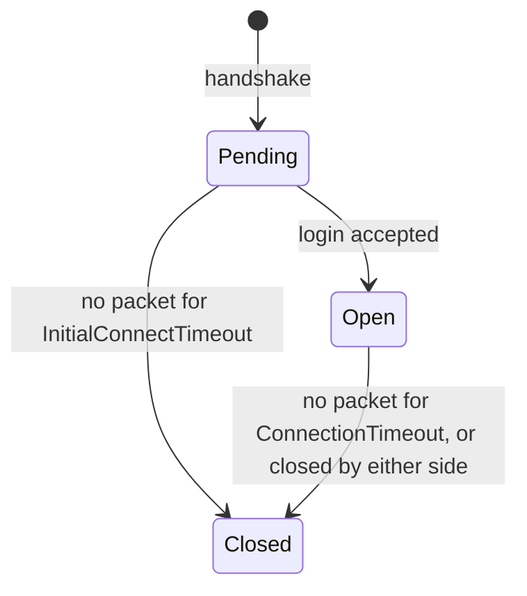
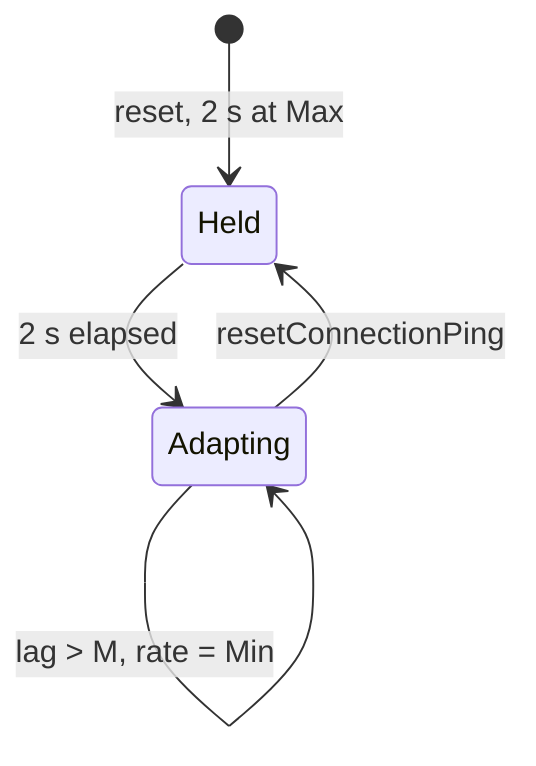

# Net driver, connections, packets and the adaptive net speed

Units: eng:UNetDriver::TickDispatch, eng:UNetDriver::TickFlush, eng:UTcpNetDriver::TickDispatch, eng:UTcpipConnection::LowLevelSend, eng:UNetConnection::Tick, eng:UNetConnection::FlushNet, eng:UNetConnection::IsNetReady, eng:UNetConnection::SendRawBunch, eng:UNetConnection::ReceivedPacket, eng:UChannel::SendBunch, eng:UChannel::IsNetReady, eng:UChannel::ReceivedAcks, eng:UNetConnection::AdaptNetSpeed, eng:UNetDriver::ResetNetSpeed, eng:UGameEngine::GetMaxTickRate, eng:ULevel::NotifyReceivedText, nat:Engine.PlayerController.resetConnectionPing, eng:IpDrv.TcpNetDriver.config

## Purpose

How the original moves bytes: when the driver ticks and flushes, how much a server may send, how a
connection decides it is saturated, how reliable data is acknowledged and resent, when connections
time out, and the SCCT adaptive net speed driven by the `CONF*` keys of `Default.ini`. This is the
layer below `net-replication.md`. Wire compatibility is not a goal; the rules here are the ones that
change what reaches a client and when.

The game executable differs from the sibling editor build in this layer: the editor keeps the stock
per-connection send budget, the game replaces it with one budget per driver and adds the `CONF*`
control law. Everything below describes the game.

## Data

Driver (one per level; client: one server connection, server: a list of client connections):

| Field | Meaning |
|---|---|
| `Time` | Driver clock in seconds (double), advanced by the frame delta in `TickDispatch`. |
| `QueuedBytes` (driver) | SCCT: one send budget shared by every connection of the driver. Bytes sent are added, the rate drains it. |
| `NetSpeed` (driver) | SCCT: the server's adaptive rate in bytes per second, shared by all client connections. |
| `NetSpeedResetTime` | SCCT: wall-clock time of the last reset of the adaptive speed (double). |
| Config | `ConnectionTimeout`, `InitialConnectTimeout`, `KeepAliveTime`, `RelevantTimeout`, `MaxClientRate`, `NetServerMaxTickRate`, `LanServerMaxTickRate`, the 21 `CONF*` keys and `maxAcceptableUnAckBunch` (`spec/net/settings.md`). |

Connection:

| Field | Meaning |
|---|---|
| `CurrentNetSpeed` | Rate in bytes per second. On a client it is the budget rate; on a server it is only the cap used by the correction rate limit (`net-moves.md` rule 17). |
| `State` | Pending, Open or Closed. |
| `LastReceiveTime`, `LastSendTime` | Driver time of the last packet in and out. |
| `OutstandingReliable` | SCCT: count of reliable bunches sent and not yet acknowledged, over all channels. |
| `AvgLag` | Mean acknowledgement round trip of the last statistics period (seconds). |
| `InLoss`, `OutLoss` | Percent of packets lost in the last statistics period. |
| `LastServerTickTime` | Driver time of the last replication pass for this connection (`net-replication.md`). |

Channel: `ChIndex` (0..510), type (control, actor, file), `OpenPacketId`, `OpenAcked`, `Closing`,
the list of outgoing reliable bunches not yet acknowledged (`NumOutRec`, at most 127).

## Rules

1. **Frame order on any machine with a driver.** Each level tick: `TickDispatch` (receive), then the
   world tick, then on a server `TickNetServer` (`net-replication.md`), then `TickFlush`. `TickFlush`
   ticks the server connection (client) or every client connection (server) in list order.
2. **Budget refill (TickDispatch).** `Time += dt`. Let `R` be the client's `CurrentNetSpeed` on a
   client, else the driver `NetSpeed`. Then `QueuedBytes -= trunc(R × dt)` and, if
   `QueuedBytes < −2 × R × dt`, `QueuedBytes = trunc(−2 × R × dt)`: at most two frames of unused rate
   can be saved up. On a server it also closes every connection whose state became Closed.
3. **Saturation.** A connection is ready when `QueuedBytes + pending_out_bytes ≤ 0`, where
   `QueuedBytes` is the driver budget (so on a server every client connection becomes not ready at
   the same moment). A channel is ready when its connection is ready and it has fewer than 127
   unacknowledged reliable bunches.
4. **Flush (FlushNet).** When the connection has pending bits, or nothing was sent for
   `KeepAliveTime` (0.2 s) and this is a client, the pending packet is closed with a terminator bit,
   padded to a byte, sent, and its id and send time are remembered for the lag measurement. The
   packet size plus the per-packet overhead is added to the driver `QueuedBytes` and to the
   connection's output statistics. Acknowledgements queued during the frame are moved to the resend
   list for the next packet.
5. **Connection tick** (once per frame per connection, from `TickFlush`):
   1. frame-time statistics;
   2. statistics period: when more than the period (1 s) has passed since the last one, per-second
      rates are computed, `InLoss` and `OutLoss` in percent, `AvgLag = LagSum / LagCount` over the
      period, then the adaptive speed step of rule 8 runs; a counter of consecutive periods with more
      than 20 % loss in either direction is kept (no reader found);
   3. if more than 1 s passed since the previous frame, `LastReceiveTime` is set to now (a hitch does
      not cause a timeout);
   4. timeout: `InitialConnectTimeout` (15 s) while pending or without a player controller, else
      `ConnectionTimeout` (15 s); past it the connection is closed; otherwise every channel ticks;
   5. queued acknowledgements are sent;
   6. flush as in rule 4.
6. **Bunches.** A bunch carries: an open-or-close flag (then the open and close bits), the reliable
   bit, the channel index (0..510, 511 is reserved), for reliable bunches a channel sequence number
   (0..1023), for opening or reliable bunches the channel type, then the payload size and payload.
   `SendBunch` merges a new unreliable bunch into the previous one of the same channel when they fit
   in one packet. Reliable bunches get the next sequence of their channel, are copied to the
   channel's outgoing list and increase `OutstandingReliable`. The first bunch of a channel that
   opens it is reliable unless the actor is `bNetTemporary` (then it opens and closes in one
   unreliable bunch).
7. **Acknowledgement and resend.** Every packet has a 14-bit id (compared with wrap-around). The
   receiver acknowledges each received id in its next packets. When an acknowledgement arrives for
   a later id than the last one seen, every id skipped in between is treated as lost (counted in
   `OutLoss`): reliable bunches it carried are resent, unreliable data is not, and properties whose
   last copy rode on that packet are marked dirty and resent by the next replication pass
   (`net-replication.md` rules 9 and 15). There is no resend on a timer. When the oldest reliable bunches of a channel are acknowledged
   they leave the list and `OutstandingReliable` decreases; a channel whose close was acknowledged is
   destroyed. Lag is measured from acknowledgements: `now − send time − frame time / 2`.
8. **Adaptive net speed (SCCT).** Once per statistics period, per connection:
   - **Client** (the connection is the server connection). Bounds `[Min, Max]` =
     `CONFClientLanMin/MaxNetSpeed` when the game is in LAN mode, else
     `CONFClientInternetMin/MaxNetSpeed`. Clamp `CurrentNetSpeed` into the bounds. With
     `L = AvgLag`, `A = CONFClientLagToTakeAction`, `M = CONFClientMaxAllowedLag`:
     - `L > M`: `CurrentNetSpeed = Min`;
     - `A < L ≤ M` and `CurrentNetSpeed > Min`: `CurrentNetSpeed = trunc(Max − (Max − Min) × (L − A) / (M − A))`;
     - `L ≤ A` and `CurrentNetSpeed < Max`: `CurrentNetSpeed += CONFClientNetSpeedStepUp`.
   - **Server** (any client connection). The row is `CONFDedicatedServer*` when the level runs as a
     dedicated server, else `CONFListenServer*` (also when the connection has no player yet). The
     same law is applied to the driver `NetSpeed` with `L` = the largest `AvgLag` of all client
     connections and a step of `StepUp / number_of_client_connections` (integer division), so each
     period the shared rate rises by about one `StepUp`.
   - In both cases, during the first 2 s after the last reset the rate is forced to `Max`.
   LAN mode is the engine-wide net type set by `EnterLAN` and cleared by `LeaveLAN`.
9. **Reset.** `PlayerController.resetConnectionPing` (called by `SGameInfo` when a late joiner is
   restarted and for every player at match start) resets the adaptive state: reset time = now, rate =
   999999 (then clamped to `Max` by an immediate rule 8 step, and held at `Max` for 2 s), and the lag
   and loss accumulators of the affected connections are zeroed.
10. **Net speed handshake.** The client sends `NETSPEED n` after the challenge and whenever the
    player changes `INTERNETSPEED`/`LANSPEED`; values below 500 are ignored; the server stores
    `CurrentNetSpeed = min(n, MaxClientRate)` on that connection. In the game build the server's send
    rate is the driver `NetSpeed` of rule 8, so this value only feeds the correction rate limit.
11. **Server tick cap.** `GetMaxTickRate` returns, on a dedicated server, `LanServerMaxTickRate` when
    started with the `lanplay` command-line switch (`-lanplay` or `/lanplay`) else `NetServerMaxTickRate`, clamped to [10, 120]; on a client in a
    level that asks for it, `min(90, CurrentNetSpeed / 64)`; otherwise 0 (no cap; listen servers and
    normal clients). The replication pass uses the same value (`net-replication.md` rule 3).
12. **Datagram framing (game build).** One UDP datagram holds: a 16-bit length, the packet payload
    compressed with one of several per-connection models followed by one byte naming the model, then
    auxiliary records queued on the connection (length-prefixed; voice or lobby data), up to 1086
    bytes of payload. The receiver selects the model from that byte, decompresses, and hands the
    auxiliary part to its own handler. A server ignores a datagram from an unknown port when its
    address already has more than 16 connections created in the last 60 s.

## States

Adaptive rate (per period):

## Constants

| Name | Value | Unit | Provenance | Source |
|---|---|---|---|---|
| Budget carry-over | 2 | frames of rate | decoded | game 0x109eeff0 |
| Reliable bunches per channel before not ready | 127 | bunches | decoded | editor 0x1113e920 (`RELIABLE_BUFFER − 1`) |
| Channel index range | 0..510 (511 = none) | | decoded | bunch header and package map, game 0x109ee320 |
| Channel sequence range | 0..1023 | | decoded | editor 0x11144f60 |
| Channel types | 8 | | decoded | editor 0x11144f60 |
| Statistics period | 1.0 | s | estimated | game 0x10a0e570 reads a per-connection period; 1.0 is the UE2 default |
| Loss counter threshold | 20 | % | decoded | game 0x10a0e570 |
| Hitch guard | 1.0 | s | decoded | game 0x10a0e570 |
| Adaptive hold after reset | 2.0 | s | decoded | game 0x10a0eac0 |
| Reset rate | 999999 | bytes/s | decoded | game 0x109ef0a0 |
| Minimum accepted NETSPEED | 500 | bytes/s | decoded | game 0x109f7970, 0x10a0b3b0 |
| Client tick cap formula | min(90, speed / 64) | Hz | decoded | game 0x109ecb10 |
| Dedicated tick cap clamp | 10..120 | Hz | decoded | game 0x109ecb10 |
| Datagram payload buffer | 1086 | bytes | decoded | game 0x10a807c0 |
| Connections per address | 16 per 60 s | | decoded | game 0x10a80b80 |
| `CONF*` defaults | see `spec/net/settings.md` | | decoded | `Default.ini` |

## Network

This file is the transport. Server: rules 2 to 9 and 11 on every client connection. Client: rules
2 to 8 for its server connection.

## Edge cases

- Because the server budget is shared, one client with a slow link (high lag) lowers the rate for
  every client (rule 8 uses the worst lag), and one connection's large update starves the others in
  the same frame.
- The client rate law steps up by `StepUp` per second only while the lag stays at or under
  `LagToTakeAction`; at the default client values (5000 to 8000, step 20) a full climb takes 150 s.
- `maxAcceptableUnAckBunch` is not used by the transport itself; its reader is the client move
  batching window (`net-moves.md` rule 2).
- The per-connection `CurrentNetSpeed` of a client connection on a server does not limit sending in
  the game build; a port that limits per connection will send more than the original on LAN.

## Evidence

- Game (base 0x10900000): `UNetDriver::TickDispatch` 0x109eeff0, `UNetDriver::TickFlush` 0x109eef50,
  `UTcpNetDriver::TickDispatch` 0x10a80b80, `UNetConnection::Tick` 0x10a0e570,
  `UNetConnection::FlushNet` 0x10a0d690, adaptive step 0x10a0eac0, reset 0x109ef0a0 (only caller
  `APlayerController::execresetConnectionPing` 0x10a21f00), `UTcpipConnection::LowLevelSend`
  0x10a807c0, `UGameEngine::GetMaxTickRate` 0x109ecb10 (vtable slot 40 of `UGameEngine::vftable`
  0x10c041e8), server text handler with `NETSPEED` 0x109f7970, console `INTERNETSPEED`/`LANSPEED`
  0x10a0b3b0, net type writers `AActor::execEnterLAN` 0x10a265c0 and `execLeaveLAN` 0x10a265e0.
- Editor (stock layer for comparison): `UNetConnection::Tick` 0x11148d40, `FlushNet` 0x11147ab0,
  `SendRawBunch` 0x11144f60, `ReceivedPacket` 0x11148160, `UChannel::SendBunch` 0x11142060,
  `UChannel::IsNetReady` 0x1113e920, `UChannel::ReceivedAcks` 0x1113f280, `UNetConnection::IsNetReady`
  0x11144570.
- Field offsets used to tell the builds apart (game reflection): `NetDriver.CONF*` 0x98..0xe8,
  `maxAcceptableUnAckBunch` 0xf8 (editor 0x8c), driver budget 0x8c and rate 0x90 (game only, native),
  connection `CurrentNetSpeed` 0x44, outstanding reliable 0xb8, `AvgLag` 0x1d0.

## Open questions

1. Confirm the shared server budget in a trace: two clients on a dedicated server, one with 150 ms
   added lag; log bytes per second per connection and check that both follow one rate.
2. Where the statistics period and the per-packet overhead come from (config or constant); read
   the connection constructor in the game.
3. What the auxiliary datagram records carry (voice, LAN beacons) and whether they count against the
   budget.
