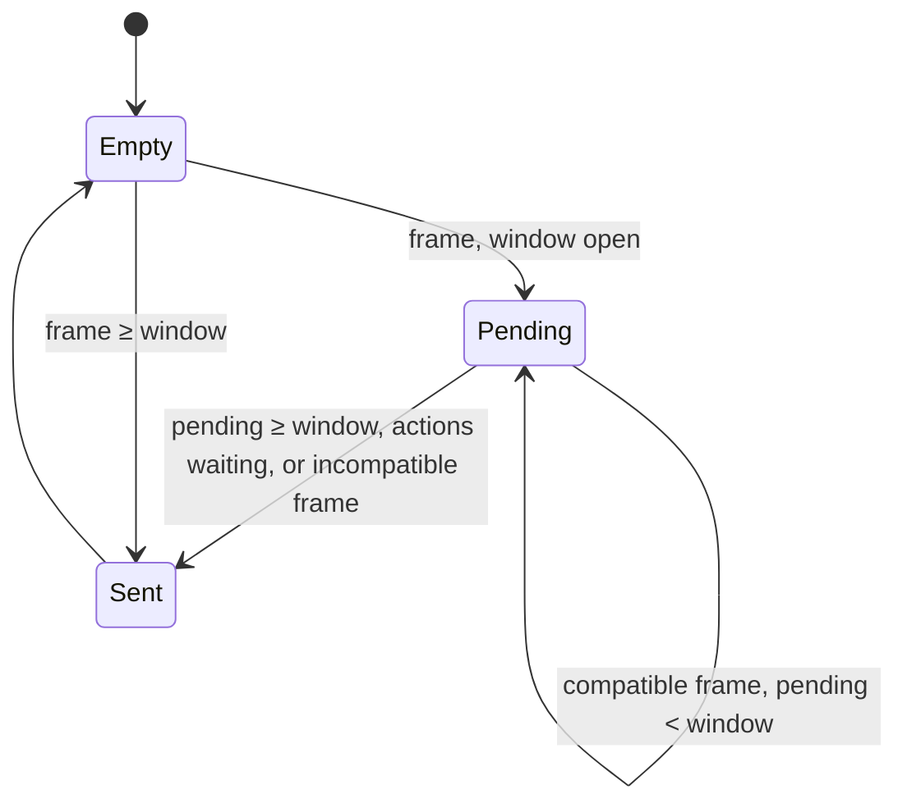

# Native move protocol: client batching, message choice, server move processing

Units: nat:SBase.SPlayerController.MyReplicateMove, nat:SBase.SPlayerController.MyReplicateMoveWithoutMoving, eng:ASPlayerController::RealReplicateMove, eng:ASPlayerController::GetFreeSMove, eng:ASPlayerController::MoveAutonomous, nat:SBase.SPlayerController.MyServerMove, eng:ASPlayerController::ProcessServerMove, nat:SBase.SPlayerController.BigServerMove, nat:SBase.SPlayerController.UnreliableReplicateBigServerMove, nat:SBase.SPlayerController.MyServerMoveWithPCRot, nat:SBase.SBasePawn.CompressActions, nat:SBase.SBasePawn.UnCompressActions, nat:SBase.SBasePawn.MovePawn, nat:SBase.SBasePawn.ReinitBecauseOfDivergences, rl:SBase.SPlayerController.MyServerMoveWithPCRot, eng:ASBasePawn::Tick

## Purpose

The native halves of the SCCT move protocol whose script halves are in
`spec/net/move-protocol.md`: how the client merges frames into moves and picks one of four
messages, how saved moves are kept, how `View`, `DiversInfos`, the old-move pair and pawn actions
are packed, and how the server applies a move, caps speed, decides on a correction and forces a
reinit. Also the Reloaded change to `MyServerMoveWithPCRot`.

## Data

`SPlayerController` fields (script names): `fPendingDeltaTime`, `vPendingAccel`, `ePendingPhysics`,
`PendingDiversInfo` (the pending move), `bPhysicsChangeWithinPhysics`, `fLeftTimeForSecondPhysics`,
`fLastMovementTime`, `vOldAccel`, `NumberOfBigServerMoveToReSend`, `BSMS`,
`BigServerMoveLastActionTime`, `FirstSMove`, `LastSMove`, `fLastTimePhysicsChecked`,
`AdrenalineTime`, `fTimeWhenHit`, `AdrenalineFactor`, `SPawnType` (0 spy, 1 merc), `bIsCharging`,
`bWaitingForReinit`, `bTestBackFeetGrab`, `fLastTimeOnAMover`; from `PlayerController`:
`CurrentTimeStamp`, `ServerTimeStamp`, `LastUpdateTime`, `ClientUpdateTime`, `TimeMargin`,
`MaxTimeMargin`, `MaxResponseTime`. Pawn: `ZoneConfig`, `ZCDecal[16]` (height offset table between
zone configurations, index `from × 4 + to`), `RunningSpeed`, `GroundSpeed`,
`bActionsSendByServerMove`, `bActionsHasBeenSentByServerMove`, `iNbAction`, `iNbActionInTable`,
`AllActions[6]`, `iYawPitchFromView`. One process-wide flag `ShortMoveToggle` (client only).

## Rules

### Client

1. **Per frame** (`MyReplicateMove(DeltaTime, NewAccel)`, needs a pawn): clear
   `bPhysicsChangeWithinPhysics`; move the pawn locally (rule 12) for `DeltaTime`; if a physics split
   happened during that move (rule 6) with no time left (`fLeftTimeForSecondPhysics < 1e-5`) and no
   actions are waiting for a big move, stop. Then build `DiversInfos` (rule 9) and run the batching
   of rule 2.
2. **Batching.** `MaxPending = 0.09 × min(1, OutstandingReliable / maxAcceptableUnAckBunch)` (with no
   unacknowledged reliable data the window is 0 and every frame is sent; it widens up to 90 ms as
   the reliable backlog grows towards 40 bunches).
   - The frame merges into the pending move when no actions wait for a big move and the pending move
     is empty or has the same physics and the same `DiversInfos`: `vPendingAccel` becomes the
     time-weighted mean of the two accelerations, `fPendingDeltaTime += DeltaTime`. The move is kept
     pending while `fPendingDeltaTime < MaxPending`, else sent (rule 3) at stamp `Level.TimeSeconds`.
   - Otherwise a non-empty pending move is first sent at stamp `Level.TimeSeconds − DeltaTime` with
     its own `DiversInfos` and never as a big move; then this frame becomes the pending move and is
     sent at once when `DeltaTime ≥ MaxPending` or actions wait for a big move, else kept.
   After a send the pending time is 0. The time stamp of a move is the client's `Level.TimeSeconds`;
   the pending delta itself is not transmitted (the server derives deltas from time stamps).
3. **Sending one move** (`RealReplicateMove(TimeStamp, …, Accel, Velocity, DiversInfos)`):
   1. big move resends: when `NumberOfBigServerMoveToReSend` is non-zero, send
      `UnreliableReplicateBigServerMove(BSMS)` if it is below 4, then decrement it. A big move sets
      it to 4, so its three resends ride on the second, third and fourth sends after it;
   2. record a saved move (rule 5) with `TimeStamp`, the pawn's physics and location, and
      `ZoneConfig = DiversInfos & 3`;
   3. velocity to send: 0 when `bTestBackFeetGrab`; `(Pawn.Rotation.Yaw, 0, 0)` in root motion;
   4. old move: when `fLastMovementTime ≥ 0` and `OldTimeDelta = trunc((TimeStamp −
      fLastMovementTime) × 2000)` is below 256, the old-move pair is attached (rule 10);
   5. choose the message:
      - actions wait (`bActionsSendByServerMove` and `iNbAction > 0`): `ScriptBigServerMove`
        with `InAccel = Accel × 10`, `ClientLoc = Pawn.Location`, `Vel = velocity × 100`, `View`
        from the pawn's yaw, `DiversInfos`, the six `AllActions` and `iNbActionInTable`; then
        `bActionsHasBeenSentByServerMove = true`, `iNbAction = 0`, `ShortMoveToggle = true`;
      - else in `PHYS_RootMotion` or `PHYS_FollowParent`: nothing is sent (the saved move is kept);
      - else in `PHYS_Vandamme`, or `BTW` is one of the four fire values (`BTWFireStandLeft` ..
        `BTWFireCrouchRight`), or `PipHFire` is `PipH4` or `PipH2`: `ScriptMyServerMoveWithPCRot`
        with `View` from the **controller's** yaw (aim decoupled from the pawn), no acceleration;
      - else with a non-zero acceleration: `ScriptMyServerMove` with `InAccel = Accel × 10` and
        `View` from the pawn's yaw; `ShortMoveToggle = true`;
      - else (zero acceleration): `ScriptMyShortServerMove` is sent only when `ShortMoveToggle` is
        set; the toggle flips on every such call, so a standing player sends every other move.
4. Script then stores the sent stamp and acceleration (`fLastMovementTime`, `vOldAccel`) for the
   full and PCRot forms (`move-protocol.md` rule 5). `vOldAccel` therefore holds `Accel × 10`.
5. **Saved moves.** The list grows by one move per send. `GetFreeSMove` spawns a new move while
   the list has fewer than 100; at 100 it returns `FirstSMove`, which closes the list into a ring:
   from then on each send overwrites the oldest move in place. Moves are never freed or trimmed
   (`CleanOutSavedSMoves` is a no-op). Corrections match by exact time stamp within 100 moves
   (`move-protocol.md` rule 20).
6. **Physics split** (`MyReplicateMoveWithoutMoving(LeftTime, Accel)`, from `MyFalling` and
   `MyNotifyLanded` while the frame is being simulated): sets `bPhysicsChangeWithinPhysics`; the part
   already simulated is `Level.m_dT − LeftTime`; it is merged into or flushed from the pending move as
   in rule 2, then the pending move is sent at once at stamp `Level.TimeSeconds − LeftTime`, and
   `fLeftTimeForSecondPhysics = LeftTime`.
7. **View packing.** `View = ((Pitch / 2) & 0x7FFF) × 32768 + ((Yaw / 2) & 0x7FFF)`, with the
   controller's pitch and the yaw chosen by rule 3.5 (integer division rounds toward zero). The
   server reads `Pitch = 2 × (View / 32768)` and `Yaw = 2 × (View mod 32768)`: pitch and yaw lose their
   lowest bit and come back in 0..65534.
8. **Action packing** (`CompressActions`): first int = `a1 | a2 << 9 | a3 << 18 | count << 27`,
   second int = `a4 | a5 << 9 | a6 << 18`; codes are 9 bits, the count 3 bits. Bits 30 and 31 of the
   first int and 27 to 31 of the second are left unset by the original (whatever was in memory); a
   port writes 0. `UnCompressActions` reads the same fields.
9. **DiversInfos** (one byte): `Physics << 4 | (bPressedJump ? 8 : 0) | speed | ZoneConfig`, where
   `speed` is 4 for a merc while `bIsCharging`, and for a spy **1** while
   `AdrenalineTime + fTimeWhenHit ≥ Level.TimeSeconds` (the spy's flag lands in the zone bits, see
   Edge cases).
10. **Old move pair.** `OldTimeDelta` (byte, 0.5 ms units, rule 3.4). `OldAccel` packs
    `a = 0.1 × vOldAccel` (that is, the old acceleration): X and Y as `trunc(|a|)` with the two low
    bits cleared, plus a sign bit, X in bits 18..31 and Y in bits 6..19 (the low two bits of each
    field are zero, so the fields do not overlap); Z as `trunc(|a.Z|) / 2` plus a sign bit in bits
    0..7. Resolution: 4 uu/s² on X and Y, 2 on Z; range ±8188 on X/Y and ±254 on Z. The client
    (game 0x10aad000) sets the sign bit for a zero component too and does not clamp, so a component
    out of range bleeds into the next field; the server (0x10aac4a0, 0x10aaec30) reads exactly these
    fields. The port clamps to the range, which only differs where the original would corrupt.

### Server

11. **Accepting a move** (`ProcessServerMove`, shared by `MyServerMove`, `MyShortServerMove` through
    its script, `BigServerMove` and the big-move resend). Ignored when `bWaitingForReinit`, without a
    pawn, or when `TimeStamp ≤ CurrentTimeStamp`. `DiversInfos` gives the client's zone config
    (bits 0..1), speed flag (bit 2), jump (bit 3) and physics (bits 4..7).
    1. **Old move:** with an old-move pair (a non-zero `OldTimeDelta` byte: 0 means none, whatever the
       caller; game 0x10aac4a0 and 0x10aaec30 test the byte), the client physics equal to the pawn's, and
       `OldStamp = TimeStamp − OldTimeDelta × 0.0005 > CurrentTimeStamp + 0.001`, the old
       acceleration is unpacked and applied for `min(MaxResponseTime, OldStamp − CurrentTimeStamp)`
       without jump, and `CurrentTimeStamp = OldStamp`.
    2. `DeltaTime = min(MaxResponseTime, TimeStamp − CurrentTimeStamp)`.
    3. **Time margin** (speed-hack guard): when `ServerTimeStamp > 0`,
       `TimeMargin = max(0, TimeMargin + DeltaTime − 1.01 × (Level.TimeSeconds − ServerTimeStamp))`;
       if `TimeMargin > MaxTimeMargin`, `TimeMargin −= DeltaTime`, `MaxTimeMargin` becomes 0.5 when
       the margin is at least 0.5 else 0.35, and `DeltaTime = 0` (the move is not simulated).
    4. **View:** the controller's rotation becomes `(Pitch, Yaw, 0)` from `View` (rule 7).
    5. **Physics check.** If the client's physics differs from the pawn's, nothing else happens,
       except that after 3 s of continuous mismatch (`fLastTimePhysicsChecked` older than 3 s) with a
       living pawn the time stamps are accepted and `ReinitPawnBecauseOfDivergences` is raised
       (`fLastTimePhysicsChecked` is not stamped then: only a matching move writes it).
       Otherwise `fLastTimePhysicsChecked = now`, `CurrentTimeStamp = TimeStamp`,
       `ServerTimeStamp = now`.
    6. **Speed cap:** walking or falling: `GroundSpeed = |a| / 3000 × RunningSpeed` with `a` the
       decoded acceleration (`InAccel × 0.1`), capped at 423.5 (603.2 while `bIsRolling`), the cap
       times `AdrenalineFactor` when the speed flag is set; for a merc the cap is 346.5, or 770 with the
       speed flag. `PHYS_Linear`: `GroundSpeed = |a| / 191 × RunningSpeed`, uncapped.
    7. `PHYS_FollowParent`: the move is applied and processing ends (no correction).
    8. **Aim:** `iYawPitchFromView = PackW(Yaw, Pitch)`; the pawn's rotation becomes
       `(0, Yaw, its own roll)`. In `PHYS_Flying` only the high half (pitch) of `iYawPitchFromView` is
       written, its yaw half is kept and the pawn's rotation is not touched (game 0x10aac4a0).
    9. **Apply:** unless in root motion without additional physics (the pawn's own
       `bUseRootMotionAdditionnalPhysics`, `Pawn + 0x2f4` bit `0x1000`), the move is simulated for
       `DeltaTime` with the decoded acceleration and the jump bit, when the game is not paused,
       `DeltaTime > 0`, and the client physics equals the pawn's or the pawn is in
       `PHYS_Repositionnal`. Applying (`MoveAutonomous`) runs `ScriptMyProcessMove`, truncates the
       pawn's acceleration components toward zero to whole units, and runs the pawn's physics.
    10. **Zone config:** when the client's zone config differs from the pawn's, the client location's
        Z is raised by `ZCDecal[server × 4 + client]` before comparing.
12. **Correction decision** (after rule 11.9; not in root motion without additional physics):
    - more than 1.0 s since `LastUpdateTime`: correct, error taken as 10000;
    - else no correction when at most `180 / CurrentNetSpeed` seconds passed since `LastUpdateTime`
      or at most 0.3 s since `ClientUpdateTime` (both tests are `≤`, game 0x10aac4a0);
    - else the error is `Pawn.Location − ClientLoc`, with Z ignored when the pawn falls and was on a
      mover in the last 3 s (`fLastTimeOnAMover`, never written: dead in practice), when its base is a
      mover whose `fLastTimeMoverMoves` is within 3 s (written by mover physics
      while `|Velocity.Z| < 0.1`, game 0x10a21d23, so in practice a mover that was vertically still in the last 3 s), or in `PHYS_OnPipeH` or `PHYS_Linear`; squared error ×10 in root
      motion; no correction when the squared error is at most 3 (error ≤ 1.73 uu, the client's
      `fErrorMax`).
    - A correction stamps `ClientUpdateTime = LastUpdateTime = now` and sends
      `ScriptMyShortClientAdjustPosition(TimeStamp, Location, Base)` when the pawn's velocity is zero,
      else `ScriptMyClientAdjustPosition(TimeStamp, Location, Velocity, Base)` (none in
      `PHYS_FollowParent`).
    - **Reinit:** after a correction, when the squared error exceeds 160000 (400 uu), the pawn is
      alive, and not both server and client are walking, `ReinitPawnBecauseOfDivergences` is raised
      (`spec/net/state-sync.md`).
13. **BigServerMove** (reliable) and **UnreliableReplicateBigServerMove** (the three resends):
    - accepted only when `trunc(MSATime − MirrorStateAcknowledgementTime)` is 0, that is when the
      two epochs differ by less than 1 s (the script action RPCs use 0.01 s), and the stamp is newer
      than `BigServerMoveLastActionTime`; the resend form also copies the whole struct into the
      server's `BSMS`; the reliable form only stores `BSMS.TimeStamp`;
    - the six actions are unpacked; when the server pawn is within 100 uu of `ClientLoc`, or not in
      root motion, or `bUseRootMotionAdditionnalPhysics` is set (the test reads the controller's
      flag, not the pawn's), the actions are executed (`NativeExecuteReceivedActionForServer`);
    - if the error is at least 100 uu (or the pawn was in `PHYS_FollowParent` before) and the actions
      put the pawn into root motion (controller flag clear; for the reliable form not from
      `PHYS_FollowParent`, the resend form has no such test, game 0x10ab1670), its previous physics is
      restored (a raw write of `Physics`, no setPhysics);
    - otherwise (error under 100 uu, pawn not previously following a parent) the server **snaps** its
      pawn to `ClientLoc` with a sweep; when blocked (hit time under 1) it retries horizontally only
      and then, without checking that second sweep, once more with the full remaining offset unless
      the pawn is falling within 3 s of `fLastTimeOnAMover` (dead) or its base is a mover whose
      `fLastTimeMoverMoves` is within 3 s (game 0x10aae660, 0x10ab1670); the snapped move is not simulated again in rule 11.9; with error under 100 uu the pawn's
      velocity becomes `Vel × 0.01` (also when it was following a parent and was not snapped, game
      0x10aae660);
    - the resend form then applies the traversal payload by the pawn's new physics: `OnPipe`,
      `Linear`, `Ledge`, `OnLadder`: `NewZipP1 = ZipP1`, `NewZipP2 = ZipP1 + DifZipP2`, and
      `ZipP1/ZipP2` = the new values; `OnPipeH`: the same, keeping the old `ZipP1/2` when the pawn
      came from `OnPipe`; `Vandamme`: `vVandammePos = vect3` (unless `bKeepLocalVandammePos`),
      `vWallJumpDir = vectUnit × 0.001`; `Repositionnal`: as `Linear` plus `vVandammePos` (also kept
      when `bKeepLocalVandammePos`) and
      `m_geoNormal = vectUnit × 0.001`;
    - finally rule 11 runs with the move (without an old-move pair) and
      `BigServerMoveLastActionTime = TimeStamp`.
14. **MyServerMoveWithPCRot** (original body, editor and game): like rule 11 with these differences:
    the old move is applied for its full `OldTimeDelta` (its acceleration unpacked from `OldAccel` as in
    rule 11.1); there is no `PHYS_FollowParent` step (11.7), no root motion step (11.9: the move is
    applied and the correction decision runs), no ×10 weight of the root motion error, and both halves
    of `iYawPitchFromView` are always written, right after the controller's rotation and **before the
    physics check** (so a move rejected for a physics mismatch still updates the aim; game
    0x10aaec30); there is no speed cap and the **pawn's
    rotation is not changed** (only the controller and `iYawPitchFromView`); no acceleration is
    applied (the call passes the rotation's bit pattern as acceleration, which truncates to zero);
    the forced-correction interval is 0.3 s instead of 1.0 s and the minimum interval since the last
    correction 0.1 s instead of 0.3 s; Z is ignored when the base is a mover with non-zero vertical
    velocity, or in `OnPipeH` or `Linear`; the corrected position sent back is
    `Pawn.Location.Z − ZCDecal[server × 4 + client]` (converted to the client's zone config).
15. **Reloaded change** (`rl:SBase.SPlayerController.MyServerMoveWithPCRot`): Reloaded replaces
    native 1392 with a wrapper that sets `MaxTimeMargin` to +infinity, calls the original body, and
    restores `MaxTimeMargin`. PCRot moves are therefore never rejected by the time-margin guard
    (rule 11.3); `TimeMargin` still accumulates during them and is checked by the next plain move.
16. **MovePawn(Delta)** (correction on the client): a swept move by `Delta`; when blocked more than
    50 uu short of the target, the pawn is teleported to the target. Editor 0x111fe4a0: `MoveActor(Delta)`,
    then when the hit's Time is below 1 and `|Target - Location|^2 > 2500`, `FarMoveActor(Target, bTest 0,
    bNoCheck 0, bAttachedMove 0)`: the teleport goes through FindSpot and the encroachment test, so a target
    inside a wall or another pawn is refused and the pawn stays where the sweep stopped.
17. **ReinitBecauseOfDivergences** (native 1670) resets the pawn's action state: clears
    `bNoRunAnimation`, `bIsRolling`, `bBeginSpecial12Anim`, `bWeaponTransit`, `bLyingOnGround`;
    `BTW = NOBTW`, `PipHFire = NOPipH`, `IK_Type` = 1 for a spy and 0 for a merc,
    `IK_TypeBeforeDamage = 1`, `fBlendTimeWithC0 = 0`, `BlendChangeTime = 0.25`,
    `fTimeOfFeetLedge = 0`, `m_AttackTarget = m_AttackedBy = None`; physics walking through the pawn's
    `setPhysics` (vtable 0xfc, `(PHYS_Walking, None)`, game 0x10ae5000), so a pawn cut out of a root-motion move
    has its root unlocked as `AActor::setPhysics` does when it leaves `PHYS_RootMotion`; movement blend
    reset, `EvSetWeaponLoaded(2)` and the merc walk animation or `EvSetWeaponLoaded(0)` and the spy
    one, collision on (actors only) and `bCollideWorld`. The same reset runs on a proxy when it
    receives the action epoch -1 (`net-proxy.md` rule 7).
18. **A remote player's pawn on the server** (`ASBasePawn::Tick`, the branch for `RemoteRole ==
    ROLE_AutonomousProxy` whose top owner is a player controller that is not local). After the script tick,
    timers and state code (as `AActor::Tick`), and in place of the engine's stalled-move catch-up
    (`net-replication.md` rule 26), with `PC` that controller and `Now = Level.TimeSeconds`:
    - in `PHYS_RootMotion`, `PHYS_FollowParent`, or `PHYS_Repositionnal` with `bServerControlsRepos`: the
      pawn's physics runs every tick for `Now − PC.ServerTimeStamp`, then `PC.ServerTimeStamp = Now`. The
      client sends no move in the first two (rule 3.5), so this is what moves the server's pawn through a
      root-motion clip (ledge mount, vault, ladder and pipe ends) and keeps it on its parent;
    - in `PHYS_Falling`, when `Now − PC.ServerTimeStamp > 0.1` and `PC.ServerTimeStamp` is not 0: the physics
      runs once for that time, `PC.CurrentTimeStamp` grows by it (so the next move does not simulate it
      again), and `PC.ServerTimeStamp = Now`;
    - in any other mode nothing runs: the pawn waits for its moves (no 0.35 s catch-up as for other actors).
    A local player controller (the listen host's own player) gets the normal authoritative tick instead.

## States

## Constants

| Name | Value | Unit | Provenance | Source |
|---|---|---|---|---|
| Batching window cap | 0.09 | s | decoded | game 0x10aad5c0, editor 0x111f3000 |
| maxAcceptableUnAckBunch | 40 | bunches | decoded | `Default.ini` |
| Split time epsilon | 1e-5 | s | decoded | same |
| OldTimeDelta unit | 0.0005 | s | decoded | client × 2000, server × 0.0005 |
| Old stamp margin | 0.001 | s | decoded | game 0x10aac4a0 |
| Accel wire scale | 10 | factor | decoded | client × 10, server × 0.1 |
| Saved move ring | 100 | moves | decoded | editor 0x111e7160 |
| Big move resends | 3 | sends | decoded | counter 4, sends below 4 |
| Time margin factor | 1.01 | | decoded | game 0x10aac4a0 |
| MaxTimeMargin after trip | 0.5 or 0.35 | s | decoded | same |
| Speed cap walk / roll | 423.5 / 603.2 | uu/s | decoded | same |
| Merc speed cap / charging | 346.5 / 770 | uu/s | decoded | same |
| Ground speed divisor (walk, linear) | 3000, 191 | uu/s² | decoded | 0.00033333 and 0.005235602 in the same |
| Forced correction interval | 1.0 (PCRot 0.3) | s | decoded | same, PCRot game 0x10aaec30 |
| Minimum correction gap | 0.3 (PCRot 0.1) | s | decoded | same |
| Correction rate factor | 180 / CurrentNetSpeed | s | decoded | same |
| Correction error threshold | 3 (squared) | uu² | decoded | same |
| Reinit error threshold | 160000 (squared) | uu² | decoded | same |
| Physics mismatch reinit | 3.0 | s | decoded | same |
| Big move snap radius | 100 (10000 squared) | uu | decoded | game 0x10aae660, 0x10ab1670 |
| Big move epoch gate | under 1.0 | s | decoded | `trunc` then compared with 0.01 |
| Mover vertical motion stamp | 0.1 | uu/s | decoded | mover physics, game 0x10a21970 |
| MovePawn teleport distance | 50 | uu | decoded | editor 0x111fe4a0 |
| Remote falling catch-up | 0.1 | s | decoded | `ASBasePawn::Tick` editor 0x11205fb0 |

## Network

Client: rules 1 to 10 and 16. Server: rules 11 to 15, 17 (17 also on proxies) and 18.

## Edge cases

- A standing spy sends a move only every other frame (rule 3.5) and nothing at all in root motion,
  so the server's `CurrentTimeStamp` lags; the next move covers the gap through `MaxResponseTime`
  (0.7 s) clamping.
- A spy with adrenaline active sets bit 0, which the server reads as zone config, so the server
  applies a `ZCDecal` height offset to its `ClientLoc` and never applies `AdrenalineFactor` to the
  spy's cap. A faithful port reproduces this; a fixed port must say so in its spec.
  OpenSCCT fixes it: the spy's flag goes in bit 2 (the speed flag), so the server raises the spy's cap by
  `AdrenalineFactor` and reads the real zone. In the original the client spy runs at 508 uu/s for 5 s after a
  hit (adrenaline 1.2) against the server's 423.5 cap, and is pulled back about 25 uu at every correction
  (0.3 s). The original's listen host never met it with its own spy, but every player of an OpenSCCT solo match
  is a connected client of the inline host, so the pull back read as a laggy run under fire.
- The time-margin guard can zero a whole move; after Reloaded, a burst of PCRot moves can leave a
  large `TimeMargin` that trips on the first plain move afterwards.
- Corrections are never more frequent than every 0.3 s (0.1 s for PCRot), so a client can stay off
  by more than 1.73 uu for up to that long.
- Big moves are accepted with an epoch up to 1 s off, unlike the action RPCs (0.01 s).

## Evidence

- Game: `execMyReplicateMove` 0x10aad5c0, `RealReplicateMove` 0x10aad000, `execMyServerMove`
  0x10aacec0, `ProcessServerMove` 0x10aac4a0, `execBigServerMove` 0x10aae660,
  `execUnreliableReplicateBigServerMove` 0x10ab1670, original `execMyServerMoveWithPCRot` 0x10aaec30,
  mover physics vertical stamp 0x10a21970.
- `ASBasePawn::Tick` editor 0x11205fb0 (rule 18): the remote branch tests `RemoteRole` 3, walks the Owner chain to
  a player controller and calls its local-player test; the physics test reads Physics 5, 12, or 11 with the pawn
  flag 0x2000 at +0xAF0 (`bServerControlsRepos`, by the generated bool order of that word), and 2 with the 0.1
  literal; it reads and writes the controller at +0x53C (`ServerTimeStamp`) and +0x534 (`CurrentTimeStamp`), the
  offsets of the generated PlayerController layout.
- Editor (named): `execMyReplicateMove` 0x111f3000, `RealReplicateMove` 0x111f2a80,
  `execMyReplicateMoveWithoutMoving` 0x111f3450, `GetFreeSMove` 0x111e7160, `MoveAutonomous`
  0x111ef3c0, `ProcessServerMove` 0x111ef4f0, `execMyServerMove` 0x111efe80, `execBigServerMove`
  0x111f06e0, `execMyServerMoveWithPCRot` 0x111f0ba0, `execUnreliableReplicateBigServerMove`
  0x111f1930, `execCompressActions` 0x111fa7f0 (packer 0x111f8ad0), `execUnCompressActions` 0x111fa990
  (unpacker 0x111f8b60), `execMovePawn` 0x111fe4a0, `execReinitBecauseOfDivergences` 0x111ff170 (reset
  0x111ff040); message events raised by name: `ScriptMyServerMove`, `ScriptMyShortServerMove`,
  `ScriptMyServerMoveWithPCRot`, `ScriptBigServerMove`, `ScriptUnreliableReplicateBigServerMove`,
  `ScriptMyClientAdjustPosition`, `ScriptMyShortClientAdjustPosition`,
  `ReinitPawnBecauseOfDivergences`, `ScriptMyProcessMove`.
- Reloaded.Core: the thunk for native 1392 looks up the original by native index and wraps it with
  the `MaxTimeMargin` swap (Reloaded.Core decompile kept under `local/re-out/c/transfer/`).
- The game and editor bodies of the server move core, big move and PCRot agree on every constant
  listed above.

## Open questions

1. `MyFalling`/`MyNotifyLanded` order inside the frame: whether the pawn's physics already changed
   when the split runs (it decides which physics the flushed part carries). Trace a jump off a ledge
   with per-move physics nibbles.
2. Whether the toggle of rule 3.5 is meant to be per controller (it is one process-wide flag, which
   only matters with several local players).
