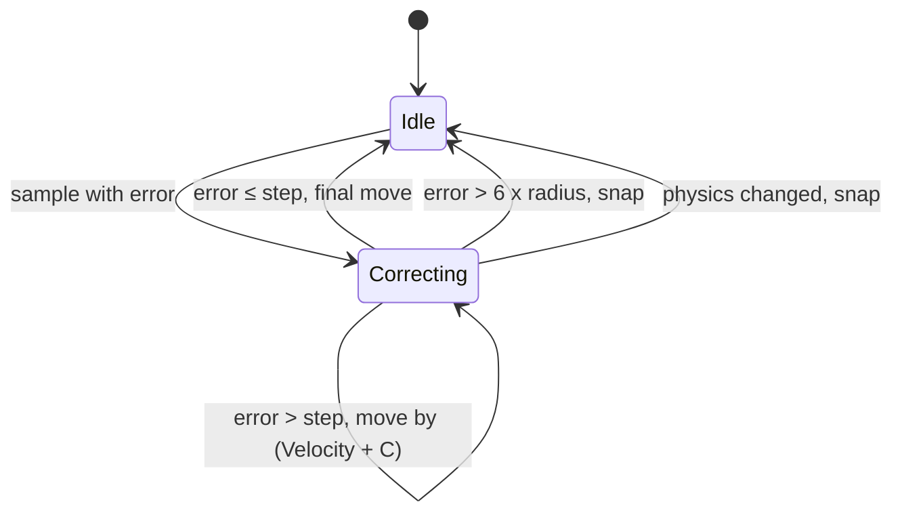

# Proxy pawns and movers: server send schedule, client smoothing, mover interpolation

Units: eng:ASBasePawn::GetOptimizedRepList, eng:ASBasePawn::TickSimulated, nat:SBase.SBasePawn.ClientDistantMoveSmooth, eng:ASBasePawn::ResetBasicActions, eng:ASBasePawn::ServerUpdateActionCounts, eng:AMover::PreNetReceive, eng:AMover::PostNetReceive, eng:AMover::GetOptimizedRepList, eng:ASBasePawn::PreNetReceive, eng:ASBasePawn::PostNetReceive

## Purpose

How another player's pawn moves on a client: when the server decides to send a position sample and
an action batch to each viewer (dead reckoning inside the pawn's native property list), how the
client blends the sample in over the following frames, how it turns the proxy and its aim, and
how replayed actions are played. Also how a mover's replicated interpolation state restarts its
motion on a client. Script halves: `spec/net/proxy-pawns.md` and `spec/net/rep-map-actors.md`.

## Data

Pawn fields (script names): `ErrorDistance`, `NormErrDist`, `fSmoothTime`, `ReceivedRotation`,
`ReceivedVelocity`, `vDeltaMove`, `iReceivedDesiredYawPitch`, `iSmoothDifYaw`,
`ClientSmoothFlags` (default 7), `AllActions[6]`, `iNbActionForDistantClient`, `iNbAction`,
`iNbActionInTable`, `iNbActionsSent`, `fRepTimeOfLastActionChange`, `fOldTimeOfLastActionChange`,
`ZoneConfig`, `ZoneConfigForClient`, `ZCDecal[16]`, `OldPhysics`, `initSlowReplication`,
`bCompressedPosition`, `bInternalChangePhysics`, `bNoInterpoleSimulatedRotation`, `PawnPosition`,
`OldRotYaw`. Channel (server, per pawn and viewer): `LastPositionTime`, `LastAimTime`,
`LastFullListTime`, and the channel's `Recent` copy of the pawn, used as the dead-reckoning
reference. Level: `m_dT` (frame delta).

Mover fields: `SimOldPos`, `SimInterpolate`, `OldPos`, `OldRot`, `PhysAlpha`, `PhysRate`,
`KeyNum`, `PrevKeyNum`, `bInterpolating`.

## Rules

### Server: what each viewer gets (per update of a pawn to a non-owning connection)

1. **Force.** A sample is forced when the pawn's physics changed since its last tick
   (`OldPhysics != Physics`) or `initSlowReplication` is set (default true, so the first update
   always sends one). When the pawn has a newer action batch than the one last sent on this
   channel (`fRepTimeOfLastActionChange` greater than the channel's copy), the sample is forced.
   Otherwise, in `PHYS_RootMotion` or `PHYS_FollowParent` without force, this whole block is
   skipped (no sample, no aim, no rotation this update).
2. **Dead reckoning.** With `dt = now − LastPositionTime`: force when `dt ≥ 0.7` s. Without force:
   - the velocity changed since the reference and is now zero (the pawn stopped): force;
   - else, when `dt ≥ 0.09` s: predict from the reference: velocity `Vref` (its Z minus `1500 × dt`
     when falling) and position `Lref + Vref × dt` (Z minus `750 × dt²` when falling). When
     `|V − Vpred|² > 0.2 × |V|²` the sample is forced; otherwise it is forced when
     `|L − Lpred|²` exceeds 1 (speed squared at most 1) or 30 (moving);
   - before 0.09 s nothing is sent unless forced.
3. **Aim and rotation as properties.** When at least 0.09 s passed since `LastAimTime` (or
   `initSlowReplication`): `iDesiredYawPitch` and `iYawPitchFromView` are pushed if changed, and,
   without a forced sample, `Rotation` if changed; `LastAimTime = now`. Before 0.09 s, without a
   forced sample, `Rotation` is pushed only when the yaw differs from the reference by more than
   1800 units (shortest arc).
4. A forced sample sets `LastPositionTime = now` and clears `initSlowReplication`. Every pass of
   this block sets `bCompressedPosition`, so the Actor list never sends `Location` or `Velocity` for
   the pawn.
5. **Sending.** On the receiving connection's player controller (each viewer gets its own call):
   - not forced: when the pawn's last action change is less than 0.15 s old,
     `SendPawnActions(pawn, Val0, Val1, fRepTimeOfLastActionChange, ZoneConfigForClient,
     m_AttackTarget, m_AttackedBy, SpecialYaw)` with `AllActions` packed over
     `iNbActionForDistantClient` actions (`net-moves.md` rule 8): action batches are repeated,
     unreliably, for 0.15 s after each change;
   - forced: `PawnPosition = (Location × 10, Rotation, Velocity)`; when the last action change is at
     least 0.4 s old, `SendPawnPosition(pawn, PawnPosition)`; otherwise the actions go with it:
     `ReliableSendPawnPositionAndActions` when this batch was not yet sent on this channel, else
     `SendPawnPositionAndActions` (unreliable); the channel's copy of the batch time is updated.
   After a forced sample the channel's reference `Location`, `Rotation` and `Velocity` become the
   current ones.
6. **Action bookkeeping on the server** (each tick of a player controller whose pawn has
   `ROLE_Authority`): when `iNbAction > 0`, `fRepTimeOfLastActionChange = now` and
   `iNbActionForDistantClient` becomes `iNbAction` when the pawn's controller has `RemoteRole`
   `ROLE_AutonomousProxy`, else `iNbActionInTable`; then `iNbActionsSent = iNbActionInTable` and
   `iNbAction = 0`. On the owning client (pawn `ROLE_AutonomousProxy`) the same tick raises
   `SendActions`.

6a. **Received actions on the server** (`NativeExecuteReceivedActionForServer`, editor 0x1121dba0, loop 0x1121db40):
    the unpacked actions run in order through the engine's action code and each is stored in `AllActions[i]`; then
    `sAction` = the last, `iNbActionForDistantClient = iNbAction = count`. Rule 6 then stamps the batch for the
    other viewers (for a remote player's pawn the count relayed is `iNbAction`).
6b. **InitializeBasicActions** (editor 0x111feb80, called by `PostNetBeginPlay` on a pawn without a controller):
    by `Physics`: 6, 8, 9, 13 and 14 (pipe, fence, ledge, ladder, hand over hand) set their own animation sets;
    any other mode: with `BTW` set, a script event (name 0x285d) and nothing else; with `PipHFire` set, the pipe
    hands set; otherwise `AnimateWalking(a)` with `a` = 75 (crouched) or 85 (standing) when `SPawnType` is 0 (spy)
    and `WeaponLoaded` is 0, else 76 or 86.

### Client: proxy tick (`TickSimulated`, every frame for a simulated pawn)

7. **Epoch reset.** When `fRepTimeOfLastActionChange` is −1 (`DistantClientReinit`), the basic action
   reset of `net-moves.md` rule 17 runs.
8. **Action playback.** When `fRepTimeOfLastActionChange > fOldTimeOfLastActionChange`: execute
   `AllActions[0 .. iNbActionForDistantClient − 1]` in order through the engine's own action code
   (not the script native, so the Reloaded `ExecuteAction` wrapper is not involved), set `sAction`
   to `AllActions[iNbAction − 1]` (unchanged when `iNbAction` is 0), and
   `fOldTimeOfLastActionChange = fRepTimeOfLastActionChange`.
9. **Zone configuration.** When `ZoneConfigForClient != ZoneConfig`: `PrePivot` back to the class
   default; the pawn is teleported down by `d = ZCDecal[ZoneConfig × 4 + ZoneConfigForClient]`
   without collision checks and `ErrorDistance.Z += d` (so the pending correction is unchanged in
   world terms), `NormErrDist = ErrorDistance`; the collision height becomes the default (config 0),
   `CrouchHeight` with `PrePivot.Z += default height − CrouchHeight` (1), `ZipHeight` with
   `PrePivot.Z += ZipHeight − default height` (2), or `Pipe4Height` with
   `PrePivot.Z −= Pipe4DecalCol` (3); `ZoneConfig = ZoneConfigForClient`.
10. **Velocity.** `Acceleration = unit(Velocity)`; when falling,
    `ReceivedVelocity.Z −= 1500 × dt`; `Velocity = ReceivedVelocity` (zero when physics is none).
11. **Physics change snap.** When `OldPhysics != Physics` and `bInternalChangePhysics` is clear, the
    whole `ErrorDistance` is applied at once (a move with world collision off), the rotation becomes
    `ReceivedRotation`, `ErrorDistance = 0`, `iDesiredYawPitch = iReceivedDesiredYawPitch`. Then
    `bInternalChangePhysics` is cleared.
12. In `PHYS_RootMotion` or `PHYS_FollowParent` the stock simulated physics runs instead of rules 13
    to 15.
13. **Position smoothing** (`ClientSmoothFlags` bits 1 and 4 set, bit 8 clear; the default):
    - no error left (`ErrorDistance` zero): a still pawn stays in place; a walking pawn runs walking
      physics with `vDeltaMove = Velocity`; any other runs `ClientDistantMoveSmooth(Velocity × dt)`;
    - error larger than `6 × CollisionRadius`: one move by `Velocity × dt + ErrorDistance` with world
      collision off, then `ErrorDistance = 0` (a snap);
    - otherwise: walking: `fSmoothTime += dt`, `Vmax = 200`; other physics: `fSmoothTime = 1`,
      `Vmax = 400`. `Vc = min(Vmax, Vmax × fSmoothTime)`, `C = NormErrDist × Vc`:
      - `|ErrorDistance| < Vc × dt` (last step): walking: `vDeltaMove = ErrorDistance / dt + Velocity`
        and walking physics; else `ClientDistantMoveSmooth(Velocity × dt + ErrorDistance)`; then
        `Velocity = displacement / dt` and `ErrorDistance = 0`;
      - else: `ErrorDistance −= C × dt`; walking: `vDeltaMove = Velocity + C` and walking physics;
        else `ClientDistantMoveSmooth((Velocity + C) × dt)` and, when it moved,
        `Velocity = displacement / dt`.
    So a walking proxy's correction speed ramps up linearly from 0 to 200 uu/s over the first second
    after a sample (`fSmoothTime` is reset to 0 by each new sample) while other physics correct at
    400 uu/s at once.
14. **ClientDistantMoveSmooth(D):** a swept move by `D`; if blocked, the rest of `D` projected on the
    hit plane is tried once, unless it points backwards.
15. **Rotation and aim** (`ClientSmoothFlags` bit 2 set, the default):
    - `OldRotYaw = Rotation.Yaw`. When the yaw differs from `ReceivedRotation.Yaw`:
      `bNoInterpoleSimulatedRotation = (BTW != NOBTW)`; when the raw difference exceeds 1299 units and
      interpolation is allowed, the yaw turns toward the received yaw at `65535 × dt` units per frame
      (`131071 × dt` when the speed is under 10 uu/s), else it takes the received yaw at once. Pitch
      becomes 0; roll becomes 0 when the received roll is 0, else stays. When the yaw already equals the
      received yaw the rotation becomes `ReceivedRotation` as it is (pitch and roll included).
    - A `Rotation` pushed as a property between samples (rule 3) does not turn the proxy: see rule 15a. The
      yaw it brings is the target this step turns toward.
    - Aim: when `iDesiredYawPitch != iReceivedDesiredYawPitch`, the aim yaw keeps its offset from
      the body yaw, smoothed: `delta = (newYaw − receivedAimYaw) − (Yaw − aimYaw)` (wrapped to ±32768);
      `iSmoothDifYaw = delta` when `m_dT ≥ 0.3`, else
      `iSmoothDifYaw = trunc((iSmoothDifYaw × (0.3 − m_dT) + delta × m_dT) / 0.3)`; aim yaw =
      `newYaw − iSmoothDifYaw`; aim pitch turns toward the received pitch at `16384 × m_dT`.
      `m_dT` is `Level.m_dT`; `newYaw` is the yaw this step computed, `Yaw` the proxy's yaw before it;
      both aim angles are 16-bit, the received pitch wrapped to ±32768 first. The x87 order is
      `((0.3 − m_dT) / m_dT × iSmoothDifYaw + delta) × m_dT × 3.3333` then a truncation (editor
      0x1121e7db to 0x1121e816; constants 0.3 at 0x1147e204, 3.3333 at 0x114a2d5c, 16384 at
      0x11476cb8). The pitch step is the engine's fixed turn (editor 0x10fdeef0: the shorter way, the
      target itself when it is within the step). The game build has the same sequence (game 0x10acc402 to 0x10acc4f9:
      `iDesiredYawPitch` at pawn + 0xa58, `iReceivedDesiredYawPitch` + 0xa60, `iSmoothDifYaw` + 0xa64,
      `Level.m_dT` at Level + 0x54c; fixed turn game 0x10953200; constants 0.3 at 0x10c109ec, 10/3 at
      0x10c11270, 16384 at 0x10c10c48). With `m_dT = 0` the original divides by zero; the port skips
      that frame. The aim is not touched in `PHYS_RootMotion` or
      `PHYS_FollowParent` (rule 12) until a physics change snaps it (rule 11).
    - With bit 2 clear: `iDesiredYawPitch = iReceivedDesiredYawPitch` and `OldRotYaw` takes the
      received yaw.
    - The rotation is applied with a move when it changed. Finally the script `Tick` event runs.

15a. **PreNetReceive and PostNetReceive** (`ASBasePawn` overrides both in its vtable: editor 0x111f8c60 and
    0x1120be70, slots 0x114ae9dc and 0x114ae9e0; `AActor`'s are 0x110a6ee0 and 0x110b2770). PreNetReceive runs
    the actor's and saves `iDesiredYawPitch`. PostNetReceive puts the saved `Location`, `Rotation`,
    `RelativeLocation`, `RelativeRotation`, `Base`, `bCollideActors`, `DrawScale` and the other rule 24 values
    back, applies collision, animation, draw scale and base changes as the actor's does, and moves the pawn to a
    received location or rotation only when its `Base` is set and is not world geometry (then relative to the
    base). So a pawn standing on the world keeps the rotation it had. Then:
    - when the received `iDesiredYawPitch` differs from the saved one, `iReceivedDesiredYawPitch` takes the
      received value and `iDesiredYawPitch` keeps the saved one (the aim smoothing of rule 15 moves it);
    - for `ROLE_SimulatedProxy` outside `PHYS_FollowParent`, when the received `Rotation` differs from the kept
      one, `ReceivedRotation` takes the received `Rotation`.
    Effect: between samples the server's Rotation pushes only move the proxy's turn target; the proxy turns
    toward it at the rule 15 rates and never swings back to an older sample's yaw.

### Movers on clients

16. **Interpolation restart** (`AMover::PostNetReceive`): `PreNetReceive` saves `SimInterpolate`;
    after a bunch, when it changed: `OldPos = SimOldPos`, `OldRot = Rotation` (the client's current
    rotation), `PhysAlpha = SimInterpolate.X × 0.01`, `PhysRate = SimInterpolate.Y × 0.01`, `KeyNum` =
    low byte and `PrevKeyNum` = high byte of `trunc(SimInterpolate.Z)`, physics `PHYS_MovingBrush`,
    `bInterpolating = true`. The client's mover physics then runs the same interpolation as the
    server from that point. All three values travel as rounded integer vectors, so `PhysAlpha` and
    `PhysRate` have 0.01 resolution and `SimOldPos` whole units.
17. **Mover list** (`net-replists.md` rule 26): `SimOldPos`, `SimInterpolate`, `RealPosition`,
    `Velocity`, `AmbientSound` on every update, `BaseRot` first bunch. Movers are `bAlwaysRelevant`
    with update frequency 100, so they pass every server pass.
18. Mover physics on any machine stamps `fLastTimeMoverMoves = Level.TimeSeconds` while
    `|Velocity.Z| > 0.1` (read by the correction rules, `net-moves.md` rule 12).

## States

## Constants

| Name | Value | Unit | Provenance | Source |
|---|---|---|---|---|
| Forced sample interval | 0.7 | s | decoded | editor 0x1120c9d0 |
| Minimum sample interval | 0.09 | s | decoded | same |
| Aim property interval | 0.09 | s | decoded | same |
| Velocity deviation ratio | 0.2 | of speed squared | decoded | same |
| Position error threshold | 1 (still) / 30 (moving) | uu² | decoded | same |
| Prediction gravity | 1500 (Z velocity), 750 (Z position) | uu/s² | decoded | same |
| Rotation property threshold | 1800 | rotator units | decoded | same |
| Action resend window | 0.15 | s | decoded | same |
| Actions with position window | 0.4 | s | decoded | same |
| Snap distance | 6 × CollisionRadius | uu | decoded | editor 0x1121dc30 |
| Correction speed walking / other | 200 / 400 | uu/s | decoded | same |
| Proxy gravity | 1500 | uu/s² | decoded | same |
| Yaw interpolation threshold | 1299 | rotator units | decoded | same |
| Yaw turn rates | 65535, 131071 | units/s | decoded | same |
| Aim yaw smoothing time | 0.3 | s | decoded | same |
| Aim pitch turn rate | 16384 | units/s | decoded | same |
| ClientSmoothFlags default | 7 | bits | decoded | `def:SBase.SBasePawn` |
| Mover vertical motion threshold | 0.1 | uu/s | decoded | game 0x10a21970 |

## Network

Server: rules 1 to 6 for every pawn and every non-owning viewer. Client: rules 7 to 16 for every
proxy pawn and mover.

## Edge cases

- A pawn in root motion or following a parent gets no samples and no aim updates unless its physics
  just changed or it has new actions (rule 1).
- Samples are per viewer: two viewers can see different sample times for the same pawn.
- The 1299-unit test uses the raw yaw difference without wrapping, so near the 0 / 65536 seam a
  small turn counts as large and is interpolated instead of snapped (the turn itself takes the
  shortest arc).
- `ClientSmoothFlags` other than 7 selects older code paths that the slice never uses.
- Without channel data on a viewer (pawn not yet relevant) the first update always sends a sample
  (`initSlowReplication` is per pawn, so it is cleared by the first viewer's sample; later viewers
  get theirs through the 0.7 s rule or the dead-reckoning test).
- The snap of rule 13 turns world collision off but not actor collision (MoveActor's mask keeps pawns
  and others), and it clears `ErrorDistance` whether or not the move arrived. A proxy whose straight
  line to a far sample crosses a blocking gameplay object stops against it, and every later snap
  starts touching it, so it stays there until the pawn's own moves bring the error under six radii.
  Only a teleport makes such a jump (the play-shocker smoke's server-side setup does).

## Evidence

- Editor: `ASBasePawn::execInitializeBasicActions` 0x111feb80 (AnimateWalking pushes 0x4b, 0x4c, 0x55, 0x56 at
  0x111fee5f to 0x111feebb), `ASBasePawn::execNativeExecuteReceivedActionForServer` 0x1121dba0 and its loop
  0x1121db40.
- Editor: `ASBasePawn::GetOptimizedRepList` 0x1120c9d0 (send events raised through the thunks
  0x111fa430 `SendPawnActions`, 0x111ff2f0 `SendPawnPosition`, 0x111ff340
  `SendPawnPositionAndActions`, 0x111ff3d0 `ReliableSendPawnPositionAndActions`), proxy tick
  0x1121dc30 (virtual, in the vtables of `ASBasePawn`, `ASPawnAttaque` and `ASPAWNDEFENSE`),
  `ClientDistantMoveSmooth` 0x11206650 (exec 0x11206850), reset 0x111ff040, server action
  bookkeeping 0x111f8c80 (from `ASPlayerController::Tick` 0x111f41b0), `AMover::PreNetReceive`
  0x110a70e0, `AMover::PostNetReceive` 0x110b3020.
- Game: pawn list (vtable) for `ASPawnAttaque` 0x10af5bc0 (calls the `ASBasePawn` list 0x10ae0310),
  mover physics 0x10a21970.
- `execNativeTick` (editor 0x1120ff60, game 0x10ae3c20) holds health regeneration and animation
  housekeeping, not smoothing.

## Open questions

1. Trace a proxy at 120 ms lag to confirm the 200 uu/s ramp while walking and the 6 × radius snap.
2. `initSlowReplication` is per pawn while samples are per viewer; check with three clients whether a
   late viewer waits up to 0.7 s for its first sample.
