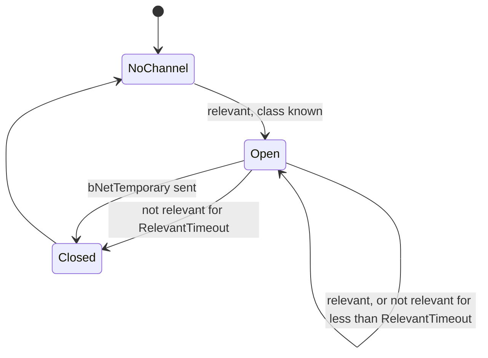

# Native replication: the server pass, actor channels, RPC routing and receive

Units: eng:ULevel::TickNetServer, eng:ULevel::ServerTickClient, eng:UActorChannel::SetChannelActor, eng:UActorChannel::ReplicateActor, eng:UActorChannel::ReceivedBunch, eng:AActor::ProcessRemoteFunction, eng:AActor::InternalProcessRemoteFunction, eng:AActor::FindNetChannel, eng:UPackageMapLevel::SerializeObject, eng:UStructProperty::NetSerializeItem, eng:AActor::PreNetReceive, eng:AActor::PostNetReceive, eng:AActor::Tick, eng:ULevel::TickNetClient, nat:Core.Object.PackW, nat:Core.Object.GetPackedLW, nat:Core.Object.GetPackedHW

## Purpose

What the engine does around the script replication blocks: which actors a connection gets each
server tick and in which order, when channels open and close, how a property update and an RPC are
built, how values are encoded, how the client applies what it receives, and how SCCT routes server
calls to clients that do not own the actor. It refines `spec/net/model.md`; the relevancy tests are
in `net-relevancy.md` and the per-class property lists in `net-replists.md`. Wire layout is not a
goal; ordering, timing and the selection rules are.

## Data

Actor fields the native code reads (names from `Engine/Actor.uc`): `NetTag`, `NetUpdateFrequency`,
`bNetDirty`, `bNetInitial`, `bNetOwner`, `bNetTemporary`, `bAlwaysRelevant`,
`bOnlyRelevantToOwner`, `bOnlyDirtyReplication`, `bTearOff`, `bStatic`, `bNoDelete`,
`bNetInitialRotation`, `Role`, `RemoteRole`, `Owner`, `Instigator`, `Class`, `Location`,
`Rotation`, and the per-actor channel cache that overlays `ActorNetChannels` plus its seven padding
ints (32 bytes): four (connection, channel) pairs, cleared on first use while `bMustInitNetChannels`
is set. `NetPriority` and `NetUpdateTime` are not read by the server pass.

Actor channel: `Actor`, `OpenPacketId` (none until the first bunch is sent), `OpenAcked`,
`SpawnAcked`, `ActorDirty`, `bActorMustStayDirty`, `bActorStillInitial`, `RelevantTime` (double),
`LastUpdateTime`, `Recent` (a copy of the actor's property block as last sent, initialised from the
class defaults), `Retirement` (per replicated property: packet id of the last send and whether that
packet was reliable), `Dirty` (properties to resend after a loss), and three SCCT times used by the
pawn list (`net-proxy.md`).

Connection: `SentTemporaries` (bNetTemporary actors already sent), `LastServerTickTime`.

## Rules

### Server pass (each server tick, after the world tick)

1. **Dirty propagation.** For every actor of the level's network list with `bNetDirty`: for every
   open client connection that has a player, the actor's channel on that connection (found through
   the four-slot cache, rule 22) gets `ActorDirty = true`; then `bNetDirty` is cleared. A change made
   by script during the tick therefore reaches every channel even if that channel is not updated
   this tick.
2. **Connections.** Client connections are processed in list order. A connection gets a pass only
   when it has a player controller, is ready (`net-driver.md` rule 3), is Open, and received a packet
   less than 1.5 s ago. Otherwise nothing is sent to it this tick and its `LastServerTickTime` is not
   advanced.
3. **Pass set-up.** The level's pass counter increments; every actor in the connection's
   `SentTemporaries` is stamped with it (never sent again on this connection). The viewer is the
   controller's view target; the source location and rotation come from the controller's
   `PlayerCalcView` (the camera). `dt = Driver.Time − LastServerTickTime` and
   `Rate = GetMaxTickRate()` (`net-driver.md` rule 11).
4. **Actor loop.** Actors are taken in the order of the level's network actor list (no sorting). An
   actor is a candidate when it is not already stamped this pass and
   - `bAlwaysRelevant`, or not `bOnlyRelevantToOwner`, or its direct `Owner` is the view target or
     the connection's controller (only the direct owner, not the owner chain), and
   - **frequency gate:** `NetUpdateFrequency ≥ Rate`, or `NetUpdateFrequency × dt > 1`.
   With `Rate = 0` (listen server) every candidate passes the gate every tick.
5. **Only-dirty skip.** If the actor has `bOnlyDirtyReplication`, a channel with a `Recent` block, no
   pending `Dirty` entries and `ActorDirty` false, it is skipped and the channel's `RelevantTime` is
   set to now.
6. **Relevancy cadence.** The actor is stamped. If it has a channel whose actor is gone, nothing
   happens. Relevancy (`net-relevancy.md`) is evaluated only when the actor is not torn off and there
   is no channel or more than 1.0 s passed since `RelevantTime`. Then:
   - relevant: open a channel if none (only if the connection's package map knows the actor's class),
     set `RelevantTime = now + 0.5 × FRand()`;
   - not evaluated, or not relevant, with a channel: if `now − RelevantTime < RelevantTimeout` (5 s)
     the actor is still replicated; otherwise the channel is closed, and when the actor's mesh is
     skeletal, the channels of its attached actors (not always relevant, attached to a bone) close too;
   - not relevant and no channel: nothing.
7. **Send.** Before replicating, and again after, the pass stops for this connection (breaks out of
   the actor loop) when the connection is no longer ready. Otherwise, if the channel is ready
   (`net-driver.md` rule 3), `ReplicateActor` runs. Actors late in the list therefore starve first
   when the budget is short.
8. **Pass end.** `LastServerTickTime = Driver.Time`.

### Building an update (ReplicateActor)

9. **Initial bunch and retirement.**
   - First bunch of the channel (`OpenPacketId` none): `bNetInitial = true`; the bunch is reliable,
     except for `bNetTemporary` actors, whose single bunch is unreliable and closes the channel.
   - Later bunches: `bNetInitial = false`; the first time the channel's opening is acknowledged
     (`SpawnAcked`), every property whose last send was unreliable is marked dirty, so values lost
     before the spawn arrived are resent.
10. **Ownership flag.** `bNetOwner` is set for this build only: the top of the `Owner` chain is a
    player controller whose player is this connection (on a client driver: whose player is the local
    viewport). It is cleared again when the update is finished. The only other writer on a server is
    the receive path (rule 21), which sets it when a bunch from the owning connection arrives and
    leaves it set until the actor's next update. Outside those windows `bNetOwner` is false on the
    server, which matters for RPC conditions (rule 19.5).
11. **Autonomous downgrade.** When `RemoteRole` is `ROLE_AutonomousProxy`, the actor has an
    `Instigator`, the `Instigator`'s `bNetOwner` is false and the actor's own `bNetOwner` is false,
    `RemoteRole` reads `ROLE_SimulatedProxy` during this update and is restored afterwards. A pawn's
    `Instigator` is the pawn itself (`Pawn.PreBeginPlay`), so pawns are sent as simulated proxies to
    every connection but the owner's. An autonomous actor without `Instigator` keeps
    `ROLE_AutonomousProxy` for everyone.
12. **Spawn information** (first bunch only, written before properties): an actor that is neither
    `bStatic` nor `bNoDelete` is described by its class plus its `Location` (and `Rotation` when the
    class has `bNetInitialRotation`); a map actor is described by an object reference to the map
    copy, so the client binds it to its own copy and keeps the map's location.
13. **Flags for the property list.** `bNetDirty = ActorDirty or bNetInitial`; `bNetInitial |=
    bActorStillInitial`; `bActorMustStayDirty` and `bActorStillInitial` are cleared. The native list
    of the class (`net-replists.md`) returns the property indices to send, comparing with `Recent`;
    every index in `Dirty` is appended once.
14. **Writing.** For each index: the property's field index, the array index byte for static arrays,
    then the value (rule 17). `Role` and `RemoteRole` are written swapped (each into the other's
    slot), which performs the role swap of `model.md` rule 2. If the bunch overflows, the last value
    is taken back and the remaining indices wait for the next update ("overflow"). If a value could
    not be mapped (an object reference without a channel on that connection, rule 18), it is not
    copied into `Recent` but added to `Dirty`, so it is retried; mapped values are copied into
    `Recent`.
15. **Send and bookkeeping.** A non-empty bunch is sent (merging allowed); every written index leaves
    `Dirty` and records the packet id and reliability in `Retirement`. `bNetTemporary` actors are
    added to `SentTemporaries`. `LastUpdateTime = now` when nothing overflowed. After the update:
    `bActorStillInitial = bNetInitial and (overflow or (not bNetTemporary and bActorMustStayDirty))`,
    `ActorDirty = bActorMustStayDirty or overflow`, `bNetOwner = false`, `RemoteRole` restored,
    `bNetDirty = false`. A list that sets `bActorMustStayDirty` (an object it could not map) keeps the
    actor dirty, and keeps its initial-only properties eligible, until it can.
16. **Channel open.** `SetChannelActor` stores the actor, adds the (connection, channel) pair to the
    actor's cache, sizes `Retirement` to the class's replicated properties, and, for non-temporary
    actors, fills `Recent` from the class defaults and then zeroes the class's config properties in
    it (so a property equal to its default is not sent in the first bunch, while config values,
    which may differ between machines, always are).

### Values

17. **Encoding** (`NetSerializeItem`): ints, floats, names and strings exact; bytes as 8 bits, or as
    few bits as the enum needs; bools 1 bit; static arrays element by element. Structs by name:
    - `Vector`: each component rounded to the nearest integer (`floor(x + 0.5)`), sent with a bit
      count chosen per value (up to 20 bits per component);
    - `Rotator`: each component reduced to its high byte (`(r >> 8) & 255`, truncation, negative
      angles wrap to 0..65280), with a flag bit per component for zero; received as `byte × 256`;
    - `Plane`: four components rounded to 16-bit integers;
    - `CompressedPosition`: `Location` and `Velocity` as rounded vectors, `Rotation` as pitch and yaw
      high bytes only (roll arrives as 0);
    - other structs: member by member.
18. **Object references** (`UPackageMapLevel::SerializeObject`): an actor that is neither `bStatic`
    nor `bNoDelete` is sent as the index of its actor channel on that connection; it counts as mapped
    only when that channel's opening was acknowledged. No channel gives the reserved index and the
    receiver reads None. Static and map actors, and non-actor objects, go by package object index.

### Calls

19. **Routing a replicated call** (`ProcessRemoteFunction`), with `F` the called function:
    1. Static functions, actors being destroyed and standalone games: run locally.
    2. *Absorb:* the call is swallowed (neither sent nor run) when the actor's `Role` is
       `ROLE_SimulatedProxy` or lower and `F` is neither simulated nor native. This applies to every
       script function, replicated or not.
    3. If `F` is not a net function, the absorb result stands.
    4. On the authority, for an `F` without the SCCT broadcast flag (rule 20): the owning connection
       is the player of the top player controller of the `Owner` chain; with no such controller, or a
       local player, the call runs locally.
    5. The replication condition of the first declaration of `F` is evaluated once, in the actor's
       current state of flags (on the server `bNetOwner` is normally false here, rule 10). False: the absorb
       result stands (run locally unless absorbed).
    6. True: on a server the call is not run locally; on a client it goes to the server connection.
       Each target connection receives the bunch when it is non-null and the function is reliable or
       the connection is ready; unreliable calls to a saturated connection are dropped.
    7. Sending on one connection (`InternalProcessRemoteFunction`): the actor's channel is looked up
       in the four-slot cache. On a server a missing channel is opened (and the actor replicated
       first if its channel never sent), on a client the call is dropped. Parameters are written in
       declaration order; each non-bool parameter is preceded by a bit saying whether it differs from
       zero and is omitted when it does not.
20. **SCCT broadcast flag (function flag 0x01000000).** When `F` carries it, step 4 is skipped and the
    targets are all client connections of the driver, but only those on which the actor already has
    an open channel (no channel is opened for a broadcast; port note: on a listen server a local, loopback
    connection without a channel gets one opened and the call, since those are the host's own players, for whom
    the original runs the call locally). After sending, the call also runs locally
    on a listen server; on a dedicated server it does not run locally; on a client a broadcast call
    whose condition is true is neither sent (a client has no client connections) nor run. The flag is
    set on exactly 20 functions in this build:
    `Engine.ESoftBodyActor.SBBulletHitClient`, `Engine.Emitter.ReplicateTrigger`,
    `Engine.MusicTrigger.ClientPlayStopMusic`, `Engine.SImpactManager.AddImpact`,
    `SBase.SBasePawn.CamNetworkSwitchVisionModeOnAllClients`, `SBase.SBasePawn.ClientPlayLandingSound`,
    `SBase.SBasePawn.SetDesiredGlassValueOnClients`, `SBase.SBasePawn.SetPerturbationGlassOnClients`,
    `SBase.SBombTargetInteraction.Update`, `SBase.SFlag.SetFlagCarrier`,
    `SBase.SGamePlayObject.KillDamageEmitter`, `SBase.SGamePlayObject.SpawnDamageEmitter`,
    `SBase.SMineLaser.DetruitFaisceau`, `SBase.SNotifyNoise.ChangeStateToAll`,
    `SBase.SObjective.AddRemoveObjectiveOnClientHud`, `SBase.SObjectiveTrigger.AddRemoveObjectiveForRadar`,
    `SBase.SPlayerController.SetClientShouldShowMenu`, `SBase.STriggerInteraction.AddRemoveActorOnClientHud`,
    `SBase.STriggerLight.SetEMFDLightToClient`, `SBase.STriggerLight.UnSetEMFDLightToClient`.
    `Actor.ChangeClientState` does not carry the flag: it follows the owner rule.
21. **Receiving a call.** On a server, the receiver evaluates the function's condition with `Role` and
    `RemoteRole` swapped (the sender's point of view) and requires the actor's `bNetOwner` (the
    actor is owned by this connection's player, set by the receive path); a call failing either test
    is read and discarded. On a client the call is executed through the normal event path, so the
    absorb rule of rule 19.2 applies: on a proxy only simulated functions run.
22. **Per-actor channel cache.** Up to four (connection, channel) pairs per actor. Lookup returns
    nothing while `bMustInitNetChannels` is set (the first add clears the cache and the flag). A
    channel open adds the pair (reusing the slot of the same connection, else the first free slot,
    else not stored); channel close removes it. Every server-side lookup (dirty propagation, the
    pass, RPC sends) uses only this cache, so the original supports at most four client connections
    per actor.

### Receive and apply (client)

23. **Opening a channel.** The spawn information is read: a map actor is looked up by reference, a
    dynamic one is spawned from its class at the sent location (and rotation), with its roles taken
    from the class defaults swapped. On every received bunch `bNetOwner` of the client copy is
    recomputed: true when the top player controller of its owner chain is the local player.
24. **Properties.** Before the properties of a bunch, `PreNetReceive` saves `Location`, `Rotation`,
    `RelativeLocation`, `RelativeRotation`, `Base`, `bCollideActors`, `SimAnim`, `DrawScale`,
    `DrawScale3D`, `DrawType`, `RepSkin` and `StaticMesh`, and takes the actor out of the collision
    hash. After them, `PostNetReceive` puts the old values back and applies each change through its
    setter: collision hash re-insert, replicated animation, `SetCollision` when `bCollideActors`
    changed, `SetStaticMesh` when `StaticMesh` changed (and, when the new mesh is None, collision off
    and `bBlockActors`/`bBlockPlayers` cleared), location move, rotation move, draw scale and type,
    base change with relative offsets. A newly spawned actor then gets `PostNetBeginPlay`.
25. **Tear-off.** When a client receives `bTearOff`, the actor becomes `ROLE_Authority` with
    `RemoteRole` none, leaves the channel and the cache, and gets the `TornOff` event.
26. **What runs on a client** (`AActor::Tick` role gates): an actor with `Role` at least
    `ROLE_AutonomousProxy` gets the authoritative tick (timers, state code, script `Tick`);
    `ROLE_SimulatedProxy` gets the simulated tick (simulated parts only); `ROLE_DumbProxy` and
    `ROLE_None` get no script tick, no timers and no state code, only falling or rotating physics.
    On the server, an actor whose `RemoteRole` is autonomous and whose controller is remote is not
    ticked by script; if no move arrived for more than `0.5 × MaxResponseTime` (0.35 s), its
    `Velocity` is not zero and its physics is not none, its physics is run for the elapsed time; the
    controller's server time stamp is then set to now.

### Packed words

27. `PackW(Low, High) = (High << 16) | (Low & 0xFFFF)`. `GetPackedLW` and `GetPackedHW` return the low
    and high 16 bits sign-extended (values 0x8000 and up become negative).

## States

## Constants

| Name | Value | Unit | Provenance | Source |
|---|---|---|---|---|
| Receive window for a pass | 1.5 | s | decoded | `ServerTickClient`, game 0x10a30730 |
| Relevancy recheck interval | 1.0 | s | decoded | same |
| RelevantTime jitter | 0.5 × FRand | s | decoded | same |
| RelevantTimeout | 5.0 | s | decoded | `Default.ini`, read by the same code |
| Channel cache slots | 4 | pairs | decoded | game 0x10992150, editor 0x110a6320 |
| Broadcast function flag | 0x01000000 | | decoded | game 0x10a29830, reflection flags |
| Broadcast functions | 20 | | decoded | `local/reflect/game.json` |
| Vector bits per component | up to 20 | bits | decoded | game 0x109567e0 |
| Rotator step | 256 | units | decoded | same |
| Autonomous stall threshold | 0.5 × MaxResponseTime | s | decoded | editor `AActor::Tick` 0x11183b50 |

## Network

Server: rules 1 to 22 and 26 (server part). Client: rules 17, 18, 21 (client part), 23 to 27.

## Edge cases

- With a dedicated server tick cap of 20 Hz, an actor with `NetUpdateFrequency` below 20 passes the
  frequency gate only on passes that come more than `1 / NetUpdateFrequency` after the previous pass
  of that connection (rule 4); at a steady 20 Hz, `NetUpdateFrequency` 5 and 10 actors (PRI,
  objective triggers, GRI, team infos) would never pass. Passes are skipped while the shared budget
  is exhausted, which stretches `dt`; how often this happens in play is open (Open question 1). A
  listen server has no cap and every actor passes every tick.
- Ordering, not priority, decides who is served first when the budget is short.
- A condition containing `bNetOwner` is normally false when a server-side RPC is routed (rule 19.5),
  so such calls run on the server and are not sent. `SBasePawn.AddDefaultGadgets` (condition
  `Role == ROLE_Authority && bNetOwner`, called by `SGameInfo` right after spawning the pawn, before
  the pawn could receive anything from its owner) is therefore never sent to the owning client.
- A late joiner never receives a broadcast made before its channel opened (rule 20).
- A fifth client connection would never find its channel in the cache and would get a new channel
  every pass; the original has at most four connections (2v2). The port must not depend on this.
- Properties equal to the class default are not sent in the first bunch (rule 16), so a client
  copy spawned from the class keeps the right value without data on the wire. For a map actor the
  comparison is still against the class default, so map-edited values are sent in its first bunch.

## Evidence

- Game (base 0x10900000): `TickNetServer` 0x10a30ba0, `ServerTickClient` 0x10a30730,
  `ReplicateActor` 0x109e1300, `ReceivedBunch` 0x109e0b10 (string "Received invalid actor class"),
  `UChannel::SendBunch` 0x109e0090, `ProcessRemoteFunction` 0x10a29830 (vtable slot 10 of
  `AActor::vftable` 0x10c0bbb8), `InternalProcessRemoteFunction` 0x10a29530, channel cache lookup
  0x10992150, `UPackageMapLevel::SerializeObject` 0x109ee320, `UStructProperty::NetSerializeItem`
  0x109567e0 (slot 31 of `UStructProperty::vftable` 0x10c0c628), byte 0x10954470, bool 0x10954f00,
  int and float 0x109546f0.
- Editor (named by guard strings): `TickNetServer` 0x11184200, `ServerTickClient` 0x11183250,
  `ReplicateActor` 0x11142700, `SetChannelActor` 0x11140b30, `ReceivedBunch` 0x11140de0,
  `ProcessRemoteFunction` 0x1118fa40, `InternalProcessRemoteFunction` 0x1118f6f0, cache lookup
  0x110a6320, add 0x110a63f0, remove 0x110a6360, `AActor::PreNetReceive` 0x110a6ee0,
  `AActor::PostNetReceive` 0x110b2770, `AActor::Tick` 0x11183b50, `ULevel::Tick` 0x11184820,
  `UObject::execPackW` 0x10ff09a0, `execGetPackedLW` 0x10ff0ac0, `execGetPackedHW` 0x10ff0b10.
- The game and editor bodies of the pass, `ReplicateActor` (including the downgrade test) and the
  routing were compared and agree except for the shared driver budget (`net-driver.md`).
- Function flags: `local/reflect/game.json` (`flags` of the 20 functions above).

## Open questions

1. **Frequency gate in play.** Count property updates per second of a PRI and the GRI on a
   dedicated server (internet tick cap 20) during a 2v2 SteeE minute; if they are rare, the port's
   faithful profile must reproduce the gate exactly, budget stalls included.
2. Which actors are on the level's network actor list and in which order (map order, then spawn
   order?); read the list maintenance in `ULevel::SpawnActor` and the level load path.
3. Whether the client-side receive of a call on an autonomous proxy evaluates any condition.
