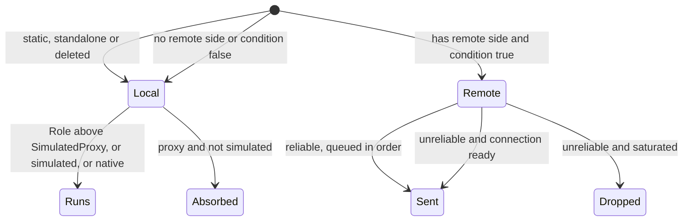

# Replication model

Units: def:Engine.Actor, rep:Engine.Actor.AmbientGlow, rep:Engine.Actor.AmbientSound, rep:Engine.Actor.AttachmentBone, rep:Engine.Actor.Base, rep:Engine.Actor.ChangeClientState, rep:Engine.Actor.ChangeServerState, rep:Engine.Actor.DesiredRotation, rep:Engine.Actor.DrawScale, rep:Engine.Actor.DrawType, rep:Engine.Actor.EMFIntensity, rep:Engine.Actor.EMFOpacity, rep:Engine.Actor.EchelonRange, rep:Engine.Actor.HeatIntensity, rep:Engine.Actor.Instigator, rep:Engine.Actor.LightBeamFalloffScale, rep:Engine.Actor.LightBeamInitialAlpha, rep:Engine.Actor.LightBeamMesh, rep:Engine.Actor.LightBrightness, rep:Engine.Actor.LightEffect, rep:Engine.Actor.LightHue, rep:Engine.Actor.LightPeriod, rep:Engine.Actor.LightPhase, rep:Engine.Actor.LightRadius, rep:Engine.Actor.LightSaturation, rep:Engine.Actor.LightType, rep:Engine.Actor.Location, rep:Engine.Actor.Mesh, rep:Engine.Actor.Owner, rep:Engine.Actor.Physics, rep:Engine.Actor.RelativeLocation, rep:Engine.Actor.RelativeRotation, rep:Engine.Actor.RemoteRole, rep:Engine.Actor.RepSkin, rep:Engine.Actor.Role, rep:Engine.Actor.Rotation, rep:Engine.Actor.RotationRate, rep:Engine.Actor.SimAnim, rep:Engine.Actor.SoundBone, rep:Engine.Actor.SoundOcclusion, rep:Engine.Actor.SoundPitch, rep:Engine.Actor.SoundRadius, rep:Engine.Actor.SoundVolume, rep:Engine.Actor.SpotHeight, rep:Engine.Actor.SpotWidth, rep:Engine.Actor.StaticMesh, rep:Engine.Actor.UsesLightBeam, rep:Engine.Actor.Velocity, rep:Engine.Actor.bBlockActors, rep:Engine.Actor.bBlockNonZeroExtentTraces, rep:Engine.Actor.bBlockPlayers, rep:Engine.Actor.bBlockZeroExtentTraces, rep:Engine.Actor.bCollideActors, rep:Engine.Actor.bCollideWorld, rep:Engine.Actor.bEMFIsOn, rep:Engine.Actor.bFixedRotationDir, rep:Engine.Actor.bHidden, rep:Engine.Actor.bIgnoreDynamicEchelonLighting, rep:Engine.Actor.bIgnoreEchelonLighting, rep:Engine.Actor.bNetOwner, rep:Engine.Actor.bProjTarget, rep:Engine.Actor.bRotateToDesired, rep:Engine.Actor.bSpecialLit, rep:Engine.Actor.bTearOff, rep:Engine.Actor.bUnlit, uc:Engine.Pawn:PossessedBy, uc:Engine.Pawn:UnPossessed, def:Engine.Emitter, rep:Engine.Emitter.ReplicateTrigger, uc:Engine.Emitter:PreBeginPlay, uc:Engine.Emitter:Trigger, uc:Engine.Emitter:ReplicateTrigger, def:Engine.MusicTrigger, rep:Engine.MusicTrigger.ClientPlayStopMusic, uc:Engine.MusicTrigger:Trigger, uc:Engine.MusicTrigger:UnTrigger, uc:Engine.MusicTrigger:ClientPlayStopMusic, nat:Core.Object.PackW, nat:Core.Object.GetPackedLW, nat:Core.Object.GetPackedHW, eng:AActor::ProcessRemoteFunction, eng:AActor::IsNetRelevantFor, eng:AActor::GetOptimizedRepList, eng:UActorChannel::ReplicateActor, eng:UActorChannel::ReceivedBunch, eng:ULevel::TickNetServer, eng:ULevel::TickNetClient, eng:UStructProperty::NetSerializeItem

## Purpose

How the original decides what crosses the network and in which direction: network roles, the role
swap on clients, how replication conditions are evaluated, what `nativereplication` means for the
port, how replicated function calls are routed (including the SCCT behaviour of server calls on
unowned actors), how values are encoded on the wire, and how relevancy, priority and update rate
pick the actors sent each tick. Every other file in `spec/net/` relies on these rules. The per-class
tables are in `rep-*.md`; the movement protocol is in `move-protocol.md`.

## Data

Actor fields that steer replication (types from `Engine/Actor.uc`, defaults from `def:Engine.Actor`;
booleans not listed in the defaults file are false):

| Field | Type | Default | Meaning |
|---|---|---|---|
| `Role` | ENetRole | `ROLE_Authority` | Authority of this copy. |
| `RemoteRole` | ENetRole | `ROLE_DumbProxy` | Role the other side gets. `ROLE_None` means never replicated. |
| `bNetInitial` | bool (const) | | True while building the first bunch of a channel. |
| `bNetOwner` | bool (const) | | True while replicating to the connection that owns the actor. |
| `bNetDirty` | bool (transient) | | A replicated value changed since the last update. |
| `bNetRelevant` | bool (const) | | Set by the relevancy pass. |
| `bAlwaysRelevant` | bool | false | Skip the relevancy test. |
| `bOnlyRelevantToOwner` | bool | false | Relevant to the owner only. |
| `bOnlyDirtyReplication` | bool | false | Compare properties only when dirty. |
| `bSkipActorPropertyReplication` | bool | false | Actor-level properties only in the first bunch (rule 6). |
| `bReplicateMovement` | bool | true | Gate for the movement properties. |
| `bUpdateSimulatedPosition` | bool | false | Keep sending `Location`/`Rotation`/`Velocity` to simulated proxies after the first bunch. |
| `bReplicateAnimations` | bool | false | Gate for `SimAnim`. |
| `bReplicateInstigator` | bool | false | Gate for `Instigator`. |
| `bNoRepMesh` | bool | false | Suppress `Mesh` replication. |
| `bClientAnim` | bool | false | With `bNetOwner`, suppresses ambient sound replication to the owner. |
| `bTearOff` | bool | false | Stop updating; the client keeps a local copy. |
| `bNetTemporary` | bool (const) | false | Send once, then close the channel. |
| `bNetNotify` | bool | false | Call `PostNetReceive` on the client after a bunch. |
| `bStatic`, `bNoDelete` | bool (const) | false | Map actors that exist on both sides from the map file. |
| `NetUpdateFrequency` | float | 100.0 | Maximum updates per second. |
| `NetPriority` | float | 1.0 | Bandwidth share weight. |
| `NetUpdateTime` | float | | Next time the actor may be considered. |
| `bMustInitNetChannels` | bool | true | Clears the per-actor channel cache at init (rule 10). |
| `ActorNetChannels` | ActorNetCollection | | SCCT addition: with its padding, a native cache of four (`NetConnection`, `ActorChannel`) pairs, filled when a channel opens and cleared when it closes (decoded, editor 0x110a63f0). |

`ENetRole`: `ROLE_None` 0, `ROLE_DumbProxy` 1, `ROLE_SimulatedProxy` 2, `ROLE_AutonomousProxy` 3,
`ROLE_Authority` 4. `ENetMode` (LevelInfo): `NM_Standalone` 0, `NM_DedicatedServer` 1,
`NM_ListenServer` 2, `NM_Client` 3.

## Rules

1. **Server truth.** On the server every actor has `Role == ROLE_Authority`. `RemoteRole` is the role a
   client copy will have. An actor whose `RemoteRole` is `ROLE_None` is never sent.
2. **Role swap on clients.** A replicated actor arrives on a client with the two roles swapped:
   client `Role` = server `RemoteRole`, client `RemoteRole` = `ROLE_Authority`. Script tests
   `Role < ROLE_Authority` to mean "I am on a client" and `Role == ROLE_Authority` to mean "server
   or standalone".
3. **Owner downgrade.** An actor whose `RemoteRole` is `ROLE_AutonomousProxy` is seen as
   `ROLE_SimulatedProxy` by every connection except its owner. While building a bunch for a
   non-owner, `RemoteRole` reads as `ROLE_SimulatedProxy`, so a condition `RemoteRole ==
   ROLE_SimulatedProxy` means "to everyone except the owner" (used by `SBasePawn.iDesiredYawPitch`).
   UE2 behaviour, to confirm in `UActorChannel::ReplicateActor`.
4. **Ownership.** `bNetOwner` is true when the connection's player controller is the top of the actor's
   `Owner` chain. `Pawn.PossessedBy` sets `Owner` to the controller, sets `NetPriority = 3.0`, and,
   outside standalone, sets `RemoteRole = ROLE_AutonomousProxy` for a player controller (else the class
   default). `UnPossessed` clears `Owner`, `Controller` and `PlayerReplicationInfo`.
   `PlayerController.PawnDied` and `SPlayerController.UnPossess` reset the pawn's `RemoteRole` to
   `ROLE_SimulatedProxy`. Inventory and gadgets are owned by the pawn, so they are owned by the player.
5. **Property conditions.** For each connection and each net update of an actor, the server evaluates
   every replicated variable's condition with `bNetInitial`, `bNetOwner` and the role fields set for
   that connection. A variable is sent when its condition is true and its value differs from the
   last value sent on that channel. `bNetDirty` (decoded, game 0x10a30ba0, 0x10a30730, 0x109e1300): each
   server tick every actor with `bNetDirty` marks its channel dirty on every open connection, then
   `bNetDirty` is cleared; during an update the condition variable `bNetDirty` reads "channel dirty or first
   bunch". An actor with `bOnlyDirtyReplication` whose channel is clean is skipped entirely. Which script
   writes set `bNetDirty` was not traced. The `reliable`/`unreliable` keyword in front of
   variables has no effect; only function reliability matters.
6. **Actor properties of skip actors.** Every Actor-level condition except three groups starts with
   `!bSkipActorPropertyReplication || bNetInitial`, so for actors with
   `bSkipActorPropertyReplication` (ReplicationInfo, SBasicGamePlayObject and their subclasses, map
   objects) `Location`, `Rotation`, `bHidden`, `DrawType`, `Owner` and the rest go out only in the
   first bunch. Not guarded: `bCollideWorld`/`bCollideActors` (`bNetInitial` only), `StaticMesh`
   (condition `false`, never sent by script), and the vision group `bBlockNonZeroExtentTraces`,
   `bBlockZeroExtentTraces`, `bUnlit`, `bEMFIsOn`, `AmbientGlow`, `EMFOpacity`, `EMFIntensity`,
   `HeatIntensity` (condition `Role == ROLE_Authority`, always eligible). `SGamePlayObject.PostBeginPlay`
   clears `bSkipActorPropertyReplication` on objects that are pickable, pushable or change mesh or skin.
   The native Actor list (decoded, net-replists.md; editor 0x110a8610, game 0x10988610) does not follow the
   script set everywhere: `Base` is never sent; `bHidden`, `Role`, `RemoteRole`, `bNetOwner` and `bTearOff`
   only in the first bunch; the vision group (`bEMFIsOn`, `EMFOpacity`, `EMFIntensity`, `HeatIntensity`,
   `bUnlit`, the Echelon flags, `bSpecialLit`) and the ambient sound group only in the first bunch; `Owner`
   only to the owning connection; `AmbientGlow` and `SoundBone` never; `StaticMesh` in the first bunch for
   `DT_StaticMesh`. Subclass lists resend what they need (the pawn resends the vision fields on every
   change, rep-pawn.md).
7. **Movement properties** (Actor blocks 0 to 6), all gated by `bReplicateMovement`:
   - `Location`: to an autonomous proxy only in the first bunch; to a simulated proxy in the first
     bunch or always when `bUpdateSimulatedPosition`; to a dumb proxy always; for simulated and dumb
     proxies only while `Base` is None or world geometry.
   - `Rotation`: as `Location`, and only when `DrawType` is `DT_Mesh` or `DT_StaticMesh`.
   - `Base`: to dumb and simulated proxies. `AttachmentBone`, `RelativeLocation`, `RelativeRotation`:
     the same, when `Base` is set and not world geometry.
   - `Velocity`: to simulated proxies (first bunch, or always with `bUpdateSimulatedPosition`), to
     dumb proxies only while falling.
   - `Physics`: to simulated proxies in the first bunch, to dumb proxies always.
   - `bRotateToDesired`, `bFixedRotationDir`, `DesiredRotation`, `RotationRate`: to proxies while
     `Physics == PHYS_Rotating` (the disk drop zone cover uses this).
8. **nativereplication.** All 59 classes that declare replicated variables carry the
   `NativeReplication` class flag (83 classes have the flag in total; 17 classes declare only
   replicated functions without it, among them `SWeaponDefense`, `SGadGrenLauncher`, `MusicTrigger`
   and `Emitter`). For flagged classes, the server does not run the script conditions for their own
   variables; a native `GetOptimizedRepList` override per class does. The script block
   states the intended rule and the port implements it as written, but each native override has to be
   checked; the per-class differences are decoded in net-replists.md and summarised in the `rep-*.md` files.
   `SBasicGamePlayObject`'s list sends `StaticMesh` on every change while `DrawType` is `DT_StaticMesh`, and the
   client's `PostNetReceive` calls `SetStaticMesh` (with no new mesh it turns collision off and clears
   `bBlockActors` and `bBlockPlayers`): this is how glass and the crane wall change on clients (editor
   0x111c1830, 0x110b2770). Native overrides also exist for classes with no script variables
   (`ASAnimatedMesh`, `ASDisk`, `ASFlagDropZone`, `ASAmmoStock`, `ASZoneTips`, `ASAmbientSoundTrigger`,
   `ASLift`, `ASLiftDoor`, `ASSmokeEmitter`, `AProjector`, `AEffects`, `ASImpactEffectBase`,
   `ASBulletImpact`, `ASBloodSplat`), which may send extra fields.
9. **Function replication.** A function is replicated when it carries `FUNC_Net`; the condition is
   the one of its first declaration. When script calls it:
   1. Static functions, standalone games and actors being destroyed run locally.
   2. The remote side is the server connection on a client; on a server it is the connection of the
      player controller that owns the actor. With no remote side the call runs locally (see rule 10
      for the SCCT exception).
   3. If the condition evaluates false the call runs locally.
   4. Otherwise the call is sent and does not run locally. `NetReliable` calls are queued on the
      actor channel in order and retried until acknowledged; unreliable calls are dropped when the
      connection is saturated and may be lost.
   5. A call that runs locally on a proxy (`Role` <= `ROLE_SimulatedProxy`) is dropped silently unless
      the function is `simulated` or native ("absorbed"). On a client, `ROLE_None` and `ROLE_DumbProxy`
      actors also get no script tick, no timers and no state code (only falling or rotating physics run);
      simulated functions called by engine events still run (decoded, `AActor::Tick` editor 0x11183b50 and
      `ProcessRemoteFunction` 0x1118fa40).
   A received call runs in the receiving actor's current state, so state overrides apply
   (`s_WaitForClientToReinit.TellServerIAMReadyToReinit`). On a client a received call on a proxy
   actor runs only if the function is `simulated` (every SCCT function aimed at proxies is).
10. **Server calls on the broadcast flag (SCCT, decoded).** A function carrying the SCCT flag 0x01000000
    (`FUNC_NetAllClients`) skips the owner rule: when its condition holds on the server, the call goes to
    every client connection on which the actor already has an open channel (no channel is opened for it), in
    that channel's reliable order when the function is reliable; it also runs locally on a listen server but
    not on a dedicated server; on a client it is neither sent nor run. The condition is evaluated once, not per
    connection, and `bNetOwner` is normally false at that point on the server. Exactly 20 functions carry the
    flag (net-replication.md rule 20): `Engine.ESoftBodyActor.SBBulletHitClient`, `Engine.Emitter.ReplicateTrigger`,
    `Engine.MusicTrigger.ClientPlayStopMusic`, `Engine.SImpactManager.AddImpact`,
    `SBase.SBasePawn.CamNetworkSwitchVisionModeOnAllClients`, `SBase.SBasePawn.ClientPlayLandingSound`,
    `SBase.SBasePawn.SetDesiredGlassValueOnClients`, `SBase.SBasePawn.SetPerturbationGlassOnClients`,
    `SBase.SBombTargetInteraction.Update`, `SBase.SFlag.SetFlagCarrier`, `SBase.SGamePlayObject.KillDamageEmitter`,
    `SBase.SGamePlayObject.SpawnDamageEmitter`, `SBase.SMineLaser.DetruitFaisceau`,
    `SBase.SNotifyNoise.ChangeStateToAll`, `SBase.SObjective.AddRemoveObjectiveOnClientHud`,
    `SBase.SObjectiveTrigger.AddRemoveObjectiveForRadar`, `SBase.SPlayerController.SetClientShouldShowMenu`,
    `SBase.STriggerInteraction.AddRemoveActorOnClientHud`, `SBase.STriggerLight.SetEMFDLightToClient`,
    `SBase.STriggerLight.UnSetEMFDLightToClient`. Every other function, `Actor.ChangeClientState` included,
    follows the owner rule of rule 9, and `SBasePawn.AddDefaultGadgets` (a condition with `bNetOwner`, no flag)
    is never sent. Each receiver applies the receive rule of rule 9: on a proxy only `simulated` functions run.
    Clients without an open channel at call time do not get the call; the state it changed must also be carried
    by a replicated variable if late joiners need it (Edge cases). The per-actor cache in `ActorNetChannels`
    (four pairs) speeds up finding the channels (evidence: game 0x10a29830, 0x10a29530, 0x10992150; editor
    0x1118fa40, 0x110a63f0).
11. **Encoding of values** (decoded, game 0x109567e0):
    - `Vector`: each component rounded to the nearest integer before sending (adaptive bit count, up to 20
      bits per component). SCCT scales vectors to
      keep precision: unit normals and directions ×1000 (`m_geoNormal`, `vWallJumpDir`, `vectUnit`),
      velocities ×100 (`Vel`, `speed`), `CompressedPosition.Location` ×10. The receiver multiplies back
      (×0.001, ×0.01, ×0.1).
    - `Rotator`: each component reduced to its high byte by truncation (multiples of 256 rotator units;
      negative angles wrap to 0..65280). `CompressedPosition` keeps only the pitch and yaw bytes. Callers
      that need exact angles send ints instead (`View`, `iPitch`/`iYaw`, `YawToGo`, `iYawToRepos`).
    - `float`, `int`, `byte`, enums, `bool`, `name`, `string`: exact.
    - Object references go by network index; a reference to an actor with no channel on the receiver
      arrives as None.
    - Position corrections are sent as three separate floats (`NewLocX`, `NewLocY`, `NewLocZ`), so
      they are exact.
    - `PackW(Low, High)` packs two 16-bit values into one int (yaw low, pitch high) as
      `High << 16 | Low & 0xFFFF`; `GetPackedLW` and `GetPackedHW` return the 16-bit half sign-extended, so a
      negative pitch survives (decoded, editor 0x10ff0ac0, 0x10ff0b10, 0x10ff09a0).
12. **Relevancy.** Each server net tick, for each client connection, an actor is a candidate when its
    `RemoteRole` is not `ROLE_None`, it is not `bStatic` (the `LevelInfo` is the exception), and it
    passes `IsNetRelevantFor(viewer)`: always when `bAlwaysRelevant`, when owned by the viewer, or when
    the owner-only rule allows it, else by a visibility test from the viewer. SCCT overrides the test
    natively for `ASBasePawn`, `ASGamePlayObject`, `ASBasicGamePlayObject`, `ASFlag`, `ASCamera`,
    `ASVolumetricSensor`, `ASGadTorche` (two overrides), `ASLeaveInteraction` and
    `ASShareObjectInteraction`. The base test (net-relevancy.md rule 5) is always relevant within 2500 uu of
    the viewer's camera, else a BSP line of sight; a pickable object on a bone follows its carrier. The slice pawn classes `SPawnAttaque_1Mesh` and `SPawnDefense_1Mesh` are
    `bAlwaysRelevant`, so all players see all pawns. The viewer location is the player controller's
    location, which SCCT keeps up to date from the client camera (`move-protocol.md` rule 17). A channel
    whose actor stays not relevant for `RelevantTimeout` (5.0 s) is closed.
13. **Rate and order (decoded, game 0x10a30730, 0x109eeff0, 0x10a0d690).** An actor is considered at most
    `NetUpdateFrequency` times per second, gated by the server tick rate (`settings.md`). The server pass has no
    priority: candidates are served in actor-list order (`SpawnPrioritySeconds` and `NetPriority` are not read
    by it). The game's server has one send budget for all client connections: its rate is the adaptive driver
    speed (`settings.md`), refilled each frame with two frames of carry-over; `MaxClientRate` and the
    per-connection `NETSPEED` only feed the correction rate limit (`move-protocol.md`).
14. **Map actors.** `bStatic` and `bNoDelete` actors exist on both sides from the map; their channel opens
    with an object reference to the map copy (no class, no location), which the rewrite resolves by the SVMap
    actor index. Dynamic actors are spawned on the client from class and location (and rotation with
    `bNetInitialRotation`) (decoded, editor 0x11142700, 0x11140de0).
    On a client, map actors that are neither `bStatic` nor `bNoDelete` are destroyed at load and come
    back only if the server replicates them (UE2 rule, to confirm). A map actor whose class
    `RemoteRole` is `ROLE_None` keeps `Role == ROLE_None` on the client: its script does not run there
    (observed in RE+ testing; native ticking such as particles still runs). `Emitter` with
    `bNetworkTrigger` switches itself to `ROLE_SimulatedProxy` and `bAlwaysRelevant` in `PreBeginPlay`
    so that `Trigger` can reach clients through `ReplicateTrigger`.
14a. **Map actor baseline (an OpenSCCT addition).** The original opens every channel against the class
    defaults (`SetChannelActor` copies the class defaults into `Recent`, then zeroes config properties; no
    case for map actors; decoded, editor 0x11140b30). A map actor's property that the map placed away from
    its default and that the server later sets back to the default before a client's channel opens is
    therefore never sent to that client, which keeps the map's value (a late joiner, or a client coming back
    into relevancy after its channel closed). The rewrite keeps the original rule and adds one: once the map has
    loaded on the server (after its begin-play passes, before any client joins), it records for each
    `bStatic` or `bNoDelete` map actor which replicated properties differ from the class default; a channel to
    that actor also sends those properties, whenever their condition holds, until it has sent each once, even
    if the value now equals the default. A property equal to its default both in the map and now is still not
    sent. Not covered: a property the server's own begin-play moves away from a non-default map value is
    recorded at its new value.
15. **Client to server.** A client can only call functions on actors it owns (its player controller,
    its pawn, its inventory, gadgets, the goggle beam). Map interactions therefore go through the player
    controller (`InteractionInit`, `Interaction`, `InteractionPost`, `DestroyGPO`) or through owned
    actors.
16. **Initial bunch.** Variables gated by `bNetInitial` are sent once when the channel opens. Values
    changed later never reach a client whose channel is already open (for example
    `SComputerObjectiveTrigger.DominationCaptureTime`, `SBasePawn.AllActions`).

Actor replication blocks (the base of every class; conditions abbreviated with `Authority`, `SimulatedProxy` and so on for the `ROLE_` values):

#### Engine.Actor (nativereplication)

| Blk | Member | Kind | Type or parameters | Condition | Dir | Rel | Sim |
|---|---|---|---|---|---|---|---|
| 0 | `Location` | var | Vector | `(!bSkipActorPropertyReplication \|\| bNetInitial) && bReplicateMovement && (RemoteRole == AutonomousProxy && bNetInitial \|\| RemoteRole == SimulatedProxy && (bNetInitial \|\| bUpdateSimulatedPosition) && (Base == None \|\| Base.bWorldGeometry) \|\| RemoteRole == DumbProxy && (Base == None \|\| Base.bWorldGeometry))` | S to C | | |
| 1 | `Rotation` | var | Rotator | `(!bSkipActorPropertyReplication \|\| bNetInitial) && bReplicateMovement && (DrawType == DT_Mesh \|\| DrawType == DT_StaticMesh) && (RemoteRole == AutonomousProxy && bNetInitial \|\| RemoteRole == SimulatedProxy && (bNetInitial \|\| bUpdateSimulatedPosition) && (Base == None \|\| Base.bWorldGeometry) \|\| RemoteRole == DumbProxy && (Base == None \|\| Base.bWorldGeometry))` | S to C | | |
| 2 | `Base` | var | Actor | `(!bSkipActorPropertyReplication \|\| bNetInitial) && bReplicateMovement && RemoteRole <= SimulatedProxy` | S to C | | |
| 3 | `AttachmentBone` | var | name | `(!bSkipActorPropertyReplication \|\| bNetInitial) && bReplicateMovement && RemoteRole <= SimulatedProxy && Base != None && !Base.bWorldGeometry` | S to C | | |
| 3 | `RelativeRotation` | var | Rotator | `(!bSkipActorPropertyReplication \|\| bNetInitial) && bReplicateMovement && RemoteRole <= SimulatedProxy && Base != None && !Base.bWorldGeometry` | S to C | | |
| 3 | `RelativeLocation` | var | Vector | `(!bSkipActorPropertyReplication \|\| bNetInitial) && bReplicateMovement && RemoteRole <= SimulatedProxy && Base != None && !Base.bWorldGeometry` | S to C | | |
| 4 | `Velocity` | var | Vector | `(!bSkipActorPropertyReplication \|\| bNetInitial) && bReplicateMovement && (RemoteRole == SimulatedProxy && (bNetInitial \|\| bUpdateSimulatedPosition) \|\| RemoteRole == DumbProxy && Physics == PHYS_Falling)` | S to C | | |
| 5 | `Physics` | var | EPhysics | `(!bSkipActorPropertyReplication \|\| bNetInitial) && bReplicateMovement && (RemoteRole == SimulatedProxy && bNetInitial \|\| RemoteRole == DumbProxy)` | S to C | | |
| 6 | `bRotateToDesired` | var | bool | `(!bSkipActorPropertyReplication \|\| bNetInitial) && bReplicateMovement && RemoteRole <= SimulatedProxy && Physics == PHYS_Rotating` | S to C | | |
| 6 | `bFixedRotationDir` | var | bool | `(!bSkipActorPropertyReplication \|\| bNetInitial) && bReplicateMovement && RemoteRole <= SimulatedProxy && Physics == PHYS_Rotating` | S to C | | |
| 6 | `DesiredRotation` | var | Rotator | `(!bSkipActorPropertyReplication \|\| bNetInitial) && bReplicateMovement && RemoteRole <= SimulatedProxy && Physics == PHYS_Rotating` | S to C | | |
| 6 | `RotationRate` | var | Rotator | `(!bSkipActorPropertyReplication \|\| bNetInitial) && bReplicateMovement && RemoteRole <= SimulatedProxy && Physics == PHYS_Rotating` | S to C | | |
| 7 | `SoundOcclusion` | var | ESoundOcclusion | `(!bSkipActorPropertyReplication \|\| bNetInitial) && Role == Authority && (!bNetOwner \|\| !bClientAnim)` | S to C | | |
| 7 | `AmbientSound` | var | Sound | `(!bSkipActorPropertyReplication \|\| bNetInitial) && Role == Authority && (!bNetOwner \|\| !bClientAnim)` | S to C | | |
| 8 | `SoundPitch` | var | byte | `(!bSkipActorPropertyReplication \|\| bNetInitial) && Role == Authority && (!bNetOwner \|\| !bClientAnim) && AmbientSound != None` | S to C | | |
| 8 | `SoundVolume` | var | byte | `(!bSkipActorPropertyReplication \|\| bNetInitial) && Role == Authority && (!bNetOwner \|\| !bClientAnim) && AmbientSound != None` | S to C | | |
| 8 | `SoundBone` | var | name | `(!bSkipActorPropertyReplication \|\| bNetInitial) && Role == Authority && (!bNetOwner \|\| !bClientAnim) && AmbientSound != None` | S to C | | |
| 8 | `SoundRadius` | var | float | `(!bSkipActorPropertyReplication \|\| bNetInitial) && Role == Authority && (!bNetOwner \|\| !bClientAnim) && AmbientSound != None` | S to C | | |
| 9 | `SimAnim` | var | AnimRep | `(!bSkipActorPropertyReplication \|\| bNetInitial) && Role == Authority && DrawType == DT_Mesh && bReplicateAnimations` | S to C | | |
| 10 | `bIgnoreDynamicEchelonLighting` | var | bool | `(!bSkipActorPropertyReplication \|\| bNetInitial) && Role == Authority` | S to C | | |
| 10 | `bIgnoreEchelonLighting` | var | bool | `(!bSkipActorPropertyReplication \|\| bNetInitial) && Role == Authority` | S to C | | |
| 10 | `bHidden` | var | bool | `(!bSkipActorPropertyReplication \|\| bNetInitial) && Role == Authority` | S to C | | |
| 11 | `bCollideWorld` | var | bool | `bNetInitial` | S to C | | |
| 11 | `bCollideActors` | var | bool | `bNetInitial` | S to C | | |
| 12 | `DrawType` | var | EDrawType | `(!bSkipActorPropertyReplication \|\| bNetInitial) && Role == Authority && bNetDirty` | S to C | | |
| 12 | `RepSkin` | var | Material | `(!bSkipActorPropertyReplication \|\| bNetInitial) && Role == Authority && bNetDirty` | S to C | | |
| 12 | `DrawScale` | var | float | `(!bSkipActorPropertyReplication \|\| bNetInitial) && Role == Authority && bNetDirty` | S to C | | |
| 12 | `Owner` | var | Actor | `(!bSkipActorPropertyReplication \|\| bNetInitial) && Role == Authority && bNetDirty` | S to C | | |
| 13 | `bProjTarget` | var | bool | `(!bSkipActorPropertyReplication \|\| bNetInitial) && Role == Authority && bNetDirty && (bCollideActors \|\| bCollideWorld)` | S to C | | |
| 13 | `bBlockPlayers` | var | bool | `(!bSkipActorPropertyReplication \|\| bNetInitial) && Role == Authority && bNetDirty && (bCollideActors \|\| bCollideWorld)` | S to C | | |
| 13 | `bBlockActors` | var | bool | `(!bSkipActorPropertyReplication \|\| bNetInitial) && Role == Authority && bNetDirty && (bCollideActors \|\| bCollideWorld)` | S to C | | |
| 14 | `bNetOwner` | var | bool | `(!bSkipActorPropertyReplication \|\| bNetInitial) && Role == Authority` | S to C | | |
| 14 | `UsesLightBeam` | var | bool | `(!bSkipActorPropertyReplication \|\| bNetInitial) && Role == Authority` | S to C | | |
| 14 | `bTearOff` | var | bool | `(!bSkipActorPropertyReplication \|\| bNetInitial) && Role == Authority` | S to C | | |
| 14 | `Role` | var | ENetRole | `(!bSkipActorPropertyReplication \|\| bNetInitial) && Role == Authority` | S to C | | |
| 14 | `RemoteRole` | var | ENetRole | `(!bSkipActorPropertyReplication \|\| bNetInitial) && Role == Authority` | S to C | | |
| 14 | `LightType` | var | ELightType | `(!bSkipActorPropertyReplication \|\| bNetInitial) && Role == Authority` | S to C | | |
| 15 | `Instigator` | var | Pawn | `(!bSkipActorPropertyReplication \|\| bNetInitial) && Role == Authority && bNetDirty && bReplicateInstigator` | S to C | | |
| 16 | `Mesh` | var | Mesh | `(!bSkipActorPropertyReplication \|\| bNetInitial) && Role == Authority && bNetDirty && !bNoRepMesh && DrawType == DT_Mesh` | S to C | | |
| 17 | `StaticMesh` | var | StaticMesh | `false` | never | | |
| 18 | `bSpecialLit` | var | bool | `(!bSkipActorPropertyReplication \|\| bNetInitial) && Role == Authority && bNetDirty && LightType != LT_None` | S to C | | |
| 18 | `LightBeamInitialAlpha` | var | byte | `(!bSkipActorPropertyReplication \|\| bNetInitial) && Role == Authority && bNetDirty && LightType != LT_None` | S to C | | |
| 18 | `LightPhase` | var | byte | `(!bSkipActorPropertyReplication \|\| bNetInitial) && Role == Authority && bNetDirty && LightType != LT_None` | S to C | | |
| 18 | `LightPeriod` | var | byte | `(!bSkipActorPropertyReplication \|\| bNetInitial) && Role == Authority && bNetDirty && LightType != LT_None` | S to C | | |
| 18 | `LightSaturation` | var | byte | `(!bSkipActorPropertyReplication \|\| bNetInitial) && Role == Authority && bNetDirty && LightType != LT_None` | S to C | | |
| 18 | `LightHue` | var | byte | `(!bSkipActorPropertyReplication \|\| bNetInitial) && Role == Authority && bNetDirty && LightType != LT_None` | S to C | | |
| 18 | `LightEffect` | var | ELightEffect | `(!bSkipActorPropertyReplication \|\| bNetInitial) && Role == Authority && bNetDirty && LightType != LT_None` | S to C | | |
| 18 | `LightBeamFalloffScale` | var | float | `(!bSkipActorPropertyReplication \|\| bNetInitial) && Role == Authority && bNetDirty && LightType != LT_None` | S to C | | |
| 18 | `LightBeamMesh` | var | StaticMesh | `(!bSkipActorPropertyReplication \|\| bNetInitial) && Role == Authority && bNetDirty && LightType != LT_None` | S to C | | |
| 18 | `SpotWidth` | var | float | `(!bSkipActorPropertyReplication \|\| bNetInitial) && Role == Authority && bNetDirty && LightType != LT_None` | S to C | | |
| 18 | `SpotHeight` | var | float | `(!bSkipActorPropertyReplication \|\| bNetInitial) && Role == Authority && bNetDirty && LightType != LT_None` | S to C | | |
| 18 | `EchelonRange` | var | float | `(!bSkipActorPropertyReplication \|\| bNetInitial) && Role == Authority && bNetDirty && LightType != LT_None` | S to C | | |
| 18 | `LightRadius` | var | float | `(!bSkipActorPropertyReplication \|\| bNetInitial) && Role == Authority && bNetDirty && LightType != LT_None` | S to C | | |
| 18 | `LightBrightness` | var | float | `(!bSkipActorPropertyReplication \|\| bNetInitial) && Role == Authority && bNetDirty && LightType != LT_None` | S to C | | |
| 19 | `ChangeServerState` | func | name, name?, bool? | `Role < Authority` | C to S | R |  |
| 20 | `ChangeClientState` | func | name, name?, bool?, Actor? | `Role == Authority` | S to C | R | S |
| 21 | `bBlockNonZeroExtentTraces` | var | bool | `Role == Authority` | S to C | | |
| 21 | `bBlockZeroExtentTraces` | var | bool | `Role == Authority` | S to C | | |
| 21 | `bUnlit` | var | bool | `Role == Authority` | S to C | | |
| 21 | `bEMFIsOn` | var | bool | `Role == Authority` | S to C | | |
| 21 | `AmbientGlow` | var | byte | `Role == Authority` | S to C | | |
| 21 | `EMFOpacity` | var | float | `Role == Authority` | S to C | | |
| 21 | `EMFIntensity` | var | float | `Role == Authority` | S to C | | |
| 21 | `HeatIntensity` | var | float | `Role == Authority` | S to C | | |

## States

No state machines here. The routing of one replicated call:

## Constants

| Name | Value | Unit | Provenance | Source |
|---|---|---|---|---|
| ROLE_None .. ROLE_Authority | 0..4 | enum | decoded | `Engine/Actor.uc` ENetRole |
| Actor NetUpdateFrequency | 100.0 | 1/s | decoded | def:Engine.Actor |
| Actor NetPriority | 1.0 | weight | decoded | def:Engine.Actor |
| Pawn NetPriority after possession | 3.0 | weight | decoded | uc:Engine.Pawn:PossessedBy |
| PlayerController NetPriority | 3.0 | weight | decoded | def:Engine.PlayerController |
| ActorNetChannels slots | 8 | pairs | decoded | `Engine/ActorNetCollection.uc` |
| Unit vector scale | 1000 | factor | decoded | ServerSetWallJumpDir, ServerGetZipPAndNormal, ScriptBigServerMove |
| Velocity scale | 100 | factor | decoded | ReplicateActionToServerWithVelocity, ServerSetVelocityForDyingPawn |
| CompressedPosition location scale | 10 | factor | decoded | ClientGetPawnPosition (0.1 on receipt) |
| Rotator wire step | 256, by truncation (negative angles wrap to 0..65280) | rotator units | decoded | game 0x109567e0 |
| Vector wire precision | nearest integer, up to 20 bits per component | uu | decoded | game 0x109567e0 |
| Broadcast functions | 20 (flag 0x01000000) | functions | decoded | net-replication.md rule 20 |
| RelevantTimeout | 5.0 | s | decoded | `Default.ini` [IpDrv.TcpNetDriver] |

## Network

This file is the network layer itself: it runs on the server for property replication and relevancy,
and on both sides for function routing. Replicated members are listed per class in `rep-pawn.md`,
`rep-controller.md`, `rep-info.md`, `rep-inventory.md`, `rep-objectives.md` and `rep-map-actors.md`.

## Edge cases

- A late joiner never receives a broadcast call made before its channel opened (rule 10). The port
  must not add catch-up for these unless a replicated variable carries the same state, or it would
  diverge from the original (for example a client joining during a hack does not see the merc radar
  marker added by `AddRemoveObjectiveForRadar(true)` until the next trigger).
- Object parameters that point at actors without a channel arrive as None (for example `NewBase` in a
  position correction when the base is a non-relevant mover; movers are `bAlwaysRelevant`, so this
  only matters for other bases).
- The rotator rounding of rule 11 applies to `UpdateDesiredRotation`, `MyDesiredRotation`,
  `UpdatePositionForServer`, `ClientReinitPawnBecauseOfDivergences.rRot`,
  `ServerUpdateActorRotation` and `ForceRotateTo`.
- `PlayerController.ClientShake` (unreliable, private) and `SPlayerController.ClientShake` (reliable,
  simulated) are two different functions: the engine one is private, so the SCCT one does not
  override it.
- `Actor.ChangeState` and `SPlayerController.ChangeState` do not send anything on a listen server or in
  standalone (`state-sync.md`).

## Evidence

- Script: `local/re-out/uc/Engine/Actor.uc` (replication block, `ChangeState`, `MirrorState`,
  `ChangeClientState`), `Engine/Pawn.uc` (`PossessedBy` line 212, `UnPossessed`),
  `Engine/ActorNetCollection.uc`, `Engine/Emitter.uc`, `Engine/MusicTrigger.uc`,
  `SBase/SObjective.uc`, `SBase/SObjectiveTrigger.uc`, `SBase/SFlag.uc`, `SBase/SBasePawn.uc`
  (`ClientPlayLandingSound`, line 1197).
- Class flags and property flags: `local/reflect/game.json` (59 classes with replicated variables,
  all nativereplication; `checks.netProperties` 379, `checks.netFunctions` 366, which counts
  overrides that inherit `FUNC_Net`; 287 functions are named in replication blocks).
- Class defaults: `local/formats/classdefaults_effective.json`.
- Editor addresses (sibling build, names from guard strings; the game addresses of the transferred names are in
  `re/ghidra/annotations/transfer.json`, 1,084 functions, about 98% pair precision; spec/native/ANSWERS-transfer.md):
  `AActor::ProcessRemoteFunction` 0x1118fa40, `AActor::IsNetRelevantFor` 0x11182c90 and 0x111d3c30,
  `AActor::GetOptimizedRepList` 0x110a8610, `UActorChannel::ReplicateActor` 0x11142700,
  `UActorChannel::ReceivedBunch` 0x11140de0, `UActorChannel::SetChannelActor` 0x11140b30,
  `ULevel::TickNetServer` 0x11184200, `ULevel::TickNetClient` 0x11182b60, `UChannel::SendBunch`
  0x11142060, `UChannel::IsNetReady` 0x1113e920, `UPackageMap::GetClassNetCache` 0x11001cd0,
  `AActor::PreNetReceive` 0x110a6ee0, `AActor::PostNetReceive` 0x110b2770. Native relevancy
  overrides: `ASBasePawn` 0x111fe9b0, `ASGamePlayObject` 0x111c1f10, `ASBasicGamePlayObject`
  0x111c1b10, `ASFlag` 0x111cf570, `ASCamera` 0x111d2150, `ASVolumetricSensor` 0x111c1580,
  `ASGadTorche` 0x111de220 and 0x111df8f0, `ASLeaveInteraction` 0x111be0c0,
  `ASShareObjectInteraction` 0x111c9f00 (from `re/ghidra/annotations/editor.json`).
- Natives: `PackW` 438 at game 0x1094a680, `GetPackedLW` 441 at 0x1094a6f0, `GetPackedHW` 442 at
  0x1094a750.
- Role None on clients: memory note `game-console-and-bots.md` (2026-10-06, RE+ character skins).

## Open questions

5. **Who sets `bNetDirty`.** The engine's use is decoded (rule 5); which script property writes set it was not
   traced.
8. **Map actor deletion on clients** (rule 14): whether map actors that are neither `bStatic` nor `bNoDelete`
   are destroyed at client load and come back only through replication (the binding itself is decoded).
   Confirm in the client level load path.

Trace still useful: dump the bunches of one 2v2 SteeE minute (RE+ host plus client, localhost UDP capture) and
list the property indices per actor against net-replists.md.

### Resolved

1. **Native property conditions.** Resolved: no, not everywhere. The Actor list's differences are in rule 6;
   per-class differences in net-replists.md and the `rep-*.md` files. Evidence: editor 0x110a8610, game
   0x10988610 (ANSWERS-net model 1).
2. **StaticMesh of map objects.** Resolved: `SBasicGamePlayObject`'s native list sends `StaticMesh` on every change
   while `DT_StaticMesh`; the client's `PostNetReceive` calls `SetStaticMesh` (no mesh: collision off, blocking
   cleared). Rule 8. Evidence: editor 0x111c1830, 0x110b2770 (ANSWERS-net model 2).
3. **Broadcast calls.** Resolved: only the 20 functions with flag 0x01000000 go to every client connection with an
   open channel; no channel is opened; they run locally on a listen server, not on a dedicated one; the condition
   is evaluated once; `ActorNetChannels` is a cache of four pairs; `ChangeClientState` and `AddDefaultGadgets` do
   not carry the flag (`AddDefaultGadgets` is never sent). Rule 10. Evidence: game 0x10a29830, 0x10a29530,
   0x10992150; editor 0x1118fa40, 0x110a63f0 (ANSWERS-net model 3).
4. **Role None on clients.** Resolved: both effects; `ROLE_None` and `ROLE_DumbProxy` actors get no script tick,
   timers or state code, and non-simulated non-native calls on them are swallowed; simulated functions called by
   events still run. Rule 9.5. Evidence: editor 0x11183b50, 0x1118fa40 (ANSWERS-net model 4).
5. (part) **bNetDirty semantics.** Resolved: marks the channel dirty on every connection each tick, then cleared;
   reads "channel dirty or first bunch" during an update; `bOnlyDirtyReplication` actors with a clean channel are
   skipped. Rule 5. Evidence: game 0x10a30ba0, 0x10a30730, 0x109e1300 (ANSWERS-net model 5).
6. **PackW sign.** Resolved: both halves sign-extend; `PackW = High << 16 | Low & 0xFFFF`. Rule 11. Evidence:
   editor 0x10ff0ac0, 0x10ff0b10, 0x10ff09a0 (ANSWERS-net model 6).
7. **Encoding.** Resolved: vectors rounded to integers (up to 20 bits per component), rotators truncated to the high
   byte, `CompressedPosition` keeps pitch and yaw bytes, floats and ints exact. Rule 11. Evidence: game 0x109567e0
   (ANSWERS-net model 7).
8. (part) **Map actor binding.** Resolved: static and no-delete actors bind by an object reference to the map copy;
   dynamic actors spawn from class, location and (with `bNetInitialRotation`) rotation. Rule 14. Evidence: editor
   0x11142700, 0x11140de0 (ANSWERS-net model 8).
