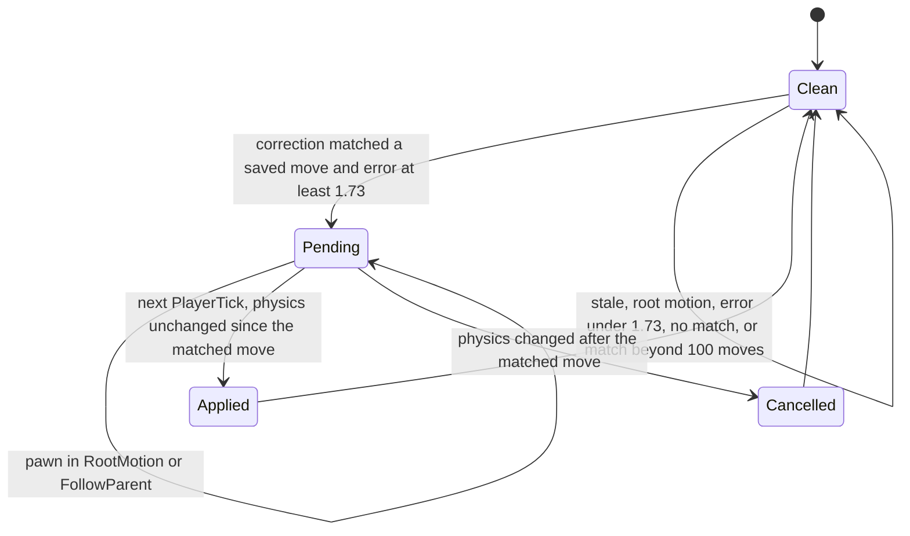
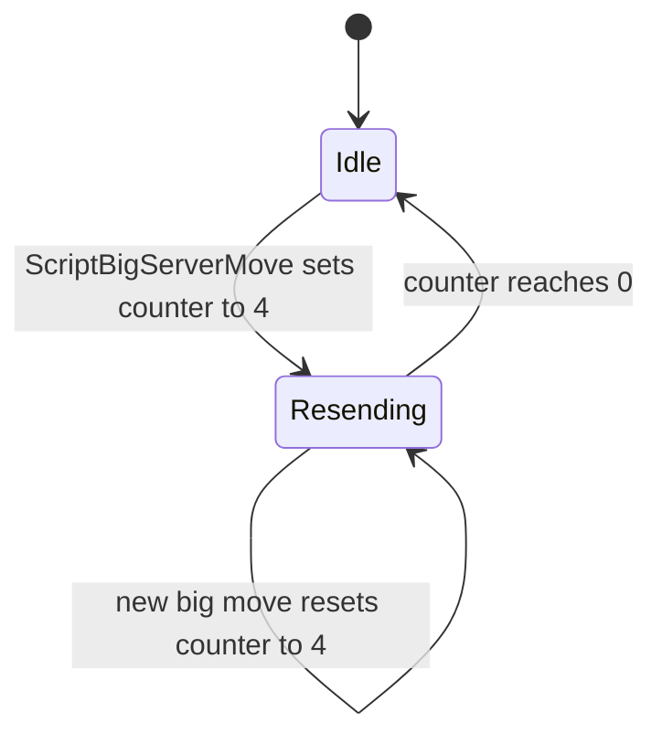

# Movement protocol: saved moves, server moves and corrections

Units: uc:SBase.SPlayerController:PlayerMove, uc:SBase.SPlayerController:PlayerTick, uc:SBase.SPlayerController:MyProcessMove, uc:SBase.SPlayerController:ScriptMyProcessMove, uc:SBase.SPlayerController:s_PlayerJump.MyProcessMove, uc:SBase.SPlayerController:s_BaseSpectating.MyProcessMove, uc:SBase.SPlayerController:BaseSpectating.MyProcessMove, nat:SBase.SPlayerController.MyReplicateMove, nat:SBase.SPlayerController.MyReplicateMoveWithoutMoving, nat:SBase.SPlayerController.MyServerMove, uc:SBase.SPlayerController:ScriptMyServerMove, uc:SBase.SPlayerController:MyShortServerMove, uc:SBase.SPlayerController:ScriptMyShortServerMove, nat:SBase.SPlayerController.MyServerMoveWithPCRot, uc:SBase.SPlayerController:ScriptMyServerMoveWithPCRot, nat:SBase.SPlayerController.BigServerMove, uc:SBase.SPlayerController:ScriptBigServerMove, nat:SBase.SPlayerController.UnreliableReplicateBigServerMove, uc:SBase.SPlayerController:ScriptUnreliableReplicateBigServerMove, uc:SBase.SPlayerController:ReplicateActionToServer, uc:SBase.SPlayerController:ReplicateActionToServerWithVelocity, uc:SBase.SPlayerController:ServerSetWallJumpDir, uc:SBase.SPlayerController:ServerSetInfoForVandamme, uc:SBase.SPlayerController:ServerGetZipP, uc:SBase.SPlayerController:ServerGetNewZipP, uc:SBase.SPlayerController:ServerGetZipPAndNormal, uc:SBase.SPlayerController:ServerSetVelocityAndOrientationForBlast, uc:SBase.SPlayerController:ServerSetVelocityForDyingPawn, uc:SBase.SPlayerController:MyVeryShortClientAdjustPosition, uc:SBase.SPlayerController:MyShortClientAdjustPosition, uc:SBase.SPlayerController:MyClientAdjustPosition, uc:SBase.SPlayerController:MyLongClientAdjustPosition, uc:SBase.SPlayerController:ScriptMyShortClientAdjustPosition, uc:SBase.SPlayerController:ScriptMyClientAdjustPosition, uc:SBase.SPlayerController:ClientUpdatePosition, uc:SBase.SPlayerController:CleanOutSavedSMoves, uc:SBase.SPlayerController:MyFalling, uc:SBase.SPlayerController:MyNotifyLanded, uc:SBase.SPlayerController:UpdatePositionForServer, uc:SBase.SPlayerController:UpdateDesiredRotation, uc:SBase.SPlayerController:UpdateRotationAttaquant_Mouse, uc:SBase.SPlayerController:UpdateRotationDefenseur, uc:SBase.SPlayerController:Possess, uc:SBase.SPlayerController:UnPossess, uc:SBase.SPlayerController:ClientRestart, nat:SBase.SBasePawn.CompressActions, nat:SBase.SBasePawn.UnCompressActions, nat:SBase.SBasePawn.MovePawn, nat:SBase.SBasePawn.NativeExecuteReceivedActionForServer, uc:SBase.SBasePawn:SendActions, uc:SBase.SBasePawn:ChangeEnumAction, uc:SBase.SBasePawn:SendZipPToServer, uc:SBase.SBasePawn:SendNewZipPToServer, uc:SBase.SBasePawn:SendZipPAndNormalToServer, uc:SBase.SBasePawn:SetWallJumpDir, uc:SBase.SBasePawn:SetInfoForVandamme, uc:SBase.SBasePawn:SetVelocityAndOrientationForBlast, uc:SBase.SBasePawn:SetVelocityForDyingPawn, def:SBase.SSavedMove, rep:SBase.SPlayerController.UpdatePositionForServer, rep:SBase.SPlayerController.MyVeryShortClientAdjustPosition, rep:SBase.SPlayerController.MyShortClientAdjustPosition, rep:SBase.SPlayerController.MyClientAdjustPosition, rep:SBase.SPlayerController.MyLongClientAdjustPosition, rep:SBase.SPlayerController.UpdateDesiredRotation, rep:SBase.SPlayerController.MyServerMove, rep:SBase.SPlayerController.UnreliableReplicateBigServerMove, rep:SBase.SPlayerController.MyShortServerMove, rep:SBase.SPlayerController.MyServerMoveWithPCRot, rep:SBase.SPlayerController.ReplicateActionToServer, rep:SBase.SPlayerController.ReplicateActionToServerWithVelocity, rep:SBase.SPlayerController.ServerSetWallJumpDir, rep:SBase.SPlayerController.ServerSetInfoForVandamme, rep:SBase.SPlayerController.ServerGetZipP, rep:SBase.SPlayerController.ServerGetNewZipP, rep:SBase.SPlayerController.ServerGetZipPAndNormal, rep:SBase.SPlayerController.ServerSetVelocityAndOrientationForBlast, rep:SBase.SPlayerController.ServerSetVelocityForDyingPawn, rep:SBase.SPlayerController.BigServerMove, rep:SBase.SPlayerController.MyDesiredRotation, eng:ASPlayerController::RealReplicateMove

## Purpose

How a remote player's movement gets from the client to the server and back: the client moves
itself every frame and remembers each move, the server re-runs the move from the client's input,
and when the two disagree the server sends a correction that the client applies as an offset. The
SCCT protocol replaces stock UE2 `ServerMove`/`ClientAdjustPosition` with its own set
(`MyServerMove`, `MyShortServerMove`, `MyServerMoveWithPCRot`, `BigServerMove` and its unreliable
resends, `MyShortClientAdjustPosition`, `MyClientAdjustPosition`) and carries pawn actions and
traversal data alongside. The client-side move building and the server-side move processing are
native; their script-visible contract is specified here, and their insides are now decoded in
`spec/native/net-moves.md` (summarised in rules 3, 7, 9 and 10). The correction side is script and is
specified exactly. Forced resynchronisation
(`ClientReinitPawnBecauseOfDivergences`) and state mirroring are in `state-sync.md`.

## Data

`SPlayerController` (types from `SBase/SPlayerController.uc`, defaults from
`def:SBase.SPlayerController`; unlisted numbers default to 0):

| Field | Type | Default | Role |
|---|---|---|---|
| `FirstSMove`, `LastSMove` | SSavedMove | None | Head and tail of the saved-move list (client). |
| `UpdatingSMove` | SSavedMove | None | Saved move matched by the last correction. |
| `vUpdateLocation`, `vUpdateVelocity` | Vector | 0 | Pending correction (client). |
| `aUpdateBase` | Actor | None | Base named by the pending correction. |
| `BSMS` | BigServerMoveStruct | zero | Last big move: kept for resends (client); on the server the resend form copies the whole struct into it and the reliable form stores only `BSMS.TimeStamp` (net-moves.md rule 13). |
| `NumberOfBigServerMoveToReSend` | byte | 0 | Remaining unreliable resends of `BSMS`; set to `C_MaxBSMReSend` = 4. |
| `BigServerMoveLastActionTime` | float | 0 | Native use. |
| `PendingDiversInfo`, `ePendingPhysics`, `fPendingDeltaTime`, `vPendingAccel` | byte, EPhysics, float, Vector | 0 | Native pending-move state. |
| `fLastMovementTime` | float | 0 | Time stamp of the last move sent (client) or received short move (server). |
| `vOldAccel` | Vector | 0 | Acceleration of the last move sent (client) or 0 after a short move (server). |
| `fLastTimeOnAMover` | float | -3.0 | Last time the pawn stood on a mover; no script writes it. |
| `MirrorStateAcknowledgementTime` | float | 0 | Epoch token, see `state-sync.md`. |
| `lastCameraReplicationPositionTime` | float | 0 | Cadence of `UpdatePositionForServer`. |
| `MyDesiredRotation`, `LocalMyDesiredRotation`, `LastDesiredRotationUpdate` | Rotator, Rotator, float | 0 | Aim sent to the server. |
| `NumberOfSavedPos` (const) | | 100 | Saved-move walk limit. |
| `C_MaxBSMReSend` (const) | | 4 | Big move resend count. |

From `PlayerController`: `CurrentTimeStamp`, `ServerTimeStamp`, `LastUpdateTime`, `TimeMargin`
(float, 0), `ClientUpdateTime` (-10.0), `MaxResponseTime` (0.7), `MaxTimeMargin` (0.35),
`bUpdatePosition`, `bUpdating` (bool).

`BigServerMoveStruct` (108 bytes): `MSATime`, `TimeStamp` (float); `View`, `Val0`, `Val1`,
`iDiversInfos` (int); `InAccel`, `ClientLoc`, `Vel`, `ZipP1`, `DifZipP2`, `vect3`, `vectUnit`
(Vector).

`SSavedMove` (extends Info, native, class `RemoteRole` None, so client-local): `SavedLocation`
(Vector), `ZoneConfig` (byte), `SavedPhysics` (EPhysics), `TimeStamp` (float), `NextMove`
(SSavedMove).

`SBasePawn`: `bActionsSendByServerMove`, `bActionsHasBeenSentByServerMove`,
`bActionsSendWithVelocity` (bool); `iNbAction`, `iNbActionInTable`, `iNbActionsSent`, `sAction`
(int); `AllActions[6]` (int); `fTimeOfLastActionChange` (float); `ZipP1`, `ZipP2`, `NewZipP1`,
`NewZipP2`, `m_geoNormal`, `vVandammePos`, `vWallJumpDir` (Vector); `fLastRootMotionTimeCalled`
(float); `SpecialYaw` (int); `ZoneConfig` (byte). `Mover.fLastTimeMoverMoves` (float, default
-1.0; no script writes it).

## Rules

### Client frame

1. **Order inside `PlayerTick`** (global version; most states keep the tail order): input and control
   variables are computed natively; then, if `bUpdatePosition`, `ClientUpdatePosition()` runs (rule
   20); then `PlayerMove(DeltaTime)`; then chat updates; then, if more than 0.14 s passed since
   `lastCameraReplicationPositionTime`, the time is stored and
   `UpdatePositionForServer(Location, Rotation)` is sent (rule 17).
2. **PlayerMove.** Nearly every state's `PlayerMove` (197 state overrides) computes the new
   acceleration and then calls `MyReplicateMove(DeltaTime, NewAccel)` when `Role < ROLE_Authority`
   (a remote client) or `MyProcessMove(DeltaTime, NewAccel)` otherwise (standalone, the listen host's
   own player). The global version also calls `UpdateRotation(DeltaTime, 1.0)` for spies, clears
   `bPressedJump`, and passes a zero acceleration. `MyProcessMove` sets `Pawn.Acceleration = newAccel`
   (the `s_PlayerJump` and spectating overrides do the same).
3. **MyReplicateMove** (native 1391, client only; contract). Per frame it:
   - records a saved move (`TimeStamp`, `SavedLocation`, `SavedPhysics`, `ZoneConfig`) and links it at
     `LastSMove`;
   - moves the pawn locally for `DeltaTime` with the given acceleration (through
     `ScriptMyProcessMove` then physics);
   - merges frames and sends one of the messages of rule 4 (decoded, net-moves.md rules 1 to 5):
     - frames merge into a pending move only while reliable data is unacknowledged: the window is
       `0.09 x min(1, unacked reliable bunches / maxAcceptableUnAckBunch)` seconds (0 with no backlog, so
       every frame is sent), and only with the same physics and `DiversInfos` and no actions waiting; a
       merged move carries the time-weighted mean acceleration;
     - the message: a big move when actions wait (`bActionsSendByServerMove` and `iNbAction > 0`); nothing
       in `PHYS_RootMotion` or `PHYS_FollowParent` (the saved move is kept); the PCRot form in
       `PHYS_Vandamme`, in a back-to-wall fire pose and in a hand-over-hand fire pose (with `View` from the
       controller's yaw); the full move with a non-zero acceleration (`InAccel = Accel x 10`); the short move
       with zero acceleration only every other call (`ShortMoveToggle`);
     - one saved move per send, not per frame: new ones until 100, then the list becomes a ring and the oldest
       is overwritten in place; moves are never freed;
   - while `NumberOfBigServerMoveToReSend > 0`, also sends `UnreliableReplicateBigServerMove(BSMS)` when the
     counter is below 4, then decrements it: a big move sets it to 4, so its three resends ride on the second,
     third and fourth sends after it.
   The time stamp is the client's `Level.TimeSeconds` (decoded; a flushed pending move uses
   `Level.TimeSeconds - DeltaTime`, a physics split `Level.TimeSeconds - LeftTime`). The old-move pair is
   attached when `OldTimeDelta = trunc((TimeStamp - fLastMovementTime) x 2000)` is below 256 (0.5 ms units);
   `OldAccel` packs the old acceleration X and Y as 14-bit magnitudes in 4 uu/s^2 steps with sign bits and Z
   in 7 bits of 2 uu/s^2 (net-moves.md rule 10).
4. **Messages from client to server**, each an RPC on the player controller:

   | Message | Reliability | Parameters | Sent by |
   |---|---|---|---|
   | `MyServerMove` (native) | unreliable | TimeStamp, InAccel (Vector), ClientLoc (Vector), View (int), DiversInfos (byte), optional OldTimeDelta (byte), OldAccel (int) | `ScriptMyServerMove` |
   | `MyShortServerMove` (script) | unreliable | TimeStamp, ClientLoc, View, DiversInfos, optional OldTimeDelta, OldAccel | `ScriptMyShortServerMove` |
   | `MyServerMoveWithPCRot` (native, Reloaded thunk) | unreliable | as `MyShortServerMove` | `ScriptMyServerMoveWithPCRot` |
   | `BigServerMove` (native) | reliable | MSATime, TimeStamp, InAccel, ClientLoc, Vel (Vector), View, DiversInfos, Val0, Val1 (int) | `ScriptBigServerMove` |
   | `UnreliableReplicateBigServerMove` (native) | unreliable | BigServerMoveStruct | `ScriptUnreliableReplicateBigServerMove` |
   | `ReplicateActionToServer` | reliable | BSTTime, MSATime (float), Val0, Val1 (int) | `SBasePawn.SendActions` |
   | `ReplicateActionToServerWithVelocity` | reliable | as above plus Vel (Vector, velocity ×100) | `SBasePawn.SendActions` |
   | `ServerSetWallJumpDir`, `ServerSetInfoForVandamme`, `ServerGetZipP`, `ServerGetNewZipP`, `ServerGetZipPAndNormal`, `ServerSetVelocityAndOrientationForBlast`, `ServerSetVelocityForDyingPawn` | reliable | rule 14 | pawn helpers |
   | `UpdateDesiredRotation` | unreliable | Rotator | rule 18 |
   | `UpdatePositionForServer` | unreliable | Vector, Rotator | rule 17 |

5. **ScriptMyServerMove** (client): `fLastMovementTime = TimeStamp`, `vOldAccel = InAccel`, then
   `MyServerMove` with or without the old-move pair according to `bSendOldMove`.
   **ScriptMyShortServerMove** (client): sends `MyShortServerMove` with or without the old-move pair.
   **ScriptMyServerMoveWithPCRot** (client): `fLastMovementTime = TimeStamp`, `vOldAccel = 0`, then
   `MyServerMoveWithPCRot` with or without the old-move pair. The short and PCRot forms carry no
   acceleration.
6. **ScriptBigServerMove** (client), in this order:
   1. `SBPawn.CompressActions(Val0, Val1, Action1..Action6, NbAction)` packs up to six action codes
      and their count into two ints; `SBPawn.iNbActionsSent = NbAction`.
   2. Send `BigServerMove(MirrorStateAcknowledgementTime, TimeStamp, InAccel, ClientLoc, Vel, View,
      DiversInfos, Val0, Val1)`.
   3. Fill `BSMS`: `MSATime` = the acknowledgement time, `TimeStamp`, `View`, `Val0`, `Val1`,
      `iDiversInfos = DiversInfos`, `InAccel`, `ClientLoc`, `Vel`.
   4. Fill the traversal part of `BSMS` from k = `DiversInfos >> 4` (the physics mode, rule 7):
      - k = 11 (`PHYS_Repositionnal`): `ZipP1 = NewZipP1`, `DifZipP2 = ZipP2 - NewZipP1`,
        `vect3 = vVandammePos`, `vectUnit = m_geoNormal × 1000`.
      - k = 10 (`PHYS_Vandamme`): `ZipP1 = 0`, `DifZipP2 = 0`, `vect3 = vVandammePos`,
        `vectUnit = vWallJumpDir × 1000`.
      - k in {6, 7, 9, 13, 14} (`PHYS_OnPipe`, `PHYS_Linear`, `PHYS_Ledge`, `PHYS_OnLadder`,
        `PHYS_OnPipeH`): `ZipP1 = NewZipP1`, `DifZipP2 = NewZipP2 - NewZipP1`, `vect3 = 0`,
        `vectUnit = 0`.
      - otherwise all four are 0.
   5. `NumberOfBigServerMoveToReSend = 4`.
   The reliable `BigServerMove` itself carries no traversal vectors; only the unreliable resends of
   `BSMS` do. Traversal end points also travel separately in the reliable helpers of rule 14.
7. **DiversInfos.** One byte per move: `Physics << 4 | (bPressedJump ? 8 : 0) | speed | ZoneConfig`
   (decoded, net-moves.md rule 9). The high four bits hold the pawn's physics mode (`EPhysics` 0..15; the
   mode values in rule 6 are the ones with a payload); bits 0 and 1 the zone config; bit 2 a merc's
   `bIsCharging`; bit 3 the jump. A spy's adrenaline flag (`AdrenalineTime + fTimeWhenHit >= TimeSeconds`)
   is written as 1, into the zone bits, not bit 2, in the original. OpenSCCT writes it into bit 2 (a fix, see
   net-moves.md Edge cases). The server checks the physics nibble against
   its own pawn and never switches its pawn into the client's mode. `PHYS_Flying` (16) does not fit in four
   bits; pawns do not use it.
8. **Actions.** Pawn actions are animation and behaviour codes (0..328, the `SA_*` constants of
   `SBasePawn`). They are generated only where the pawn's controller exists and is not a remote
   player's: the owning client, the listen host's own player, and AI on the server.
   `ChangeEnumAction(Action, bForce)`:
   1. returns when the pawn has no controller (every non-owning client), or when
      `Controller.RemoteRole == ROLE_AutonomousProxy` (the server for a remote player: the server never
      generates actions for remote players, it only replays theirs);
   2. if `Action` differs from `sAction` or `bForce`: `sAction = Action`; `ExecuteAction(Action)`
      (native, Reloaded thunk); if more than 0.06 s passed since `fTimeOfLastActionChange` and all
      queued actions were sent (`iNbActionsSent >= iNbActionInTable`), the queue restarts
      (`iNbActionInTable = 0`, `fTimeOfLastActionChange = Level.TimeSeconds`); if fewer than 6 are
      queued, `AllActions[iNbActionInTable] = Action`, `iNbAction += 1`, `iNbActionInTable += 1`.
   A seventh action within one window is executed locally but not queued.
9. **SendActions** (event, called natively once per frame after the move, inferred): if
   `iNbAction > 0` and the pawn has a controller and `bActionsHasBeenSentByServerMove` is false, it
   compresses `AllActions[0..5]` with count `iNbActionInTable` and sends
   `ReplicateActionToServerWithVelocity(Level.TimeSeconds, MSA, Val0, Val1, Velocity × 100)` when
   `bActionsSendWithVelocity`, else `ReplicateActionToServer(Level.TimeSeconds, MSA, Val0, Val1)`;
   then `iNbActionsSent = iNbActionInTable`, `iNbAction = 0`. In every case it clears
   `bActionsSendByServerMove`, `bActionsHasBeenSentByServerMove` and `bActionsSendWithVelocity`. The
   native move code sets `bActionsHasBeenSentByServerMove` (and `iNbAction = 0`) when it put the actions into a
   `BigServerMove` (decoded, net-moves.md rule 3.5). `CompressActions` packs `a1 | a2 << 9 | a3 << 18 |
   count << 27` and `a4 | a5 << 9 | a6 << 18` (9-bit codes, 3-bit count; the top bits unset, a port writes 0).

### Server side

10. **Server move processing** (natives 1390, 1392, 1393, 1686; decoded in net-moves.md rules 11 to 15, game
    0x10aac4a0). For a received move the server:
    1. ignores it while `bWaitingForReinit`, without a pawn, or when `TimeStamp <= CurrentTimeStamp`;
    2. applies an attached old move first (same physics, its stamp newer than `CurrentTimeStamp + 0.001`) for
       at most `MaxResponseTime`;
    3. takes `DeltaTime = min(MaxResponseTime, TimeStamp - CurrentTimeStamp)` (0.7 s cap) and runs the
       time-margin guard (`TimeMargin` against `MaxTimeMargin` 0.35, raised to 0.5 after a trip; a tripped move
       is not simulated);
    4. sets the controller rotation from `View` (`Pitch = 2 x (View / 32768)`, `Yaw = 2 x (View mod 32768)`);
    5. compares the client's physics nibble with its pawn: on a mismatch nothing is applied, and after 3 s of
       continuous mismatch with a living pawn it raises `ReinitPawnBecauseOfDivergences`;
    6. caps the ground speed (walking or falling: `|a| / 3000 x RunningSpeed`, at most 423.5, 603.2 rolling,
       times `AdrenalineFactor` with the speed flag; a merc 346.5, 770 charging; `PHYS_Linear` uncapped);
    7. sets `iYawPitchFromView = PackW(Yaw, Pitch)` and the pawn's yaw (pitch 0), then simulates the move
       through `ScriptMyProcessMove` and the pawn's physics (acceleration truncated to whole units);
    8. corrects (net-moves.md rule 12): forced after 1.0 s since `LastUpdateTime`; otherwise not before
       `180 / CurrentNetSpeed` s since `LastUpdateTime` nor 0.3 s since `ClientUpdateTime`, and only when the
       squared error exceeds 3 (1.73 uu); Z is ignored on a vertically moving mover and in `PHYS_OnPipeH` and
       `PHYS_Linear`; the short form `ScriptMyShortClientAdjustPosition` when the server pawn's velocity is
       zero, else `ScriptMyClientAdjustPosition`; none in `PHYS_FollowParent`;
    9. after a correction with squared error above 160000 (400 uu), a living pawn and not both sides walking,
       raises `ReinitPawnBecauseOfDivergences` (`state-sync.md`).
    Big moves (rule 13 of net-moves.md) are accepted only when `trunc(MSATime -
    MirrorStateAcknowledgementTime)` is 0 (within 1 s, where the action RPCs use 0.01 s) and newer than
    `BigServerMoveLastActionTime`; their actions are executed, the server snaps its pawn to `ClientLoc` when
    within 100 uu, and the resend form applies the traversal payload (`ZipP*`, `NewZipP*`, `vVandammePos`,
    `vWallJumpDir`, `m_geoNormal`) by the pawn's new physics.
11. **MyShortServerMove** (script, runs on the server): `fLastMovementTime = TimeStamp`;
    `vOldAccel = 0`; if `OldTimeDelta == 0` call `MyServerMove(TimeStamp, 0, ClientLoc, View,
    DiversInfos)`, else `MyServerMove(TimeStamp, 0, ClientLoc, View, DiversInfos, OldTimeDelta,
    OldAccel)`. On the server the condition of `MyServerMove` (`Role < ROLE_Authority`) is false, so
    the native runs locally.
12. **ReplicateActionToServer(BSTTime, MSATime, Val0, Val1)** (server): only when
    |`MSATime` - `MirrorStateAcknowledgementTime`| < 0.01:
    1. `NativeExecuteReceivedActionForServer(Val0, Val1)`;
    2. if `BSTTime < BSMS.TimeStamp` (a newer big move already arrived):
       `NativeExecuteReceivedActionForServer(BSMS.Val0, BSMS.Val1)` again, and if the pawn is in
       `PHYS_RootMotion`, `SpecialYaw = int(BSMS.Vel.X / 100)`.
13. **ReplicateActionToServerWithVelocity(BSTTime, MSATime, Val0, Val1, Vel)** (server): same gate;
    execute `Val0`/`Val1`; if the pawn is not in `PHYS_RootMotion` set `Velocity = 0.01 × Vel`, else
    `SpecialYaw = int(Vel.X / 100)`; then if `BSTTime < BSMS.TimeStamp` execute `BSMS.Val0`/`Val1`
    and apply `BSMS.Vel` the same way. In root motion the client therefore carries the special yaw in
    the X component of the scaled velocity.
14. **Traversal and impulse helpers** (reliable, client to server). The client calls them only when
    `Role < ROLE_Authority` and the pawn has a controller; the server applies them without checks:

    | Client helper | Sent | Server effect |
    |---|---|---|
    | `SetWallJumpDir(wallDir)` | `ServerSetWallJumpDir(wallDir × 1000)` | `vWallJumpDir = wallDir × 0.001` |
    | `SetInfoForVandamme(wallDir)` | `ServerSetInfoForVandamme(vVandammePos, wallDir × 1000)` | `vVandammePos = vPos`, `vWallJumpDir = wallDir × 0.001`, `fLastRootMotionTimeCalled = Level.TimeSeconds` |
    | `SendZipPToServer()` (event; also sets `NewZipP1/2 = ZipP1/2` locally) | `ServerGetZipP(ZipP1, ZipP2)` | `ZipP1`, `ZipP2`, `NewZipP1`, `NewZipP2` set |
    | `SendNewZipPToServer()` | `ServerGetNewZipP(NewZipP1, NewZipP2)` | `NewZipP1`, `NewZipP2` set |
    | `SendZipPAndNormalToServer()` (also sets `NewZipP1/2` locally) | `ServerGetZipPAndNormal(ZipP1, ZipP2, m_geoNormal × 1000)` | `NewZipP1/2` and `ZipP1/2` set, `m_geoNormal = Normal × 0.001` |
    | `SetVelocityAndOrientationForBlast(speed)` | `ServerSetVelocityAndOrientationForBlast(100 × speed)` | `PHYS_Falling`, `Velocity = speed × 0.01`, rotation faces against the horizontal direction |
    | `SetVelocityForDyingPawn(speed)` | `ServerSetVelocityForDyingPawn(100 × speed)` | `PHYS_Falling`, `Velocity = speed × 0.01` |

    The client also applies the value locally (`vWallJumpDir = wallDir`, `Velocity = speed`). End
    points (`ZipP1`, `ZipP2`) are sent unscaled, so they arrive rounded to whole units (model rule 11).
    The script performs no validation of client-proposed attach points; the rewrite's GE check is an
    addition (record it as such in its spec). The rewrite's check (`GEPointCheck`, docs/NETCODE.md): a point
    that arrives within rounding (half a unit per axis) of a point of one of the map's GEs is replaced by that
    exact point, for `ServerGetZipP`, `ServerGetNewZipP`, `ServerGetZipPAndNormal` and the big move resend's
    payload; other points are kept as they arrived.
15. **Mid-frame physics changes.** When the client's pawn starts falling, `MyFalling(LeftTime)` calls
    `MyReplicateMoveWithoutMoving(LeftTime, Pawn.Acceleration)` if `Role < ROLE_Authority` and
    `bActionsSendByServerMove` is false; on landing `MyNotifyLanded(HitNormal, fTimeLeft, LandedOn)`
    calls it if `Role < ROLE_Authority`. The native sends the part of the frame already simulated
    before the change (`Level.m_dT - LeftTime`, stamped `Level.TimeSeconds - LeftTime`), so the server splits
    the move at the same point (decoded, net-moves.md rule 6). Eight states
    override `MyFalling` and fifteen ignore it.
16. **Listen host.** The host's own player never sends moves: its `PlayerMove` calls `MyProcessMove`,
    and none of this file's corrections apply to it.

### Aim and camera

17. **UpdatePositionForServer(NewLocation, NewRotation)** (unreliable, client to server): the server
    does `SetLocation(NewLocation)` and `SetRotation(NewRotation)` on the player controller. This keeps
    the server's copy of the camera position (the relevancy viewer, model rule 12) in step with the
    client's third-person camera. Sent at most every 0.14 s from the global `PlayerTick`, every frame
    from the spectator `PlayerTick`.
18. **UpdateDesiredRotation(Rot)** (unreliable, client to server): server sets `MyDesiredRotation =
    Rot`. Mouse aim (`UpdateRotationAttaquant_Mouse`, also used by the merc through
    `UpdateRotationDefenseur_Mouse`) adds `fTurnValue × ratio × fSensibiliteSouris × dt × 50` to yaw
    and the same with `fLookUpValue` to pitch (ratio 0.5 with binoculars, else 1), normalises, clamps
    pitch to [-12000, 13000], sets the controller rotation and sends every call. The merc pad camera
    (`UpdateRotationDefenseur`) sends when the rotation changed or 0.2 s passed. The other call sites
    (33 calls in total in SBase script) send once when a state or the camera resets the aim. `MyDesiredRotation` is also replicated to the owner once, in the first
    bunch.

### Corrections on the client

19. **Correction entry points.** The server's corrections arrive as `MyShortClientAdjustPosition(
    TimeStamp, X, Y, Z, NewBase)` or `MyClientAdjustPosition(TimeStamp, X, Y, Z, VelX, VelY, VelZ,
    NewBase)` (both unreliable, floats exact). Each reads `Pawn.Floor` into an unused local and calls
    `MyLongClientAdjustPosition(TimeStamp, X, Y, Z, VelX, VelY, VelZ, NewBase, SBPawn.ZoneConfig)`
    with zero velocity for the short form. On the client the condition of `MyLongClientAdjustPosition`
    is false, so it runs locally; it is never sent over the network. `MyVeryShortClientAdjustPosition`
    has no caller in script or in the executable's name table: it is dead.
20. **MyLongClientAdjustPosition** (client), exactly:
    1. If `CurrentTimeStamp > TimeStamp`, return (stale). Else `CurrentTimeStamp = TimeStamp`.
    2. `NewLocation = (X, Y, Z)`, `NewVelocity = (VelX, VelY, VelZ)`, `fErrorMax = 1.73`.
    3. If the pawn exists and is in `PHYS_RootMotion` (5), return (the stamp stays updated).
    4. `UpdatingSMove = None`, `BeforeMove = None`, `i = 0`; walk from `FirstSMove`:
       - if the move's `TimeStamp == CurrentTimeStamp` (exact float equality):
         a. if `NewBase` is a mover with `Level.TimeSeconds - NewBase.fLastTimeMoverMoves < 3.0`, or the
            pawn's current base is a mover with `Level.TimeSeconds - Base.fLastTimeMoverMoves < 3.0`,
            then `NewLocation.Z = move.SavedLocation.Z`;
         b. if the pawn is in `PHYS_Falling` and `Level.TimeSeconds - fLastTimeOnAMover < 3.0`, then
            `NewLocation.Z = move.SavedLocation.Z`;
         c. if |`move.SavedLocation` - `NewLocation`| < 1.73, return (accepted, no correction);
         d. `UpdatingSMove = move`; stop the walk.
       - else `BeforeMove = move`, `i += 1`, go to `move.NextMove`; stop when `i > 99`.
    5. If `i > 99`, return (no correction when the match is beyond 100 moves).
    6. `vUpdateLocation = NewLocation`, `vUpdateVelocity = 0`.
    7. If the pawn is falling and `BeforeMove` is set: `dt = TimeStamp - BeforeMove.TimeStamp`; if
       `dt > 0`, `vUpdateVelocity = NewVelocity - (UpdatingSMove.SavedLocation -
       BeforeMove.SavedLocation) / dt`; then `vUpdateVelocity.Z = 0`.
    8. `aUpdateBase = NewBase`, `bUpdatePosition = true`.
    `NewZoneConfig` is not used. When no saved move matches, step 4 runs off the list with
    `UpdatingSMove` None and the correction is dropped later by rule 21.
21. **ClientUpdatePosition** (client, called from `PlayerTick` when `bUpdatePosition`):
    1. If the pawn is in `PHYS_RootMotion` or `PHYS_FollowParent`, return without clearing
       `bUpdatePosition` (the correction waits and is applied on the first frame out of those modes).
    2. `bUpdatePosition = false`; if `UpdatingSMove` is None, return.
    3. `bUpdating = true`; `PhysicsBefore = UpdatingSMove.SavedPhysics`.
    4. Physics check: if `PhysicsBefore` differs from `LastSMove.SavedPhysics`, the correction is
       cancelled. Otherwise walk from `UpdatingSMove.NextMove` while moves have `TimeStamp >
       CurrentTimeStamp`: a move with a different `SavedPhysics` cancels the correction; stop at
       `LastSMove`.
    5. If not cancelled:
       a. if `aUpdateBase` is a mover with `Velocity.Z != 0`, or the pawn's base is a mover with
          `Velocity.Z != 0`, then `vUpdateLocation.Z = UpdatingSMove.SavedLocation.Z` (no vertical
          correction on a vertically moving lift);
       b. `vDiff = vUpdateLocation - UpdatingSMove.SavedLocation` (server position minus the client's
          position at that time stamp);
       c. remember `Old = Pawn.Location`; `SBPawn.MovePawn(vDiff)` (native: a swept move by the offset,
          teleporting to the target when blocked more than 50 uu short; the base is not changed explicitly;
          net-moves.md rule 16); `vDiff = Pawn.Location - Old` (the offset actually applied);
       d. if falling, `Pawn.Velocity += vUpdateVelocity`;
       e. for every later saved move (`TimeStamp > CurrentTimeStamp`, up to `LastSMove`):
          `SavedLocation += vDiff + vUpdateVelocity × (move.TimeStamp - CurrentTimeStamp)`.
    6. `bUpdating = false`.
    No move is replayed: the correction is a translation of the present position plus a shift of the
    remembered positions, unlike stock UE2. Saved moves are not removed here.
22. **Saved-move list.** Singly linked from `FirstSMove` through `NextMove` to `LastSMove`. One move per
    send; new moves until 100, then a ring that overwrites the oldest in place; never freed (decoded, editor
    0x111e7160, 0x111f2a80; rule 3). Script reads at most 100 entries per
    correction (rule 20). `CleanOutSavedSMoves` (called from `Possess`, `UnPossess` and `ClientRestart`)
    copies `FirstSMove` into a local and then loops while `FirstSMove` is not None and differs from that
    local, so its body never runs: it is a no-op. Port it as a no-op and leave list management to the
    native contract.

## States

Big move resend counter (client):

## Constants

| Name | Value | Unit | Provenance | Source |
|---|---|---|---|---|
| fErrorMax | 1.73 | uu | decoded | uc:SBase.SPlayerController:MyLongClientAdjustPosition |
| NumberOfSavedPos | 100 | moves | decoded | const in `SPlayerController.uc`; walk limit `i > 99` |
| C_MaxBSMReSend | 4 | resends | decoded | const; `ScriptBigServerMove` sets 4 |
| Mover recent-move window | 3.0 | s | decoded | MyLongClientAdjustPosition |
| Recently-on-mover window | 3.0 | s | decoded | MyLongClientAdjustPosition |
| fLastTimeOnAMover default | -3.0 | s | decoded | def:SBase.SPlayerController |
| Mover.fLastTimeMoverMoves default | -1.0 | s | decoded | def:Engine.Mover |
| MSA match tolerance | 0.01 | s | decoded | ReplicateActionToServer, ReplicateActionToServerWithVelocity |
| Action queue window | 0.06 | s | decoded | uc:SBase.SBasePawn:ChangeEnumAction |
| Action queue size | 6 | actions | decoded | `AllActions[6]` |
| Action codes | 0..328 | | decoded | `SA_*` constants, 318 values |
| Camera position interval | 0.14 | s | decoded | PlayerTick |
| Merc pad aim resend | 0.2 | s | decoded | UpdateRotationDefenseur |
| Merc pitch clamp | -12000..13000 | rotator units | decoded | UpdateRotationAttaquant_Mouse |
| Mouse aim scale | 50 | per s | decoded | UpdateRotationAttaquant_Mouse |
| Direction scale | 1000 | factor | decoded | rule 14 |
| Velocity scale | 100 | factor | decoded | rule 14, rule 13 |
| Physics in DiversInfos | high 4 bits | | decoded | ScriptBigServerMove switch |
| Batching window cap | 0.09 x min(1, unacked / 40) | s | decoded | net-moves.md rule 2 |
| Server delta cap (MaxResponseTime) | 0.7 | s | decoded | net-moves.md rule 11.2 |
| Time margin factor, MaxTimeMargin | 1.01; 0.35 (0.5 after a trip) | -, s | decoded | net-moves.md rule 11.3 |
| Server speed caps | 423.5 walk, 603.2 roll, merc 346.5 / 770 charging | uu/s | decoded | net-moves.md rule 11.6 |
| Correction gate | squared error > 3; forced after 1.0 s; gaps 180 / NetSpeed and 0.3 s (PCRot 0.3 / 0.1) | uu^2, s | decoded | net-moves.md rules 12, 14 |
| Reinit thresholds | squared error 160000 after a correction; 3.0 s physics mismatch | uu^2, s | decoded | net-moves.md rules 11.5, 12 |
| Big move gates | epoch within 1.0 s; snap radius 100 | s, uu | decoded | net-moves.md rule 13 |
| MovePawn teleport distance | 50 | uu | decoded | net-moves.md rule 16 |

## Network

| Who | Runs |
|---|---|
| Owning client (autonomous proxy) | `PlayerTick`, `PlayerMove`, `MyReplicateMove`, `ScriptMy*`/`ScriptBigServerMove`, `SendActions`, helpers of rule 14, `MyShort/MyClient/MyLongClientAdjustPosition`, `ClientUpdatePosition`. |
| Server | `MyServerMove`, `MyShortServerMove`, `MyServerMoveWithPCRot`, `BigServerMove`, `UnreliableReplicateBigServerMove`, `ReplicateActionToServer*`, the `Server*` helpers, `UpdateDesiredRotation`, `UpdatePositionForServer`, `ScriptMyClientAdjustPosition`, `ScriptMyShortClientAdjustPosition`. |
| Listen host's player | `MyProcessMove` only. |

All messages are RPCs on the player controller channel (owner only). Reliable: `BigServerMove`,
`ReplicateActionToServer`, `ReplicateActionToServerWithVelocity`, the seven helpers. Unreliable: the
three plain server moves, the big-move resend, the corrections, `UpdateDesiredRotation`,
`UpdatePositionForServer`. Encoding per model rule 11: `InAccel`, `ClientLoc`, `Vel`, `BSMS` vectors
and the zip end points are rounded to integers; correction positions are exact floats; rotators lose
their low 8 bits.

## Edge cases

- Time stamps match by exact float equality; the rewrite must carry the client's float time stamp
  through the server unchanged (no re-quantisation).
- A correction that arrives while the pawn is in root motion is discarded, but `CurrentTimeStamp`
  already moved forward, so older corrections that arrive later are also dropped.
- A correction accepted while in `PHYS_FollowParent` is kept pending and applied later against moves
  recorded before it, possibly long after.
- Physics changing between the matched move and the newest move cancels the correction entirely.
- Rule 20b reads `fLastTimeOnAMover`, which no script writes; with its default -3.0 the rule never
  fires unless native code writes it: no native writes it, so it never fires; `fLastTimeMoverMoves` is
  written by mover physics (`Level.TimeSeconds` while `|Velocity.Z| < 0.1`, byte-checked; game 0x10a21970).
- `MovePawn` may move less than `vDiff` (blocked); later saved moves are shifted by the offset actually
  applied, not the requested one.
- On a lift moving vertically, Z is never corrected (rule 21.5a), and on a mover that moved in the last
  3 s the error test ignores Z (rule 20.4a).
- `ClientUpdatePosition` and `ReinitPawnBecauseOfDivergences` are ignored in
  `s_PlayerFalling_OutOfWorld`.
- A seventh pawn action inside one 0.06 s window runs locally but is never sent.
- If `UpdatingSMove` is None while falling with a `BeforeMove`, rule 20.7 reads None fields (zero in
  script); port as zero.

## Evidence

- Script (decompiled file lines): `local/re-out/uc/SBase/SPlayerController.uc` constants 14 and 23;
  `BigServerMoveStruct` 92-107; replication block 492-518; `PlayerMove` 1228; `MyFalling` 1865;
  `MyNotifyLanded` 4903; `ScriptMyServerMove` 6087; `ScriptBigServerMove` 6101; `ReplicateActionToServer`
  6152; helpers 6168-6219; `ReplicateActionToServerWithVelocity` 6221; adjust functions 6258-6380;
  `MyShortServerMove` 6394; `ScriptMyServerMoveWithPCRot` 6408; `ClientUpdatePosition` 6430;
  `UpdatePositionForServer` 7784; `CleanOutSavedSMoves` 7824 (raw tokens confirmed with `ucdecomp dis`);
  global `PlayerTick` tail 3545-3555; `UpdateRotationAttaquant_Mouse` 2433; `UpdateRotationDefenseur`
  2526. `SBase/SBasePawn.uc`: `SendActions` 2702, `ChangeEnumAction` 2729, helpers 2390-2460.
  `SBase/SSavedMove.uc`.
- Natives (game address from the reflection dump, editor address from guard names): `MyReplicateMove`
  1391 at 0x10aad5c0 (editor `execMyReplicateMove` 0x111f3000, `ASPlayerController::RealReplicateMove`
  0x111f2a80); `MyReplicateMoveWithoutMoving` 1361 at 0x10aae310 (editor 0x111f3450); `MyServerMove`
  1390 at 0x10aacec0 (editor 0x111efe80); `MyServerMoveWithPCRot` 1392 thunk in `Reloaded.Core.dll`
  (0x64773870 in the capture; the original exe body is at 0x10aaec30, editor 0x111f0ba0);
  `BigServerMove` 1393 at 0x10aae660 (editor 0x111f06e0); `UnreliableReplicateBigServerMove` 1686 at
  0x10ab1670 (editor 0x111f1930); `CompressActions` 1823 at 0x10ac20e0 (editor 0x111fa7f0);
  `UnCompressActions` 1824 at 0x10ac2290 (editor 0x111fa990); `MovePawn` 1402 at 0x10ae2da0 (editor
  0x111fe4a0); `NativeExecuteReceivedActionForServer` 1410 at 0x10ae4030 (editor 0x1121dba0);
  `ExecuteAction` 1411 Reloaded thunk (exe body 0x10ad6800).
- The executable's name table registers the events native code raises: `ScriptMyProcessMove`,
  `ScriptMyShortClientAdjustPosition`, `ScriptMyClientAdjustPosition`, `ScriptMyServerMove`,
  `ScriptBigServerMove`, `ScriptMyShortServerMove`, `ScriptMyServerMoveWithPCRot`,
  `ScriptUnreliableReplicateBigServerMove`, `SendActions`, `MyFalling`, `MyNotifyLanded`,
  `ReinitPawnBecauseOfDivergences` (`local/reloaded_strings/game_exe.txt` lines 12349-12422), and not
  `MyVeryShortClientAdjustPosition` or `MyLongClientAdjustPosition`.
- Field offsets for Ghidra searches (game reflection): `SPlayerController.FirstSMove` 1548,
  `LastSMove` 1552, `UpdatingSMove` 1544, `BSMS` 1636, `NumberOfBigServerMoveToReSend` 3119,
  `ePendingPhysics` 3120, `PendingDiversInfo` 3121, `fPendingDeltaTime` 2484, `vPendingAccel` 2368,
  `MirrorStateAcknowledgementTime` 2464, `fLastTimeOnAMover` 2976; `PlayerController.CurrentTimeStamp`
  1332, `ServerTimeStamp` 1340; `Mover.fLastTimeMoverMoves` 1072.

## Open questions

None left from the native study for the move protocol. Trace still useful: a localhost UDP capture between two
RE+ slots (60 s of walking, standing, a ledge grab and a zip line) with per-frame client `Level.TimeSeconds`, to
check the decoded batching and message choice end to end.

### Resolved

1. **Client message choice, merging, old-move pair, View.** Resolved: frames merge only while reliable data is
   unacknowledged (window up to 90 ms); big move when actions wait; nothing in root motion or follow-parent; PCRot
   for Vandamme, back-to-wall fire and hand-over-hand fire (view from the controller's yaw); full move with a
   non-zero acceleration (x 10); short move every other frame with zero acceleration; `OldTimeDelta` in 0.5 ms
   units (below 256); `OldAccel` 11 + 11 + 7 bits plus signs; `View = (Pitch/2 & 0x7FFF) x 32768 + (Yaw/2 &
   0x7FFF)`. Rule 3. Evidence: net-moves.md rules 1 to 10 (ANSWERS-net move-protocol 1).
2. **Server processing.** Resolved: delta `min(MaxResponseTime, stamp - CurrentTimeStamp)`; time-margin guard;
   physics must match or nothing is applied (3 s mismatch: reinit); correction above 1.73 uu, at most every 0.3 s
   and every `180 / NetSpeed` s, forced after 1 s; short form when the server pawn's velocity is zero; reinit
   after a correction above 400 uu unless both walk. Rule 10. Evidence: net-moves.md rules 11, 12
   (ANSWERS-net move-protocol 2).
3. **DiversInfos low nibble.** Resolved: bits 0..1 zone config, bit 2 merc charging, bit 3 jump; a spy's
   adrenaline flag lands in the zone bits as 1; the server checks the physics nibble and never switches modes.
   Rule 7. Evidence: net-moves.md rule 9 (ANSWERS-net move-protocol 3).
4. **Server-side BSMS, resends, traversal vectors.** Resolved: the resend stores the whole struct in the server's
   `BSMS`, the reliable form only `BSMS.TimeStamp`; big moves older than `BigServerMoveLastActionTime` are
   ignored; the traversal vectors set `ZipP1/2`, `NewZipP1/2`, `vVandammePos`, `vWallJumpDir` or `m_geoNormal`
   by the pawn's physics. Data and rule 10. Evidence: net-moves.md rule 13 (ANSWERS-net move-protocol 4).
5. **Stale MSATime in BigServerMove.** Resolved: dropped, with a 1 s tolerance (`trunc` of the difference must
   be 0), unlike the 0.01 s of the action RPCs. Rule 10. Evidence: game 0x10aae660, 0x10ab1670
   (ANSWERS-net move-protocol 5).
6. **Saved-move lifetime.** Resolved: one per send; spawned until 100, then a ring overwriting the oldest; never
   freed. Rules 3, 22. Evidence: editor 0x111e7160, 0x111f2a80 (ANSWERS-net move-protocol 6).
7. **fLastTimeOnAMover / fLastTimeMoverMoves writers.** Resolved: `fLastTimeOnAMover` has no writer (rule 20.4b
   never fires); `fLastTimeMoverMoves` is written by mover physics while `|Velocity.Z| < 0.1`. Edge cases.
   Evidence: game 0x10a21970; offset search (ANSWERS-net move-protocol 7).
8. **MovePawn.** Resolved: swept move; teleport to the target when blocked more than 50 uu short; base not
   changed explicitly. Rule 21. Evidence: editor 0x111fe4a0 (ANSWERS-net move-protocol 8).
9. **MyServerMoveWithPCRot and Reloaded.** Resolved: like a short move but the pawn's rotation is left alone
   (only the controller and `iYawPitchFromView` follow `View`), no speed cap, quicker corrections (0.3 s / 0.1 s),
   corrected Z in the client's zone config; Reloaded sets `MaxTimeMargin` to infinity during the call. Evidence:
   net-moves.md rules 14, 15 (ANSWERS-net move-protocol 9).
10. **CompressActions layout.** Resolved: `a1 | a2<<9 | a3<<18 | count<<27` and `a4 | a5<<9 | a6<<18`; top bits
    unset. Rule 9. Evidence: editor 0x111f8ad0 (ANSWERS-net move-protocol 10).
