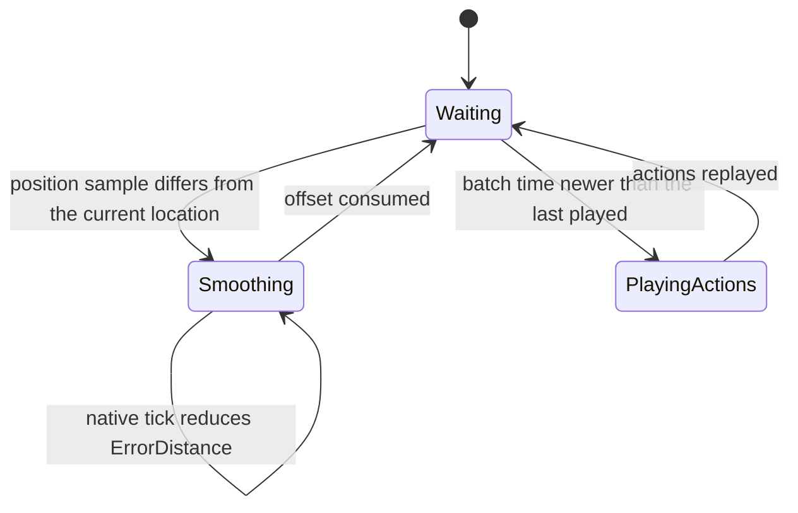

# Other players' pawns: positions, actions and aim on non-owning clients

Units: uc:SBase.SPlayerController:SendPawnActions, uc:SBase.SPlayerController:ClientGetPawnActions, uc:SBase.SPlayerController:ReliableSendPawnPositionAndActions, uc:SBase.SPlayerController:ClientReliableGetPawnPositionAndActions, uc:SBase.SPlayerController:SendPawnPositionAndActions, uc:SBase.SPlayerController:ClientGetPawnPositionAndActions, uc:SBase.SPlayerController:SendPawnPosition, uc:SBase.SPlayerController:ClientGetPawnPosition, uc:SBase.SBasePawn:GetNewActions, uc:SBase.SBasePawn:PostNetBeginPlay, uc:SBase.SBasePawn:TurnHead, uc:SBase.SPAWNDEFENSE:TurnHead, uc:SBase.SBasePawn:ClientPlayLandingSound, uc:SBase.SBasePawn:ServerPlayLandingSound, uc:SBase.SBasePawn:PlayLandingSound, uc:SBase.SBasePawn:DistantClientReinit, nat:SBase.SBasePawn.InitializeBasicActions, nat:SBase.SBasePawn.ClientDistantMoveSmooth, nat:SBase.SBasePawn.ExecuteAction, nat:SBase.SBasePawn.NativeTick, uc:SBase.SBasePawn:Tick, nat:SBase.SPawnAttaque.TickNative, uc:SBase.SPawnAttaque:Tick, uc:SBase.SBasePawn:SetWeaponLoaded, uc:SBase.SBasePawn:EvSetWeaponLoaded, rep:SBase.SPlayerController.ClientGetPawnActions, rep:SBase.SPlayerController.ClientGetPawnPositionAndActions, rep:SBase.SPlayerController.ClientGetPawnPosition, rep:SBase.SPlayerController.ClientReliableGetPawnPositionAndActions, rep:SBase.SBasePawn.ClientPlayLandingSound, rep:SBase.SBasePawn.ServerPlayLandingSound, rep:SBase.SBasePawn.iDesiredYawPitch, rep:SBase.SBasePawn.iYawPitchFromView, rep:SBase.SBasePawn.AllActions, rep:SBase.SBasePawn.iNbActionForDistantClient, rep:SBase.SBasePawn.fRepTimeOfLastActionChange, rep:SBase.SBasePawn.ZoneConfigForClient, rep:SBase.SBasePawn.WeaponLoaded, rep:SBase.SBasePawn.BTW, rep:SBase.SBasePawn.PipHFire, rep:SBase.SBasePawn.IK_Type, rep:SBase.SBasePawn.bBeginSpecial12Anim, rep:SBase.SBasePawn.m_PawnNoMoreGrabbed, rep:Engine.Pawn.PawnPosition, eng:ASBasePawn::IsNetRelevantFor

## Purpose

How a client sees the pawns it does not control (simulated proxies). SCCT does not rely on the
pawn's own channel for the moving parts: the server sends each client the position, velocity,
rotation and recent action codes of every other pawn through RPCs on that client's own player
controller, and the client smooths toward them and replays the actions to drive animation. Aim and
head direction travel as packed yaw and pitch variables on the pawn. This file specifies the
script side of that path; the scheduling and the smoothing are native.

## Data

`SBasePawn` fields used on the receiving client (all 0 or None by default unless stated):

| Field | Type | Meaning |
|---|---|---|
| `PawnPosition` (Pawn) | CompressedPosition | Last received sample: `Location` (×10), `Rotation`, `Velocity`. |
| `ErrorDistance`, `NormErrDist` | Vector | Remaining smoothing offset and its direction. |
| `fSmoothTime` | float | Time since the last position sample. |
| `ReceivedRotation`, `ReceivedVelocity` | Rotator, Vector | Last received rotation and velocity. |
| `AllActions[6]`, `iNbActionForDistantClient` | int | Last action batch and its count. |
| `fRepTimeOfLastActionChange` | float | Server time of that batch. |
| `fOldTimeOfLastActionChange` | float | Default -1.0; batch time already played (native). |
| `ZoneConfigForClient`, `ZoneConfig` | byte | Collision zone configuration of the pawn (crouch, ledge, and so on). |
| `m_AttackedBy`, `m_AttackTarget` | SBasePawn | Grab and attack partners. |
| `SpecialYaw` | int | Yaw used by root-motion actions. |
| `iDesiredYawPitch`, `iYawPitchFromView` | int | Packed aim: low word yaw, high word pitch (`PackW`). |

`CompressedPosition` (Core.Object struct, 36 bytes): `Location` (Vector), `Rotation` (Rotator),
`Velocity` (Vector).

## Rules

1. **Server sends per receiving player.** Native server code raises, on the receiving player's
   controller, one of four simulated events per other pawn and update (decoded, net-proxy.md rules 1 to 5,
   inside the pawn's native property list, per viewer):
   - a sample is forced on a physics change, on a new action batch, at least every 0.7 s, when the pawn stopped,
     or (checked at most every 0.09 s) when dead reckoning from the last sample fails: velocity off by more
     than the square root of 0.2 of the speed, or position off by more than the square root of 30 uu (1 uu when
     still); in `PHYS_RootMotion` and `PHYS_FollowParent` nothing is sent without a forced sample;
   - not forced: `SendPawnActions` while the last action change is under 0.15 s old (batches repeat unreliably
     for 0.15 s);
   - forced: `SendPawnPosition` when the last action change is at least 0.4 s old, else the position goes with
     the actions, reliable (`ReliableSendPawnPositionAndActions`) only for a batch new to that viewer, else
     `SendPawnPositionAndActions`;
   - `iDesiredYawPitch`, `iYawPitchFromView` and `Rotation` go as properties at most every 0.09 s (sooner for a
     yaw change above 1800); the list sets `bCompressedPosition`, so `Location` and `Velocity` never go as
     Actor properties.
   The events:
   - `SendPawnActions(WhichPawn, Val0, Val1, fRepTime, ZoneConfigForClient, Target, AttackedBy,
     iSpecialYaw)` sends `ClientGetPawnActions` with the same arguments (unreliable);
   - `SendPawnPositionAndActions(WhichPawn, CompPosition, ...)` sends
     `ClientGetPawnPositionAndActions` (unreliable);
   - `ReliableSendPawnPositionAndActions(WhichPawn, CompPosition, ...)` sends
     `ClientReliableGetPawnPositionAndActions` (reliable), whose body calls
     `ClientGetPawnPositionAndActions` locally;
   - `SendPawnPosition(WhichPawn, CompPosition)` sends `ClientGetPawnPosition` (unreliable).
   `Val0`/`Val1` are the pawn's actions packed by `CompressActions`. These RPCs go only to the owner
   of the receiving controller, so every client gets its own stream.
2. **ClientGetPawnPosition(WhichPawn, CompPosition)** (client): `NewPos = 0.1 × CompPosition.Location`.
   If `WhichPawn` is set and not in `PHYS_FollowParent`:
   1. if `NewPos != WhichPawn.Location`: `ErrorDistance = NewPos - Location`,
      `NormErrDist = Normal(ErrorDistance)`, `fSmoothTime = 0` (the native tick then smooths the offset
      away: rule 4a);
   2. `ReceivedRotation = CompPosition.Rotation`;
   3. if `CompPosition.Velocity != ReceivedVelocity`: `ReceivedVelocity = Velocity =
      CompPosition.Velocity`;
   4. `PawnPosition = CompPosition`.
   The pawn is not teleported: the position error becomes a smoothing offset.
3. **ClientGetPawnActions(WhichPawn, Val0, Val1, fRepTime, ZC, Target, AttackedBy, iSpecialYaw)**
   (client): if `WhichPawn` is set: if `fRepTime > WhichPawn.fOldTimeOfLastActionChange`, call
   `WhichPawn.GetNewActions(Val0, Val1, fRepTime, ZC)`; then always set `m_AttackedBy`,
   `m_AttackTarget` and `SpecialYaw` from the arguments. `ClientGetPawnPositionAndActions` does
   `ClientGetPawnPosition` first, then the same as `ClientGetPawnActions`.
4. **GetNewActions(Val0, Val1, fTime, ZC)**: `UnCompressActions` into `AllActions[0..5]` and a count;
   `iNbActionForDistantClient` = count, `fRepTimeOfLastActionChange = fTime`,
   `ZoneConfigForClient = ZC`. The native proxy tick (decoded, net-proxy.md rule 8) then executes
   `AllActions[0 .. iNbActionForDistantClient - 1]` in order when `fRepTimeOfLastActionChange >
   fOldTimeOfLastActionChange`, through the engine's own action code (the Reloaded `ExecuteAction` wrapper is not
   involved), sets `sAction` to the last one and `fOldTimeOfLastActionChange = fRepTimeOfLastActionChange`.
4a. **Smoothing law** (decoded, net-proxy.md rules 9 to 14, `TickSimulated`): a zone config change teleports the
   proxy by the `ZCDecal` offset and keeps the pending error in world terms; a physics change applies the whole
   error at once; an error above 6 x `CollisionRadius` snaps; otherwise the error is removed at up to 200 uu/s
   while walking (ramping linearly from 0 over the first second after each sample, `fSmoothTime`) or 400 uu/s in
   other physics, and the last step absorbs the rest. Between samples a walking proxy runs walking physics with
   the received velocity (gravity applied when falling); other modes move with `ClientDistantMoveSmooth`, a swept
   move with one slide along the hit surface. This is the `net.proxy=ue2` mode of the plan.
5. **First bunch.** When a pawn's channel opens, the server also sends, once (`bNetInitial`), the
   current `AllActions`, `iNbActionForDistantClient`, `fRepTimeOfLastActionChange`,
   `ZoneConfigForClient`, `WeaponLoaded`, `BTW`, `PipHFire`, `IK_Type`, `bBeginSpecial12Anim` and
   `m_PawnNoMoreGrabbed`, so a late or re-relevant viewer starts in the right pose. After that these
   fields change only through rule 3.
6. **Proxy start-up.** `SBasePawn.PostNetBeginPlay` (simulated) calls the native
   `InitializeBasicActions()` when the pawn has no `Controller`, that is on every client that does not
   own it.
7. **Server-side action epoch.** `DistantClientReinit(0)` sets the server pawn's
   `fRepTimeOfLastActionChange = -1` after a forced reinit (`state-sync.md` rule 12).
8. **Aim and head.** The native tick raises `TurnHead` on every copy. On a copy that has the
   controller (server, owning client, standalone), for a merc always, and for a spy only when the
   controller's `RemoteRole` is not `ROLE_AutonomousProxy` (so on the owning client and on a listen
   host for its own spy, not on the server for a remote spy):
   `iYawPitchFromView = PackW(Controller.Rotation.Yaw, Controller.Rotation.Pitch)` and
   `iDesiredYawPitch = PackW(MyDesiredRotation.Yaw, MyDesiredRotation.Pitch)`.
   `SPAWNDEFENSE.TurnHead` also sets `iDesiredYawPitch` on the server before calling the parent.
   Both variables replicate to every connection except the owner (`RemoteRole ==
   ROLE_SimulatedProxy`, model rule 3). On proxies `TurnHead` uses them to aim bones by `IK_Type`:
   `IKT_JCVD` (wall jump), `IKT_BTW` (back to wall fire, with fixed arm angles while the back-to-wall
   animation plays backwards), `IKT_GRAB_FIREMODE`, `IKT_PIPH` (hand-over-hand fire), and
   `IKT_WEAPONLOADED` (`AimAt` with yaw and pitch from `iDesiredYawPitch` for a merc and from
   `iYawPitchFromView` for a spy). The server copy of a remote spy gets `iYawPitchFromView` from every server
   move: `PackW(Yaw, Pitch)` decoded from `View` (net-moves.md rule 11.8).
9. **Landing sound.** `PlayLandingSound` (simulated) plays the landing sound locally (radius 300), then
   on the server calls `ClientPlayLandingSound` (unreliable, simulated, server to client) and on a
   client calls `ServerPlayLandingSound` (unreliable, simulated, client to server), which plays it on
   the server and calls `ClientPlayLandingSound`. `ClientPlayLandingSound` plays only when the pawn has
   no `Controller` (non-owning clients). Delivery to non-owners needs the broadcast rule of
   `model.md` rule 10.
10. **Pawn.PawnPosition** is also declared replicated to non-owners (`!bNetOwner`). Whether the native
    `ASBasePawn::GetOptimizedRepList` still sends it, given the RPC path above, is open (Open
    question 5).
11. **Relevancy.** The slice pawns (`SPawnAttaque_1Mesh`, `SPawnDefense_1Mesh`) are `bAlwaysRelevant`,
    so every client has a channel and a proxy for every pawn all match long. `ASBasePawn` still
    overrides `IsNetRelevantFor` natively.

## States

None in script. The receiving client's per-pawn data flow:

## Constants

| Name | Value | Unit | Provenance | Source |
|---|---|---|---|---|
| Position scale | 10 | factor | decoded | ClientGetPawnPosition multiplies by 0.1 |
| Action batch size | 6 | actions | decoded | `AllActions[6]` |
| fOldTimeOfLastActionChange default | -1.0 | s | decoded | def:SBase.SBasePawn |
| Reset batch time | -1.0 | s | decoded | DistantClientReinit |
| Landing sound radius | 300 | uu | decoded | PlayLandingSound |

## Network

Server: native scheduling of the four `Send*` events per receiving controller; `TurnHead` for mercs;
`ServerPlayLandingSound`. Receiving clients (simulated proxies of other pawns): the four
`Client*Get*` RPCs on their own controller, `GetNewActions`, `InitializeBasicActions`, smoothing,
`TurnHead` bone aiming, `ClientPlayLandingSound`. Owning client: computes its spy aim locally. Encoding:
`CompPosition.Location` is sent ×10 and rounded (0.1 uu steps); `Velocity` is rounded to whole uu/s;
`Rotation` loses its low 8 bits; `Target` and `AttackedBy` arrive as None when the receiver has no
channel for them.

## Edge cases

- Samples for a pawn in `PHYS_FollowParent` (attached, for example while grabbed) are ignored
  entirely, rotation and velocity included.
- A sample equal to the current location leaves the smoothing offset as it is.
- The velocity is only overwritten when it changed since the last sample, so local physics may have
  modified `Velocity` between samples.
- Action batches are filtered by time, so an old unreliable batch arriving late is dropped, but
  `m_AttackedBy`, `m_AttackTarget` and `SpecialYaw` are still overwritten by it.
- `WhichPawn` None (pawn not yet relevant or destroyed) makes the whole RPC a no-op.

## Evidence

- `local/re-out/uc/SBase/SPlayerController.uc` lines 972-1050 (the eight functions), replication
  block 500-501 and 512-513.
- `local/re-out/uc/SBase/SBasePawn.uc`: `ClientPlayLandingSound` 1197, `ServerPlayLandingSound` 1205,
  `PlayLandingSound` 1211, `GetNewActions` 1302, `PostNetBeginPlay` 1384, `TurnHead` 2254,
  `DistantClientReinit` 3843; `SPAWNDEFENSE.uc` `TurnHead` 108; `SPawnAttaque.uc` `Tick` 121.
- Names raised by native code: `SendPawnActions`, `ReliableSendPawnPositionAndActions`,
  `SendPawnPositionAndActions`, `SendPawnPosition` (`local/reloaded_strings/game_exe.txt` lines
  12419-12422) and `TurnHead` (line 12319).
- Natives: `InitializeBasicActions` 1027 at 0x10ae4720 (editor 0x111feb80), `ClientDistantMoveSmooth`
  1817 at 0x10acc8c0 (editor 0x11206850), `NativeTick` 1403 at 0x10ae3c20 (editor 0x1120ff60),
  `ExecuteAction` 1411 (Reloaded thunk; exe body 0x10ad6800, editor 0x1121eb10),
  `SPawnAttaque.TickNative` 1414 (Reloaded thunk), `UnCompressActions` 1824 at 0x10ac2290.
  Relevancy: `ASBasePawn::IsNetRelevantFor` editor 0x111fe9b0; `ASBasePawn::GetOptimizedRepList`
  editor 0x1120c9d0.

## Open questions

None left from the native study. Trace still useful: count `ClientGet*` RPCs per second per pawn in a 2v2
capture, and compare a proxy's location with the server's at 120 ms lag against rule 4a.

### Resolved

1. **Scheduling of the four Send events.** Resolved: decided per viewer inside the pawn's native list: a sample
   at most every 0.09 s and at least every 0.7 s, else when dead reckoning fails, always on a physics change or
   new actions; actions alone repeated for 0.15 s; actions with the position within 0.4 s of a change, reliable
   only for a batch new to that viewer. Rule 1. Evidence: net-proxy.md rules 1 to 5 (ANSWERS-net proxy-pawns 1).
2. **Smoothing law.** Resolved: up to 200 uu/s walking (ramping over 1 s) or 400 uu/s; snap above 6 x collision
   radius or on a physics change; the final step absorbs the rest. Rule 4a. Evidence: net-proxy.md rule 13
   (ANSWERS-net proxy-pawns 2).
3. **Action playback, and Reloaded's ExecuteAction.** Resolved: the proxy tick executes the new batch in order
   when its time is newer than the last played, through the engine's action code; Reloaded's wrapper is not
   involved (and passes every action through elsewhere, the only change being the fGEZLocation shift around
   action 234 for the local pawn). Rule 4. Evidence: net-proxy.md rule 8; execute-action.md rule 6
   (ANSWERS-net proxy-pawns 3, ANSWERS-actions 12).
4. **Server copy of a remote spy's iYawPitchFromView.** Resolved: set by every server move from `View`. Rule 8.
   Evidence: net-moves.md rule 11.8 (ANSWERS-net proxy-pawns 4).
5. **PawnPosition as a property.** Resolved: no; the pawn list bypasses the Pawn list and sets
   `bCompressedPosition`. Rule 1. Evidence: editor 0x1120c9d0 (ANSWERS-net proxy-pawns 5).
6. **ClientDistantMoveSmooth.** Resolved: a swept move with one slide along the hit surface (not when it points
   backwards). Rule 4a. Evidence: editor 0x11206650; net-proxy.md rule 14 (ANSWERS-net proxy-pawns 6).
