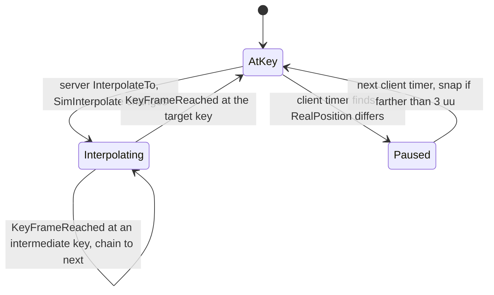

# Map actor replication and client roles

Units: def:Engine.Mover, rep:Engine.Mover.BasePos, rep:Engine.Mover.BaseRot, rep:Engine.Mover.RealPosition, rep:Engine.Mover.SimInterpolate, rep:Engine.Mover.SimOldPos, uc:Engine.Mover:BeginPlay, uc:Engine.Mover:Timer, uc:Engine.Mover:InterpolateTo, uc:Engine.Mover:KeyFrameReached, uc:Engine.Mover:StartInterpolation, def:SBase.SBasicGamePlayObject, rep:SBase.SBasicGamePlayObject.InteractionObj, rep:SBase.SBasicGamePlayObject.bSecondaryObjective, uc:SBase.SBasicGamePlayObject:PreBeginPlay, uc:SBase.SBasicGamePlayObject:Timer, uc:SBase.SBasicGamePlayObject:Destroyed, uc:SBase.SBasicGamePlayObject:PostBeginPlay, def:SBase.SGamePlayObject, rep:SBase.SGamePlayObject.KillDamageEmitter, rep:SBase.SGamePlayObject.SpawnDamageEmitter, rep:SBase.SGamePlayObject.Throw, uc:SBase.SGamePlayObject:BeginPlay, uc:SBase.SGamePlayObject:PostBeginPlay, uc:SBase.SGamePlayObject:Trigger, uc:SBase.SGamePlayObject:SpawnDamageEmitter, uc:SBase.SGamePlayObject:KillDamageEmitter, uc:SBase.SGamePlayObject:Throw, nat:SBase.SGamePlayObject.ProcessDamage, def:SBase.SVitre, def:SBase.SInterrupteur, rep:SBase.SInterrupteur.UseRelativeLocation, rep:SBase.SInterrupteur.UseRelativeRotation, rep:SBase.SInterrupteur.bMaintainsSwitch, rep:SBase.SInterrupteur.iHackingTime, rep:SBase.SInterrupteur.iReusableTime, uc:SBase.SInterrupteur:PreBeginPlay, uc:SBase.SInterrupteur:PostNetBeginPlay, def:SBase.SAnimatedMesh, uc:SBase.SAnimatedMesh:PostNetBeginPlay, uc:SBase.SAnimatedMesh:s_Wait.BeginState, uc:SBase.SAnimatedMesh:s_Wait.Trigger, uc:SBase.SAnimatedMesh:s_Wait.UnTrigger, uc:SBase.SAnimatedMesh:s_AnimateForward.AnimEnd, uc:SBase.SAnimatedMesh:s_AnimateForward.BeginState, uc:SBase.SAnimatedMesh:s_AnimateForward.Trigger, uc:SBase.SAnimatedMesh:s_AnimateForward.UnTrigger, def:SBase.SOrientableObject, rep:SBase.SOrientableObject.PitchConstraint, rep:SBase.SOrientableObject.RollConstraint, rep:SBase.SOrientableObject.YawConstraint, rep:SBase.SOrientableObject.fVisionFOV, rep:SBase.SOrientableObject.iReplicatedPitch, rep:SBase.SOrientableObject.iReplicatedYaw, def:SBase.SStickyCam, rep:SBase.SStickyCam.Smoke_NbDoses, rep:SBase.SStickyCam.SpawnGaz, def:SBase.SCamNetwork, rep:SBase.SCamNetwork.MuzzleCount, rep:SBase.SCamNetwork.aUsedByPawn, rep:SBase.SCamNetwork.iReplicatedVisionMode, def:SBase.STriggerLight, rep:SBase.STriggerLight.SetEMFDLightToClient, rep:SBase.STriggerLight.UnSetEMFDLightToClient, uc:SBase.STriggerLight:SetEMFDLightToClient, uc:SBase.STriggerLight:UnSetEMFDLightToClient, def:SBase.SExtincteur, def:SBase.SInfirmary, def:SBase.SAmmoStock, def:SBase.SPresenceTrigger, def:SBase.SDamageVolume, def:SBase.SMagicEvent, def:SBase.SShaker, def:SBase.SHelpPath, def:SBase.SZoneTips, def:SBase.STriggerPlayerStart, def:SBase.SAmbientSoundTrigger, def:Engine.Trigger, def:Engine.SoundTrigger, def:Engine.Light, def:Engine.StaticMeshActor, def:Engine.PlayerStart, def:Engine.AntiPortalActor, def:Engine.SkyZoneInfo, def:Engine.Camera, eng:AMover::GetOptimizedRepList, eng:AMover::PreNetReceive, eng:AMover::PostNetReceive, eng:ASBasicGamePlayObject::GetOptimizedRepList, eng:ASBasicGamePlayObject::IsNetRelevantFor, eng:ASGamePlayObject::GetOptimizedRepList, eng:ASGamePlayObject::IsNetRelevantFor, eng:ASInterrupteur::GetOptimizedRepList, eng:ASAnimatedMesh::GetOptimizedRepList, eng:ASOrientableObject::GetOptimizedRepList, eng:ASStickyCam::GetOptimizedRepList, eng:ASCamNetwork::GetOptimizedRepList, eng:ASTriggerLight::GetOptimizedRepList, eng:ASAmmoStock::GetOptimizedRepList, eng:ASAmbientSoundTrigger::GetOptimizedRepList, eng:ASZoneTips::GetOptimizedRepList

## Purpose

Which SteeE map actors exist on a client, with which role, and how their changes reach clients:
movers (doors, shutters, the crushing duct), breakable and switchable gameplay objects
(`SGamePlayObject`, `SVitre`), switches (`SInterrupteur`), the crane (`SAnimatedMesh`), camera
network nodes, trigger lights, music and emitters. Objectives and the disk are in
`rep-objectives.md`.

## Data

SteeE map actors by class with their network defaults and what a client has (counts from the map
exports; instance properties in SteeE do not override any network field, so class defaults apply):

| Class | Count | RemoteRole | bStatic | bNoDelete | bAlwaysRelevant | bHidden | NetUpdateFrequency | On clients |
|---|---|---|---|---|---|---|---|---|
| `Engine.StaticMeshActor` | 950 | DumbProxy | yes |  |  |  | 100.0 | map copy on both sides, static, never replicated |
| `Engine.Light` | 118 | DumbProxy | yes | yes |  | yes | 100.0 | map copy on both sides, static, never replicated |
| `SBase.SGamePlayObject` | 67 | SimulatedProxy |  | yes |  |  | 100.0 | map copy, channel while relevant |
| `Engine.BlockingVolume` | 48 | DumbProxy | yes | yes |  | yes | 100.0 | map copy on both sides, static, never replicated |
| `Engine.Volume` | 42 | DumbProxy | yes | yes |  | yes | 100.0 | map copy on both sides, static, never replicated |
| `Engine.ZoneInfo` | 36 | None | yes | yes |  | yes | 10.0 | map copy on both sides, static, never replicated |
| `Engine.Emitter` | 31 | None |  | yes |  |  | 100.0 | map copy on both sides, Role None on clients |
| `SBase.SDisk` | 30 | SimulatedProxy |  | yes |  |  | 100.0 | map copy, channel while relevant |
| `Engine.AmbientSound` | 26 | None | yes |  |  | yes | 100.0 | map copy on both sides, static, never replicated |
| `Engine.Mover` | 24 | SimulatedProxy |  | yes | yes |  | 100.0 | map copy, channel always open |
| `SBase.STriggerLight` | 20 | SimulatedProxy |  | yes |  | yes | 100.0 | map copy, channel while relevant |
| `Engine.PlayerStart` | 18 | DumbProxy | yes | yes |  | yes | 100.0 | map copy on both sides, static, never replicated |
| `SBase.SAmbientSoundTrigger` | 15 | SimulatedProxy |  |  |  | yes | 100.0 | deleted on clients, re-created while relevant |
| `SBase.SVitre` | 14 | SimulatedProxy |  | yes |  |  | 100.0 | map copy, channel while relevant |
| `SBase.SHelpPath` | 13 | None |  | yes |  | yes | 100.0 | map copy on both sides, Role None on clients |
| `SBase.SZoneTips` | 12 | None | yes | yes |  |  | 100.0 | map copy on both sides, static, never replicated |
| `Engine.Camera` | 10 | AutonomousProxy |  |  |  | yes | 100.0 | deleted on clients, re-created while relevant |
| `Engine.SoundTrigger` | 9 | DumbProxy |  |  |  | yes | 100.0 | deleted on clients, re-created while relevant |
| `SBase.SDamageVolume` | 7 | None |  | yes |  | yes | 100.0 | map copy on both sides, Role None on clients |
| `Engine.Trigger` | 7 | DumbProxy |  |  |  | yes | 100.0 | deleted on clients, re-created while relevant |
| `SBase.SExtincteur` | 7 | SimulatedProxy |  | yes |  |  | 100.0 | map copy, channel while relevant |
| `SBase.SObjective` | 6 | DumbProxy |  | yes | yes | yes | 100.0 | map copy, channel always open |
| `SBase.SComputerObjectiveTrigger` | 5 | SimulatedProxy |  | yes | yes | yes | 5.0 | map copy, channel always open |
| `SBase.SPresenceTrigger` | 4 | DumbProxy |  |  |  | yes | 100.0 | deleted on clients, re-created while relevant |
| `SBase.SInterrupteur` | 4 | SimulatedProxy |  | yes |  |  | 100.0 | map copy, channel while relevant |
| `SBase.SCamNetwork` | 3 | SimulatedProxy |  | yes | yes |  | 100.0 | map copy, channel always open |
| `SBase.SAmmoStock` | 3 | SimulatedProxy |  | yes |  |  | 100.0 | map copy, channel while relevant |
| `SBase.SInfirmary` | 3 | SimulatedProxy |  | yes |  |  | 100.0 | map copy, channel while relevant |
| `SBase.SMission` | 3 | DumbProxy |  | yes | yes | yes | 100.0 | map copy, channel always open |
| `SBase.SAnimatedMesh` | 2 | SimulatedProxy |  | yes | yes |  | 100.0 | map copy, channel always open |
| `Engine.LevelInfo` | 1 | DumbProxy | yes | yes | yes | yes | 10.0 | map copy, always replicated |
| `Engine.SkyZoneInfo` | 1 | SimulatedProxy | yes | yes |  | yes | 10.0 | map copy on both sides, static, never replicated |
| `SBase.SFlag` | 1 | SimulatedProxy |  | yes |  |  | 100.0 | map copy, channel while relevant |
| `SBase.SFlagDropZone` | 1 | SimulatedProxy |  | yes | yes |  | 5.0 | map copy, channel always open |
| `SBase.STriggerPlayerStart` | 1 | DumbProxy |  | yes |  | yes | 100.0 | map copy, channel while relevant |
| `Engine.AntiPortalActor` | 1 | None |  | yes |  |  | 100.0 | map copy on both sides, Role None on clients |
| `SBase.SShaker` | 1 | None |  |  |  | yes | 100.0 | server only, deleted on clients |
| `Engine.MusicTrigger` | 1 | SimulatedProxy |  | yes | yes |  | 100.0 | map copy, channel always open |
| `SBase.SMagicEvent` | 1 | None |  | yes |  | yes | 10.0 | map copy on both sides, Role None on clients |
| `SBase.SGETrigger` | 1 | None |  |  |  | yes | 100.0 | server only, deleted on clients |

Not actors (listener objects referenced by zones): `SBase.EFFECT_Room` (8), `SBase.EFFECT_StoneCorridor` (8), `SBase.EFFECT_Sewerpipe` (6), `SBase.EFFECT_Stoneroom` (4), `SBase.EFFECT_Hangar` (1), `SBase.EFFECT_City` (1), `SBase.EFFECT_Hallway` (1).

## Rules

1. **Presence** follows `model.md` rule 14: map copies on both sides for `bStatic`/`bNoDelete`,
   bound to a channel while relevant; others deleted on clients at load and re-created only when the
   server replicates them. Classes with `RemoteRole` None run no script on clients (`SGETrigger`,
   `SShaker`, `SMagicEvent`, `SDamageVolume`, `SHelpPath`, `Emitter` unless `bNetworkTrigger`), so
   every effect they cause on clients must travel through other actors (the GE mask through
   `LevelInfo`, camera shake through `ClientShake` on player controllers, damage through pawns).
   Hidden, non-always-relevant classes (`SPresenceTrigger`, `Trigger`, `SoundTrigger`,
   `SAmbientSoundTrigger`, `STriggerPlayerStart`) are expected never to be relevant (Open question 3).
2. **Movers (server).** Mover states (`TriggerOpenTimed`, `TriggerOpenOnceOnly` and the rest) run on
   the server only. `InterpolateTo(NewKeyNum, Seconds)` (simulated) clamps the key to 0..7, keeps
   continuity when reversing (`PhysAlpha = 1 - PhysAlpha` and `OldPos = BasePos + KeyPos[KeyNum]` when
   going back to the previous key mid-move, else `OldPos = Location`, `PhysAlpha = 0`), sets
   `PHYS_MovingBrush`, `PrevKeyNum = KeyNum`, `KeyNum = NewKeyNum`,
   `PhysRate = 1 / max(Seconds, 0.005)`, increments `ClientUpdate`, and packs the move for clients:
   `SimOldPos = OldPos`; `SimInterpolate.X = 100 × PhysAlpha`;
   `SimInterpolate.Y = 100 × max(0.01, PhysRate)`; `SimInterpolate.Z = 256 × PrevKeyNum + KeyNum`.
   `RealPosition`, `SimInterpolate` and `SimOldPos` replicate whenever they change; `BaseRot` only in the
   first bunch. The Mover's native list never sends `BasePos`, although the script block names it (only
   `SLiftDoor` sends it, with `Base`; editor 0x110aaeb0, 0x111d36b0). The mover's own `Location` and `Rotation` do not replicate
   (`bReplicateMovement` false).
3. **Movers (client).** The native `PostNetReceive` (decoded, editor 0x110b3020, 0x110a70e0) starts the same
   interpolation on the client, only when `SimInterpolate` changed: `OldPos = SimOldPos`, `OldRot` = the current
   rotation, `PhysAlpha` and `PhysRate` = `SimInterpolate.X` and `.Y` x 0.01, `KeyNum` = the low byte and
   `PrevKeyNum` = the high byte of `SimInterpolate.Z`, physics PHYS_MovingBrush, `bInterpolating` on. Port note: the
   client's map `Rotation` and its byte-sent `BaseRot` can name one orientation whole turns apart (-32768 and
   32768), so `OldRot` is moved by whole turns to the nearest of `BaseRot + KeyRot[PrevKeyNum]` (estimated; without
   it such a mover spins a full turn on its first leg). `KeyFrameReached`
   (simulated) runs on both sides: `PrevKeyNum = KeyNum`, `PhysAlpha = 0`, `ClientUpdate -= 1`; it
   chains to the next key while moving through intermediate keys (down when `0 < KeyNum <
   OldKeyNum`, up when `KeyNum < NumKeys - 1` and `KeyNum > OldKeyNum`), else it stops the ambient
   sound and, on the server when `ClientUpdate == 0`, sets `RealPosition = Location`.
4. **Mover drift check.** `BeginPlay` (simulated) starts a repeating timer: 4.0 s on a client, 1.0 s
   on a server (none in standalone); clients return before the rest of `BeginPlay`. `Timer`: if the
   mover is moving (`Velocity != 0`), clear `bClientPause` and stop. On a client with `ClientUpdate ==
   0`: if `bClientPause` was set, snap with `SetLocation(RealPosition)` when farther than 3 uu, else
   adopt the location as `RealPosition`, and clear `bClientPause`; else if `RealPosition != Location`
   set `bClientPause`. With `ClientUpdate != 0` clear `bClientPause`. On a server set `RealPosition =
   Location`. A stopped client mover that disagrees with the server is therefore corrected 4 to 8 s
   later. Movers are `bAlwaysRelevant` with priority 2.7.
5. **Gameplay objects.** `SBasicGamePlayObject` replicates `bSecondaryObjective` and its
   `InteractionObj`. `PreBeginPlay` and `Timer` (simulated) copy the localized `sDescriptionText` into
   the interaction object on both sides, retrying every 3 s on clients until the interaction object has
   arrived (first try after 1 + 2 × FRand() s). `SGamePlayObject.BeginPlay` (simulated) sets
   `bWorldGeometry` for objects that are neither pickable nor pushable; `PostBeginPlay` (server) turns
   on movement replication (`bReplicateMovement`, `bUpdateSimulatedPosition`, actor properties) for
   pickable and pushable objects and keeps actor properties for objects that change mesh or skin.
6. **Damage visuals.** Damage is processed on the server (`ProcessDamage`, native). Particle effects for
   damage steps are broadcast with `SpawnDamageEmitter(i)` and `KillDamageEmitter(i)` (reliable,
   simulated), and each client spawns or destroys its own local `SSpawnableEmitter` from
   `SpawnableObjects[i]` (`model.md` rule 10). Skin swaps travel as `RepSkin` (Actor block, dirty).
   Mesh swaps (`TriggeredMesh`, `DamagedMeshes`, the crane wall) have no script replication path; the native
   list of `SBasicGamePlayObject` sends `StaticMesh` on every change while `DrawType` is `DT_StaticMesh`, and the
   client's `PostNetReceive` calls `SetStaticMesh` (with no mesh: collision off, `bBlockActors` and
   `bBlockPlayers` cleared) (`model.md` rule 8; editor 0x111c1830, 0x110b2770). Relevancy of gameplay objects:
   the AActor test, always relevant within 2500 uu of the viewer's camera, else a BSP line of sight; a pickable
   object on a bone follows its carrier (net-relevancy.md rule 5). `NotifyPickup(Instigator)` (server) makes the picking controller the
   owner (`SetOwner`), stops physics and enters `s_PickedUp`; while held, the holder's client may call
   `Throw(Controller, Vector)` (reliable, client to server), and the server also calls it itself
   (`DiscardPickup`, `DiscardFlag`). `StoppedMoving` clears the owner again. The disk inherits this, so
   it is owned by its carrier while carried.
7. **SVitre** (14 in SteeE) is an `SGamePlayObject` with 1 hit point whose single damaged mesh is none
   (the glass disappears) and which spawns `SVitreEmitter` (lifespan 10 s); everything above applies.
8. **Switches.** `SInterrupteur` sends `bMaintainsSwitch`, `iHackingTime`, `UseRelativeLocation`,
   `UseRelativeRotation` in the first bunch and `iReusableTime` always. `PreBeginPlay` (simulated)
   stores and clears `bSecondaryObjective` on both sides; the server's `PostNetBeginPlay` (not
   simulated) links the `STriggerInteraction` and copies `iReusableTime`. Use and hacking go through the
   interaction protocol of `rep-objectives.md` rule 8.
9. **Crane (SAnimatedMesh).** The animation state machine (`s_Wait`, `s_AnimateForward`,
   `s_AnimateBackward`) runs on the server only. `PostNetBeginPlay` (simulated) attaches
   `ActorsToAttach` to their bones on every machine; the server also sets `DT_Mesh`, plays the first
   animation and freezes it at 0. Clients see playback through the Actor `SimAnim` group (sent because
   `bReplicateAnimations` and `DrawType == DT_Mesh`), `bHidden`, and the root-motion position through
   `Location`/`Rotation` (`bUpdateSimulatedPosition`). Notify-driven events (`tueletube`, `blast01`) are
   raised on the server; their effects reach clients through the movers, objects and pawns they change.
   `ASAnimatedMesh`'s native list sends `bHidden` on every change and nothing else beyond the Actor list's
   `SimAnim` (editor 0x111d2790); whether clients run the clip notifies is not studied (Open question 2).
10. **Camera network and orientable objects.** `SOrientableObject` sends its rotation limits in the
    first bunch, `iReplicatedYaw`/`iReplicatedPitch` to every connection except the owner (set on the
    server by `ServerUpdateOrientableRotation`, `rep-controller.md` rule 4) and `fVisionFOV`.
    `SStickyCam` adds `Smoke_NbDoses` and the client-to-server `SpawnGaz`; `SCamNetwork` adds
    `MuzzleCount`, `iReplicatedVisionMode` and `aUsedByPawn`. Vision mode changes are also broadcast
    through `SBasePawn.CamNetworkSwitchVisionModeOnAllClients`.
11. **Trigger lights.** `STriggerLight` (20 in SteeE) broadcasts `SetEMFDLightToClient`
    (`bEMFIsOn = true`, `EMFOpacity = 1.0`) and `UnSetEMFDLightToClient` (`bEMFIsOn = false`,
    `EMFOpacity = 0.3`); the same two fields are also in the always-eligible Actor vision group.
12. **Music.** `MusicTrigger.Trigger`/`UnTrigger` (server) broadcast `ClientPlayStopMusic(bTrigger,
    EventInstigator)` (reliable, simulated). Each client: if `bInstigatorOnly` and the local player's
    pawn is not the instigator, nothing; if the song is not playing and `bTrigger`, `PlayMusic(Song,
    FadeInTime)`; else if `bToggle` or not `bTrigger`, `StopMusic(Song, 0, FadeOutTime)`.
13. **Emitters.** Map emitters run their particles on every machine with no network traffic. An emitter
    with `bNetworkTrigger` becomes `ROLE_SimulatedProxy` and `bAlwaysRelevant` in `PreBeginPlay`, and
    its `Trigger` (server) broadcasts `ReplicateTrigger()` (reliable, simulated), which triggers each
    particle emitter on every client.

#### Engine.Mover (nativereplication)

| Blk | Member | Kind | Type or parameters | Condition | Dir | Rel | Sim |
|---|---|---|---|---|---|---|---|
| 0 | `BasePos` | var | Vector | `Role == Authority` | S to C | | |
| 0 | `RealPosition` | var | Vector | `Role == Authority` | S to C | | |
| 0 | `SimInterpolate` | var | Vector | `Role == Authority` | S to C | | |
| 0 | `SimOldPos` | var | Vector | `Role == Authority` | S to C | | |
| 1 | `BaseRot` | var | Rotator | `Role == Authority && bNetInitial` | S to C | | |

#### SBase.SBasicGamePlayObject (nativereplication)

| Blk | Member | Kind | Type or parameters | Condition | Dir | Rel | Sim |
|---|---|---|---|---|---|---|---|
| 0 | `bSecondaryObjective` | var | bool | `Role == Authority` | S to C | | |
| 0 | `InteractionObj` | var | SInteractObject | `Role == Authority` | S to C | | |

#### SBase.SGamePlayObject (nativereplication)

| Blk | Member | Kind | Type or parameters | Condition | Dir | Rel | Sim |
|---|---|---|---|---|---|---|---|
| 0 | `Throw` | func | Controller, Vector | `Role < Authority` | C to S | R |  |
| 1 | `SpawnDamageEmitter` | func | int | `Role == Authority` | S to C | R | S |
| 1 | `KillDamageEmitter` | func | int | `Role == Authority` | S to C | R | S |

#### SBase.SInterrupteur (nativereplication)

| Blk | Member | Kind | Type or parameters | Condition | Dir | Rel | Sim |
|---|---|---|---|---|---|---|---|
| 0 | `bMaintainsSwitch` | var | bool | `bNetInitial && Role == Authority` | S to C | | |
| 0 | `iHackingTime` | var | int | `bNetInitial && Role == Authority` | S to C | | |
| 0 | `UseRelativeLocation` | var | Vector | `bNetInitial && Role == Authority` | S to C | | |
| 0 | `UseRelativeRotation` | var | Rotator | `bNetInitial && Role == Authority` | S to C | | |
| 1 | `iReusableTime` | var | int | `Role == Authority` | S to C | | |

#### SBase.SOrientableObject (nativereplication)

| Blk | Member | Kind | Type or parameters | Condition | Dir | Rel | Sim |
|---|---|---|---|---|---|---|---|
| 0 | `RollConstraint` | var | Vector | `Role == Authority && bNetInitial` | S to C | | |
| 0 | `YawConstraint` | var | Vector | `Role == Authority && bNetInitial` | S to C | | |
| 0 | `PitchConstraint` | var | Vector | `Role == Authority && bNetInitial` | S to C | | |
| 1 | `iReplicatedYaw` | var | int | `Role == Authority && !bNetOwner` | S to C | | |
| 1 | `iReplicatedPitch` | var | int | `Role == Authority && !bNetOwner` | S to C | | |
| 2 | `fVisionFOV` | var | float | `Role == Authority` | S to C | | |

#### SBase.SStickyCam (nativereplication)

| Blk | Member | Kind | Type or parameters | Condition | Dir | Rel | Sim |
|---|---|---|---|---|---|---|---|
| 0 | `SpawnGaz` | func | - | `Role < Authority` | C to S | R |  |
| 1 | `Smoke_NbDoses` | var | int | `Role == Authority` | S to C | | |

#### SBase.SCamNetwork (nativereplication)

| Blk | Member | Kind | Type or parameters | Condition | Dir | Rel | Sim |
|---|---|---|---|---|---|---|---|
| 0 | `MuzzleCount` | var | int | `Role == Authority` | S to C | | |
| 0 | `iReplicatedVisionMode` | var | int | `Role == Authority` | S to C | | |
| 0 | `aUsedByPawn` | var | SBasePawn | `Role == Authority` | S to C | | |

#### SBase.STriggerLight (nativereplication)

| Blk | Member | Kind | Type or parameters | Condition | Dir | Rel | Sim |
|---|---|---|---|---|---|---|---|
| 0 | `SetEMFDLightToClient` | func | - | `Role == Authority` | S to C | R | S |
| 0 | `UnSetEMFDLightToClient` | func | - | `Role == Authority` | S to C | R | S |

#### Engine.MusicTrigger (script conditions)

| Blk | Member | Kind | Type or parameters | Condition | Dir | Rel | Sim |
|---|---|---|---|---|---|---|---|
| 0 | `ClientPlayStopMusic` | func | bool, Pawn | `Role == Authority` | S to C | R | S |

#### Engine.Emitter (script conditions)

| Blk | Member | Kind | Type or parameters | Condition | Dir | Rel | Sim |
|---|---|---|---|---|---|---|---|
| 0 | `ReplicateTrigger` | func | - | `Role == Authority` | S to C | R | S |

## States

## Constants

| Name | Value | Unit | Provenance | Source |
|---|---|---|---|---|
| Mover keys | 8 | keys | decoded | `KeyPos[8]`, clamp 0..7 |
| Minimum move time | 0.005 | s | decoded | uc:Engine.Mover:InterpolateTo |
| SimInterpolate scales | 100, 100, 256 | factors | decoded | uc:Engine.Mover:InterpolateTo |
| Mover check timer | 1.0 server, 4.0 client | s | decoded | uc:Engine.Mover:BeginPlay |
| Mover snap distance | 3 | uu | decoded | uc:Engine.Mover:Timer |
| Mover NetPriority | 2.7 | weight | decoded | def:Engine.Mover |
| Description retry | 1 + 2 × FRand(), then 3 | s | decoded | uc:SBase.SBasicGamePlayObject:PreBeginPlay, Timer |
| EMF light opacity on/off | 1.0 / 0.3 | | decoded | STriggerLight |

## Network

Server: all map logic. Clients: map copies receive the variables above while relevant and run the
simulated functions listed; non-simulated functions and all state code of these classes run only on
the server.

## Edge cases

- A mover that stops between two client timer ticks may sit up to 8 s at a slightly wrong position
  before the snap.
- `SimInterpolate.X` and `.Y` are rounded to integers on the wire (vector encoding), so client
  `PhysAlpha` has 0.01 steps and `PhysRate` 0.01 steps per second.
- A client joining after a window broke gets the current `RepSkin` and actor properties in the first
  bunch but never the past `SpawnDamageEmitter` call.
- SteeE instance data sets `DrawType` 8 (`DT_StaticMesh`) on movers and gameplay objects and
  `DT_Mesh` (2) on the crane; network defaults are unchanged.

## Evidence

- `local/re-out/uc/Engine/Mover.uc` (replication 113-119, `Timer` 129, `InterpolateTo` 168,
  `KeyFrameReached` 202, `BeginPlay` 340), `SBase/SBasicGamePlayObject.uc`, `SBase/SGamePlayObject.uc`
  (`BeginPlay` 78, `PostBeginPlay` 86, `Trigger` 148, `NotifyPickup` 364, `Throw` 375,
  `SpawnDamageEmitter` 415, `KillDamageEmitter` 443), `SBase/SVitre.uc`, `SBase/SInterrupteur.uc`, `SBase/SAnimatedMesh.uc`, `SBase/STriggerLight.uc`
  24-34, `Engine/MusicTrigger.uc`, `Engine/Emitter.uc` 30-61.
- SteeE: `Packages/Maps/SteeE.sdc` exports read with scctpkg (class counts and instance properties;
  network fields absent from instances).
- Defaults: `local/formats/classdefaults_effective.json`.
- Native lists and hooks (editor): `AMover::GetOptimizedRepList` 0x110aaeb0, `AMover::PreNetReceive`
  0x110a70e0, `AMover::PostNetReceive` 0x110b3020, `ASBasicGamePlayObject::GetOptimizedRepList`
  0x111c1830 (relevancy 0x111c1b10), `ASGamePlayObject::GetOptimizedRepList` 0x111c1dc0 (relevancy
  0x111c1f10), `ASInterrupteur::GetOptimizedRepList` 0x111d1620, `ASAnimatedMesh::GetOptimizedRepList`
  0x111d2790, `ASOrientableObject::GetOptimizedRepList` 0x111c3cb0, `ASStickyCam::GetOptimizedRepList`
  0x111d0040, `ASCamNetwork::GetOptimizedRepList` 0x111d0300, `ASTriggerLight::GetOptimizedRepList`
  0x111d3900, `ASAmmoStock::GetOptimizedRepList` 0x111c0630, `ASAmbientSoundTrigger::GetOptimizedRepList`
  0x111c0520, `ASZoneTips::GetOptimizedRepList` 0x111bed20. `SGamePlayObject.ProcessDamage` native 1779
  at 0x10a8fc40.

## Open questions

1. **Mover interpolation at lag**: the start rule is decoded (rule 3); trace a SteeE shutter opening on a client
   at 120 ms lag and compare positions per frame with the server.
2. **Crane notifies on clients**: whether clients run the anim notifies of the crane (they would trigger local
   copies of events; non-simulated `Trigger` functions are absorbed on clients). The list itself is decoded
   (rule 9).
3. **Relevancy of hidden map triggers** (`SPresenceTrigger`, `SAmbientSoundTrigger` and the rest): are
   they ever replicated? Check the client actor list in a live 2v2 SteeE session.

### Resolved

1. (part) **Mover client interpolation.** Resolved: `OldPos = SimOldPos`, `OldRot` the current rotation,
   `PhysAlpha/PhysRate = SimInterpolate.XY x 0.01`, `KeyNum` the low and `PrevKeyNum` the high byte of Z, physics
   moving brush, interpolating; only when `SimInterpolate` changed. Rule 3. Evidence: editor 0x110b3020, 0x110a70e0
   (ANSWERS-net rep-map-actors 1).
2. (part) **What `ASAnimatedMesh`'s list sends.** Resolved: `bHidden` on every change, nothing else. Rule 9.
   Evidence: editor 0x111d2790 (ANSWERS-net rep-map-actors 2).
4. **Gameplay object relevancy.** Resolved: the AActor test (always within 2500 uu of the camera, else a BSP line
   of sight); a pickable object on a bone follows its carrier. Rule 6. Evidence: net-relevancy.md rule 5
   (ANSWERS-net rep-map-actors 4).
5. **BasePos (extra).** Resolved: the Mover list never sends it; only `SLiftDoor` does, with `Base`. Rule 2.
   Evidence: editor 0x110aaeb0, 0x111d36b0 (ANSWERS-net rep-map-actors extra).
