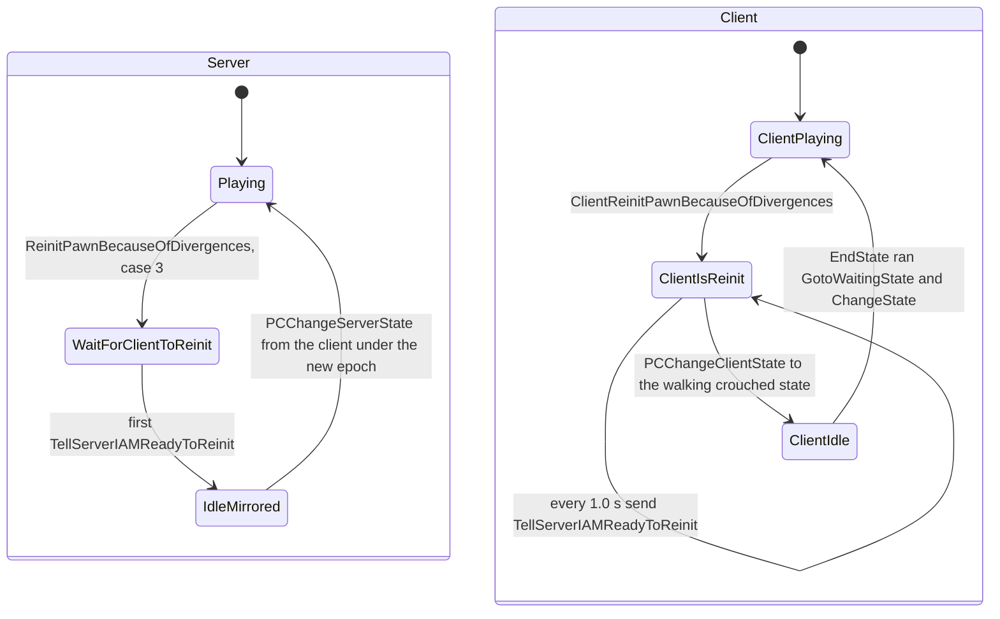

# State mirroring and forced resynchronisation

Units: uc:SBase.SPlayerController:MirrorState, uc:SBase.SPlayerController:MirrorPredictedState, uc:SBase.SPlayerController:MirrorStateForRepos, uc:SBase.SPlayerController:PCChangeClientStateForRepos, uc:SBase.SPlayerController:MirrorStateForMercGrabbedFromLedge, uc:SBase.SPlayerController:PCChangeClientStateForMercGrabbedFromLedge, uc:SBase.SPlayerController:PCChangeClientState, uc:SBase.SPlayerController:ChangeState, uc:SBase.SPlayerController:PCChangeServerState, uc:SBase.SPlayerController:GotoWaitingState, uc:SBase.SPlayerController:TestReinitPawnBecauseOfDivergences, uc:SBase.SPlayerController:ReinitPawnBecauseOfDivergences, uc:SBase.SPlayerController:ClientReinitPawnBecauseOfDivergences, uc:SBase.SPlayerController:TellServerIAMReadyToReinit, uc:SBase.SPlayerController:s_ClientIsReinit.BeginState, uc:SBase.SPlayerController:s_ClientIsReinit.EndState, uc:SBase.SPlayerController:s_ClientIsReinit.PlayerMove, uc:SBase.SPlayerController:s_ClientIsReinit.Timer, uc:SBase.SPlayerController:s_WaitForClientToReinit.PlayerMove, uc:SBase.SPlayerController:s_WaitForClientToReinit.TellServerIAMReadyToReinit, uc:SBase.SPlayerController:TellClientServerWaitForFatalBlast, uc:SBase.SPlayerController:AntiBugTellServerIAmDead, uc:SBase.SPlayerController:SendAnEventToServer, uc:SBase.SPlayerController:ServerSendAnEvent, uc:SBase.SPlayerController:ReceiveAnEvent, uc:SBase.SPlayerController:ClientStopRM, uc:Engine.Actor:ChangeState, uc:Engine.Actor:ChangeServerState, uc:Engine.Actor:MirrorState, uc:Engine.Actor:ChangeClientState, nat:SBase.SBasePawn.ReinitBecauseOfDivergences, uc:SBase.SBasePawn:DistantClientReinit, uc:Engine.PlayerController:ClientGotoState, rep:SBase.SPlayerController.PCChangeClientStateForRepos, rep:SBase.SPlayerController.PCChangeClientStateForMercGrabbedFromLedge, rep:SBase.SPlayerController.PCChangeClientState, rep:SBase.SPlayerController.PCChangeServerState, rep:SBase.SPlayerController.GotoWaitingState, rep:SBase.SPlayerController.TestReinitPawnBecauseOfDivergences, rep:SBase.SPlayerController.ClientReinitPawnBecauseOfDivergences, rep:SBase.SPlayerController.TellServerIAMReadyToReinit, rep:SBase.SPlayerController.TellClientServerWaitForFatalBlast, rep:SBase.SPlayerController.AntiBugTellServerIAmDead, rep:SBase.SPlayerController.SendAnEventToServer, rep:SBase.SPlayerController.ServerSendAnEvent, rep:SBase.SPlayerController.ClientStopRM, rep:Engine.Actor.ChangeClientState, rep:Engine.Actor.ChangeServerState, rep:Engine.PlayerController.ClientGotoState

## Purpose

SCCT keeps the player controller's script state (walking, ledge, grab, hack, dead, and about 280
more) the same on the owning client and on the server by sending state changes explicitly, in both
directions, guarded by an epoch value called the mirror state acknowledgement time (MSA). When the
server decides the two sides have diverged too far it reinitialises the client pawn and waits for the
client to confirm. Map actors use a simpler version of the same calls. This file specifies both.

## Data

`SPlayerController` (defaults 0 unless stated):

| Field | Type | Meaning |
|---|---|---|
| `MirrorStateAcknowledgementTime` (MSA) | float | Epoch. Server: last epoch it opened. Client: last epoch it received. |
| `MirrorStateLastTime` | float | Client: server time of the newest state change applied. |
| `ActorPassedByMirrorState` | Actor | Extra actor carried by `PCChangeClientState`. |
| `PredictedStickyCamDeadline` | float | Client sticky-cam prediction window. |
| `bWaitingForReinit` | bool | Server: a reinit is in progress. |
| `SmokeInstigator`, `SmokeInstigatorTime` | Pawn, float | Server bookkeeping for smoke knock-outs. |
| `TimeShockForGrab`, `RealTimeInvulSticky` | float | Inputs of the smoke bookkeeping. |
| `PreviousState` | name | From Controller; used by `GotoWaitingState`. |

`ReinitType_`: `RT_Normal` 0, `RT_KO` 1, `RT_Dead` 2, `RT_Grabbed` 3, `RT_Grabbing` 4.
`SentEventType_`: `SE_GrabFromLedgePb` 0, `SE_GrabFromLedgeMercIsReady` 1, `SE_TerminatePawnPb` 2.

## Rules

### Server to client: MirrorState

1. **MirrorState(State, Label, bDontSave, AddActor)** (server, player controller): `GotoState(State,
   Label, bDontSave)` locally. If this controller is the local viewport player (listen host), stop.
   Else, if `Level.TimeSeconds - MSA > 1.0`, open a new epoch: `MSA = Level.TimeSeconds`. Then send
   `PCChangeClientState(MSA, Level.TimeSeconds, State, Label, bDontSave, AddActor)` (reliable).
2. **PCChangeClientState(MSATime, fNewTime, State, Label, bDontSave, AddActor)** (client): only if
   `MirrorStateLastTime <= fNewTime`: `MirrorStateLastTime = fNewTime`, `ActorPassedByMirrorState =
   AddActor`, `MSA = MSATime`; then, if `State` is `s_UseObject_StickyCam_SmoothToPosition` and
   `Level.TimeSeconds < PredictedStickyCamDeadline`, stop (the client already predicted it); else
   `GotoState(State, Label, bDontSave)`.
3. **MirrorPredictedState(State, bDontSave)** (server): `GotoState(State, , bDontSave)`; if local
   viewport player stop; send `PCChangeClientState(MSA, Level.TimeSeconds, State, , bDontSave)`
   without opening a new epoch.
4. **MirrorStateForRepos(State, LocationToRepos, iYawToRepos)** (server): `GotoState(State)`; local
   player stop; epoch rule of 1; send `PCChangeClientStateForRepos(MSA, Level.TimeSeconds, State,
   LocationToRepos, iYawToRepos)`. **PCChangeClientStateForRepos** (client): if `MirrorStateLastTime
   <= fNewTime`: store time and MSA, `GotoState(State)`, `vDelta = LocationToRepos - Pawn.Location`
   with `vDelta.Z = 0`, `SBPawn.ClientDistantMoveSmooth(vDelta, iYawToRepos)` (native smooth slide and
   turn, `proxy-pawns.md`).
5. **MirrorStateForMercGrabbedFromLedge(Spy)** (server, the merc's controller):
   `vVandammePos = Spy.Location + (m_LedgeGrabArmsZone.X + 16 + CollisionRadius + 4) × vector(Spy.Rotation)`
   (`m_LedgeGrabArmsZone` and `CollisionRadius` of the merc pawn); `iYawToGo = Spy.Rotation.Yaw + 32768`;
   `vWallJumpDir = vector(rot(0, iYawToGo, 0))`; `m_AttackedBy = Spy`; `Spy.m_AttackTarget = SBPawn`;
   `GotoState('s_GrabbedFromLedge_Begin')`; local player stop; epoch rule of 1; send
   `PCChangeClientStateForMercGrabbedFromLedge(MSA, Level.TimeSeconds, Spy, vVandammePos, iYawToGo)`.
   The client handler (same time guard) sets the same four fields from the parameters, calls
   `ChangeEnumAction(SA_REPOS)` and `GotoState('s_GrabbedFromLedge_Begin')`. `PosToGo` is a vector
   parameter, so it arrives rounded to whole units.
6. **GotoWaitingState()** (reliable, server to client; runs locally for the listen host): the
   receiving side picks its idle state and announces it with `ChangeState` (rule 8):
   - spy: if `PreviousState` is `s_PipH_Fire2`, `s_PipH_Fire4` or `VandammeWeapon`, `ChangeState(
     PreviousState, , true)` and stop; else by `WeaponLoaded` and crouch: `s_PlayerWalkingCr0H` with
     action 75, `s_PlayerWalkingSt0H` with `SA_WALK_ST_0H`, `s_PlayerWalkingCr2H` with
     `SA_WALK_CR_2H`, `s_PlayerWalkingSt2H` with `SA_WALK_ST_2H` (actions forced);
   - merc: `s_PlayerWalkingCr2H` or `s_PlayerWalkingSt2H` by crouch, with the matching forced action.
7. **Actor.MirrorState** (any actor, server): `GotoState` locally; if the actor is a player controller
   with a viewport player stop; else `ChangeClientState(State, Label, bDontSave, AddActor)` (reliable,
   simulated), whose client body logs and calls `GotoState`. For actors no player owns (interaction
   objects, `STriggerInteraction`), delivery to clients relies on the broadcast rule of `model.md`
   rule 10. There is no epoch on this path.

### Client to server: ChangeState

8. **ChangeState(State, Label, bDontSave)** (`SPlayerController`, simulated): `GotoState(State, Label,
   bDontSave)`; in standalone or on a listen server stop; else send `PCChangeServerState(MSA, State,
   Label, bDontSave)` (reliable). On a client this goes to the server. On a dedicated server, when
   server code calls `ChangeState` on a remote player's controller, the condition `Role <
   ROLE_Authority` is false, so `PCChangeServerState` runs locally and repeats the same `GotoState`
   (harmless double entry: `EndState`/`BeginState` run twice). On a listen server nothing is sent and
   the client is not told.
9. **PCChangeServerState(CodeTime, State, Label, bDontSave)** (server): only if |`CodeTime` - MSA| <
   0.01 (the client has seen the server's current epoch):
   1. smoke bookkeeping: if (`State == 's_FallDown'` and `Label == 'DIE_InPlace'`) or `State ==
      's_FallDropAttacked'`, and the controller is not already in `s_FallDropAttacked`: if
      `Level.TimeSeconds - SmokeInstigatorTime > 0.5` and `Level.TimeSeconds - TimeShockForGrab >
      RealTimeInvulSticky`, then `SmokeInstigator = FindGasInstigator(SSmokeEmitter,
      SSmokeEmitter.default.RadiusEffect)` and `SmokeInstigatorTime = Level.TimeSeconds`; then
      `CountGasKO()`;
   2. `GotoState(State, Label, bDontSave)`.
   A change sent with an old epoch is dropped silently; the client stays in its state until the
   server corrects it.
10. **Actor.ChangeState** (any actor): `GotoState`; in standalone or listen server stop; else
    `ChangeServerState(State, Label, bDontSave)` (reliable), whose server body is `GotoState`. Only
    actors the client owns can send it (model rule 15).
11. **Epoch meaning.** MSA ties every client-originated state change and action packet
    (`PCChangeServerState`, `ReplicateActionToServer*`, `BigServerMove`) to the latest server-forced
    epoch. When the server forces a state on the client (a hit, a grab, a reinit) more than 1 s after the
    previous epoch, it opens a new one, and anything the client sent before receiving it is ignored.
    Within 1 s of an epoch, forced states reuse it.

### Forced resynchronisation

12. **ReinitPawnBecauseOfDivergences()** (event, server; raised by the native move core, decoded in
    net-moves.md rules 11.5 and 12, game 0x10aac4a0: after a correction with squared error above 160000 (400 uu)
    unless the server and client pawns both walk or the pawn is dead, and after 3 s of continuous physics
    mismatch between the client's moves and the server pawn; and by `TestReinitPawnBecauseOfDivergences`, a
    reliable client-to-server RPC with no script caller): `StopSound(None)`, then the first matching case:
    1. pawn `Health <= 0`: if not in `GameEnded`, `MirrorState('s_Dead')`;
    2. merc with `m_AttackedBy` set, spy with `m_AttackTarget` set, or pawn `bLyingOnGround`: do nothing
       (grabs and knock-downs are left alone);
    3. otherwise:
       - if the controller is in `s_TerminatePawn`, `s_TerminatePawn_Maintain` or
         `s_TerminatePawn_Kill` and the victim (`m_PawnToTerminate`) is alive, deal it 300 damage
         (type `SDTBase`, momentum 0, hit normal (0, 0, 1)) through its controller's `PawnTakeDamage`;
       - `SBPawn.ReinitBecauseOfDivergences()` (native 1670, decoded in net-moves.md rule 17: clears
         `bNoRunAnimation`, `bIsRolling`, `bBeginSpecial12Anim`, `bWeaponTransit`, `bLyingOnGround`; `BTW = NOBTW`,
         `PipHFire = NOPipH`, `IK_Type` 1 for a spy and 0 for a merc, `IK_TypeBeforeDamage = 1`,
         `fBlendTimeWithC0 = 0`, `BlendChangeTime = 0.25`, `fTimeOfFeetLedge = 0`, `m_AttackTarget =
         m_AttackedBy = None`; physics walking, movement blend reset, the weapon-loaded event and the idle walk
         animation of the side; collision on (actors only) and `bCollideWorld`);
       - open a new epoch unconditionally: `MSA = Level.TimeSeconds`;
       - `vLocation = Pawn.Location`, minus `Base.Location` when the base is a mover;
       - send `ClientReinitPawnBecauseOfDivergences(RT_Normal, MSA, vLocation, Pawn.Rotation, Base)`
         (reliable);
       - `SBPawn.DistantClientReinit(0)`: `fRepTimeOfLastActionChange = -1` on the server copy, so the
         next action batch counts as new for other clients;
       - `GotoState('s_WaitForClientToReinit')`, `bWaitingForReinit = true`.
13. **ClientReinitPawnBecauseOfDivergences(RT, MSATime, vPos, rRot, aBase)** (client, simulated):
    `MSA = MSATime`; `SBPawn.ReinitBecauseOfDivergences()`; `Pawn.SetLocation(aBase.Location + vPos)`
    when `aBase` is a mover, else `Pawn.SetLocation(vPos)`; `Pawn.SetBase(aBase)`;
    `Pawn.SetRotation(rRot)`; `StopSound(None)`; `bTazered = false`. For `RT_Normal`:
    - `LocalMyDesiredRotation = Pawn.Rotation`; clear `bActionsSendByServerMove` and
      `bActionsHasBeenSentByServerMove`;
    - spy: `DefaultFOV = SpyFOV`; camera mode `ECM_WalkingCr`; `SetWeaponLoaded(0)`; HUD state None;
      controller rotation = pawn rotation with pitch 0; destroy and clear `UsedObject`;
    - merc: `DefaultFOV = DefenderFOV`; camera mode `ECM_FirstPerson`; HUD SFX slot 0 forced, a
      linear texture-colour SFX (255, 1.0, 0.0); camera detached from the bone; HUD perturbation 0;
      `SetWeaponLoaded(2)`; weapon to state `s_Selected`; if `bLaserEtaitAllume` is false,
      `bNoReticule = false`;
    - both: `SetWeirdEffect(0)`, `DesiredFOV = FovAngle = DefaultFOV`,
      `LastZipP = (-10000000, 0, -10000000)`.
    Other `RT` values do nothing extra. Then `GotoState('s_ClientIsReinit')`.
    `vPos` is a vector parameter: rounded to whole units (model rule 11); `rRot` loses its low 8 bits.
14. **s_ClientIsReinit** (client): `PlayerMove` does nothing (no moves are sent); `BeginState` starts a
    repeating 1.0 s timer; each `Timer` sends `TellServerIAMReadyToReinit()` (reliable). `EndState`
    calls `GotoWaitingState()` (runs locally on the client, rule 6).
15. **s_WaitForClientToReinit** (server): `PlayerMove` does nothing; `TellServerIAMReadyToReinit`
    clears `bWaitingForReinit` and calls `MirrorState('s_PlayerWalkingCr0H')` for a spy or
    `MirrorState('s_PlayerWalkingCr2H')` for a merc. Outside this state the global
    `TellServerIAMReadyToReinit` is empty, so the client's repeated timer messages after the first are
    ignored. The `MirrorState` arrives as `PCChangeClientState`, which leaves `s_ClientIsReinit`
    (running its `EndState`, so `GotoWaitingState` then `ChangeState` announce the idle state back to
    the server under the new epoch).

### Small helpers

16. **TellClientServerWaitForFatalBlast()** (reliable, simulated, server to client; 23 call sites, used
    when a fatal blast is pending): if the pawn has a base: `PlayAnimDeath(0, Pawn.Health)`
    and, unless in `GameEnded`, `ChangeState('s_Dead')`; else, unless in `GameEnded`,
    `ChangeState('PlayerFallingInerte')`.
17. **AntiBugTellServerIAmDead()** (reliable, simulated, client to server): if not in `s_Dead`,
    `GotoState('s_Dead')`. Ignored in `s_WaitRespawn`.
18. `SendAnEventToServer`, `ServerSendAnEvent`, `ReceiveAnEvent` and `ClientStopRM` have empty bodies
    in the global state; `s_GrabbingFromLedge_Begin` and `s_TerminatePawn_Base` override the first three
    and carry the `SE_*` events (specified with those states).
19. `PlayerController.ClientGotoState(State, Label)` (reliable, server to client): `GotoState`.
    Engine path, no epoch.

## States

## Constants

| Name | Value | Unit | Provenance | Source |
|---|---|---|---|---|
| Epoch refresh age | 1.0 | s | decoded | MirrorState, MirrorStateForRepos, MirrorStateForMercGrabbedFromLedge |
| Epoch match tolerance | 0.01 | s | decoded | PCChangeServerState |
| Reinit ready resend | 1.0 | s | decoded | s_ClientIsReinit.BeginState |
| Terminate victim damage on reinit | 300 | hp | decoded | ReinitPawnBecauseOfDivergences |
| Smoke instigator refresh | 0.5 | s | decoded | PCChangeServerState |
| Ledge grab offset extra | 16 + 4 | uu | decoded | MirrorStateForMercGrabbedFromLedge |
| Yaw flip | 32768 | rotator units | decoded | MirrorStateForMercGrabbedFromLedge |
| LastZipP reset | (-10000000, 0, -10000000) | uu | decoded | ClientReinitPawnBecauseOfDivergences |
| SpyFOV / DefenderFOV | 75 / 95 | degrees | decoded | def:SBase.SPlayerController |

## Network

Server runs `MirrorState*`, `ReinitPawnBecauseOfDivergences`, `PCChangeServerState`,
`s_WaitForClientToReinit`. The owning client runs `PCChangeClientState*`, `ChangeState`,
`ClientReinitPawnBecauseOfDivergences`, `s_ClientIsReinit`. All calls listed in Units are reliable
RPCs on the player controller (owner only), except `Actor.ChangeClientState`/`ChangeServerState` on
other actors. State names travel as `name` values. The listen host's own player never sends or
receives any of them.

## Edge cases

- The client applies a server state change only if its server time is not older than the newest one
  applied (`MirrorStateLastTime`); reliable ordering makes this a guard against replays rather than
  reordering.
- Within 1 s of an epoch, a forced state reuses the old MSA, so a client change sent just before it
  arrived is still accepted by the server and may override the forced state. The reinit path always
  opens a new epoch.
- A dedicated server calling `ChangeState` on a remote controller enters the state twice (rule 8).
- A reinit while grabbing, being grabbed or lying on the ground is skipped entirely.
- `ClientReinitPawnBecauseOfDivergences` with `aBase` None reads `aBase.bIsAMover` as false and uses
  `vPos` as an absolute location.
- The client timer keeps sending `TellServerIAMReadyToReinit` every second until the server's
  `PCChangeClientState` arrives; the server ignores all but the first.

## Evidence

- `local/re-out/uc/SBase/SPlayerController.uc` (decompiled file lines): `TestReinitPawnBecauseOfDivergences`
  767, `ReinitPawnBecauseOfDivergences` 772, `ClientReinitPawnBecauseOfDivergences` 816,
  `TellClientServerWaitForFatalBlast` 905, `AntiBugTellServerIAmDead` 921, `MirrorState` 1088,
  `MirrorPredictedState` 1102, `MirrorStateForRepos` 1112, `MirrorStateForMercGrabbedFromLedge` 1141,
  `PCChangeClientState` 1186, `ChangeState` 1201, `PCChangeServerState` 1211, `GotoWaitingState` 7284,
  `s_ClientIsReinit` 8120, `s_WaitForClientToReinit` 8140; `ignores ... ReinitPawnBecauseOfDivergences`
  in `s_PlayerFalling_OutOfWorld` 19481.
- `local/re-out/uc/Engine/Actor.uc` lines 1577-1606 (`ChangeState`, `ChangeServerState`,
  `MirrorState`, `ChangeClientState`).
- Natives: `ReinitBecauseOfDivergences` 1670 at game 0x10ae5130 (editor 0x111ff170).
  `ReinitPawnBecauseOfDivergences` is in the executable's name table
  (`local/reloaded_strings/game_exe.txt` line 12415), so native code raises it.
- `Engine.Controller.GotoState` (native 1175) is replaced by a `Reloaded.Core.dll` thunk in the
  captured game: every `GotoState` above goes through Reloaded code (Open question 4).

## Open questions

None left from the native studies.

### Resolved

1. **Who raises ReinitPawnBecauseOfDivergences.** Resolved: the server move core, after a correction with squared
   error above 160000 (unless both sides walk or the pawn is dead), and after 3 s of continuous physics mismatch.
   Rule 12. Evidence: game 0x10aac4a0; net-moves.md rules 11.5, 12 (ANSWERS-net state-sync 1).
2. **What ReinitBecauseOfDivergences resets.** Resolved: the basic action state (BTW, PipHFire, IK type, rolling,
   special anim, weapon transit, lying flags, blend times, attack partners), physics walking, idle animation,
   collision on. Rule 12. Evidence: net-moves.md rule 17 (ANSWERS-net state-sync 2).
3. **Epoch check in BigServerMove on a dedicated server.** Resolved: yes, with a 1 s tolerance (`trunc` of the
   difference must be 0). Evidence: game 0x10aae660, 0x10ab1670 (ANSWERS-net state-sync 3, move-protocol 5).
4. **Reloaded GotoState hook.** Resolved: stock behaviour (PreviousState = the state left on success, and also on a
   same-state call, unless bDontSaveCurrentState), plus an anti-tamper redirect to s_MultiSpectating for the local
   player's controller when the game code was modified; the rewrite ports the stock behaviour. Evidence:
   natives2-events.md rule 3, reloaded-hooks.md rule 3 (ANSWERS-natives2 30).
