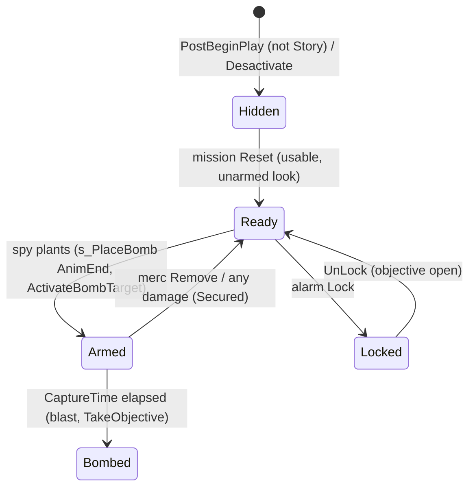

# Bomb target (SBombTargetObjectiveTrigger)

Units:
- def:SBase.SBombTargetObjectiveTrigger, def:SBase.SBombTargetInteraction, def:SBase.SGadBomb
- rep:SBase.SBombTargetObjectiveTrigger.bSkinState, rep:SBase.SBombTargetInteraction.bRemove, rep:SBase.SBombTargetInteraction.Update, rep:SBase.SGadBomb.ActivateBombTarget, rep:SBase.SPlayerController.ServerPlaceBomb
- uc:SBase.SBombTargetObjectiveTrigger:CheckOtherTriggers, uc:SBase.SBombTargetObjectiveTrigger:Triggering, uc:SBase.SBombTargetObjectiveTrigger:Timer, uc:SBase.SBombTargetObjectiveTrigger:TakeDamage, uc:SBase.SBombTargetObjectiveTrigger:Reset, uc:SBase.SBombTargetObjectiveTrigger:PostBeginPlay, uc:SBase.SBombTargetObjectiveTrigger:Lock, uc:SBase.SBombTargetObjectiveTrigger:TakeObjective
- uc:SBase.SBombTargetObjectiveTrigger:s_TemporaryInactive.BeginState, uc:SBase.SBombTargetObjectiveTrigger:s_TemporaryInactive.EndState, uc:SBase.SBombTargetObjectiveTrigger:s_TemporaryInactive.UnLock, uc:SBase.SBombTargetObjectiveTrigger:s_TemporaryInactive.Reset
- nat:SBase.SBombTargetObjectiveTrigger.Desactivate
- uc:SBase.SBombTargetInteraction:Touch, uc:SBase.SBombTargetInteraction:Update, uc:SBase.SBombTargetInteraction:InitInteract
- uc:SBase.SGadBomb:Use, uc:SBase.SGadBomb:ActivateBombTarget, nat:SBase.SGadBomb.CanUse
- uc:SBase.SPlayerController:ServerPlaceBomb, uc:SBase.SPlayerController:s_PlaceBomb.BeginState, uc:SBase.SPlayerController:s_PlaceBomb.PawnTakeDamage, uc:SBase.SPlayerController:s_PlaceBomb.AnimEnd, uc:SBase.SPlayerController:s_PlaceBomb.PlayerMove, uc:SBase.SPlayerController:s_PlaceBomb_End.BeginState, uc:SBase.SPlayerController:s_PlaceBomb_End.PawnTakeDamage, uc:SBase.SPlayerController:s_PlaceBomb_End.AnimEnd, uc:SBase.SPlayerController:s_PlaceBomb_End.PlayerMove
- Native C++ without a script unit (proposed): eng:ASBombTargetObjectiveTrigger::Tick

SteeE has no bomb target; 196 Story bomb spots exist across the other maps (and a few in StroD's Disk Hunt and
Deathmatch missions).

## Purpose

A bomb spot is a trigger where a spy plants a charge with the "Modem" gadget (`SGadBomb`, given to spies in Story
and Sabotage). After `CaptureTime` seconds the charge goes off: a blast around the spot and the objective is taken.
While armed, mercs can remove it through the same interaction, and any damage to the charge defuses it. Several
spots can share one objective; only one of them can be armed at a time.

## Data

| Field | Default | Notes |
|---|---|---|
| AbsentSkin | `SGameplayObjectsTex.Object.FX_pose_bomb_heat` | The look of an unarmed spot (a special-vision material). With an AbsentSkin the spot stays visible and `bSkinState` swaps its look (rule 14); with None it is hidden except while armed. |
| bSkinState | false | Replicated (reliable, authority): armed look. |
| bLocalSkinState | false | Each machine's copy, compared every tick. |
| CaptureTime | inherited 5; stock maps 25 or 30 | Fuse seconds. |
| HitPoints | 1 | Fed to the native blast. |
| bDamageable, bBlockActors, bCanDamageActor | true | |
| DamageActorType, DamageActorRange, DamageActorPoints | SDamage_Explosion, 200, 15 | Blast parameters of the native ProcessDamage (`spec/devices/gameplay-object.md`, `spec/native/natives2-damage.md` rule 1). |
| InteractionClass | SBombTargetInteraction | fInteractionRadius 100. |
| Mesh | `SGameplayObjects.SGPO_SM.Mode_bombing_spy`, Skins 0 to 2 = FX_pose_bomb_heat | bAcceptsProjectors false. |

`SBombTargetInteraction`: iPriority 30, Description "Place bomb", DescriptionRemove "Remove",
`bInteractInFrontWithCollisions`, UsableBy spies; `bRemove` replicated (reliable, authority); `Update` a reliable
simulated server-to-client function.

`SGadBomb`: ItemName "Modem", Charge 5000, RefireRate 4.0, bActivatable (never selectable: the gadget selection
skips it), `WhyCantUse` (int), `BombTrigger` (the spot being used, server).

## Rules

Setup:

1. `PostBeginPlay` (simulated): parent; `InteractionObj.bUsable = false`; on the authority, when the match mode is
   not GM_Multi (Story), `bHidden = true`. So outside Story the spots are hidden until a mission resets them.
2. `Reset` (from the objective's reset): parent (`objective-trigger.md` rule 6: active, unlocked, triggering stopped,
   `s_Initial`); with an AbsentSkin `bSkinState = false` and visible, else hidden; `bIgnoreEchelonLighting = true`;
   `InteractionObj.bUsable = true`.
3. `Desactivate` (native, decoded; it replaces the objective trigger version): `bActive = false`, `bLocked = false`,
   the `Triggering(false)` event, `bEMFIsOn = false`, `bHidden = true`, `InteractionObj.bUsable = false`. There is no
   `GotoState_Inactive`: the spot keeps its state.

Planting (spy):

4. `SBombTargetInteraction.InitInteract` (server) by a spy pawn: when the pawn has an `SGadBomb`, its `BombTrigger`
   becomes this spot and the controller's `ServerPlaceBomb()` runs (alive: `MirrorState('s_PlaceBomb')`). Without a
   gadget, a spy still in `s_MenuInteraction` with health goes back to its previous state without saving the menu
   state.
5. `s_PlaceBomb` (ignores nothing extra). BeginState: on the spy's own machine, when the gadget's `CanUse()` fails,
   go back to walking (crouched: `SA_WALK_CR_0H` and `s_PlayerWalkingCr0H`; else `SA_WALK_ST_0H` and
   `s_PlayerWalkingSt0H`) and stop. Otherwise `SA_BOMB`. `PlayerMove`: no jump, camera rotation, zero acceleration
   (sent or processed). `AnimEnd(0)`: on the spy's own machine `SGadBomb.Use(1)`; then `ChangeState
   ('s_PlaceBomb_End')`. Damage while alive: `MirrorState('s_PlaceBomb_End')` (combat spec handler).
6. `s_PlaceBomb_End`: BeginState `SA_BOMB_END`. `AnimEnd(0)`: with a loaded weapon the undraw action for the stance
   (`SA_WALK_CR_2Hto0H` or `SA_WALK_ST_2Hto0H`), then back to walking as in rule 5. `PlayerMove` as rule 5. Damage
   while alive: `MirrorState('s_PlayerWalkingSt0H')` and the undraw action when a weapon is loaded.
7. `SGadBomb.Use(V)` (simulated): `LastUsed = TimeSeconds`, `Charge -= 1`, then `ActivateBombTarget()` (reliable
   client-to-server): `BombTrigger.Triggering(true)` and `BombTrigger.ControllerWhoTakesIt` = the owner pawn's
   controller.
8. `SGadBomb.CanUse()` (native, decoded): false with `WhyCantUse = 6` ("wrong position") when the owner exists and
   is not walking (`PHYS_Walking`) or its current action (`sAction`) is a roll (`SA_ROLLING` 130, `SA_ROLLINGUP`
   131, `SA_ROLL_LAND` 132). Else true when `TimeSeconds - LastUsed >= RefireRate` and (`Charge >= 1` or the level
   is a tutorial); otherwise false with `WhyCantUse = 0` ("no modem left"). The other reasons (1 to 5) are never
   set by this build.

Arming and the fuse (server):

9. `Triggering(Status)`: ignore when unchanged; ignore arming when not `bActive`; arming fails when another trigger
   of the same objective is triggering (`CheckOtherTriggers`: walking the objective's triggers in order, a
   triggering one fails the test; every other one checked before it is made unusable and hidden). Then the base
   `Triggering` (HUD status, trigger time, no merc radar marker for this class). Armed: AbsentSkin set gives
   `bSkinState = true`, else visible; `bIgnoreEchelonLighting = false`; `SetTimer(CaptureTime)`; ambient sound
   `Armes_impacts.Armes.ProxMine_ACTI_1`; `UsableBy = U_SPAWNDEFENSE`; `Update(true)`; message 27 to everyone
   ("<ObjectiveName> : Under attack"). Disarmed: AbsentSkin set gives `bSkinState = false` and visible, else hidden;
   `bIgnoreEchelonLighting = true`; timer cleared; every other active trigger of the objective usable and visible
   again; ambient sound off; `bUsable = true`; `UsableBy = U_SPAWNOFFENSE`; `Update(false)`.
10. Merc use while armed (`InitInteract` by a non-spy pawn): `Triggering(false)`, timer cleared, message 28 to
    everyone ("<ObjectiveName> : Secured"), `Stats.Merc_SecuredBombs++` for that merc, then the base interaction
    (back to the previous state).
11. `TakeDamage` (any damage): while armed, message 28 and, for a merc player instigator, `Merc_SecuredBombs++`;
    then always `Triggering(false)` and the timer cleared. Shooting the charge defuses it.
12. `Timer` (the fuse is done): `bUsable = false`, hidden, `bIgnoreEchelonLighting = true`, `ProcessDamage
    (HitPoints)` (the native blast: `DamageActorPoints` of `SDamage_Explosion` to actors around within
    `DamageActorRange`, with the falloff and sight rules of `natives2-damage.md` rule 1; a pawn hit by
    SDamage_Explosion takes the blast reaction of the combat spec), `HitPoints = 1`, `Triggering(false)`, then
    `TakeDamage(HitPoints, ControllerWhoTakesIt.Pawn, ...)` (no message any more: not armed), then `TakeObjective`.
13. `TakeObjective`: spawn `SMineProxEmitter` at the spot (owned by it), sound `Armes_impacts.Armes.RA_ProxMine_Explo`
    (slot Misc, radius 500), message 29 to everyone ("<ObjectiveName> : Bombed"), then the base `TakeObjective`
    (credit to `ControllerWhoTakesIt`, objective taken).
14. `ASBombTargetObjectiveTrigger::Tick` (native, decoded, every machine): when `bSkinState` differs from
    `bLocalSkinState`, copy it; armed: `Skins[0..2] = None` (the mesh's own materials) and `bAcceptsProjectors =
    true`; unarmed: `Skins[0..2] = AbsentSkin` and `bAcceptsProjectors = false`. The AbsentSkin is the ghost of the
    charge: `FX_pose_bomb_heat` is a SpecialVisionTextureModifier (heat and EMF texture `FX_pose_bomb`) over the
    Shader `FX_pose_bomb_fx` (Diffuse, Opacity and SelfIllumination all `FX_pose_bomb`, TwoSided): a fullbright,
    two-sided, pale green charge at about 25% opacity, flickering at 3 fps with its darker, fainter second frame
    (`FX_pose_bomb` AnimNext `FX_pose_bomb_2`). Every player of both teams sees it; armed, the solid C4 shows
    (`bombing_c4_heat`, `bombing_c4_ecran_heat`). Client drawing: `MeshFollower.DrawSkin` puts Skins[0] over the node
    when `GameplaySkins` builds it (game/Scripts/Render/GameplaySkins.cs).

Menu label:

15. `SBombTargetInteraction.Update(remove)` (simulated multicast): `bRemove = remove`; the local player's pawn
    leaves the entry and, when it touches it, enters it again (the label refreshes); on the authority every other
    touching SBase pawn leaves and re-enters. `Touch` sets `Description` to DescriptionRemove when `bRemove`, else
    the class default, then the normal touch.

Alarm lock:

16. `Lock`: nothing when hidden; in Sabotage or Story, message 28 when not armed; `InteractionObj.bUsable = false`;
    `s_TemporaryInactive` (BeginState `bLocked = true`, EndState `bLocked = false`; `Reset` ignored; `UnLock`: when
    the objective is not taken `bUsable = true` and back to `s_Initial`, else the global `Desactivate`). In the
    locked state `TakeObjective` still works (`objective-trigger.md`).

## States

## Constants

| Name | Value | Unit | Provenance | Source |
|---|---|---|---|---|
| Plant to blast (CaptureTime 30) | 31.0 | s | measured | RE+ MapBuilderFacts |
| Plant animation | about 1 | s | measured | RE+ MapBuilderFacts |
| Blast | 15 within 200 | hp, uu | decoded | def (native application) |
| Explosion sound radius | 500 | uu | decoded | SBombTargetObjectiveTrigger.TakeObjective |
| Messages | 27 under attack, 28 secured, 29 bombed | switch | decoded | SGameMessages.GetString |
| Wrong position actions | 130 to 132 | sAction | decoded | ASGadBomb::execCanUse (game 0x10A9FBB0) |
| WhyCantUse codes | 0 no modem left, 6 wrong position | | decoded | ASGadBomb::execCanUse |
| Modem charge, refire | 5000, 4.0 | uses, s | decoded | def:SBase.SGadBomb |

## Network

The interaction's `UsableBy` is not a replicated field. `Update(Remove)` refreshes it on each machine together
with the label: mercs while armed, spies while unarmed. A client must not keep the planting-side default after
receiving the removal label.

Server-side logic. `bSkinState` and `bRemove` replicate (reliable, authority); `Update` is a reliable simulated
multicast; `ActivateBombTarget` is a reliable client-to-server function of the gadget and `ServerPlaceBomb` one of
the controller. The skin swap (rule 14) runs on each machine from the replicated flag.

## Edge cases

- Only one spot per objective can be armed; another spot's menu entry disappears (unusable and hidden) while one
  counts down, and comes back when it is defused.
- `TakeDamage` from the fuse itself happens after disarming, so it never sends "Secured".
- `CheckOtherTriggers` hides the spots it walked past before it finds an armed one, and nothing restores them until
  that armed spot is disarmed.
- Outside Story (Sabotage) and in other modes' missions the spots start hidden (rule 1).

## Evidence

- Decompiled: `local/re-out/uc/SBase/SBombTargetObjectiveTrigger.uc`, `SBombTargetInteraction.uc`, `SGadBomb.uc`,
  `SPlayerController.uc` (ServerPlaceBomb, s_PlaceBomb, s_PlaceBomb_End), `SGameMessages.uc` switches 27 to 29.
- Natives (game / editor): Desactivate thunk 0x10AE9C60 calling vtable slot 0x138, which for
  ASBombTargetObjectiveTrigger is 0x10A98A40 (editor 0x111BD350; event 0x36184 is Triggering, as in
  ASObjectiveTrigger::Desactivate 0x111CE1E0); Tick 0x10A98B00 (editor 0x111BD290 is the bare actor tick);
  ASGadBomb::execCanUse 0x10A9FBB0 / 0x111DADE0. Offsets: SObjectiveTrigger bit field at 996 (bit 1 bActive, bit 3
  bLocked), Actor bit fields at 744 (bit 12 bHidden, bit 25 bAcceptsProjectors) and 748 (bit 16 bEMFIsOn),
  InteractionObj at 768, SInteractObject bit field at 808 (bit 1 bUsable), SBombTargetObjectiveTrigger.AbsentSkin
  at 1000 and bit field at 1008 (bit 0 bSkinState, bit 1 bLocalSkinState), SBasePawn.sAction at 1824.
- Measured: RE+ `docs/MapBuilderFacts.md`.

## Open questions

1. Exact timing from plant to blast relative to `CaptureTime` (31.0 s measured for 30): plant animation length plus
   the fuse; confirm with a Play Level trace on a map with bomb spots.
2. The blast's per-pawn effect (falloff and the knock-down reaction) belongs to the native ProcessDamage and the
   combat spec; verify on a live bomb.
