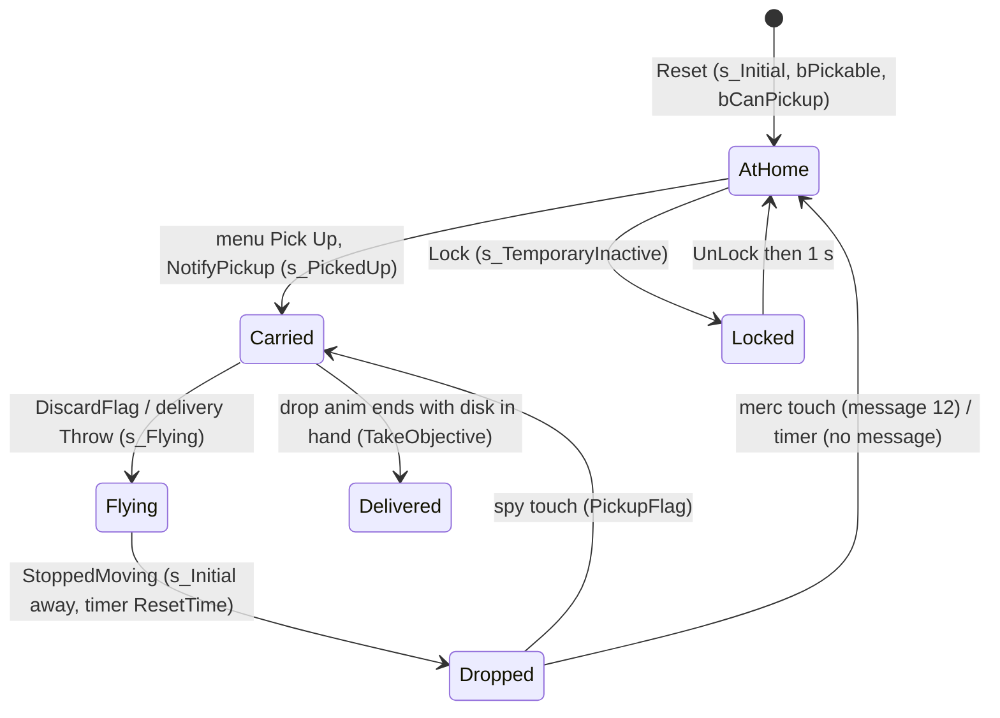
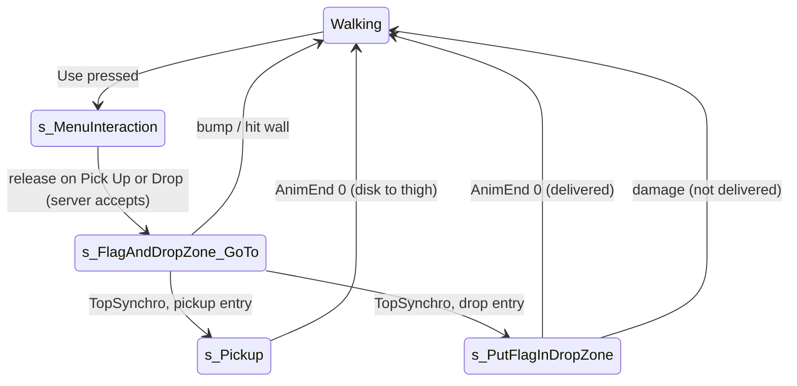

# Disk to carry (SFlag, SFlagDropZone)

Units:
- def:SBase.SFlag, def:SBase.SFlagDropZone, def:SBase.SFlagDropZoneInteraction, def:SBase.SPickupInteraction
- rep:SBase.SFlag.FlagCarrier, rep:SBase.SFlag.DropZone, rep:SBase.SFlag.bResetZeroValues, rep:SBase.SFlag.SetFlagCarrier, rep:SBase.SFlagDropZoneInteraction.MyOwner, rep:SBase.SPickupInteraction.bCanPickup, rep:SBase.SBasePawn.CarriedFlag, rep:SBase.SBasePawn.HandItem, rep:SBase.SGamePlayObject.Throw
- uc:SBase.SFlag:LeaveCarrier, uc:SBase.SFlag:PostBeginPlay, uc:SBase.SFlag:Destroyed, uc:SBase.SFlag:Prepare, uc:SBase.SFlag:Reset, uc:SBase.SFlag:SetFlagCarrier, uc:SBase.SFlag:NotifyPickup, uc:SBase.SFlag:Throw, uc:SBase.SFlag:StoppedMoving, uc:SBase.SFlag:CheckDropZone, uc:SBase.SFlag:TakeObjective, uc:SBase.SFlag:Lock, uc:SBase.SFlag:UnLock
- uc:SBase.SFlag:s_Initial.BeginState, uc:SBase.SFlag:s_Initial.Timer, uc:SBase.SFlag:s_Initial.Touch, uc:SBase.SFlag:s_Inactive.BeginState, uc:SBase.SFlag:s_Inactive.Timer, uc:SBase.SFlag:s_TemporaryInactive.BeginState, uc:SBase.SFlag:s_TemporaryInactive.Lock, uc:SBase.SFlag:s_TemporaryInactive.UnLock, uc:SBase.SFlag:s_TemporaryInactive.Reset, uc:SBase.SFlag:s_TemporaryInactive.Timer
- nat:SBase.SFlag.Desactivate
- uc:SBase.SFlagDropZone:PostBeginPlay, uc:SBase.SFlagDropZone:Close, uc:SBase.SFlagDropZone:Timer, uc:SBase.SFlagDropZone:IsWaitingAFlag, uc:SBase.SFlagDropZone:Open (the states s_Initial and s_Inactive have empty code and no unit)
- uc:SBase.SFlagDropZoneInteraction:PostBeginPlay, uc:SBase.SFlagDropZoneInteraction:PostNetBeginPlay, uc:SBase.SFlagDropZoneInteraction:InitInteract, nat:SBase.SFlagDropZoneInteraction.CanUse
- uc:SBase.SPickupInteraction:PostBeginPlay, uc:SBase.SPickupInteraction:InitInteract, nat:SBase.SPickupInteraction.CanUse
- uc:SBase.SGamePlayObject:NotifyPickup, uc:SBase.SGamePlayObject:Throw, uc:SBase.SGamePlayObject:StoppedMoving, uc:SBase.SGamePlayObject:s_PickedUp.BeginState, uc:SBase.SGamePlayObject:s_PickedUp.TakeDamage, uc:SBase.SGamePlayObject:s_Flying.BeginState, uc:SBase.SGamePlayObject:s_Flying.Landed, uc:SBase.SGamePlayObject:s_Flying.Bump, uc:SBase.SGamePlayObject:s_Flying.HitWall, nat:SBase.SGamePlayObject.NativeHitWall
- uc:SBase.SPlayerController:DiscardPickup, uc:SBase.SPlayerController:DiscardFlag, uc:SBase.SPlayerController:SetHandItemFromInteraction, uc:SBase.SPlayerController:PickupFlag
- uc:SBase.SPlayerController:s_Pickup_GoTo.BeginState, uc:SBase.SPlayerController:s_Pickup_GoTo.EndState, uc:SBase.SPlayerController:s_Pickup_GoTo.NotifyBump, uc:SBase.SPlayerController:s_Pickup_GoTo.NotifyHitWall, uc:SBase.SPlayerController:s_Pickup_GoTo.PlayerMove, uc:SBase.SPlayerController:s_Pickup_GoTo.TopSynchro
- uc:SBase.SPlayerController:s_Pickup.BeginState, uc:SBase.SPlayerController:s_Pickup.EndState, uc:SBase.SPlayerController:s_Pickup.AnimEnd, uc:SBase.SPlayerController:s_Pickup.PlayerMove
- uc:SBase.SPlayerController:s_FlagAndDropZone_GoTo.BeginState, uc:SBase.SPlayerController:s_FlagAndDropZone_GoTo.EndState, uc:SBase.SPlayerController:s_FlagAndDropZone_GoTo.NotifyBump, uc:SBase.SPlayerController:s_FlagAndDropZone_GoTo.NotifyHitWall, uc:SBase.SPlayerController:s_FlagAndDropZone_GoTo.PlayerMove, uc:SBase.SPlayerController:s_FlagAndDropZone_GoTo.TopSynchro
- uc:SBase.SPlayerController:s_PutFlagInDropZone.BeginState, uc:SBase.SPlayerController:s_PutFlagInDropZone.EndState, uc:SBase.SPlayerController:s_PutFlagInDropZone.PawnTakeDamage, uc:SBase.SPlayerController:s_PutFlagInDropZone.AnimEnd, uc:SBase.SPlayerController:s_PutFlagInDropZone.PlayerMove
- uc:SBase.SBasePawn:AnimNotifyPickup
- rl:fix.disk_radar
- partial: uc:SBase.SPlayerController:s_Dead.BeginState, uc:SBase.SPlayerController:s_PlayerFalling_OutOfWorld.BeginState, uc:SBase.SPlayerController:Destroyed (flag discard lines only); uc:SBase.SGameInfo:Killed (CarrierKiller line only)

## Purpose

The Story "Disk:" objective is an `SFlag` (a hard disk sitting in a server rack) whose drop zones are `SFlagDropZone`s (a case with a lid). A spy takes the disk from its home through the interaction menu, carries it on his thigh, and completes the objective by using a drop zone's "Drop" entry. If the carrier dies, falls out of the world or leaves, the disk drops where he was. A dropped disk is picked up again by any spy who touches it, is sent home by any merc who touches it, and goes home on its own `ResetTime` seconds after it comes to rest. (`SDisk` is the separate GM_DiskHunt class and is not part of this spec.)

## Data

`SFlag`:

| Field | Type | Default | SteeE (SFlag28768) | Notes |
|---|---|---|---|---|
| ResetTime | int | 60 | **15** | Seconds a dropped disk waits before going home. |
| DropZone[5] | Actor | None | [0] = SFlagDropZone28771, [1..4] None | Zones this disk can be delivered to. Replicated (`bNetInitial`). |
| TriggerName | string | "Unnamed trigger" | "Secret Files" | Used in messages 10, 11, 12, 22. |
| fInteractionRadius / Height | float | -1 / -1 | 50 / 30 | Overridden by the pickup interaction (rule 3); no effect. |
| CaptureTime | int | 0 | 0 | Not used by the flag flow. |
| bPickable | bool | true | | True only while at home and takeable through the menu. |
| FlagCarrier | Pawn | None | | Replicated (`bNetInitial` only). |
| FlagTaken | bool | false | | Set on every machine by the multicast `SetFlagCarrier`. |
| bResetZeroValues | bool | false | | Replicated; true after a drop, false after a pickup (native reader). |
| CarrierKiller | Controller | None | | Set by `SGameInfo.Killed` when an enemy kills the carrier. |
| bShouldLock | bool | false | | Pending lock while carried. |
| finalDropZone | int | 0 | | 1-based index of the zone nearest the disk at delivery. |
| InitialLocation / InitialRotation | | | (-4452.3, 261.6, -1052.0) / yaw -32768 | Home. |
| Server | SBasicGamePlayObject | | | Rack mesh `SGameplayObjects.Extraction_SM.Server`, spawned at home. |
| DefDropZone | SFlagDropZone | | | Spawned at home (see rule 2 and Open questions). |
| Mesh | | `Extraction_SM.HardDisk_T` (set in PostBeginPlay) | | |
| Collision | | radius 5, height 16 | | |
| Light | | LT_Steady, LE_PointAmbient, hue 29, sat 141, brightness 255, radius 1 | brightness 0 | Dynamic light; SteeE turns it off. |
| Net | | NetUpdateFrequency 100, NetPriority 1.4, bAlwaysRelevant false, bReplicateMovement true, bUpdateSimulatedPosition true | | Native `IsNetRelevantFor`. |

`SFlagDropZone` (SFlagDropZone28771 at (-1575, 1700, -92), rotation 0, TriggerName "Secret Files", fInteractionRadius 50, fInteractionHeight 30): mesh `Extraction_SM.Malette_bas` (case bottom), PrePivot (-10, 0, 0), collision 5 x 5, `InteractionClass = SFlagDropZoneInteraction`, `bInteractInFront = true`. It is not in any objective's `Triggers`, so it is never reset by a mission.

`SFlagDropZoneInteraction`: iPriority 25, Description "Drop", bUsable **false**, UsableBy U_SPAWNOFFENSE, vRelativePositionForInteraction (0, 0, 0).

`SPickupInteraction`: iPriority 25, Description "Pick Up", bCanPickup true, UsableBy U_SPAWNOFFENSE, vRelativePositionForInteraction (0, 0, 0), bAlwaysRelevant, bReplicateMovement.

## Rules

Setup (server):

1. `SFlag.PostBeginPlay`: spawn the rack `Server` (an `SBasicGamePlayObject` owned by the flag, at home, ignoring collision): rack mesh, `DT_StaticMesh`, visible, simulated proxy, flag's `HeatIntensity`, collision (true, true, true) so it blocks players. Set the flag's mesh to `HardDisk_T`. Store `InitialLocation`, `InitialRotation`. Spawn `DefDropZone` (an SFlagDropZone at the flag's location). `bShouldLock = false`. Parent `PostBeginPlay` (SGamePlayObject: because `bPickable`, spawn the `PickupInteraction` at the flag's location and rotation, set `bMovable`, `bReplicateMovement`, `bUpdateSimulatedPosition`, clear `bSkipActorPropertyReplication`; remember `InitialStaticMesh = HardDisk_T`). Then `PickupInteraction.bInteractInFront = true`, `SetCollision(false, false, false)`, `bResetZeroValues = false`.
2. `DefDropZone`: the class `SFlagDropZone` has `bNoDelete = true` by default, and a UE2 `Spawn` of a `bNoDelete` class fails, so `DefDropZone` is expected to be None (estimated, see Open questions). It is only used by `CheckDropZone` for a merc carrier, which cannot happen in Story.
3. Pickup interaction size: the generic sizing (50 x 30 from the flag's instance values) is overridden by `SPickupInteraction.PostBeginPlay`: `ItRadius = Owner.CollisionRadius + 50`, `ItHeight = Owner.CollisionHeight + 10`, so the disk's cylinder is 55 x 26 uu, centred on the disk and based on it.
4. `SFlagDropZone.PostBeginPlay`: parent (spawns its `SFlagDropZoneInteraction` at the zone's location and rotation; the zone's `iPriority` is -1 so 25 is kept; `bInteractInFront = true` copied); then spawn the lid `Cover` (`SBasicGamePlayObject`, owned by the zone) at `Location + (0, 0, 10) - 10 X`: mesh `Malette_haut`, visible, collision (true, true, true), `PHYS_Rotating`, movable, replicated movement, `bRotateToDesired`, `DesiredRotation = Rotation`, `RotationRate = (20000, 0, 0)`. Then the zone itself `SetCollision(true, true, false)` (blocks actors, not players).
5. Drop zone interaction size: `SFlagDropZoneInteraction.PostBeginPlay` sets 100 x 100 after the generic sizing, but its `PostNetBeginPlay` (which runs right after spawn on the server) restores `(ItRadius, ItHeight)` from the zone's instance values. SteeE effective server cylinder: 50 x 30. `MyOwner = Owner` (replicated copy of the owner).
6. `Reset` (from the objective's reset, and every "go home"): parent `Reset` (`objective-trigger.md` rule 6: mesh restored, `bActive = true`, `bLocked = false`, `Triggering(false)` which removes any merc radar marker, `GotoState('s_Initial')`); `CarrierKiller = None`; `bPickable = true`; `PickupInteraction.bCanPickup = true`; collision off; `bCollideWorld = false`; move to `InitialLocation`, `InitialRotation`, `DesiredRotation = InitialRotation`; `bCollideWorld = true`; `bHidden = false`; `bTriggering = false`; `SetCollision(true, false, false)` (touchable, not blocking); re-place the pickup interaction on the disk (unbase, move, rotate, rebase). If `bShouldLock`: `bPickable = false`, `bCanPickup = false`, `GotoState('s_TemporaryInactive')`; else `GotoState('s_Initial')`. Reset does not touch the drop zones and sends no message.
7. `Prepare`: `bHidden = false`.

Taking the disk from home:

8. At home `s_Initial.Touch` ignores everyone (rule 17), so the only way is the menu: a spy (UsableBy) opens it and releases Use on "Pick Up". The server `SPickupInteraction.InitInteract`: if the instigator is alive, `MirrorState('s_FlagAndDropZone_GoTo')` because the owner is an SFlag (other pickables use `s_Pickup_GoTo`).
9. `s_FlagAndDropZone_GoTo` (input machine): unless already repositioning, `SA_REPOS`. Let `F = vector(interaction.Rotation)` (the disk's facing) and `X, Y, Z` the axes of `rotator(-F)`. Target `= interaction.Location + X * off.X + Y * off.Y + Z * off.Z` with `off = vRelativePositionForInteraction` ((0, 0, 0) for both the pickup and the drop interaction), then Z replaced by the pawn's Z, then minus `67 X`; facing `-F` with its Z zeroed. So the spy stands 67 uu in front of the disk along its facing and looks at it. SteeE: (-4519.3, 261.6), facing yaw 0. On both machines `DiscardPickup()` (throws a hand item, if any). Bump or hit wall: `SA_EXIT_REPOS`, `GotoWaitingState()`. `AltFire`, `Fire` and `PickupFlag` are ignored in this state. On EndState (input machine) the repositioning target is cleared and the walk action restored for the stance and weapon.
10. `TopSynchro` (input machine): the selected interaction is an `SPickupInteraction`, so `ChangeState('s_Pickup')` and `SA_PICKUP_FLAG`.
11. `s_Pickup.BeginState` (input machine, local player only): `SetHandItemFromInteraction(selected)`, a reliable client-to-server call. Server: if `HandItem` is set, return; if the item's owner is owned by a player controller (someone holds it), return; for an SFlag: if already carrying a flag, `DiscardFlag()`; `CarriedFlag = flag`; `flag.NotifyPickup(self)`.
12. `SFlag.NotifyPickup(C)` (server): parent (SGamePlayObject: `SetPhysics(PHYS_None)`, `SetOwner(C)`, unbase the pickup interaction, `bCanPickup = false`, `GotoState('s_PickedUp')` (collision off; `TakeDamage` ignored), collision off). Then `CarrierKiller = None`; `bActive = false`; `FlagCarrier = C.Pawn`; `FlagTaken = true`; `SetFlagCarrier(true)` (multicast); `bResetZeroValues = false`. If the pawn is a spy: `BroadcastLocalizedMessage(10, obj = self)` to all ("Secret Files : Data stolen"); `C.ReceiveLocalizedMessage(53)` to the carrier only ("Go to the drop zone (secured case)"); `bTriggering = true` (set directly: no `Triggering()` call, so no merc radar marker and no `NotifyTriggering`); for each of the 5 `DropZone` entries: `bTriggering = true`, `InteractionObj.bUsable = true`, `Open()` (None entries are skipped). Then for any carrier: `BroadcastTeamLocalizedMessage(1, 54)` to the mercs ("Retrieve the hard drive"). If the pawn is a merc, attach to its `B L Thigh` bone at (10, 0, -10), rotation 0 (dead code in Story). Returns false.
13. `SFlagDropZone.Open`: `Cover.DesiredRotation = Rotation + (5000, 0, 0)` (lid opens by pitch 5000 at 20000 per second, 0.25 s). `Close`: `SetTimer(1.5)`; `Timer`: `Cover.DesiredRotation = Rotation`.
14. Attachment during the pickup animation: the pawn's `AnimNotifyPickup` (server) attaches the carried flag (when there is no hand item) to `B L Hand` at (8, -5, 0), rotation (-4000, 0, 16768). `s_Pickup.EndState` (server) moves it to `B L Thigh` at (10, 0, -10), rotation (0, 0, 32768). `s_Pickup.AnimEnd(0)`: back to `s_PlayerWalkingCr0H` or `s_PlayerWalkingSt0H` with the matching walk action. `s_Pickup` ignores `AltFire` and `Fire`.

Carrying:

15. The disk rides the carrier's thigh bone. `HandItem` stays free; the carrier cannot throw the disk (throwing uses `HandItem` only). While carried the disk is in `s_PickedUp`: no collision, damage ignored. The idle reminder repeats message 53 to an idle carrier (`missions.md` rule 33).

Dropping (server):

16. `DiscardFlag()` (server; also a reliable client-to-server function, but only server code calls it): if not carrying, return. If the objective is not taken, `BroadcastLocalizedMessage(11, obj = flag)` to all ("Secret Files : Data dropped"). `CarriedFlag.Throw(self, pawn.Velocity)`; `CarriedFlag = None`. Callers: `s_Dead.BeginState`, `s_PlayerFalling_OutOfWorld.BeginState`, `SPlayerController.Destroyed` (disconnect), the native `LeaveCarrier` event, and `PickupFlag`/`SetHandItemFromInteraction` when a second flag is taken.
17. `SFlag.Throw(Thrower, V)`: parent `Throw(FlagCarrier.Controller, V)` (SGamePlayObject: `Velocity = V`; `Instigator = Thrower.Pawn`; clear the pawn's `HandItem` if it is this; detach from the bone; place the disk at the pawn's `B L Hand` bone origin plus the world offset (8, -5, 0) (not rotated); move the pickup interaction there and base it on the disk; `GotoState('s_Flying')`). Then `bHidden = false`; `FlagCarrier = None`; `FlagTaken = false`; `SetFlagCarrier(false)` (multicast); `bTriggering = false`; `bResetZeroValues = true`; for each zone: if no flag still carried lists it (`IsWaitingAFlag()`), `bTriggering = false` and `InteractionObj.bUsable = false` (the lid is not closed); else `Open()` again.
18. `s_Flying` (SGamePlayObject): BeginState: `bCollideWorld`, `bBounce`, `bFixedRotationDir` true; pitch and roll rotation rates raised to at least 10000; `SetCollision(true, true, InitialBlockPlayers)` (for the disk: collide and block actors, not players); `PHYS_Falling`. `Landed(N)` calls `HitWall(N, None)`; `HitWall` calls native `NativeHitWall` (bounce and come-to-rest rule, Open questions), which ends with the `StoppedMoving` event. `Bump(Other)`: a non-pawn reverses the velocity with a random +-25 uu/s jitter on X and Y; a pawn is hurt only when `|V| >= 20` and `|V| * Mass / 500 > 8` (for Mass 8: `|V| > 500` uu/s), with damage `int(|V| * Mass / 500)`.
19. `SFlag.StoppedMoving`: if the objective is not taken `bActive = true`; `bPickable = false` (always); parent (SGamePlayObject: `bCanPickup` restored only if `bPickable`, which is now false, so the menu stays closed; `SetOwner(None)`; `SetCollision(true, InitialBlockActors, InitialBlockPlayers)`, for the disk (true, false, false); `GotoState('None')`); then `GotoState('s_Initial')`.

A dropped disk (`s_Initial`):

20. `BeginState`: if `Location != InitialLocation` (exact vector compare), `SetTimer(ResetTime, false)`.
21. `Touch(Other)`: ignore if the objective is taken or `bPickable` (the disk is at home); ignore if `Location.X == InitialLocation.X` and `Location.Y == InitialLocation.Y`. If `Other` is a living merc controlled by an `SPlayerController`: `BroadcastLocalizedMessage(12, obj = self)` ("Secret Files : Data secured"), `Stats.Merc_SecureDisks++` for that merc, `Reset()` (home). Else if `Other` is a living spy controlled by an `SPlayerController`: `PickupFlag(self)` on that controller: no menu, no animation.
22. `PickupFlag(flag)` (server): drop any flag already carried; `CarriedFlag = flag`; `NotifyPickup` (rule 12, same messages); detach; keep rotation; attach to `B L Thigh` at (10, 0, -10), rotation 0.
23. `Timer` (ResetTime after it came to rest): if `bActive`: if `CarrierKiller != None`, that killer's `Stats.Merc_SecureDisks++`; `Reset()`. No message is broadcast for this return.
24. A carried disk keeps any reset timer that was running, but the timer then fires in `s_PickedUp`, where only the base `SBasicGamePlayObject.Timer` (description text, empty here) runs, so it has no effect. A new rest restarts the timer.

Delivering:

25. While a spy carries the disk, each listed zone's interaction is usable. The spy releases Use on "Drop". Server `SFlagDropZoneInteraction.InitInteract`: if the instigator is alive, carries a flag, and `CarriedFlag.CheckDropZone(Owner)` is true: `MirrorState('s_FlagAndDropZone_GoTo')` and `Owner.Close()` (lid closes 1.5 s later). Otherwise the generic refusal (`MirrorState(PreviousState)`).
26. `SFlag.CheckDropZone(A)` (simulated): if `A == DefDropZone` and the carrier is a merc: `Reset()`, true. If the objective is not taken and `A` is one of `DropZone[0..4]`: `ControllerWhoTakesIt` = the carrier's controller (None if no carrier), true. Else false.
27. `s_FlagAndDropZone_GoTo` as rule 9, with the zone's interaction (SteeE: stand at (-1508, 1700), facing yaw 32768). `TopSynchro`: not a pickup interaction, so `ChangeState('s_PutFlagInDropZone')` and `SA_DROP_FLAG`.
28. `s_PutFlagInDropZone` (ignores `AltFire`, `Fire`, `PickupFlag`). BeginState (server): attach the disk to `B L Hand` at (8, -5, 0), rotation (-4000, 0, 0). `AnimEnd(0)`: back to `s_PlayerWalkingCr0H` or `s_PlayerWalkingSt0H`. EndState (server): if the disk's `AttachmentBone` is still `B L Hand`: `CarriedFlag.Throw(self, (0, 0, 0))`, `CarriedFlag.TakeObjective()`, `CarriedFlag = None`. Both machines: walk action for the stance.
29. Damage during the drop (`s_PutFlagInDropZone.PawnTakeDamage`): move the disk back to `B L Thigh` (10, 0, -10), rotation 0; if alive `MirrorState('s_PlayerWalkingSt0H')`; then normal damage. Because the bone is no longer the hand, EndState does not deliver: any damage cancels the delivery, even non-lethal.
30. `SFlag.TakeObjective`: `BroadcastLocalizedMessage(22, obj = self)` ("Secret Files : Data captured"); `finalDropZone` = 1 + index of the non-None zone nearest the disk (first minimum wins, start distance 100000000); base `TakeObjective` (credit, `Spy_ObjectivesTaken`, objective taken); `SetTimer(0)`.

Lock (alarm only; not reachable in SteeE):

31. `Lock`: if the menu pickup is possible (`bCanPickup`): `bPickable = false`, `bCanPickup = false`, `GotoState('s_TemporaryInactive')`; else `bShouldLock = true` (applied at the next `Reset`). `UnLock` (global): `bShouldLock = false`. `s_TemporaryInactive`: BeginState `bLocked = true`, `SetTimer(0)`; `Lock` nothing; `Reset` nothing; `UnLock`: if not taken `SetTimer(1.0)` else `bLocked = false` and `Desactivate()`; then `bShouldLock = false`; `Timer` (1 s after unlock): `bActive`, `bPickable`, `bCanPickup` true, `bLocked = false`, `GotoState('s_Initial')`.
32. `s_Inactive` (after `Desactivate`): BeginState calls `StoppedMoving()` (which itself ends by entering `s_Initial`, and can arm the reset timer if away from home) and then `SetCollision(false, false, false)`; `Timer` does nothing.
33. `LeaveCarrier` (event, native caller): `FlagCarrier.Controller.DiscardFlag()`. `Destroyed`: destroy the rack, then parent.

Merc radar (rl:fix.disk_radar):

34. The merc HUD's update (game 0x10b27bf9) puts a spy carrying the disk (`CarriedFlag` set) on the merc radar while
    his speed is above a threshold: 170 uu/s in the stock game, 200 uu/s under Reloaded (its hook 0x1001ad50 swaps
    the constant), so climbing a pole or a ladder with the disk no longer flashes him on the radar. Reloaded also
    picks the speed it tests (hook 0x1001ad60): the pawn's `Velocity` on a listen host, its last replicated velocity
    (`ReceivedVelocity`) on any other machine. A spy marked by the spy bullet shows whatever his speed (the radar
    rules, not this spec).

### Throwing a hand item

Rules T1 to T6 (SPlayerController ThrowObject and the s_Throw* states, SBasePawn.AnimNotifyThrow; decompiled
SPlayerController.uc lines 6801, 11800 to 11960, 24513 to 24740). HandItem is a pickable gameplay object, or a Disk
Hunt disk until its pickup clip frees the hand; a carried SFlag is never a hand item (rule 15).

T1. Entry: in s_PlayerWalkingSt0H / Cr0H (input machine) a fire-mode request (bForceFireMode, not sticky-shocking)
    with a HandItem goes to `s_ThrowGoTo` instead of drawing (the laser request is still applied first).
T2. All four states extend s_PlayerWalkingWeapon; Fire and AltFire do nothing (s_ThrowReady's Fire below);
    CanActivateLaser false. PlayerMove of s_ThrowGoTo and s_Throw: no jump, the weapon walk, then
    `UpdatePawnRotationMario(DeltaTime, 1000, 0)` (the pawn turns toward the view); s_ThrowLeave: no jump, the walk.
T3. `s_ThrowGoTo`: BeginState: a spy's camera ECM_SecondPerson (crouched ECM_SecondPersonCr), SA_THROW_ENTER.
    AnimEnd(0) (no machine test): ChangeState `s_ThrowReady`.
T4. `s_ThrowReady`: BeginState: a merc can be grabbed (bCanBeGrabbed; CanBeGrabbed true for a merc only),
    TimerUSe 0, SA_THROW_LOOP; EndState clears the grab flag. Fire (not in inventory mode): TimerUSe = now when 0,
    fThrowForce 0. PlayerTick, input machine, while TimerUSe > 0: held under MinimumThrowObjectDelay (0.25 s) gives
    fThrowForce 1; else `min((held - 0.25) / MaximumThrowObjectDelay (1 s), 1)` and the HUD gauge
    (SetBallisticValue); when Fire is no longer pressed: TimerUSe 0, gauge 0, ChangeState `s_Throw`. Then on every
    machine a spy whose fire-mode key is down (bFireMode 1, not shocked) goes to `s_ThrowLeave`; then the global tick.
T5. `s_Throw`: BeginState SA_THROW (ThroStAlEdH / ThroCrAlEdH). The clip's AnimNotifyThrow (0.257) runs only for
    the local player's own pawn: `ThrowObject` on the input machine: with X, Z the pawn's axes,
    `HandItem.Throw(self, (X + Z) * (fThrowForce + 1)^2 * 250)` (Throw is a reliable client-to-server function, so
    the server places and launches the item, rule 17's parent part), gauge 0. AnimEnd(0): SA_WALK_CR_0H /
    s_PlayerWalkingCr0H crouched, else SA_WALK_ST_0H / s_PlayerWalkingSt0H.
T6. `s_ThrowLeave`: BeginState camera ECM_Walking, SA_THROW_LEAVE (the raise clip backward); AnimEnd(0) as s_Throw.

## States

Disk:

Carrier (spy controller):

## Constants

| Name | Value | Unit | Provenance | Source |
|---|---|---|---|---|
| ResetTime default / SteeE | 60 / 15 | s | decoded | def:SBase.SFlag, SFlag28768 |
| Pickup cylinder | owner radius + 50, owner height + 10 (55 x 26) | uu | decoded | SPickupInteraction.PostBeginPlay |
| Drop zone cylinder (server) | instance fInteractionRadius x Height (50 x 30) | uu | decoded | SFlagDropZoneInteraction, SteeE |
| Stand-off from disk or zone | 67 | uu | decoded | s_FlagAndDropZone_GoTo |
| Thigh attach | bone B L Thigh, (10, 0, -10) | uu | decoded | PickupFlag, s_Pickup.EndState (rotation roll 32768 there, 0 in PickupFlag) |
| Hand attach | bone B L Hand, (8, -5, 0), rotation (-4000, 0, 0) drop / (-4000, 0, 16768) pickup notify | uu, rot | decoded | s_PutFlagInDropZone, AnimNotifyPickup |
| Drop placement | B L Hand origin + (8, -5, 0) world | uu | decoded | SGamePlayObject.Throw |
| Lid open | pitch +5000 at 20000/s | rot units | decoded | SFlagDropZone |
| Carrier radar speed | 170 stock, 200 Reloaded | uu/s | decoded | game 0x10b27bf9, Reloaded.Core 0x1001ad50 (0x1032b820) |
| Lid close delay | 1.5 | s | decoded | SFlagDropZone.Close |
| Lid offset | (0, 0, 10) - 10 X | uu | decoded | SFlagDropZone.PostBeginPlay |
| Unlock re-enable delay | 1.0 | s | decoded | s_TemporaryInactive.UnLock |
| Flying min spin | 10000 | rot units/s | decoded | s_Flying.BeginState |
| Bump damage | int(abs(V) * Mass / 500), only if over 8 | hp | decoded | s_Flying.Bump |
| Messages | 10 taken (all), 53 carrier hint, 54 to mercs, 11 dropped (all), 12 returned by merc (all), 22 delivered (all) | switch | decoded | messages.md |

## Network

The drop zone's `Cover` is transient. Its lid is a separately replicated `SBasicGamePlayObject`; the renderer binds
it by mesh and placement when `Owner` is absent (Actor's owner replication is restricted to `bNetOwner`). The lid
node must then follow that actor's replicated rotation rather than remain at the map's closed pose.
The server-driven lid enables both `bReplicateMovement` and `bUpdateSimulatedPosition`: without the latter, the
simulated-proxy rotation gate sends only the initial pose, leaving a lid that arrived open stuck open after delivery.

- Server: every rule above except the input-machine parts of `s_FlagAndDropZone_GoTo` and `s_Pickup` (repositioning, `SetHandItemFromInteraction` call, animation actions). `Touch` pickups and returns, timers, throws and deliveries are server-only.
- `SetHandItemFromInteraction`, `DiscardPickup`, `DiscardFlag`, `SGamePlayObject.Throw` are reliable client-to-server functions; only `SetHandItemFromInteraction` is called by a client in this flow.
- `SetFlagCarrier(bool)` is a reliable simulated multicast (flag 0x01000000) that sets `FlagTaken` on every machine.
- Replicated: `FlagCarrier`, `DropZone` (`bNetInitial` only), `bResetZeroValues` (reliable), `SBasePawn.CarriedFlag` and `HandItem` (reliable, `Role == ROLE_Authority`), `SPickupInteraction.bCanPickup`, `SFlagDropZoneInteraction.MyOwner`; the zone interaction's `bUsable` (SInteractObject field). The disk moves by normal movement replication while free and by attachment replication (`Base`, `AttachmentBone`, `RelativeLocation`, `RelativeRotation`) while carried. The flag has a native `IsNetRelevantFor` (decoded, game 0x10ae9a00, editor 0x111CF570): a hidden flag is not relevant; a flag carried by a pawn is relevant exactly when its carrier is (slice pawns are `bAlwaysRelevant`); otherwise it is always relevant. So in the slice every client has the disk except while it is hidden (a message naming a hidden disk then names a None object and loses "Secret Files"). The disk's native list sends `Base`, `bHidden` and `bTriggering` plus the objective trigger list (editor 0x111ce9c0); the drop zone's sends only `bTriggering` (editor 0x111cf480).
- On a client the drop zone interaction's non-simulated `PostNetBeginPlay` is absorbed, so the client cylinder stays at the generic size; only the server's cylinder matters for the server-side menu list.

## Edge cases

- A disk at home can only be taken through the menu (with the pickup animation); a dropped disk can only be taken by touch (the menu is closed because `bCanPickup` stays false), instantly and without animation.
- The "home" tests differ: `Touch` compares X and Y only, the reset timer compares the full vector. A disk that settles exactly above its home X and Y can never be touched and still goes home by timer.
- A merc touching a dropped disk returns it and credits himself; the timer return credits the carrier's killer (`CarrierKiller`, set only when an enemy kills the carrier; a carrier who fell out of the world or disconnected leaves it None).
- After a drop the zones' lids stay open (the drop does not close them); they close only when a delivery is started.
- `InitInteract` closes the lid even if the delivery is then cancelled by damage.
- Delivery completes when the drop animation ends; damage at any time before cancels it. Death during the drop: the state's damage handler moves the disk back to the thigh first, then death drops it (message 11).
- During delivery the disk is thrown with zero velocity from the hand and then `TakeObjective` runs; the disk ends in the case area. Afterwards, `Desactivate` moves it to `s_Inactive`, whose `StoppedMoving` call immediately re-enters `s_Initial` (and arms a 15 s timer that does nothing because `bActive` is false). The match normally ends at that point anyway.
- `DropZone` entries that are None are skipped silently (the original logs an access warning).
- While the disk is still flying (`s_Flying`) touches do nothing: a merc or spy must touch it after it has come to rest.
- A second flag taken while carrying drops the first (message 11 for it).
- Only `SPlayerController` pawns pick up or return by touch; bots or other controllers do not.

## Evidence

- Decompiled: `local/re-out/uc/SBase/SFlag.uc`, `SFlagDropZone.uc`, `SFlagDropZoneInteraction.uc`, `SPickupInteraction.uc`, `SGamePlayObject.uc`, `SBasePawn.uc` (AnimNotifyPickup, replication), `SPlayerController.uc` lines 6728 to 6799 (DiscardPickup, DiscardFlag, SetHandItemFromInteraction, PickupFlag), 24111 to 24511 (pickup and drop states), 19506, 20463 (death), 6705 (Destroyed); `SGameInfo.uc` line 1237 (CarrierKiller).
- Defaults: `classdefaults_effective.json` (SFlag, SFlagDropZone, SFlagDropZoneInteraction, SPickupInteraction).
- SteeE: SFlag28768, SFlagDropZone28771, SObjective28818.
- Natives: SFlag.Desactivate 1320 (thunk 0x10AE9C60), SPickupInteraction.CanUse 1338 and SFlagDropZoneInteraction.CanUse 1845 (thunk 0x10AB96F0), SGamePlayObject.NativeHitWall 0x10A90870. Editor: ASFlag Tick 0x111CED70, execDesactivate 0x111CECC0, GetOptimizedRepList 0x111CF040, IsNetRelevantFor 0x111CF570; ASFlagDropZone GetOptimizedRepList 0x111CF480; ASFlagDropZoneInteraction execCanUse 0x111BCFB0; ASPickupInteraction execCanUse 0x111BDD60; ASGamePlayObject execNativeHitWall 0x111C6850.
- Observed: RE+ `docs/MapBuilderFacts.md` (stock ResetTime 10 to 20; zones stand on their surface; carrier needs clear floor in front of the zone), `docs/phase4/revision3/office.md` (dropped-disk return and merc touch not yet measured).

## Open questions

1. `ASFlag::Tick` (editor 0x111CED70): when does it raise `LeaveCarrier`? Candidates: carrier KO'd, grabbed, carrier pawn destroyed, team change. Trace: KO a carrying spy (stun), grab him, put him on a zip line or ledge, and watch `CarriedFlag`.
2. What `bResetZeroValues` does on clients (likely zeroes relative location/rotation after detach to stop a stale attachment offset).
3. `NativeHitWall`: bounce coefficient, rest threshold, rotation handling (Ghidra 0x10A90870). Trace: drop the disk from a ledge in SteeE and record its path.
4. Does `Spawn` of the `bNoDelete` SFlagDropZone really fail (`DefDropZone == None`)? Live read of `SFlag28768.DefDropZone` in a sandbox, or Ghidra `ULevel::SpawnActor`.
5. `SPickupInteraction.CanUse` and `SFlagDropZoneInteraction.CanUse`: confirm that `bCanPickup`, `bUsable`, team and "is carrying a flag for this zone" are what is checked.
7. Measure: dropped disk returns 15 s after rest (from `StoppedMoving`, not from the drop); merc touch return; spy touch pickup with no animation.

### Resolved

6. `ASFlag::IsNetRelevantFor`. Resolved: hidden: no; carried: the carrier's result; otherwise always relevant. Network. Evidence: game 0x10ae9a00 (ANSWERS-net rep-objectives 2).
