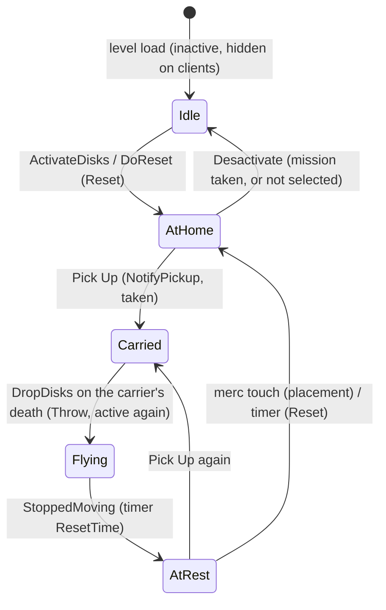

# Disk Hunt (SDisk and the GM_DiskHunt mission)

Units:
- def:SBase.SDisk
- uc:SBase.SDisk:PreBeginPlay, uc:SBase.SDisk:PostBeginPlay, uc:SBase.SDisk:NotifyPickup, uc:SBase.SDisk:Touch, uc:SBase.SDisk:Throw, uc:SBase.SDisk:StoppedMoving, uc:SBase.SDisk:Timer, uc:SBase.SDisk:Reset
- nat:SBase.SDisk.Desactivate
- nat:SBase.SMission.ActivateDisks
- uc:SBase.SPlayerController:DropDisks
- partial: uc:SBase.SPlayerController:SetHandItemFromInteraction (disk branch), uc:SBase.SPlayerController:s_Pickup.EndState (disk branch), uc:SBase.SBasePawn:AnimNotifyPickup (hand item branch), uc:SBase.SPlayerController:s_Dead.BeginState (disk drop line)
- Native C++ without a script unit (proposed): eng:ASDisk::Tick

## Purpose

In Disk Hunt (GameMode 4) the map's Disk Hunt mission owns a list of disks (`SDisk`, a small dog tag shaped prop).
At match start only some of them are put in play. Spies pick disks up through the Use menu and keep them; a spy
who dies drops every disk he carries; mercs send a dropped disk home by walking over it; a dropped disk goes home on
its own after `ResetTime` seconds at rest. The spies win as soon as they hold enough disks at once (the
"Disks to take" setting); otherwise the mercs win on time, or a side loses by running out of lives, as in Story
(`spec/game/end-of-round.md`).

## Data

`SDisk` extends `SObjectiveTrigger` (`objective-trigger.md`), so it has `bActive`, `bTriggering`, `Objective`,
`ControllerWhoTakesIt` and the pickable-object parts of `SGamePlayObject` (`PickupInteraction`, `bPickable`).

| Field | Type | Default | Notes |
|---|---|---|---|
| ResetTime | int | 20 | Seconds a disk at rest away from home waits before going home. |
| Group | byte | 0 | Activation group (rule 3). SteeE: all 30 disks are group 0. |
| InitialLocation, InitialRotation | | | Home, stored in PostBeginPlay. |
| bPickable | bool | true | So `SGamePlayObject.PostBeginPlay` spawns a `SPickupInteraction` ("Pick Up", spies only). |
| Mesh | | `SGameplayObjects.Objects.Dogtag_object` | Static mesh. |
| Collision | | radius 3, height 3 | |
| Net | | NetUpdateFrequency 100, bAlwaysRelevant false, bReplicateMovement, bUpdateSimulatedPosition, bSkipActorPropertyReplication false | Native replication: `Base`, `bHidden`, `bTriggering` (`spec/native/net-replists.md` rule 20); relevancy as SFlag (`spec/native/net-relevancy.md` rule 7). |

`SBasePawn.Disks` (array of SDisk, server only) lists the disks a pawn carries, newest first.
`PlayerReplicationInfo.iNbObjectivesTaken` shows how many a spy carries (replicated).

The disk counts of a match come from the host's settings object (`SPersistentData`, rule 17), not from the URL:
`NumDisks` (active disks, "Active Disks" in the menu) and `NumDisksToWin` ("Disks to take"). The game copies both into
the replicated `GameReplicationInfo.NumDisks` and `NumDisksToWin` for the HUD.

SteeE (`SMission28822`, GameMode 4, unchained, 30 SDisk triggers, `AtResetEvent` hackvolet01; map settings entry
`Handicap` 20, `NumDisksMax` 30, `ScoreLimit` 10): with untouched menu defaults 20 disks are put in play and the
spies need 10 at once.

## Rules

Match start (the mission side is `missions.md` rules 4 and 34):

1. `SGameInfo.StartMatch` sets the Disk Hunt mission's `MinimumObjectives` to the host's `NumDisks`, then calls the
   mission's `Reset`.
2. `SMission.Reset` (Disk Hunt branch): with `MinimumObjectives > 0` it calls the native `ActivateDisks
   (MinimumObjectives)`, otherwise it resets every trigger (all disks in play). Then `ComputeObjectivesLeft`,
   `TotalObjectivesLeft = GetTotalObjectivesLeft()` (the number of active disks), `GRI.NumObjectives +=
   TotalObjectivesLeft`, `ObjectiveTaken = false`, and the `AtResetEvent` fires.
3. `ActivateDisks(N)` (native, decoded):
   - Every non-empty entry of `Triggers` loses `bActive` (the flag only, no `Desactivate` call), and the distinct
     `Group` values are listed in order of first appearance (at most 10 groups).
   - `N` is lowered to the number of non-empty triggers.
   - Then, until `N` disks were activated, visit the groups in turn (group list index 0, 1, ... and back to 0
     after the last listed group): count the triggers of that group that are still not active; pick one at random
     (`rand() % count`, the C runtime generator; index 0 when the count is 0) and call its `DoReset` event (which
     runs the disk's `Reset`, so it becomes active); a group with no inactive disk left is skipped without
     counting. So disks are spread evenly over the groups, one per group per round.

Disk life cycle (server):

4. `PreBeginPlay` (simulated): clear the timer. `PostBeginPlay`: remember `InitialLocation`, `InitialRotation`;
   the parent setup (spawns the pickup interaction); `SetCollision(false, false, false)`.
5. `Reset` (the mission's `DoReset`, the timer, and every "go home"): the objective trigger reset
   (`objective-trigger.md` rule 6: `bActive = true`, `bLocked = false`, triggering stopped, state `s_Initial`).
   Then, with a pickup interaction: `bPickable = true`, `bCanPickup = true`, and every SBase player whose pawn
   touches the interaction loses it from his Use menu (`IManager.RemoveInteractionObj`). Then the disk goes home:
   collision off, `bCollideWorld` off, move to `InitialLocation`, rotation and `DesiredRotation` to
   `InitialRotation`, `bCollideWorld` on, `bHidden = false`, `SetCollision(true, false, false)`. Finally the pickup
   interaction is unbased, moved to the disk, rotated like it and based on it again.
6. `Desactivate` (native, decoded): `bHidden = true`; with a pickup interaction `bPickable = false` and
   `PickupInteraction.bCanPickup = false`; then the objective trigger `Desactivate` (`missions.md` rule 20,
   `objective-trigger.md`).
7. Taking a disk: a spy uses "Pick Up" (the interaction is spies only and needs `bCanPickup`); the generic pickup
   walk runs (`s_Pickup_GoTo`, `interaction-system.md` rule 22), then `s_Pickup.BeginState` on the spy's own
   machine asks the server `SetHandItemFromInteraction(entry)`. Server, disk branch (after the common tests: the
   hand is free and nobody owns the disk): insert the disk at the front of `Disks`, call its `NotifyPickup`, make it
   the `HandItem`, and set `PRI.iNbObjectivesTaken = Disks.Length`.
8. `NotifyPickup(C)`: the pickable-object part (`SetPhysics(PHYS_None)`, owner `C`, pickup interaction unbased and
   `bCanPickup = false`, state `s_PickedUp`, collision off); then `bActive = false`, `ControllerWhoTakesIt = C`,
   `TakeObjective()`, timer cleared; returns true.
9. `TakeObjective` is the objective trigger version (`objective-trigger.md`): taken time, event, no
   `Spy_ObjectivesTaken` statistic for a disk, then `Objective.NotifyTaken(C, disk)`. A disk's `Objective` is the
   Disk Hunt mission, whose `NotifyTaken` (`missions.md` rule 34) refreshes the counts and completes the mission
   only when `NumDisksToWin > 0` and `MinimumObjectives - (active disks) >= NumDisksToWin`, or, with
   `NumDisksToWin <= 0`, when no disk is active. Disks carried by spies and disks never activated both count as
   "not active", so the test is "enough of the disks put in play are out of play".
10. The pickup animation (`SBasePawn.AnimNotifyPickup`, server): when the hand item is a disk, the hand is freed
    (`HandItem = None`) and the disk is attached to `B L Hand` at (8, -5, 0) with rotation (-4000, 0, 32768). At the
    end of the pickup (`s_Pickup.EndState`, server), if the pawn carries no flag and `Disks[0]` exists, it is moved
    to `B L Thigh` at (10, 0, -7) with rotation (0, 0, 32768). A spy can therefore collect
    any number of disks: the hand is free again after each pickup.
11. `DropDisks()` (server only, called from `s_Dead.BeginState` when `GRI.GameMode` is Disk Hunt): if the pawn
    carries disks, everyone gets message 30 when the pawn is a merc, else message 31 (both empty in the English
    text table). Each disk `i` is thrown with velocity `i * 30 * (1, 1, 1)`, the list is emptied and
    `PRI.iNbObjectivesTaken = 0`.
12. `Throw(Thrower, V)` (a reliable server function): the pickable-object throw (velocity, instigator, released
    from the hand when it is the hand item, flying), then `bActive = true`, `bHidden = false` and the mission's
    `TotalObjectivesLeft` grows by one (the HUD count; the next `UpdateObjectivesLeft` recomputes it).
13. `StoppedMoving`: the pickable-object version (pickup entry usable again because `bPickable` stays true; owner
    cleared; collision restored), then `SetTimer(ResetTime)`.
14. `Timer`: `Reset()` (home). The timer of a disk picked up again is cleared by `NotifyPickup`.
15. `Touch(Other)` (there is no `s_Initial` override): ignored unless the disk is active and `Other` is a merc pawn
    (`SPAWNDEFENSE`, any controller, alive or not); ignored when the disk is at its home X and Y. Otherwise it is
    sent home by placement only (collision off, `bCollideWorld` off, home location and rotation, collision
    `(true, false, false)`, `bCollideWorld` on): no `Reset`, no message, no statistic, and the reset timer keeps
    running.
16. Client tick (`ASDisk::Tick`, decoded, every machine that is not the authority): a disk with no `Base` (not
    carried) and not active is hidden; otherwise (carried, or active) it is shown. This overrides the replicated
    `bHidden` locally.

Host settings (`GUI.Create_Match`, contract; the full menu contract is in `spec/game/game-modes.md`):

17. Untouched menu defaults read the map's Disk Hunt entry: `Handicap` clamped to 1..`NumDisksMax` (below 1 gives 1,
    then above `NumDisksMax` gives `NumDisksMax`) is the active disk count, and `ScoreLimit` clamped the same way to
    1..`Handicap` is the disks to take. `ApplyMatchRules` stores them as `SPersistentData.NumDisks` and
    `NumDisksToWin` and the URL carries `ScoreLimit` (the disks to take). The end menu resets both to the map entry
    values before the next game of a series.

## States

## Constants

| Name | Value | Unit | Provenance | Source |
|---|---|---|---|---|
| ResetTime | 20 | s | decoded | def:SBase.SDisk |
| Drop velocity step | 30 | uu/s per axis per disk | decoded | SPlayerController.DropDisks |
| Drop message, merc / spy carrier | 30 / 31 | switch | decoded | SPlayerController.DropDisks |
| Thigh offset and rotation | (10, 0, -7), (0, 0, 32768) | uu, rot | decoded | s_Pickup.EndState |
| Hand offset and rotation | (8, -5, 0), (-4000, 0, 32768) | uu, rot | decoded | SBasePawn.AnimNotifyPickup |
| Groups listed | 10 | | decoded | ASMission::execActivateDisks (game 0x10AC01A0) |
| SteeE defaults | 20 active, 10 to take | disks | measured | SteeE-i.utc Disk Hunt entry (Handicap 20, ScoreLimit 10, NumDisksMax 30) |

## Network

- Everything above runs on the server except rule 16 (clients) and the pickup walk (the spy's machine).
- `SetHandItemFromInteraction`, `DiscardPickup` and `DiscardFlag` are reliable client-to-server functions of the
  controller; `SDisk.Throw` is a reliable server function (only server code calls it).
- Clients see a disk through its replicated `Base`, `bHidden`, `bTriggering`, location and rotation; the HUD reads
  `GRI.NumDisks`, `GRI.NumDisksToWin`, the mission's `TotalObjectivesLeft` and `PRI.iNbObjectivesTaken`.

## Edge cases

- `NumDisksToWin = 0` (Play Level, or a host without settings): the spies must hold every disk put in play, and
  `NumDisks = 0` puts every disk in play.
- A merc touching a dropped disk sends it home without stopping its reset timer: the timer later runs `Reset` on a
  disk already at home (no visible change).
- Merc pawns are tested by class, so a dead merc body touching a disk also sends it home.
- A spy killed while holding the winning disk count never wins: the win is decided at the pickup.
- If the pickup animation notify does not fire (the pawn has no animation), the disk stays the hand item and the
  spy cannot pick up another one until it is thrown.

## Evidence

- Decompiled: `local/re-out/uc/SBase/SDisk.uc`, `SMission.uc` (Reset, NotifyTaken), `SPlayerController.uc`
  (DropDisks, SetHandItemFromInteraction, s_Pickup, s_Dead.BeginState), `SBasePawn.uc` (AnimNotifyPickup),
  `GUI/Create_Match.uc` (LoadModeRules, ApplyMatchRules, SetModeSettings), `GUI/Ending_Menu.uc`.
- Natives (game / editor): ASMission::execActivateDisks 0x10AC01A0 / 0x112207B0 (event 0x2ca31 is DoReset, as in
  ASObjective::Reset); SDisk.Desactivate is the shared thunk 0x10AE9C60 calling vtable slot 0x138, which for
  ASDisk is 0x10ABFE50 (editor slot 0x14c, 0x111CE980); ASDisk::Tick 0x10ABFDC0 / 0x111CE7F0. Field offsets from
  the generated metadata: SObjectiveTrigger bit field at 996 (bit 1 bActive), SDisk.Group at 1004, Actor bit field
  at 744 (bit 12 bHidden), SGamePlayObject.bPickable at 960, PickupInteraction at 836, SPickupInteraction bCanPickup
  bit 0 at 868.
- Map data: `SteeE.sdc` SMission28822 and its 30 SDisk; `SteeE-i.utc` map settings.

## Open questions

1. The order of `AllActors` and `Triggers` in the original is the map's; random picks will not match the original's
   C runtime sequence, so a difftest can only compare counts and group spread.
2. Whether a dedicated server animates pawns so that `AnimNotifyPickup` runs there (the rewrite runs the hand
   release at `s_Pickup.EndState` until script anim notifies are dispatched).
