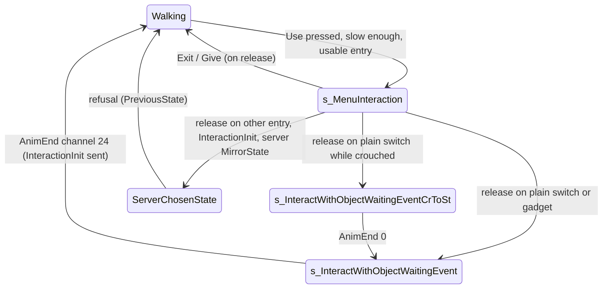

# Interaction system (Use menu)

Units:
- def:SBase.SInteractObject, def:SBase.SInteractionManager, def:SBase.SLeaveInteraction, def:SBase.SShareObjectInteraction, def:SBase.SMateInteraction, def:SBase.SHealMateInteraction, def:SBase.SRemoveSpyBulletInteraction, def:SBase.SBackPackInteraction, def:SBase.SInfirmaryInteraction, def:SBase.SAmmoStockInteraction, def:SBase.SBasicGamePlayObject (interaction fields)
- rep:SBase.SInteractObject.iLastUsedTime, rep:SBase.SInteractObject.iReusableTime, rep:SBase.SInteractObject.bPresenceDetected, rep:SBase.SInteractObject.bInteractInFrontWithCollisions, rep:SBase.SInteractObject.bInteractInFront, rep:SBase.SInteractObject.bUsable, rep:SBase.SInteractObject.bInUse, rep:SBase.SInteractObject.ItHeight, rep:SBase.SInteractObject.ItRadius, rep:SBase.SInteractObject.ChangePresenceDetected
- rep:SBase.SInteractionManager.NbObjects, rep:SBase.SInteractionManager.Interactions, rep:SBase.SInteractionManager.AddObjetOnClient, rep:SBase.SInteractionManager.RemoveInteractionObjOnClient, rep:SBase.SBasicGamePlayObject.InteractionObj, rep:SBase.SPlayerController.IManager, rep:SBase.SPlayerController.InteractionInit, rep:SBase.SPlayerController.Interaction, rep:SBase.SPlayerController.InteractionPost, rep:SBase.SMateInteraction.ReplicateMate
- uc:SBase.SInteractObject:ChangePresenceDetected, uc:SBase.SInteractObject:Interact, uc:SBase.SInteractObject:InitInteract, uc:SBase.SInteractObject:SetFocus, uc:SBase.SInteractObject:PostBeginPlay, uc:SBase.SInteractObject:PostNetBeginPlay, uc:SBase.SInteractObject:Destroyed, uc:SBase.SInteractObject:Touch, uc:SBase.SInteractObject:UnTouch
- nat:SBase.SInteractObject.DoTouch, nat:SBase.SInteractObject.PostInteract, nat:SBase.SInteractObject.TriggerEventServer, nat:SBase.SInteractObject.UnTriggerEventServer, nat:SBase.SInteractObject.SetPriority, nat:SBase.SInteractObject.CanUse
- uc:SBase.SInteractionManager:PostBeginPlay, uc:SBase.SInteractionManager:Ev_AddObjetOnClient, uc:SBase.SInteractionManager:AddObjetOnClient, uc:SBase.SInteractionManager:Ev_RemoveInteractionObjOnClient, uc:SBase.SInteractionManager:RemoveInteractionObjOnClient
- nat:SBase.SInteractionManager.GetNbInteractions, nat:SBase.SInteractionManager.HasUsableInteractions, nat:SBase.SInteractionManager.GetCurrentInteraction, nat:SBase.SInteractionManager.GetCurrentSubInteraction, nat:SBase.SInteractionManager.SelectFirstViewAbleItem, nat:SBase.SInteractionManager.SelectNextItem, nat:SBase.SInteractionManager.SelectPreviousItem, nat:SBase.SInteractionManager.CheckPriority, nat:SBase.SInteractionManager.Calc, nat:SBase.SInteractionManager.AddObjectAtIndex, nat:SBase.SInteractionManager.AddInteractionObj, nat:SBase.SInteractionManager.RemoveObject, nat:SBase.SInteractionManager.RemoveInteractionObj
- uc:SBase.SLeaveInteraction:PostBeginPlay, uc:SBase.SLeaveInteraction:Touch, uc:SBase.SLeaveInteraction:UnTouch, nat:SBase.SLeaveInteraction.CanUse
- uc:SBase.SShareObjectInteraction:PostBeginPlay, uc:SBase.SShareObjectInteraction:Touch, uc:SBase.SShareObjectInteraction:UnTouch, nat:SBase.SShareObjectInteraction.CanUse
- uc:SBase.SMateInteraction:PostBeginPlay, uc:SBase.SMateInteraction:ReplicateMate, uc:SBase.SMateInteraction:Touch, uc:SBase.SMateInteraction:UnTouch, nat:SBase.SMateInteraction.CanUse
- uc:SBase.SHealMateInteraction:InitInteract, uc:SBase.SRemoveSpyBulletInteraction:InitInteract, uc:SBase.SBackPackInteraction:InitInteract, uc:SBase.SInfirmaryInteraction:InitInteract, uc:SBase.SAmmoStockInteraction:InitInteract
- uc:SBase.SBasicGamePlayObject:PostBeginPlay, uc:SBase.SBasicGamePlayObject:PreBeginPlay, uc:SBase.SBasicGamePlayObject:Timer, uc:SBase.SBasicGamePlayObject:Destroyed (interaction parts)
- uc:SBase.SPlayerController:CanAddInteract, uc:SBase.SPlayerController:CanInteract, uc:SBase.SPlayerController:DoInteraction, uc:SBase.SPlayerController:InteractionInit, uc:SBase.SPlayerController:Interaction, uc:SBase.SPlayerController:InteractionPost, uc:SBase.SPlayerController:Possess (IManager part)
- uc:SBase.SPlayerController:s_InteractWithObject.GadTorcheSwitch, uc:SBase.SPlayerController:s_InteractWithObject.GadLaserSwitch, uc:SBase.SPlayerController:s_InteractWithObject.CanActivateLaser, uc:SBase.SPlayerController:s_InteractWithObject.DoInteraction, uc:SBase.SPlayerController:s_InteractWithObject.BeginState, uc:SBase.SPlayerController:s_InteractWithObject.EndState, uc:SBase.SPlayerController:s_InteractWithObject.CanBeDropAttacked, uc:SBase.SPlayerController:s_InteractWithObject.CanBeGrabbed, uc:SBase.SPlayerController:s_InteractWithObject.CanBeElbowShocked, uc:SBase.SPlayerController:s_InteractWithObject.PawnTakeDamage
- uc:SBase.SPlayerController:s_MenuInteraction.ShowMenu, uc:SBase.SPlayerController:s_MenuInteraction.CanInteract, uc:SBase.SPlayerController:s_MenuInteraction.WheelUp, uc:SBase.SPlayerController:s_MenuInteraction.WheelDown, uc:SBase.SPlayerController:s_MenuInteraction.PlayerMove, uc:SBase.SPlayerController:s_MenuInteraction.BeginState, uc:SBase.SPlayerController:s_MenuInteraction.EndState
- uc:SBase.SPlayerController:s_InteractWithObjectWaitingEvent.GadgetQuickChoice, uc:SBase.SPlayerController:s_InteractWithObjectWaitingEvent.PlayerMove, uc:SBase.SPlayerController:s_InteractWithObjectWaitingEvent.AnimEnd, uc:SBase.SPlayerController:s_InteractWithObjectWaitingEvent.EndState, uc:SBase.SPlayerController:s_InteractWithObjectWaitingEvent.BeginState
- uc:SBase.SPlayerController:s_InteractWithObjectWaitingEventCrToSt.AnimEnd, uc:SBase.SPlayerController:s_InteractWithObjectWaitingEventCrToSt.BeginState
- uc:SBase.SPlayerController:s_MenuInteraction_GoToInteractionPosition.BeginState, uc:SBase.SPlayerController:s_MenuInteraction_GoToInteractionPosition.EndState, uc:SBase.SPlayerController:s_MenuInteraction_GoToInteractionPosition.NotifyBump, uc:SBase.SPlayerController:s_MenuInteraction_GoToInteractionPosition.PlayerMove, uc:SBase.SPlayerController:s_MenuInteraction_GoToInteractionPosition.TopSynchro
- uc:SBase.SPlayerController:s_Pickup_GoTo.{BeginState, EndState, NotifyBump, NotifyHitWall, PlayerMove, TopSynchro} (generic pickable positioning only; flag use is in `disk-flag.md`)

## Purpose

Every usable thing in the world (terminal, switch, disk, drop zone, first aid, ammunition, bomb spot, gadgets on walls) owns an invisible `SInteractObject`: a collision cylinder that, when a pawn touches it, offers an entry in that player's Use menu. Each player controller has one `SInteractionManager` holding up to 15 entries: five fixed team-mate entries plus whatever the pawn is touching. Pressing Use opens the menu (`s_MenuInteraction`), the mouse wheel or up/down keys change the selection while Use is held, and releasing Use acts on the selected entry: the client sends `InteractionInit` and the server-side object decides what happens (start a hack, walk to a use spot, heal, refuse). "Exit" leaves.

## Data

`SInteractObject` (class defaults):

| Field | Type | Default | Notes |
|---|---|---|---|
| UsableBy | Usable | U_BOTH (1) | 0 U_DEFAULT_USABILITY (owner did not set one), 1 U_BOTH, 2 U_SPAWNDEFENSE (mercs only), 3 U_SPAWNOFFENSE (spies only), 4 U_NO_ONE. Pawn types: SPAWNOFFENSE 0 (spy), SPAWNDEFENSE 1 (merc). |
| bUsable | bool | true | Replicated. False hides or refuses the entry (native CanUse). |
| bInUse | bool | false | Replicated. True while a hold or hack runs on it. |
| bInteractInFront | bool | false | Replicated. The player must face the object (native Calc/CanUse). |
| bInteractInFrontWithCollisions | bool | false | Replicated. Also requires a clear line (bomb spots). |
| iPriority | int | 0 (subclass values below) | Menu ordering and default selection (native). |
| Description | localized string | "Use" (English .int; source default "Use this Object") | Menu label. |
| iLastUsedTime | int | 0 | Replicated. `int(TimeSeconds)` at the last use. |
| iReusableTime | int | 0 | Replicated. Seconds before the entry is usable again (native CanUse). |
| ItRadius / ItHeight | float | 0 / 0 | Replicated. Cylinder size computed at spawn. |
| vRelativePositionForInteraction | Vector | (123456792, 123456792, 123456792) | Sentinel "not set". Offset used by positioning states. |
| rRotationForInteraction | Rotator | (123456789, 123456789, 123456789) | Sentinel "not set". |
| MaxDistToInteract[10] | float | [0] = -1, others 0 | `NbPart = 10`; native only. |
| bHasFocus, bPresenceDetected | bool | false | Focus highlight (native `SetFocus` event); presence flag set by the client through `ChangePresenceDetected`. |
| Actor flags | | hidden, bCollideActors true, bBlockZeroExtentTraces false, RemoteRole SimulatedProxy, bReplicateMovement false, bNetInitialRotation true | |

`SBasicGamePlayObject` (the owner side): `InteractionClass` (class to spawn), `InteractionObj` (replicated), `UsableBy` (default 0), `iPriority` (default **0**; `SGamePlayObject` and its subclasses default -1), `bInteractInFront` false, `bInitialyUsable` true, `fInteractionRadius` / `fInteractionHeight` -1 (unset), `sDescriptionText` "", `bTriggerOnceOnly`, `TriggerMethode`, `iAttenteAvantActivation`, `iAttenteAvantDesactivation` (see `switch-hack.md`).

Subclasses:

| Class | iPriority | Label (English) | UsableBy | InitInteract effect (server) |
|---|---|---|---|---|
| SComputerInteraction | 10 | Use | spies | start terminal hack (`terminal-hack.md`) |
| STriggerInteraction | 20 (but see rule 2) | Switch, or owner's `sDescriptionText` | both | switch, hack, hold (`switch-hack.md`) |
| SPickupInteraction | 25 | Pick Up | spies | walk to and pick up (`disk-flag.md`) |
| SFlagDropZoneInteraction | 25 | Drop | spies | deliver the disk (`disk-flag.md`) |
| SBombTargetInteraction | 30 | Place Bomb / Remove | spies (mercs while armed) | `bomb-target.md` |
| SInfirmaryInteraction | 20 | Heal | both | `SInfirmary.Use(PC)`, then default |
| SAmmoStockInteraction | 20 | Pick Up | mercs | `SAmmoStock.Use(PC)`, then default |
| SBackPackInteraction | 999999 | Refill | both | refill own gadgets from the mate's backpack, play `RA_BackPack_use` at the mate (radius 100), stats; then default |
| SRemoveSpyBulletInteraction | 999999 | Unspy Mate | both | `Mate.DetectedByMarqueurSpy(0, false)`, then default |
| SHealMateInteraction | 999999 | Heal Mate | both | if the mate is alive: poison drain accounting, `Mate.Health = default.Health`, `bPoisonned = false`; then default |
| SShareObjectInteraction | 999999 | Give | both | handled in the menu itself (rule 14a) |
| SLeaveInteraction | 999999 | Exit | both | handled in the menu itself (rule 14b) |

`vRelativePositionForInteraction` is (55, 0, 0) for SComputerInteraction, SInfirmaryInteraction, SAmmoStockInteraction and (0, 0, 0) for the pickup and drop interactions.

`SInteractionManager`: `Interactions[15]` (replicated), `NbObjects` (replicated), `SelectedInteractions`, `SelectedSubInteractions`. `MAXITEM = 15`.

## Rules

Creating interaction objects:

1. A game object with an `InteractionClass` (`SBasicGamePlayObject.PostBeginPlay`, server): if the object is hidden, unhide it with no mesh (`bHidden = false`, `DT_StaticMesh`, `SetStaticMesh(None)`), so a hidden switch still collides and receives touches but draws nothing; spawn the interaction owned by the object at the object's `Location` and `Rotation`, ignoring collision. If spawned: if the object's `iPriority != -1`, copy it into the interaction; copy `bInteractInFront`. Then if not `bInitialyUsable`, `InteractionObj.bUsable = false`. (If `bDamageable` and `HitPoints == 0`, `HitPoints = 1`.) Terminals, the disk and bomb spots create theirs differently (`terminal-hack.md`, `disk-flag.md`, `bomb-target.md`).
2. Consequence of rule 1: an `SInterrupteur` (iPriority default 0, not -1) gives its switch interaction priority 0, not 20, unless the map sets it. All SteeE switches therefore have priority 0.
3. `SInteractObject.PostBeginPlay` (simulated): if the owner is an `SBasicGamePlayObject` with `fInteractionRadius >= 0`, `ItRadius = fInteractionRadius`, else `ItRadius = Owner.CollisionRadius + 150`; the same for `ItHeight` with `fInteractionHeight` and `CollisionHeight + 150`. `SetCollisionSize(ItRadius, ItHeight)`; `SetBase(Owner)`. If the owner is an `SBasicGamePlayObject` whose `UsableBy != U_DEFAULT_USABILITY`, copy it. Subclasses then override the size (pickup: owner radius + 50 and height + 10; drop zone: see `disk-flag.md`).
4. `PostNetBeginPlay` (simulated): `SetCollisionSize(ItRadius, ItHeight)` again (on clients this applies the replicated size).
5. Menu label from the owner (`SBasicGamePlayObject.PreBeginPlay`, simulated): if `sDescriptionText` is not empty: if the interaction exists set its `Description`; else `SetTimer(1 + 2 * FRand())`. `Timer`: if the interaction exists set its `Description` and, on a client (`Role != ROLE_Authority`), re-arm for 3 s (the label is re-applied every 3 s for the whole match, because `Description` is not replicated); if it does not exist yet, re-arm for 3 s. Each machine draws its own `FRand`.
6. Destruction: the owner destroys its interaction on the server (`SBasicGamePlayObject.Destroyed`); `SInteractObject.Destroyed` (server) removes it from every player's manager (`RemoveInteractionObj`).

Entering and leaving the menu list:

7. `Touch(Other)` (simulated, both machines): native `DoTouch(Other)` (0x10AF6BD0). Expected contract: if `Other` is a pawn controlled by an `SPlayerController` with a manager (and `CanAddInteract`, which always returns true), add this object to that manager (`AddInteractionObj`, server), which mirrors the add to the owning client through `Ev_AddObjetOnClient(Obj, i)` then the reliable client function `AddObjetOnClient` (calls `AddObjectAtIndex`). Teleporting into a cylinder does not touch it (RE+: walk the last steps).
8. `UnTouch(Other)` (server): if `Other` is a pawn with an `SPlayerController`, `IManager.RemoveInteractionObj(self)` (mirrored through `Ev_RemoveInteractionObjOnClient` / `RemoveInteractionObjOnClient` to `RemoveObject`).
9. The manager is spawned once per controller on the server in `Possess` (owned by the controller, ignoring collision) and kept across respawns. Its `PostBeginPlay` (simulated: runs on the server and again on the owning client when it arrives) spawns the fixed entries: `[4]` SLeaveInteraction (owner: the manager), `[3]` SShareObjectInteraction, `[2]` SHealMateInteraction, `[1]` SRemoveSpyBulletInteraction, `[0]` SBackPackInteraction (owner: the controller), all at the origin, ignoring collision, and `NbObjects += 5`. These have `bCollideActors = false` and empty `Touch`/`UnTouch`, so they never enter or leave by touch; their native `CanUse` decides if they show (the mate entries need a team mate found by the native mate search; `ReplicateMate(mate)` is a reliable client-to-server function that sets `Mate` on the server copy).

Opening the menu:

10. Walking states call `DoInteraction()` when Use is pressed (other specs own the full chains): spy walking: after rolling, grabbing a pawn, reanimating and elbow attacks have been tried (and after `DiscardPickup()`, which drops any hand item); merc walking: after the charge test and before reanimate/terminate and berserk (the merc charge and berserk are skipped while `IManager.HasUsableInteractions()`).
11. `DoInteraction()` (global): if `aStrafe^2 + aForward^2 > 4000^2`, return false (no menu while moving fast). If `bUsing > 0` and `bCanCheckUsingButton` and `CanInteract()` and `IManager.HasUsableInteractions()`: `ChangeState('s_MenuInteraction')`, return true. If `bCanCheckUsingButton` is false and `bUsing == 0`, set it true. Return false. `CanInteract()` is false globally and true in the plain walking states (`s_PlayerWalking` and its children, except the stance-transition states and other states that override it to false).
12. `s_MenuInteraction` BeginState: `Previous_BT_Up = Previous_BT_Down = 0`; `IManager.SelectFirstViewAbleItem()`; `bCanCheckUsingButton = true`; `LastUpdateButton = TimeSeconds`; then the `s_InteractWithObject` BeginState: `SBPawn.bCanBeGrabbed = true`.
13. While in the menu (input machine, every tick in `PlayerMove`): the zero-acceleration move is sent (the pawn stands still); a rising edge of `BT_Up` calls `WheelUp` = `SelectPreviousItem()`, of `BT_Down` calls `WheelDown` = `SelectNextItem()`; the mouse wheel calls them directly.
14. When Use is released (`bUsing == 0`), in this order:
    a. Selected is `SShareObjectInteraction`: if its `aActorToInteractWith` is set: HUD message "1 <selected gadget name> <tGave>" for 3 s (the text reads `tGave` from slot 0 cast as a share entry, which is the backpack entry, so it is empty), one charge removed from the selected gadget, and the reliable server call `AskServerGiveObjectToPawn(gadget, mate, 1)`. Then `ChangeState(PreviousState, '', true)`.
    b. Selected is `SLeaveInteraction` (Exit): `ChangeState(PreviousState, '', true)`.
    c. Otherwise, only if `bCanCheckUsingButton` (once per menu): set it false. If the entry is (an `STriggerInteraction` that is neither hackable nor a hold switch) or an `SMineProxInteraction`, `SStickyCamInteraction` or `SMineTrapInteraction`: for the three gadget kinds first set `SelectedInteractions = GetBestMineIndexToRemove()` (native); then if crouched and it is a trigger, `ChangeState('s_InteractWithObjectWaitingEventCrToSt', '', true)`, else `ChangeState('s_InteractWithObjectWaitingEvent', '', true)` (rules 18 to 19). Every other entry: if it is the backpack entry, the auxiliary HUD message "Gadget refill done" for 2 s; `iLastUsedTime = int(TimeSeconds)`; `InteractionInit(entry, SelectedSubInteractions)`.
    The controller then stays in `s_MenuInteraction` until the server moves it: every `InitInteract` reached from the menu normally ends in a server `MirrorState` for the instigator (a dead instigator, or a terminal refusal while the server does not see the controller in the menu, gets none).
15. Also in the menu: `ShowMenu` (Escape) works only while Use is not held; `CanInteract` is true; `DoInteraction` returns false; the torch and laser switches are blocked; `DisplayDefaultControls`, `DisplayHud`, `DisplaySessionStatus`, `DisplayStrategicMap`, `ShowMenu` are ignored in the base state; the pawn can be grabbed, drop-attacked and elbow-shocked. EndState: if sticky-shocked, `SA_DMG_ELECTRIC`; `bCanCheckUsingButton = true`; base EndState: `LastUpdateButton = TimeSeconds`, `bCanBeGrabbed = false`.
16. Damage while in the menu (`s_InteractWithObject.PawnTakeDamage`): if dead already, ignore; standard damage; if it kills: death animation and `s_Dead` (or the fatal blast path for explosions); else charged, elbow, sticky shock, drop attack go to their handlers; any other damage only plays a hit animation (not for explosions, not with a weapon drawn, not for `SDTBase_NoAnim`). Damage does not close the menu.

Server side of a use:

17. `InteractionInit(Obj, Index)` (reliable client-to-server event): `Obj.iLastUsedTime = int(TimeSeconds)`; `Obj.InitInteract(self, Index)`. `Interaction(Obj, Index)`: `Obj.Interact(self, Index)` (default does nothing). `InteractionPost(Obj, Index)`: `Obj.PostInteract(self, Index)` (virtual: a state version in the object if any, else native `PostInteract` 0x10AF6C90). All three are reliable client-to-server functions, called locally on the listen host. The server does not re-check `CanUse`, distance or team before calling the object: each `InitInteract` makes its own checks.
18. Default `SInteractObject.InitInteract`: if the instigator is alive and its `PreviousState` is not None, `MirrorState(PreviousState)` (the player leaves the menu and returns to what he was doing). `PreviousState` is the controller's state before its last saved state change; the menu transitions above pass `bDontSaveCurrentState = true` so it stays the walking state.

Button-press entries (plain switches, mines, sticky cams):

19. `s_InteractWithObjectWaitingEvent` (extends the base menu state; ignores `AltFire`, `Fire`; quick gadgets blocked). BeginState: force `SA_HANDINTERACT` (press-button animation); a merc's weapon goes to `s_Interacting`; base BeginState. `PlayerMove`: face the entry: `R = rotator(entry.Location - Pawn.Location - EyeHeight * (0, 0, 1))`; `R.Yaw = DampRotation(Pawn.Rotation.Yaw, R.Yaw, 30000, dt)`, `R.Pitch = DampRotation(Rotation.Pitch, R.Pitch, 100000, dt)`; with a weapon drawn the controller rotation is set to `R` (a merc also sends it as the desired rotation), else the normal rotation update; the pawn takes `R` with pitch and roll zeroed; zero-acceleration move. `AnimEnd(INTERACTCHANNEL = 24)` on the input machine: `iLastUsedTime = int(TimeSeconds)`, `InteractionInit(entry, sub)`, force `SA_HANDINTERACT_BACK`, `GotoWaitingState()`; other channels go to the global handler. EndState: if crouched, `SA_WANTS_TO_CROUCH`.
20. `s_InteractWithObjectWaitingEventCrToSt` (a crouched player stands first): BeginState (replaces the parent's): `SA_WANTS_TO_UNCROUCH` and `SA_WAIT_CR2ST_0H` or `SA_WAIT_CR2ST_2H`; `bCanBeGrabbed = false`. `AnimEnd(0)` on the input machine: `ChangeState('s_InteractWithObjectWaitingEvent', '', true)`; then the global `AnimEnd`.

Positioning helpers:

21. `s_MenuInteraction_GoToInteractionPosition` (no script code enters it in this build): BeginState on the input machine: unless repositioning, action 19 (`SA_GRAB_REPOS` by value); target `= entry.Location + X * off.X + Y * off.Y + Z * off.Z` in the entry's axes with `off = vRelativePositionForInteraction`, Z set to the pawn's; facing `vector(rRotationForInteraction)`. `NotifyBump` and `TopSynchro`: `InteractionInit(entry, sub)`. EndState clears the target and restores the walk action.
22. `s_Pickup_GoTo` (generic pickables; no SteeE object uses it): on the input machine, `SA_REPOS` unless repositioning; `O = entry.Location - Pawn.Location` with Z zeroed; target `= entry.Location + offset` in the axes of `rotator(O)`, Z set to the pawn's, then minus `CollisionRadius * X` if the entry is more than 20 uu below the pawn, else minus `2 * CollisionRadius * X`; facing `O`. Both machines `DiscardPickup()`. Bump or hit wall: `SA_EXIT_REPOS` then `TopSynchro`. `TopSynchro`: if a trace from the pawn to the entry hits something, back to `s_PlayerWalkingSt0H`; else `s_Pickup` with the low or forward pickup action chosen by stance and height (crouched: 20 uu below; standing: 30 uu below).

Native contracts (Open questions hold the details):

23. `CanUse(PC)` (all classes share the game exec thunk 0x10AB96F0, while the editor build has a separate `execCanUse` per class, so the game thunk most likely calls a per-class C++ virtual; editor addresses in Evidence): decides whether an entry is shown and usable. Expected and partly observed: `bUsable`; `UsableBy` against the pawn type; pawn alive; `TimeSeconds - iLastUsedTime >= iReusableTime` (observed: a switch with `iReusableTime` 20 refused 19.4 s after a use and accepted 20.9 s after; with `iLastUsedTime = 0` the first 20 s of a round are also locked); the facing rule when `bInteractInFront` (RE+: switches must be approached face on; a panel 8 uu in front of its wall never offered Use); class extras (pickup `bCanPickup`, drop zone "carries a flag for this zone").
24. `SInteractionManager` natives: `HasUsableInteractions` (any entry usable now, probably excluding Exit), `SelectFirstViewAbleItem` (choose the initial selection), `SelectNextItem` / `SelectPreviousItem`, `CheckPriority(current, new)` (compares `iPriority`), `Calc(obj, out dot, out dist)` (facing dot product and distance, used for the in-front rule and `MaxDistToInteract`), `AddInteractionObj` / `AddObjectAtIndex` / `RemoveObject` / `RemoveInteractionObj` (list upkeep), `GetCurrentInteraction`, `GetCurrentSubInteraction`, `GetNbInteractions`. The manager also has a C++ `Tick` (editor 0x11221960).
25. `TriggerEventServer` / `UnTriggerEventServer` (0x10AF6CF0 / 0x10AF6DB0): expected to fire `TriggerEvent` / `UntriggerEvent` on the server. `SetPriority(n)` (0x10AF6E70): expected `iPriority = n` plus a list re-sort. No script caller in this area.
26. `ChangePresenceDetected(b)` (reliable client-to-server event): `bPresenceDetected = b` (used by gadget code).

## States

`ServerChosenState` stands for `s_Computer_GoTo`, `s_Hack_GoTo`, `s_Maintain_GoTo`, `s_FlagAndDropZone_GoTo`, `s_Pickup_GoTo`, `s_PlaceBomb` or the previous state.

## Constants

| Name | Value | Unit | Provenance | Source |
|---|---|---|---|---|
| MAXITEM | 15 | entries | decoded | SInteractionManager |
| Fixed entries | 5 (slots 0 to 4) | entries | decoded | SInteractionManager.PostBeginPlay |
| Default cylinder padding | owner collision + 150 | uu | decoded | SInteractObject.PostBeginPlay |
| Menu speed limit | aStrafe^2 + aForward^2 <= 4000^2 | input units | decoded | DoInteraction |
| INTERACTCHANNEL | 24 | anim channel | decoded | SBasePawn const |
| Face damping | yaw 30000, pitch 100000 | rot units/s | decoded | WaitingEvent.PlayerMove |
| Label timer | 1 + 2 FRand, then 3 (clients) | s | decoded | SBasicGamePlayObject |
| Fixed-entry priority | 999999 | | decoded | defaults |
| Reuse rule | TimeSeconds - iLastUsedTime >= iReusableTime | s | measured (RE+ PowrLabD) / estimated form | lab-power.md |
| Pickup trace heights | 20 (crouched), 30 (standing) | uu | decoded | s_Pickup_GoTo |
| Sentinel position | 123456792 | uu | decoded | SInteractObject default |

## Network

- Interaction objects are server-spawned simulated proxies (not bAlwaysRelevant except `SPickupInteraction`); their size, usability, in-front flags, priority-related flags and reuse times replicate (reliable, `Role == ROLE_Authority`); `Description` does not (each machine sets it, rule 5). Classes are `nativereplication` (editor `ASInteractObject::GetOptimizedRepList` 0x111BC900 and per-subclass lists).
- The manager is owned by the controller and replicated to its owner: `Interactions[15]` and `NbObjects` (reliable) plus the reliable client functions `AddObjetOnClient` / `RemoveInteractionObjOnClient`. The controller's `IManager` reference is reliable to the owner.
- Touch runs on both machines (`DoTouch` is simulated), so the owning client may update its own list immediately; the server's list is authoritative and mirrored. Untouch is server-only.
- Use flow: the menu and selection run on the input machine; `InteractionInit`, `Interaction`, `InteractionPost` are reliable client-to-server; the server answers with `MirrorState` (reliable `PCChangeClientState`). Client state changes (`ChangeState`) reach the server through `PCChangeServerState`, which the server applies only when the acknowledgement stamp the client echoes matches its own within 0.01 s (the server renews the stamp in `MirrorState` only when it is more than 1 s old); otherwise the client is out of date and the server's next mirror wins. On the client, `PCChangeClientState` is applied only if its send time is not older than the last one applied.
- `SLeaveInteraction` and `SShareObjectInteraction` have native `IsNetRelevantFor` (editor 0x111BE0C0, 0x111C9F00); the mate entries have their own replication lists.

## Edge cases

- If the server refuses a use but the controller is not in `s_MenuInteraction` on the server (its client state change was rejected), no mirror is sent and the client can stay in the menu with `bCanCheckUsingButton` false until something else changes its state.
- The share entry's HUD text reads `tGave` from the wrong slot and shows an empty word.
- Priority 0 on map switches (rule 2) puts them ahead of terminals (10) if lower values come first; see Open questions for the order.
- `CanAddInteract` always returns true in script; the native may still filter.
- The menu is not closed by damage or by the entry becoming unusable (unless the native list removes it); releasing Use then acts on whatever is selected.
- Anyone can send `InteractionInit` for any object reference; only the objects' own `InitInteract` checks protect them (a switch's `InitInteract` checks only its hack/hold settings and the instigator's health).
- `SelectedInteractions` is not replicated. `SelectFirstViewAbleItem` runs on both machines when the menu opens, but scrolling runs only on the input machine, so server code that reads `Interactions[SelectedInteractions]` (the terminal leave states, `s_Hack_Use` callbacks) can address a different entry than the one the client used. The objects passed in `InteractionInit`/`Interaction`/`InteractionPost` are the client's.

## Evidence

- Decompiled: `local/re-out/uc/SBase/SInteractObject.uc`, `SInteractionManager.uc`, `SBasicGamePlayObject.uc`, `SLeaveInteraction.uc`, `SShareObjectInteraction.uc`, `SMateInteraction.uc`, `SHealMateInteraction.uc`, `SRemoveSpyBulletInteraction.uc`, `SBackPackInteraction.uc`, `SInfirmaryInteraction.uc`, `SAmmoStockInteraction.uc`, `SPlayerController.uc` lines 1855 to 1946 (CanAddInteract, CanInteract, DoInteraction), 1969 (Possess), 2007 to 2021 (InteractionInit etc.), 8158 to 8563 (menu states), 10130 to 10137 and 10797 to 10800 (Use chains), 24111 to 24248 (s_Pickup_GoTo), replication block line 511.
- Defaults: `classdefaults_effective.json`, `classdefaults_localized.json` (labels), `Default_kbd_0.ini` (Use = Shift, FireMode = E, wheel = WheelUp/WheelDown, W/S = BT_Up/BT_Down).
- Natives (game): DoTouch 0x10AF6BD0, PostInteract 0x10AF6C90, TriggerEventServer 0x10AF6CF0, UnTriggerEventServer 0x10AF6DB0, SetPriority 0x10AF6E70, CanUse thunk 0x10AB96F0; manager GetNbInteractions 0x10ABECF0, HasUsableInteractions 0x10ABED70, GetCurrentInteraction 0x10ABED90, GetCurrentSubInteraction 0x10ABEDD0, SelectFirstViewAbleItem 0x10ABEDF0, SelectNextItem 0x10ABEEB0, SelectPreviousItem 0x10ABEFF0, CheckPriority 0x10ABF130, Calc 0x10ABF1C0, AddObjectAtIndex 0x10ABF390, AddInteractionObj 0x10ABF470, RemoveObject 0x10ABF5A0, RemoveInteractionObj 0x10ABF970; GetBestMineIndexToRemove native 1450.
- Editor twins: ASInteractObject execDoTouch 0x111BC0B0, execPostInteract 0x111BC1B0, execSetPriority 0x111BC260, execCanUse 0x111BC330, UpdateCollisionRadius 0x111BC600; ASInteractionManager Tick 0x11221960, execSelectFirstViewAbleItem 0x11222970, execAddInteractionObj 0x112229F0, execCheckPriority 0x11221D40, execCalc 0x11221E10, execHasUsableInteractions 0x11221790; ASLeaveInteraction execCanUse 0x111BE020; ASShareObjectInteraction execCanUse 0x111C9E60; ASMateInteraction execCanUse 0x111CA3F0; ASPlayerController CheckIfCanInteractWithMate 0x111EFFC0.
- Measured: RE+ `docs/MapBuilderPatterns.md` (teleport skips the touch; Use acts on release; panel placement), `docs/phase4/lab-power.md` (reuse lock), `docs/phase4/MoonlightPark-plan.md` (panel 8 off the wall never offered Use).

## Open questions

1. Menu order and default selection: does a lower `iPriority` come first, and which entry does `SelectFirstViewAbleItem` pick when several objects overlap (for example a switch at priority 0 beside a terminal at 10)? Ghidra `CheckPriority` 0x11221D40, `SelectFirstViewAbleItem` 0x11222970; trace: stand where a SteeE first-aid point and a switch overlap, open the menu, read `SelectedInteractions`.
2. `CanUse` per class, and the exact facing rule for `bInteractInFront` (dot threshold, eye or pawn direction, `MaxDistToInteract`). Ghidra the per-class `execCanUse` and `Calc`; trace: approach a SteeE switch at 0, 30, 60, 90 degrees and log whether the menu opens.
3. `DoTouch` and `AddInteractionObj`: filters (team, `CanAddInteract`, alive), slot choice, and the client copy's behaviour (does the client add on its own touch or only through `AddObjetOnClient`?).
4. How the fixed slots 0 to 4 coexist with the replicated `Interactions` array (both the server and the client spawn their own fixed entries).
5. `HasUsableInteractions` with only Exit available: does the menu open? (RE+ saw "Use, Exit" for a terminal whose use spot was blocked, so the terminal entry was usable.)
6. Native `PostInteract` default behaviour (called after terminal leave and hack ends).
7. What `aStrafe`/`aForward` reach for keyboard movement (needed for the 4000 and 1000 thresholds).
