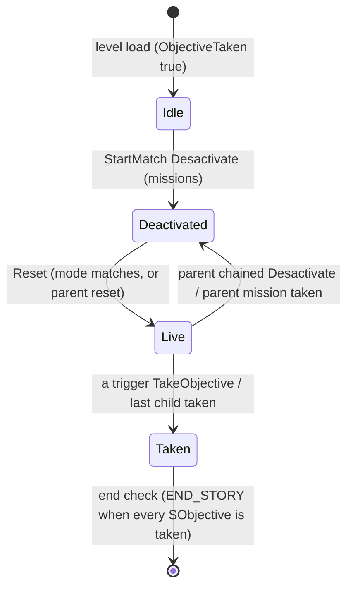

# Missions and objectives

Units:
- def:SBase.SObjective, def:SBase.SMission
- rep:SBase.SObjective.ObjectiveTaken, rep:SBase.SObjective.MinTriggerTime, rep:SBase.SObjective.iSimulatedObjectiveIsBeingTookUntil, rep:SBase.SObjective.AddRemoveObjectiveOnClientHud
- rep:SBase.SMission.ObjectivesLeft, rep:SBase.SMission.TotalObjectivesLeft
- uc:SBase.SObjective:PreBeginPlay, uc:SBase.SObjective:PostBeginPlay, uc:SBase.SObjective:DoReset, uc:SBase.SObjective:Timer, uc:SBase.SObjective:NotifyTaken, uc:SBase.SObjective:SimulateBeingTook, uc:SBase.SObjective:NotifyChildTaken, uc:SBase.SObjective:Ev_AddRemoveObjectiveOnClientHud, uc:SBase.SObjective:AddRemoveObjectiveOnClientHud
- nat:SBase.SObjective.ScheduleReset, nat:SBase.SObjective.Reset, nat:SBase.SObjective.Desactivate, nat:SBase.SObjective.NotifyTriggering
- uc:SBase.SMission:PostNetBeginPlay, uc:SBase.SMission:DoBroadcastLocalizedMessage, uc:SBase.SMission:ComputeObjectivesLeft, uc:SBase.SMission:GetTotalObjectivesLeft, uc:SBase.SMission:UpdateObjectivesLeft, uc:SBase.SMission:PrepareObjectives, uc:SBase.SMission:Reset, uc:SBase.SMission:NotifyTaken
- nat:SBase.SMission.NotifyChildTaken, nat:SBase.SMission.Desactivate, nat:SBase.SMission.ActivateDisks
- uc:SBase.SGameInfo:StartMatch (mission activation part only), uc:SBase.SGameInfo:NotifyObjectiveTaken, uc:SBase.SGameInfo:sCheckEndGame (objective clause only)
- uc:SBase.SPlayerController:GetObjectivesLeft, uc:SBase.SPlayerController:PlayerTick (idle mission reminder part only)
- nat:Engine.Actor.AllObjectives

## Purpose

An `SObjective` is one goal. It is complete as soon as one of its triggers (`SObjectiveTrigger` subclasses: terminals, disks, bomb targets) is taken. An `SMission` is a group of objectives (and possibly of other missions, used as zones). The mission decides how many objectives must be taken (all, a random subset, or a minimum count), whether they are offered one after another (`bChained`) or all at once, and which game mode it belongs to. At match start the game resets only the missions whose `GameMode` equals the match's mode; every other mission stays deactivated. When the last needed objective of the live mission is taken, the mission is taken, which makes every `SObjective` in the level count as taken and ends a Story match with the spies' win (`END_STORY`).

## Data

`SObjective` (class defaults from `def:SBase.SObjective`, effective chain):

| Field | Type | Default | Notes |
|---|---|---|---|
| ObjectiveTaken | bool | **true** | Replicated. True before the match starts, so idle objectives never block the end check. |
| activated | bool | false | Set true by `SMission.Reset`. No script reader. |
| bDelayedActivation | bool | false | Set once by a delayed `Reset`; never cleared. |
| bShowStatusOnHud | bool | true (SMission: false) | Gates `AddRemoveObjectiveOnClientHud(true)` when a trigger starts. |
| bUntriggerEvent | bool | false | Completion sends `UntriggerEvent(Event)` instead of `TriggerEvent(Event)`. |
| bScore | bool | true (SMission: false) | Completion awards `AddPoint(0, Scorer, AP_A_TakeObjective)`. |
| RemainingTime | int | 1000 | Forced to 1000 in PreBeginPlay and PostBeginPlay; read only by trigger `Lock()`. |
| ActivationTime | int | 0 | Seconds of delay before a zone mission activates (see rule 9). |
| RespawnTime | int | 20 | No script reader. |
| RandomTriggers | int | 0 | No script reader; native `Reset` keeps this many triggers active (rule 19). |
| LocalRemainingTimeSeconds, Alpha | float | 0, 1.0 | No script reader (HUD/native). |
| MinTriggerTime | float | 0 | Replicated. Set to 0 on completion; otherwise written by native `NotifyTriggering` (see Open questions). |
| iSimulatedObjectiveIsBeingTookUntil | float | 0 | Replicated. Written only by `SimulateBeingTook`. |
| Description / DescriptionDEF / ObjectiveName | localized string | "Take unnamed objective" / "Protect unnamed objective" / "Unnamed objective" (SMission: "Complete unnamed mission" / "Protect unnamed mission" (English .int) / "Unnamed mission") | Spy text, merc text, short name used in messages 3, 15, 37. |
| ParentObjective | SObjective | None | Set by the parent mission's `Reset`. |
| TriggersERVisibilityZones | array of ZoneInfo | empty | Read by the spy HUD only (see `messages.md`). |
| Triggers | array of SObjectiveTrigger | empty | Map-authored. |
| Actor flags | | bHidden, bNoDelete, bAlwaysRelevant true; bReplicateMovement false | Map actors only; never spawned at run time. |

`SMission` adds:

| Field | Type | Default | Notes |
|---|---|---|---|
| GameMode | EGameMode | GM_Undefined (0) | 0 Undefined, 1 Extraction, 2 Sabotage, 3 Neutralization, 4 DiskHunt, 5 Multi (Story), 6 DeathMatch, 7 MercDeathMatch. Not replicated (clients read the map value). |
| bChained | bool | **true** | Class default is true; a map must set false for "all at once". |
| RandomObjectives | int | 0 | Offer only this many of the children (unchained only). |
| MinimumObjectives | int | 0 | Need only this many (unchained only). For DiskHunt it is overwritten at match start. |
| AtResetEvent | name | None | Fired at the end of every completed `Reset`. |
| Objectives | array of SObjective | empty | Children; may include SMission (zones). |
| ObjectivesLeft, TotalObjectivesLeft | int | 0 | Replicated. Own count, and own count plus all nested missions' totals. |
| CurrentObjectiveIndex | int | 0 | Position in a chained mission. |

SteeE instances (read from `SteeE.sdc`):

| Actor | GameMode | bChained | MinimumObjectives | Objectives / Triggers | AtResetEvent | Texts |
|---|---|---|---|---|---|---|
| SMission28821 | 5 (GM_Multi, Story) | false | 4 | SObjective28814, 28813, 28815, 28816, 28817, 28818 | None | Description "Accomplish 4 out of 6 objectives to neutralize the boss's network."; DescriptionDEF "Prevent the intruders from reaching 4 of the 6 objectives and sabotaging the boss's network."; ObjectiveName "" |
| SMission28822 | 4 (DiskHunt) | false | 12 (overwritten at start) | Triggers: 30 SDisk | hackvolet01 | "Find and keep the data disks..." |
| SMission28823 | 6 (DeathMatch) | false | 0 | none | hackvolet01 | "Eliminate all the members..." |

| SObjective | Trigger | ObjectiveName (= Description and DescriptionDEF with "Terminal: " or "Disk: " prefix) |
|---|---|---|
| SObjective28814 | SComputerObjectiveTrigger28761 | Lounge (3rd floor) |
| SObjective28813 | SComputerObjectiveTrigger28763 | Laboratory (2nd floor) |
| SObjective28815 | SComputerObjectiveTrigger28762 | Kitchen (1st floor) |
| SObjective28816 | SComputerObjectiveTrigger28765 | Shop (1st floor) |
| SObjective28817 | SComputerObjectiveTrigger28764 | Office (2nd floor) |
| SObjective28818 | SFlag28768 | Secret Files ("Disk: Secret Files") |

No SteeE objective or mission has an `Event`; all `ActivationTime` are 0. Note that the DiskHunt and DeathMatch missions' `AtResetEvent` names the Tag of the three shutter switches (`switch-hack.md`), but those missions are never reset in Story.

## Rules

Match start (server, `SGameInfo.StartMatch`, mission part):

1. If the match mode is GM_MercDeathMatch, everyone is moved to the mercs first (other spec). Then the parent `StartMatch` runs.
2. For every SMission in actor-list order: call `Desactivate()` (native, rule 20).
3. Set `GRI.NumObjectives = 0`.
4. For every SMission in actor-list order: if the match mode is GM_MercDeathMatch, skip all. Otherwise, if `M.GameMode == MatchInfo.GameMode`: if that mode is GM_DiskHunt set `M.MinimumObjectives = SPersistentData.NumDisks`; then call `M.Reset()`. Zone missions (GM_Undefined) are never selected here; their parent resets them.
5. Lives and teams are then assigned (other spec). The mission reset therefore runs before `NumLives` is set.

`SMission.Reset` (server), non-DiskHunt branch:

6. If `GameMode != GM_Undefined`, force `ActivationTime = 0`.
7. If `ActivationTime > 0` and not `bDelayedActivation`: set `bDelayedActivation = true`, call `ScheduleReset(ActivationTime)` and return (no messages, no event). When the scheduled time passes, `Timer()` calls `Reset()` again and, because the flag is now set, the reset completes (rule 9 contract).
8. Announce: `BroadcastTeamLocalizedMessage(0, SGameMessages, 3, obj = self)` (spies get `Description`) and `BroadcastTeamLocalizedMessage(1, SGameMessages, 15, obj = self)` (mercs get `DescriptionDEF`). This happens for every completed mission reset, zone missions included.
9. For every child: `ParentObjective = self`. Then `ObjectiveTaken = false`, `activated = true`.
10. Count: `ObjectivesLeft` = number of children that are not SMission; for each child that is an SMission call its `ComputeObjectivesLeft()` (rule 15).
11. Activate children, exactly one of three ways:
    - Chained (`bChained`): `Objectives[0].Reset()`; `Objectives[i].Desactivate()` for every `i >= 1`; `CurrentObjectiveIndex = 0`; if `Objectives[0]` is not an SMission and `GameMode != GM_Undefined`, announce it with switch 3 to team 0 and switch 15 to team 1 (obj = `Objectives[0]`).
    - Random (`0 < RandomObjectives < N`, N = `Objectives.Length`): copy the children to a list; repeat `N - RandomObjectives` times: remove the entry at `Rand(listLength)` and decrement `ObjectivesLeft`; then `Reset()` every entry left. Removed children are not touched: they keep `ObjectiveTaken = true` (class default, or set by the parent's `Desactivate` in rule 2 if that recurses). Uses one `Rand` per removal from the game's random stream.
    - Otherwise: `Reset()` every child in order.
12. Minimum clamp (unchained only): if `MinimumObjectives > 0` and `MinimumObjectives < ObjectivesLeft`, set `ObjectivesLeft = MinimumObjectives`.
13. `TotalObjectivesLeft = GetTotalObjectivesLeft()`. If `GameMode != GM_Undefined`: `GRI.NumObjectives += TotalObjectivesLeft` and `PrepareObjectives()`.
14. Finally `TriggerEvent(AtResetEvent, self, None)` (nothing when the name is None). Calls to a child's `Reset()` dispatch virtually: an SObjective runs native `Reset` (rule 19), an SMission runs this function.

    SteeE Story result: `ObjectivesLeft = TotalObjectivesLeft = 4`, `GRI.NumObjectives = 4`, all six objectives reset, both teams get their mission text.

Counting helpers:

15. `ComputeObjectivesLeft()` (used for nested missions before they are reset):
    - DiskHunt: `ObjectivesLeft` = number of `Triggers` with `bActive`.
    - Otherwise: start with `R` if unchained and `0 < R < N`; else `M` if unchained and `0 < M < N`; else `N`. Then for every child that is an SMission subtract 1 and call that child's `ComputeObjectivesLeft()`.
    This is not the same formula as rules 10 to 12 (it compares M with N, not with the counted value); a nested mission's own `Reset` later overwrites the value.
16. `GetTotalObjectivesLeft()`: DiskHunt: number of `Triggers` with `bActive`. Otherwise: `ObjectivesLeft` plus `GetTotalObjectivesLeft()` of every child SMission (recursive).
17. `UpdateObjectivesLeft()` (event; called by native code): `TotalObjectivesLeft = GetTotalObjectivesLeft()`, then the same on `ParentObjective` if it is an SMission (propagates upward).
18. `PrepareObjectives()`: for each child: if SMission, recurse; else call `Prepare()` on each of its `Triggers` (unhide and enable collision, per trigger class).

Native contracts (decoded in natives2-events.md rule 4 unless marked):

19. `SObjective.Reset` (exec thunk 0x10A9F2E0): (1) when `ActivationTime > 0` and not `bDelayedActivation`: set
    `bDelayedActivation` and `ScheduleReset(ActivationTime)`, stop. (2) Otherwise clear `bDelayedActivation`, call
    `DoReset` on every trigger, `ObjectiveTaken = false`, activated = true. (3) With `0 < RandomTriggers < trigger
    count`, a copy of `Triggers` loses `RandomTriggers` entries chosen with the C runtime `rand()` (index
    `rand() % remaining`) and every trigger left in the copy is deactivated, so `RandomTriggers` triggers stay active.
    (4) With `bShowStatusOnHud`: `Ev_AddRemoveObjectiveOnClientHud(true)`. Matches the RE+ observation that every
    trigger of a reset objective is active.
20. `Desactivate` (SObjective 1418, SMission 1421 and every trigger class share the game exec thunk 0x10AE9C60, which
    calls a per-class virtual): SObjective: `bDelayedActivation = false`, `ObjectiveTaken = true`, the actor timer
    cleared, every trigger in `Triggers` deactivated (a missing entry is logged), then
    `Ev_AddRemoveObjectiveOnClientHud(false)`. SMission: the same, then `ObjectiveTaken = true` and every non-empty
    `Objectives` entry deactivated (it cascades). Triggers: objective-trigger.md rule 21.
21. `NotifyTriggering` (0x10A9F690, decoded): called by every trigger `Triggering(status)` change. Clears
    `iSimulatedObjectiveIsBeingTookUntil` and `MinTriggerTime`; for every trigger with `bTriggering` whose
    `GetTriggerTime()` (its end time, `float(CaptureTime) + TriggerTime`) is above 0, keeps the smallest in
    `MinTriggerTime`. When at least one runs: `RemainingTime = max(trunc(MinTriggerTime - ElapsedTime), 0)` with
    the local player controller's GRI. Always `Alpha = 1`. It never touches the HUD lists.
22. `ScheduleReset(Time)` (0x10A9F280): arms the actor timer for `Time` seconds, not looping (`TimerRate = Time`, counter 0), so that `Timer()` calls `Reset()`.

Taking an objective (`SObjective.NotifyTaken(Scorer)`, server):

23. If `ObjectiveTaken` already, return. Set `ObjectiveTaken = true`.
24. Call `Desactivate()` on every trigger in `Triggers` (so the other triggers of a multi-trigger objective stop).
25. If `bScore`: `SGameInfo.AddPoint(0, Scorer, AP_A_TakeObjective)` (index 15). Under the points table the game always loads (`POINT_Multiple`), index 15 is worth 0, so no score changes; `AddPoint` still runs the end check.
26. `SGameInfo.NotifyObjectiveTaken(self)`: both teams get music `Interface.Objectifs.Jingl_objectifTaken` with transition MTRAN_None (a client skips it when its profile has objective sounds off); `BroadcastScoreTime = TimeSeconds + 2`; run the end check (rule 31) and end the game if it passes.
27. If this is not an SMission: `GRI.Teams[Scorer.SPawnType].iNbObjectivesTaken++` and `Scorer.PRI.iNbObjectivesTaken++`.
28. If `ParentObjective != None`: `ParentObjective.NotifyChildTaken(Scorer)` (rule 30).
29. Fire `Event` (Trigger or Untrigger by `bUntriggerEvent`) with instigator `Scorer.Pawn`; set `MinTriggerTime = 0`.

30. `SMission.NotifyChildTaken(Scorer)` (native 0x10ABFFB0, decoded): nothing when the mission is already taken;
    `ObjectivesLeft = max(ObjectivesLeft - 1, 0)` unless `Objectives[CurrentObjectiveIndex]` is itself an SMission,
    then event `UpdateObjectivesLeft`. Not `bChained`: count the non-empty children with `ObjectiveTaken`; stop when
    not all are taken and (the count is below `MinimumObjectives` or `MinimumObjectives < 1`); otherwise
    `NotifyTaken(Scorer, None)` and `ObjectivesLeft = 0`. `bChained`: `CurrentObjectiveIndex += 1`; while still inside
    `Objectives`, that child gets `DoReset` and the mission raises `DoBroadcastLocalizedMessage(CurrentObjectiveIndex)`;
    past the end, `NotifyTaken(Scorer, None)` and `ObjectivesLeft = 0`.

End check (server, objective clause of `SGameInfo.sCheckEndGame`):

31. Only while `GRI.bMatchHasBegun`. The time limit is tested first (when `TimeLimit > 0`, `ElapsedTime >= TimeLimit * 60` gives the mercs `END_TIMEOUT`), then team deaths (other spec). Then: if any `SObjective` actor in the level (missions included, any mode) has `ObjectiveTaken == false`, return false. Otherwise `WinnerTeam = 0`, `ReplicateWinningReason(0, END_STORY)`, return true. Because deactivated missions and objectives count as taken (rule 20) and the live mission is untaken until its own completion, the spies win exactly when the live mission completes.

    SteeE Story: the 4th terminal or disk taken gives `ObjectivesLeft = 0`, the mission deactivates the two remaining objectives, marks itself taken, and the end check returns `END_STORY`.

Counters shown to players:

32. `SPlayerController.GetObjectivesLeft()` (called by the HUD every frame on each client): sum of `TotalObjectivesLeft` over all SMission with `GameMode != GM_Undefined` (via the native `AllObjectives` iterator, 0x10A28370). The HUD shows this against `GRI.NumObjectives`. SteeE Story starts at 4 / 4.
33. Idle reminder (client `PlayerTick`): when the pawn's velocity has been zero for more than `fTimeMissionMessage` (20 s): a spy carrying a flag gets message 53 every tick while idle (the timer is not reset); else (not Sabotage-without-modem) each untaken SMission's `Description` (spy) or `DescriptionDEF` (merc) is queued with `SetGameMessage(text, 3)` and the idle timer restarts. Deactivated missions count as taken, so only the live mission's text shows.

DiskHunt (not in the slice, kept short):

34. Reset: if `MinimumObjectives > 0` call native `ActivateDisks(MinimumObjectives)` (0x10AC01A0, decoded in `disk-hunt.md` rule 3), else `DoReset()` every trigger; then `ComputeObjectivesLeft()`, `TotalObjectivesLeft = GetTotalObjectivesLeft()`, `GRI.NumObjectives += TotalObjectivesLeft` (mode is never Undefined here), `ObjectiveTaken = false`, then rule 14. `NotifyTaken`: `UpdateObjectivesLeft()`; if `PersistentData.NumDisksToWin > 0` (the host's setting, `disk-hunt.md` rule 17), return unless `MinimumObjectives - activeTriggers >= NumDisksToWin`; else return while any trigger is still `bActive`; then rule 30's tail.

HUD status helpers:

35. `SimulateBeingTook()`: `iSimulatedObjectiveIsBeingTookUntil = TimeSeconds + Triggers[0].GetTriggerTime()` (or `+ 5.0` with no triggers); then if `bShowStatusOnHud`, `AddRemoveObjectiveOnClientHud(true)`. No script caller.
36. `AddRemoveObjectiveOnClientHud(add)`: on each machine, `SHud(LocalPlayerController.myHUD).AddRemoveActorOnHud(self, add)` (adds once, removes every copy). `Ev_AddRemoveObjectiveOnClientHud(add)` is the event form for native callers.
37. `SMission.DoBroadcastLocalizedMessage(i)` (event, native caller): if `Objectives[i]` is not an SMission and `GameMode != GM_Undefined`, switch 3 to team 0 and switch 15 to team 1 with obj = `Objectives[i]`.
38. `PreBeginPlay`: `RemainingTime = 1000`; set `Triggers[i].Objective = self` for every trigger (this runs before any trigger's PostBeginPlay at level start). `PostBeginPlay`: `RemainingTime = 1000`. `SMission.PostNetBeginPlay` is empty.

## States

Objectives have no script states. Life cycle as data:

## Constants

| Name | Value | Unit | Provenance | Source |
|---|---|---|---|---|
| RemainingTime initial | 1000 | s | decoded | SObjective.PreBeginPlay/PostBeginPlay |
| AP_A_TakeObjective | 15 | index | decoded | Engine.LevelInfo const |
| ActionPoints[15] under POINT_Multiple | 0 | points | decoded | LevelInfo.InitArrayNbPoints, SGameInfo.InitGame |
| Message switches | 3 spy text, 15 merc text | switch | decoded | SGameMessages.GetString |
| SimulateBeingTook fallback | 5.0 | s | decoded | SObjective.SimulateBeingTook |
| Score broadcast delay | 2.0 | s | decoded | SGameInfo.NotifyObjectiveTaken |
| fTimeMissionMessage | 20.0 | s | decoded | def:SBase.SPlayerController |
| Objective jingle | Interface.Objectifs.Jingl_objectifTaken | sound | decoded | SGameInfo.NotifyObjectiveTaken |
| SteeE Story need | 4 of 6 | objectives | decoded | SMission28821 |

## Network

- Everything here runs on the server. Objectives and missions are `bNoDelete`, `bAlwaysRelevant` map actors: clients have their own copy from the map with the authored values (GameMode, Objectives, Triggers, texts), bound to the server's by map index.
- Replicated (script block: reliable, `Role == ROLE_Authority`): `ObjectiveTaken`, `MinTriggerTime`, `iSimulatedObjectiveIsBeingTookUntil`; on SMission `ObjectivesLeft`, `TotalObjectivesLeft`. Both classes are `nativereplication`: the property send rule actually used is the C++ `GetOptimizedRepList` (editor ASObjective 0x1121FCA0, ASMission 0x11220640); assume "send when changed" until checked.
- `AddRemoveObjectiveOnClientHud` is a reliable simulated server-to-client function carrying flag 0x01000000. That flag appears only on functions whose names say "to all clients" (for example `CamNetworkSwitchVisionModeOnAllClients`, `ChangeStateToAll`, `SetDesiredGlassValueOnClients`), so it is an SCCT multicast: the server sends it to every client and (by the listen-host behaviour these functions need) also runs it locally. An unowned actor could not deliver it any other way. OpenScct.Net must support this RPC kind.
- Messages go out through `BroadcastTeamLocalizedMessage` / `ReceiveLocalizedMessage` (reliable client RPC per player), see `messages.md`.
- Clients compute the HUD count themselves from replicated `TotalObjectivesLeft` and the map's `GameMode`; `GRI.NumObjectives` is replicated on the GRI.

## Edge cases

- `bChained` defaults to true: a map that forgets to clear it gets a one-at-a-time mission, and `MinimumObjectives`/`RandomObjectives` are then ignored by rules 11 and 12.
- `MinimumObjectives >= ObjectivesLeft` leaves the count unchanged (needs all). `MinimumObjectives` equal to the number of children is the same as 0.
- A random mission's removed children are never reset, so they stay `ObjectiveTaken = true` (deactivated) and do not block the end check.
- Message 3/15 is broadcast for every completed mission reset, including GM_Undefined zone missions; chained missions additionally announce their first child.
- An SMission nested inside another whose `GameMode` equals the match mode would be reset twice (once by StartMatch, once by its parent) and add to `GRI.NumObjectives` twice.
- `NotifyTaken` on an already-taken objective is ignored, so a second trigger completing in the same tick does not double count.
- The time-limit test runs before the objective test in the same end check: if the last objective is taken on the tick the timer expires, the mercs win by `END_TIMEOUT`.
- Team counters index `GRI.Teams` by the scorer's `SPawnType`, not by team number (they agree in normal play).
- A dead merc or a spectator on a client has no pawn; HUD helpers that test the local pawn read None (see `objective-trigger.md`).

## Evidence

- Decompiled: `local/re-out/uc/SBase/SMission.uc`, `SObjective.uc`, `SGameInfo.uc` (StartMatch, NotifyObjectiveTaken, AddPoint, sCheckEndGame), `SPlayerController.uc` (GetObjectivesLeft, PlayerTick), `Engine/LevelInfo.uc` (ActionPoints), `SHud.uc` (PostRender counters).
- Defaults: `local/formats/classdefaults_effective.json` and `classdefaults_localized.json` (SObjective, SMission).
- Map data: `SteeE.sdc` exports SMission28821/28822/28823, SObjective28813 to 28818.
- Natives (game): SObjective.ScheduleReset 0x10A9F280, Reset 0x10A9F2E0, NotifyTriggering 0x10A9F690, Desactivate thunk 0x10AE9C60 (shared), SMission.NotifyChildTaken 0x10ABFFB0, ActivateDisks 0x10AC01A0, Actor.AllObjectives 0x10A28370. Editor twins: ASObjective execDesactivate 0x1121F9A0, execScheduleReset 0x1121FA80, execNotifyTriggering 0x1121FB40, execReset 0x11220210; ASMission execDesactivate 0x11220290, execNotifyChildTaken 0x112203F0, execActivateDisks 0x112207B0.
- Reflection: `local/reflect/game.json` (net fields, function flag 0x01000000 list, vtables ASObjective 0x10BF9D88, ASMission 0x10BF9768).
- Observations: RE+ `docs/MapBuilderFacts.md` (ObjectivesLeft reaching 0 deactivates the rest; `SMission.Reset` refires AtResetEvent), memory notes `mission-hierarchy-zones.md`, `objective-player-counts.md`.

## Open questions

6. `GetOptimizedRepList` for ASObjective and ASMission: which fields are sent and under what conditions.
7. Whether `RespawnTime` is used by any native code at all (`RandomTriggers` is read by native `Reset`, rule 19).

### Resolved

4. Native `NotifyTriggering`. Resolved: rule 21 (MinTriggerTime, RemainingTime from the local GRI, Alpha 1, no HUD
   list change). Evidence: game 0x10A9F690 (disassembly 0x10A9F737 to 0x10A9F784; the cached local player
   controller is Level +0x514, filled by 0x10A22E60).

1. Native `SObjective.Reset`. Resolved: delayed activation first, then DoReset on every trigger, taken false,
   activated true, RandomTriggers kept with the C runtime rand(), HUD add; no broadcast. Rule 19. Evidence:
   natives2-events.md rule 4 (ANSWERS-natives2 31).
2. Native `Desactivate` per class. Resolved: SObjective taken, timer off, triggers deactivated, HUD removal; SMission
   cascades to every child; triggers per objective-trigger.md rule 21. Rule 20. Evidence: natives2-events.md rule 4
   (ANSWERS-natives2 31, 32, 33).
3. Native `NotifyChildTaken`. Resolved: ObjectivesLeft only for non-mission children; unchained: taken when all or
   MinimumObjectives (>= 1) children are taken; chained: next child DoReset plus broadcast, NotifyTaken past the
   last. Rule 30. Evidence: natives2-events.md rule 4 (ANSWERS-natives2 32).
5. The 0x01000000 function flag. Resolved: sent to every client connection with an open channel for the actor (no
   channel opened), run locally on a listen server but not on a dedicated server. Evidence: net/model.md rule 10,
   net-replication.md rule 20 (ANSWERS-net model 3).
