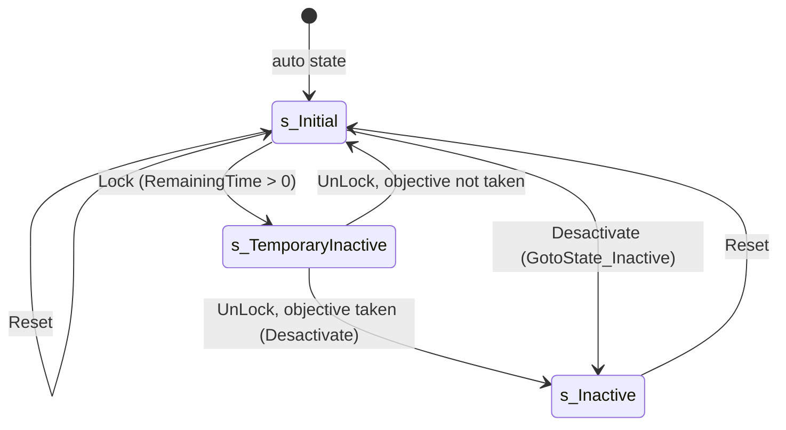

# Objective trigger base (SObjectiveTrigger)

Units:
- def:SBase.SObjectiveTrigger
- rep:SBase.SObjectiveTrigger.bLocked, rep:SBase.SObjectiveTrigger.bTriggering, rep:SBase.SObjectiveTrigger.bActive, rep:SBase.SObjectiveTrigger.CaptureTime, rep:SBase.SObjectiveTrigger.TriggerTime, rep:SBase.SObjectiveTrigger.Objective, rep:SBase.SObjectiveTrigger.TakeObjective, rep:SBase.SObjectiveTrigger.AddRemoveObjectiveForRadar
- uc:SBase.SObjectiveTrigger:AcceptStickableGPO, uc:SBase.SObjectiveTrigger:BeginPlay, uc:SBase.SObjectiveTrigger:PostBeginPlay, uc:SBase.SObjectiveTrigger:DoReset, uc:SBase.SObjectiveTrigger:Prepare, uc:SBase.SObjectiveTrigger:Reset, uc:SBase.SObjectiveTrigger:GotoState_Inactive, uc:SBase.SObjectiveTrigger:Triggering, uc:SBase.SObjectiveTrigger:AddRemoveObjectiveForRadar, uc:SBase.SObjectiveTrigger:TakeObjective, uc:SBase.SObjectiveTrigger:Lock, uc:SBase.SObjectiveTrigger:UnLock
- uc:SBase.SObjectiveTrigger:s_TemporaryInactive.TakeObjective, uc:SBase.SObjectiveTrigger:s_TemporaryInactive.BeginState, uc:SBase.SObjectiveTrigger:s_TemporaryInactive.EndState, uc:SBase.SObjectiveTrigger:s_TemporaryInactive.Lock, uc:SBase.SObjectiveTrigger:s_TemporaryInactive.UnLock, uc:SBase.SObjectiveTrigger:s_TemporaryInactive.Reset
- nat:SBase.SObjectiveTrigger.GetTriggerTime, nat:SBase.SObjectiveTrigger.IsActive, nat:SBase.SObjectiveTrigger.Desactivate

Also covered: the states s_Initial and s_Inactive, whose state code is empty (no labels, so no unit of their own).

## Purpose

The common base of everything that can complete an objective: terminals (`terminal-hack.md`), the carried disk and its drop zones (`disk-flag.md`), bomb targets (`bomb-target.md`) and DiskHunt disks. It holds the capture time, the "being captured" flag that HUDs and the merc radar read, the reset and prepare hooks a mission calls, the completion routine that credits the player and notifies the objective, and the lock/unlock pair an alarm uses. It is an `SGamePlayObject`, so it also has the generic pickup, throw and damage machinery.

## Data

| Field | Type | Default | Notes |
|---|---|---|---|
| complete | bool | false | Set by `TakeObjective`, cleared by `Reset`. No other reader. |
| bLocked | bool | false | Replicated. True while locked by an alarm. |
| bTriggering | bool | false | Replicated. True while a capture is running (hack in progress, disk carried, bomb armed). |
| bActive | bool | false | Replicated. True while the trigger can be taken. |
| bUntriggerEvent | bool | false | Completion sends Untrigger instead of Trigger on `Event`. |
| takenTime | int | 0 | `GRI.ElapsedTime` at completion. |
| CaptureTime | int | 5 | Replicated. Seconds of capture. Terminals overwrite it with `DominationCaptureTime` on reset; SFlag default 0. |
| TriggerTime | float | 0 | Replicated. `GRI.PreciseElapsedTime()` when the capture started, 0 when not capturing. |
| ControllerWhoTakesIt | PlayerController | None | The player who will be credited. |
| Objective | SObjective | None | Replicated. Set by the owning objective's PreBeginPlay. |
| TriggerName | localized string | "Unnamed trigger" | Used in messages 10, 11, 12, 22, 36. |
| Inherited | | iPriority -1, Mass 8, ShakeRange 2000, bNoDelete true, NetUpdateFrequency 5, NetPriority 1.4, bAlwaysRelevant true, bShouldBaseAtStartup true | `def:SBase.SObjectiveTrigger` effective. |

## Rules

Setup:

1. `BeginPlay` (simulated): parent BeginPlay (SGamePlayObject sets `bWorldGeometry` when neither pickable nor pushable), then `bWorldGeometry = false` always.
2. `PostBeginPlay` (server): parent chain (SGamePlayObject: remembers `InitialStaticMesh`, `InitialSkin`, blocking flags, `InitialHitPoints`, spawns a `PickupInteraction` if `bPickable`; SBasicGamePlayObject: spawns `InteractionClass` if set, see `interaction-system.md`), then if `Objective != None`: `Objective.RemainingTime = max(Objective.RemainingTime, CaptureTime)`.
3. `AcceptStickableGPO` returns false (sticky gadgets do not attach).
4. `DoReset` (event, called by native objective code) calls `Reset()`. `GotoState_Inactive` (event, called by native `Desactivate`) does `GotoState('s_Inactive')`.
5. `Prepare()` does nothing in the base class (subclasses unhide and enable collision).

Reset (server):

6. In order: `SetStaticMesh(InitialStaticMesh)`; `bActive = true`; `bLocked = false`; `Triggering(false)` (virtual: a subclass version runs); `bEMFIsOn = true`; `complete = false`; `takenTime = 0`; `GotoState('s_Initial')`.

Triggering(status) (server; event, subclasses extend it):

7. `bTriggering = status`.
8. If status is true: if `Objective.bShowStatusOnHud`, `Objective.AddRemoveObjectiveOnClientHud(true)` (multicast, see `missions.md`); `TriggerTime = GRI.PreciseElapsedTime()`; unless this is an `SBombTargetObjectiveTrigger`, `AddRemoveObjectiveForRadar(true)`.
9. If status is false: `TriggerTime = 0`; unless bomb target, `AddRemoveObjectiveForRadar(false)`.
10. Always `Objective.NotifyTriggering()` (native, `missions.md` rule 21).
11. `AddRemoveObjectiveForRadar(add)` is a reliable simulated multicast (flag 0x01000000). On each machine: if the local player controller's pawn is not an `SPAWNDEFENSE` (merc), do nothing; else `SHud.AddObjective(self)` or `SHud.RemoveObjective(self)` (natives 0x10A91C50 / 0x10A91CF0, which maintain `SHud.ObjectivesList`, the merc radar and merc HUD marker list). The server runs it too (a dedicated server has no local controller and does nothing).

Completion (`TakeObjective`, server):

12. If `ControllerWhoTakesIt == None`, return (nothing happens).
13. `complete = true`; `takenTime = GRI.ElapsedTime`; `GRI.LastTimeObjectif = takenTime`.
14. Fire `Event` with instigator `ControllerWhoTakesIt.Pawn` (Untrigger if `bUntriggerEvent`).
15. Unless this is an `SDisk`, if the taker is an `SPlayerController` with a `PRI.Stats` object: append `self.Name` to `Stats.Spy_ObjectivesTaken` and `takenTime` to `Stats.Spy_ObjectivesTakenTime`.
16. `Objective.NotifyTaken(ControllerWhoTakesIt)` (`missions.md` rules 23 to 29).

Lock and unlock (called by `SAlarm.ObjectiveTriggersToLock`; SteeE has no SAlarm, so not reachable in the slice):

17. `Lock()` (global): if `Objective.RemainingTime > 0`: `bTriggering = false` and `GotoState('s_TemporaryInactive')`. `UnLock()` (global) does nothing.
18. `s_TemporaryInactive`: BeginState sets `bActive = false`, `bLocked = true`, `bTriggering = false`; EndState sets `bLocked = false`; `Lock` does nothing; `UnLock`: if the objective is not taken: `SetStaticMesh(InitialStaticMesh)`, `bActive = true`, `bLocked = false`, `GotoState('s_Initial')`; else `Desactivate()` (global, native). `Reset` in this state: `Triggering(false)` and `bEMFIsOn = true` only (stays locked). `TakeObjective` in this state is ignored except for bomb targets, which complete normally.

Native contracts:

19. `GetTriggerTime()` (0x10AE8AF0, simulated; decoded, natives2-events.md rule 4): `float(CaptureTime) + TriggerTime` while `bTriggering`, else 0; script uses it only as "time this trigger needs" (`SimulateBeingTook`).
20. `IsActive()` (0x10AE8B30, simulated; decoded): returns NOT `bActive` (both builds; the name is misleading); no script caller.
21. `Desactivate()` (shared game thunk 0x10AE9C60 calling a per-class virtual: SObjectiveTrigger, SFlag 1320, SComputerObjectiveTrigger 1321, SBombTargetObjectiveTrigger 1801, SDisk 1813; decoded for SObjectiveTrigger in natives2-events.md rule 4): `bActive` and `bLocked` cleared; `Triggering(false)`; `bEMFIsOn` cleared; then the `GotoState_Inactive` event unless the current state is `s_TemporaryInactive` (or a state below it). Observed: devices of never-reset objectives stay hidden. Per class (game vtable slot +0x138): SDisk 0x10ABFE50 (`bHidden`, `bPickable` and the PickupInteraction's `bCanPickup` cleared, then the base); SFlag 0x10AE9C80 (`LeaveCarrier` when `FlagCarrier` is set, then as SDisk); SBombTargetObjectiveTrigger 0x10A98A40 (the flag part of the base, `bHidden`, `InteractionObj.bUsable` false, no `GotoState_Inactive`); SComputerObjectiveTrigger 0x10ABDEB0 (terminal-hack.md rule 36).

## States

## Constants

| Name | Value | Unit | Provenance | Source |
|---|---|---|---|---|
| CaptureTime default | 5 | s | decoded | def:SBase.SObjectiveTrigger |
| NetUpdateFrequency | 5 | Hz | decoded | def:SBase.SObjectiveTrigger |
| NetPriority | 1.4 | | decoded | def:SBase.SObjectiveTrigger |
| Radar filter | local pawn is SPAWNDEFENSE | | decoded | AddRemoveObjectiveForRadar |

## Network

- Server authoritative: `Reset`, `Triggering`, `TakeObjective`, `Lock`, `UnLock` are non-simulated and run only on the server (on clients these calls are absorbed because the actor is a simulated proxy).
- Replicated (reliable, `Role == ROLE_Authority`): `bLocked`, `bTriggering`, `bActive`, `CaptureTime`, `TriggerTime`, `Objective`. The class is `nativereplication` (editor `ASObjectiveTrigger::GetOptimizedRepList` 0x111CE270) and has a C++ `IsNetRelevantFor` only in some subclasses (`disk-flag.md`).
- `TakeObjective` is declared as a reliable client-to-server function, but nothing on a client calls it and a client does not own these actors, so the path is unused.
- `AddRemoveObjectiveForRadar` is a reliable multicast (flag 0x01000000) evaluated on every machine against that machine's local player.

## Edge cases

- `TakeObjective` with no taker does nothing at all (no event, no message from the base class). Subclasses that broadcast after calling the base (terminal message 37) still broadcast; see `terminal-hack.md`.
- A merc client whose pawn is None (dead, spectating) skips both the add and the remove of a radar marker, so a marker added before death can linger and one started during death is never shown.
- The base `Reset` calls the subclass `Triggering(false)`, so subclasses must handle `Triggering(false)` while not triggering.
- `Lock()` checks `Objective.RemainingTime`, which script keeps at 1000 or more; terminals adjust it (`terminal-hack.md`).

## Evidence

- `local/re-out/uc/SBase/SObjectiveTrigger.uc`; `SGamePlayObject.uc` (PostBeginPlay); `SAlarm.uc` lines with `ObjectiveTriggersToLock` (callers of Lock/UnLock).
- `local/formats/classdefaults_effective.json` (SObjectiveTrigger).
- Natives (game): GetTriggerTime 0x10AE8AF0, IsActive 0x10AE8B30, Desactivate thunk 0x10AE9C60; SHud.AddObjective 0x10A91C50, RemoveObjective 0x10A91CF0. Editor: ASObjectiveTrigger execIsActive 0x111CE0D0, execDesactivate 0x111CE0F0, execGetTriggerTime 0x111CE1A0.
- Reflection: vtable ASObjectiveTrigger 0x10BFD5D0; net fields list.

## Open questions

2. What `SHud.AddObjective`/`RemoveObjective` store and how the merc HUD and radar draw `ObjectivesList` (HUD owner; Ghidra 0x10A91C50).
3. Whether the multicast runs on the server before or after it is sent, and whether a client that becomes relevant later (late join) ever learns of a capture already running. Trace: join a client while a hack is in progress and read its `SHud.ObjectivesList`.

### Resolved

1. Bodies of `GetTriggerTime`, `IsActive`, `Desactivate`. Resolved: rules 19 to 21 (Desactivate clears bActive and
   bLocked, Triggering(false), bEMFIsOn off, GotoState_Inactive unless in s_TemporaryInactive; IsActive returns not
   bActive; GetTriggerTime is CaptureTime + TriggerTime while triggering). Evidence: natives2-events.md rule 4
   (ANSWERS-natives2 33).
