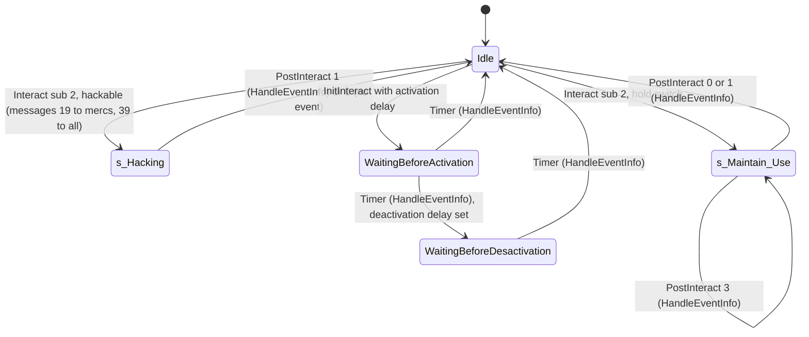
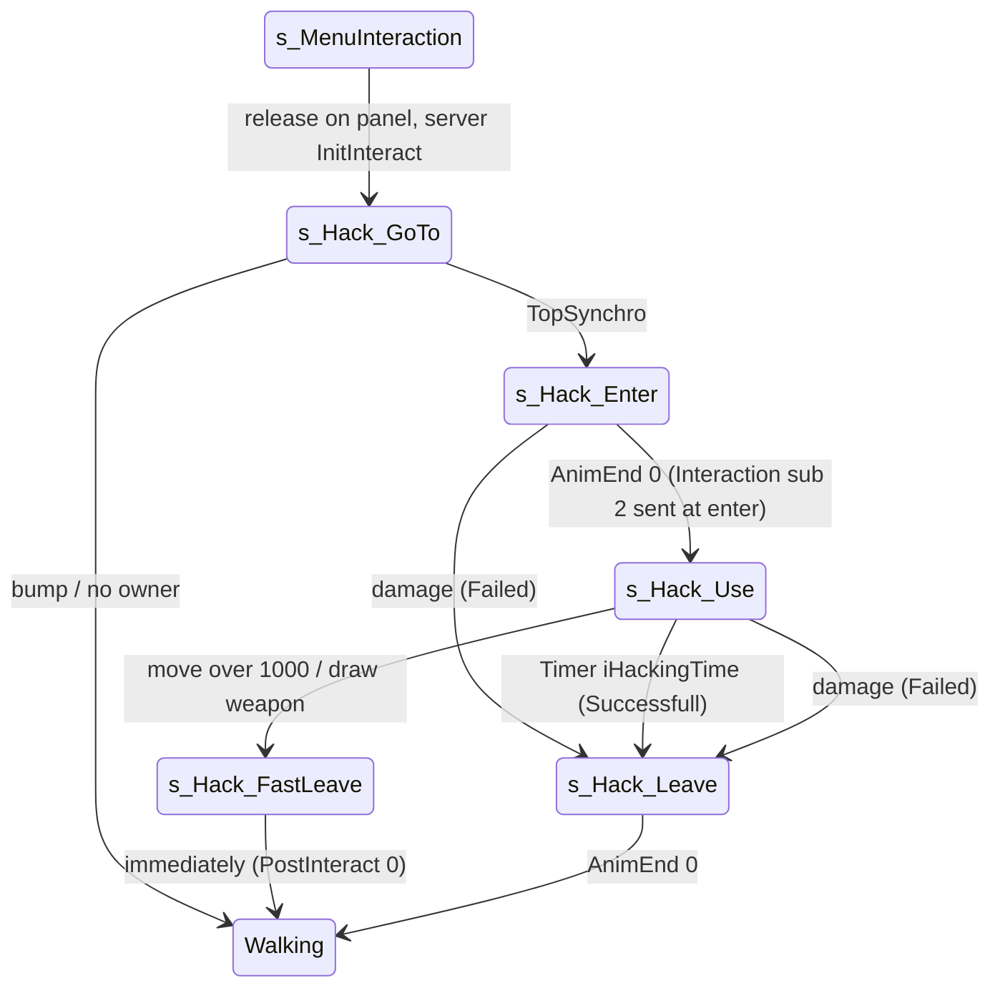

# Switches and hackable panels (SInterrupteur)

Units:
- def:SBase.SInterrupteur, def:SBase.STriggerInteraction, def:SBase.SInterrupteurManager
- rep:SBase.SInterrupteur.bMaintainsSwitch, rep:SBase.SInterrupteur.iHackingTime, rep:SBase.SInterrupteur.UseRelativeLocation, rep:SBase.SInterrupteur.UseRelativeRotation, rep:SBase.SInterrupteur.iReusableTime
- rep:SBase.STriggerInteraction.MinTriggerTime, rep:SBase.STriggerInteraction.OwnerInterrupteur, rep:SBase.STriggerInteraction.bMaintain, rep:SBase.STriggerInteraction.bHackable, rep:SBase.STriggerInteraction.AddRemoveActorOnClientHud
- uc:SBase.SInterrupteur:ForceTriggerableEvenIfMoving, uc:SBase.SInterrupteur:AcceptStickableGPO, uc:SBase.SInterrupteur:PreBeginPlay, uc:SBase.SInterrupteur:PostBeginPlay, uc:SBase.SInterrupteur:PostNetBeginPlay, uc:SBase.SInterrupteur:Trigger, uc:SBase.SInterrupteur:UnTrigger
- uc:SBase.STriggerInteraction:PostBeginPlay, uc:SBase.STriggerInteraction:AddRemoveActorOnClientHud, uc:SBase.STriggerInteraction:InitInteract, uc:SBase.STriggerInteraction:Interact
- uc:SBase.STriggerInteraction:s_Maintain_Use.BeginState, uc:SBase.STriggerInteraction:s_Maintain_Use.EndState, uc:SBase.STriggerInteraction:s_Maintain_Use.InitInteract, uc:SBase.STriggerInteraction:s_Maintain_Use.PostInteract
- uc:SBase.STriggerInteraction:s_Hacking.EndState, uc:SBase.STriggerInteraction:s_Hacking.PostInteract
- uc:SBase.STriggerInteraction:WaitingBeforeActivation.BeginState, uc:SBase.STriggerInteraction:WaitingBeforeActivation.Timer, uc:SBase.STriggerInteraction:WaitingBeforeActivation.InitInteract
- uc:SBase.STriggerInteraction:WaitingBeforeDesactivation.BeginState, uc:SBase.STriggerInteraction:WaitingBeforeDesactivation.Timer, uc:SBase.STriggerInteraction:WaitingBeforeDesactivation.InitInteract
- nat:SBase.STriggerInteraction.HandleEventInfo, nat:SBase.STriggerInteraction.CanUse
- uc:SBase.SInterrupteurManager:Trigger, uc:SBase.SInterrupteurManager:UnTrigger
- uc:SBase.SPlayerController:s_Hack_GoTo.CanActivateLaser, uc:SBase.SPlayerController:s_Hack_GoTo.NotifyBump, uc:SBase.SPlayerController:s_Hack_GoTo.BeginState, uc:SBase.SPlayerController:s_Hack_GoTo.TopSynchro, uc:SBase.SPlayerController:s_Hack_GoTo.PlayerMove
- uc:SBase.SPlayerController:s_Hack_Enter.BeginState, uc:SBase.SPlayerController:s_Hack_Enter.PawnTakeDamage, uc:SBase.SPlayerController:s_Hack_Enter.ClientDamage, uc:SBase.SPlayerController:s_Hack_Enter.AnimEnd, uc:SBase.SPlayerController:s_Hack_Enter.PlayerMove
- uc:SBase.SPlayerController:s_Hack_FastLeave.BeginState, uc:SBase.SPlayerController:s_Hack_FastLeave.EndState
- uc:SBase.SPlayerController:s_Hack_Leave.BeginState, uc:SBase.SPlayerController:s_Hack_Leave.EndState, uc:SBase.SPlayerController:s_Hack_Leave.PawnTakeDamage, uc:SBase.SPlayerController:s_Hack_Leave.ClientDamage, uc:SBase.SPlayerController:s_Hack_Leave.AnimEnd, uc:SBase.SPlayerController:s_Hack_Leave.PlayerMove, uc:SBase.SPlayerController:s_Hack_Leave@code
- uc:SBase.SPlayerController:s_Hack_Use.ServerWillStartGrabOnMe, uc:SBase.SPlayerController:s_Hack_Use.CanBeGrabbed, uc:SBase.SPlayerController:s_Hack_Use.CanBeDropAttacked, uc:SBase.SPlayerController:s_Hack_Use.GadgetQuickChoice, uc:SBase.SPlayerController:s_Hack_Use.BeginState, uc:SBase.SPlayerController:s_Hack_Use.EndState, uc:SBase.SPlayerController:s_Hack_Use.Timer, uc:SBase.SPlayerController:s_Hack_Use.PlayerMove, uc:SBase.SPlayerController:s_Hack_Use.PawnTakeDamage, uc:SBase.SPlayerController:s_Hack_Use.ClientDamage
- uc:SBase.SPlayerController:s_Maintain_GoTo.CanActivateLaser, uc:SBase.SPlayerController:s_Maintain_GoTo.NotifyBump, uc:SBase.SPlayerController:s_Maintain_GoTo.BeginState, uc:SBase.SPlayerController:s_Maintain_GoTo.TopSynchro, uc:SBase.SPlayerController:s_Maintain_GoTo.PlayerMove
- uc:SBase.SPlayerController:s_Maintain_Enter.BeginState, uc:SBase.SPlayerController:s_Maintain_Enter.PawnTakeDamage, uc:SBase.SPlayerController:s_Maintain_Enter.ClientDamage, uc:SBase.SPlayerController:s_Maintain_Enter.AnimEnd, uc:SBase.SPlayerController:s_Maintain_Enter.PlayerMove
- uc:SBase.SPlayerController:s_Maintain_Leave.BeginState, uc:SBase.SPlayerController:s_Maintain_Leave.EndState, uc:SBase.SPlayerController:s_Maintain_Leave.PawnTakeDamage, uc:SBase.SPlayerController:s_Maintain_Leave.ClientDamage, uc:SBase.SPlayerController:s_Maintain_Leave.AnimEnd, uc:SBase.SPlayerController:s_Maintain_Leave.PlayerMove, uc:SBase.SPlayerController:s_Maintain_Leave@code
- uc:SBase.SPlayerController:s_Maintain_Use.BeginState, uc:SBase.SPlayerController:s_Maintain_Use.CanBeDropAttacked, uc:SBase.SPlayerController:s_Maintain_Use.GadgetQuickChoice, uc:SBase.SPlayerController:s_Maintain_Use.EndState, uc:SBase.SPlayerController:s_Maintain_Use.PlayerMove, uc:SBase.SPlayerController:s_Maintain_Use.PawnTakeDamage, uc:SBase.SPlayerController:s_Maintain_Use.ClientDamage

## Purpose

An `SInterrupteur` is a wall switch or panel that fires its `Event` when used. Three kinds exist, chosen by its settings: a plain switch (press a button, fire at once), a hackable panel (`iHackingTime` seconds of hacking at a use spot; moving, drawing a weapon or damage aborts), and a hold switch (`bMaintainsSwitch`: fires when the hold starts and again when it ends). It can be one-shot (`bTriggerOnceOnly`), have a reuse delay, delays before and after activation, and be restricted to one team. Other events can toggle whether it is usable. In SteeE Story the "Crane Control" panel (5 s, spies, once) starts the crane chain and three shutter panels (4 s, spies) close or open shutters.

## Data

`SInterrupteur` (plus the `SBasicGamePlayObject` interaction fields, `interaction-system.md`):

| Field | Type | Default | Notes |
|---|---|---|---|
| iHackingTime | int | 0 | Seconds of hacking; non-zero makes the panel hackable. Replicated (`bNetInitial`). |
| bMaintainsSwitch | bool | false | Hold switch. Replicated (`bNetInitial`). `ForceTriggerableEvenIfMoving()` returns it. |
| iReusableTime | int | 0 | Copied into the interaction on the server. Replicated. |
| bInitialyActive | bool | false | Copied into `STriggerInteraction.bIsActive` (native meaning, see Open questions). |
| sWarnHackingText | localized string | "" | If set, mercs get it as message 19 when a hack starts. |
| InteractionSound | Sound | `Sound_Persos.divers.RA_interrupteur` | Played on use. |
| UseRelativeLocation | Vector | (55, 0, 0) | Use spot in the switch's axes (X and Y used). Replicated (`bNetInitial`). |
| UseRelativeRotation | Rotator | (0, 32768, 0) | Yaw added to the switch's yaw for the spy's facing. Replicated (`bNetInitial`). |
| bInitialSecondaryObjective | bool | false | Remembers the authored `bSecondaryObjective`. |
| InteractionClass | | STriggerInteraction | |
| Inherited: iPriority 0, bTriggerOnceOnly false, TriggerMethode TriggerToggle (0), iAttenteAvantActivation 0, iAttenteAvantDesactivation 0, bInitialyUsable true, UsableBy 0, fInteractionRadius/Height -1, sDescriptionText "", mesh `SGameplayObjects.SGPO_SM.trigger_standard`, SoundRadius 60, SoundVolume 200, bNoDelete | | | `TriggerMethode`: 0 TriggerToggle (Trigger every use), 1 TriggerControl (alternate Trigger and Untrigger), 2 UnTriggerOnly. |

`STriggerInteraction`: iPriority 20, Description "Switch", Alpha 1, plus `bHackable` (iHackingTime != 0), `bMaintain` (bMaintainsSwitch), `bIsActive` (editable), `OwnerInterrupteur`, `MinTriggerTime` (replicated: time the running hack ends, for the HUD), `InstigatorTempo` (last user), `RemainingTime`, `LocalRemainingTimeSeconds`.

`SInterrupteurManager`: `SInterrupteurList` array of { `Interrupteur`, `TriggeredUsability`, `UntriggeredUsability` }; RemoteRole None, hidden.

SteeE instances (all: `UsableBy = 3` spies, `UseRelativeLocation = (40, 0, 0)`, `fInteractionRadius 60`, `fInteractionHeight 120`, `bInteractInFront`, mesh import -209 (a switch mesh), blocking, `iReusableTime 0`, `iPriority` default 0):

| Actor | sWarnHackingText (merc message) | sDescriptionText (menu) | iHackingTime | Once | Tag | Event | Use spot (X, Y) | Face yaw |
|---|---|---|---|---|---|---|---|---|
| SInterrupteur28808 | Crane Control | Activate | 5 | yes | SInterrupteur | blast | (-264.2, 1038.4) | 16384 |
| SInterrupteur28810 | Hacking into Store and Restaurant shutters | Shutters | 4 | no | hackvolet01 | windows | (-3826.3, 1269.0) | 49152 |
| SInterrupteur28809 | Hacking into Restaurant shutters | Shutters | 4 | no | hackvolet01 | close_windows | (-1939.9, -1389.8) | 16384 |
| SInterrupteur28807 | Hacking into Store shutters | Shutters | 4 | no | hackvolet01 | fermeture_fenetre | (-2100.3, 2062.0) | 49152 |

Use spots are `Location + 40 X` from the switch yaw (float approximation). No two hackable switches are within 200 uu.

## Rules

Setup:

1. `PreBeginPlay` (simulated): parent (menu label timer, `interaction-system.md` rule 5); `bInitialSecondaryObjective = bSecondaryObjective`; `bSecondaryObjective = false`.
2. `PostBeginPlay` (server): parent spawns the `STriggerInteraction` (`interaction-system.md` rule 1; priority becomes the switch's 0 unless authored; `bInteractInFront` copied). During its own `PostBeginPlay` the interaction sets `bHackable = (iHackingTime != 0)` and `bMaintain = bMaintainsSwitch`, then sizes itself (60 x 120 in SteeE) and copies `UsableBy` (3 in SteeE). Then `bIsActive = bInitialyActive`.
3. `PostNetBeginPlay`: if `bInitialSecondaryObjective`, `bSecondaryObjective = InteractionObj.bUsable`; `OwnerInterrupteur = self`; on the server `InteractionObj.iReusableTime = iReusableTime`.
4. `AcceptStickableGPO` returns false.

Enabling and disabling by events (server):

5. `Trigger`: `InteractionObj.bUsable = !bUsable` (toggle); if `bInitialSecondaryObjective`, mirror it into `bSecondaryObjective`. `UnTrigger`: `bUsable = false` (and `bSecondaryObjective = false` when mirrored). In SteeE the shutter panels share Tag `hackvolet01`, which only the DiskHunt and DeathMatch missions fire at reset (making them unusable in those modes); in Story nothing fires it, so they stay usable.
6. `SInterrupteurManager.Trigger`: for every entry, `Interrupteur.InteractionObj.UsableBy = TriggeredUsability`; `UnTrigger`: `= UntriggeredUsability`. SteeE has none.

Use (server `STriggerInteraction.InitInteract`, after `InteractionInit`):

7. If the owner is an `SBasicGamePlayObject` (always for a switch): `InstigatorTempo = Instigator`; then the first that applies:
   - `iAttenteAvantActivation != 0`: `MirrorState('WaitingBeforeActivation')` on the interaction (rule 19), then continue to the sound step;
   - `iHackingTime != 0` and the instigator is alive: `Instigator.MirrorState('s_Hack_GoTo')` and return (no sound now);
   - `bMaintainsSwitch` and alive: `Instigator.MirrorState('s_Maintain_GoTo')` and return;
   - else: `HandleEventInfo()` (native: fire the switch's event, rule 21), then continue.
   If the owner were not an `SBasicGamePlayObject`, `TriggerEvent(Owner.Event, Owner, Instigator.Pawn)`.
8. Sound step: if the owner has an `InteractionSound`, `Owner.PlaySound(sound, SLOT_Misc, SoundVolume / 255, false, SoundRadius, SoundPitch / 64)`.
   A plain switch reaches this function from the press-button state (`interaction-system.md` rule 19), so it fires when the press animation ends on the interact channel; the controller returns to walking itself. A hackable or hold switch is entered straight from the menu release.

Hack (spy controller states):

9. `s_Hack_GoTo` BeginState (input machine): if a weapon is drawn and the pawn is not a merc, holster (`SA_WALK_CR_2Hto0H` or `SA_WALK_ST_2Hto0H`) and camera `ECM_Walking`. `Hack = selected STriggerInteraction.OwnerInterrupteur`; if None: `SA_WALK_ST_0H` and `ChangeState('s_PlayerWalkingSt0H')`. Else target `vVandammePos = Hack.Location + X * UseRelativeLocation.X + Y * UseRelativeLocation.Y` with Z = pawn Z, plus 27.5 if crouched; facing `vector(Hack.Rotation + (0, UseRelativeRotation.Yaw, 0))`; `SA_REPOS`. `NotifyBump(any)`: `SA_EXIT_REPOS`, `GotoWaitingState()`. `CanActivateLaser` false. `PlayerMove`: no jump, `ZoneHorsCrouch()`, camera rotation update for spies, zero-acceleration move. `TopSynchro` (input machine): `ChangeState('s_Hack_Enter')`.
10. `s_Hack_Enter` BeginState (input machine): uncrouch if crouched; spies play `SA_HACK_ENTER`; `UsedInterraction = selected entry`; `Interaction(UsedInterraction, 2)` (reliable client-to-server). `AnimEnd(0)` (both machines, each on its own animation): `GotoState('s_Hack_Use')` (local transition, not mirrored). The server runs the same action (SA_HACK_ENTER) with the same frame advance, so its `AnimEnd(0)` comes after the same clip time counted from the tick the server executed the action (the move's arrival), not from the client's start (execute-action.md Network, anim.md rule 2). Damage: if alive `MirrorState('s_Hack_Leave', 'TriggerHack_Failed')`, then normal damage. `ClientDamage`: `InteractionPost(UsedInterraction, 0)` and clear it.
11. Server `STriggerInteraction.Interact(Instigator, Sub)`: if the owner has a sound and `iHackingTime == 0`, play it. If `iHackingTime != 0` and `Sub == 2`: if `sWarnHackingText` is not empty, `BroadcastTeamLocalizedMessage(1, 19, obj = switch)` (mercs see the warn text); `BroadcastLocalizedMessage(39)` to everyone ("Hacking in progress...", 4 s on the HUD); `AddRemoveActorOnClientHud(Instigator, true)` (multicast: only the hacker's own HUD adds this interaction to its draw list, rule 23); `MirrorState('s_Hacking')` on the interaction (enters `s_Hacking`: `bInUse = true`). Else if `bMaintainsSwitch` and `Sub == 2`: `MirrorState('s_Maintain_Use')`.
12. `s_Hack_Use` BeginState: non-spies become grabbable (`bCanBeGrabbed = true`). Server: take the first `SInterrupteur` within 200 uu of the pawn with `iHackingTime != 0`; if found, `SetTimer(iHackingTime, true)` (looping) and, if its interaction is in `s_Hacking`, `MinTriggerTime = GRI.PreciseElapsedTime() + iHackingTime`; if none, `SetTimer(3.0, true)`. `CanBeGrabbed` returns true only for mercs; `CanBeDropAttacked` true.
13. `s_Hack_Use.Timer` (server, iHackingTime s after rule 12): (the 200 uu search repeats with no effect) if alive, `MirrorState('s_Hack_Leave', 'TriggerHack_Successfull')`.
14. `s_Hack_Leave` BeginState (input machine): spies `SA_HACK_ENTERBACK`; crouch again if crouched. Label `TriggerHack_Successfull` (input machine): `InteractionPost(UsedInterraction, 1)`, clear it; a merc then `GotoWaitingState()`. Label `TriggerHack_Failed`: `InteractionPost(UsedInterraction, 0)`, clear it; a merc `GotoWaitingState()`. `AnimEnd(0)` on the input machine for spies: `GotoWaitingState()`. Damage: `GotoWaitingState()` then normal damage. `ClientDamage`: `InteractionPost(selected, 0)`. EndState: `bCanCheckUsingButton = true`.
15. Server `s_Hacking.PostInteract(Instigator, Sub)`: if `Sub == 1`, `HandleEventInfo()` (the switch fires now); always `ChangeState('None')` on the interaction. `s_Hacking.EndState`: `MinTriggerTime = 0`; `AddRemoveActorOnClientHud(None, false)` (every machine removes it from its HUD list); then `s_Maintain_Use.EndState`: `bInUse = false`.
16. Cancelling a hack: `s_Hack_Use.PlayerMove` (input machine): if `|aStrafe| > 1000` or `|aForward| > 1000` or `bFireMode == 1`: `ChangeState('s_Hack_FastLeave')`. `s_Hack_FastLeave` BeginState (input machine): crouch again if crouched; `InteractionPost(UsedInterraction, 0)` (the server leaves `s_Hacking` without firing); `GotoWaitingState()`. EndState: `bCanCheckUsingButton = true`. `s_Hack_Use.EndState`: non-spies lose grabbable; on the input machine a living spy plays `SA_HACK_ENTERBACK`.
17. Damage in `s_Hack_Use` (server): same structure as the terminal (`terminal-hack.md` rule 27) except: there is no broadcast; `SDTStickyShocker` sends the spy to `s_PlayerWalkingSt0H` and `GotoWaitingState()`; any other non-lethal type (including `SDTBase_NoAnim`) plays the hit animation and `MirrorState('s_Hack_Leave', 'TriggerHack_Failed')`. `ServerWillStartGrabOnMe` and `ClientDamage`: `InteractionPost(selected, 0)`. Quick gadget: like the terminal, a quick grenade launch plays `SA_HACK_ENTERBACK`, sends `InteractionPost(selected, 0)` and `GotoWaitingState()`; a cloak is used without leaving.

Hold switches (not in SteeE):

18. `s_Maintain_GoTo`: as `s_Hack_GoTo` (holster for anyone with a weapon); `TopSynchro` → `ChangeState('s_Maintain_Enter')`. `s_Maintain_Enter` BeginState (input machine): uncrouch, `SA_SWM_ENTER`; `AnimEnd(0)` on the input machine: `UsedInterraction = selected`, `Interaction(UsedInterraction, 2)`, `GotoState('s_Maintain_Use')`. Damage: `MirrorState('s_Maintain_Leave', 'TriggerHack_Failed')` if alive. `s_Maintain_Use` (controller) BeginState (input machine): `SA_SWM_MAINTAIN`, `InteractionPost(UsedInterraction, 3)`. Leaving: input over 1000 on either axis (no fire-mode test) → `ChangeState('s_Maintain_Leave', 'TriggerHack_Failed')`; damage → `MirrorState` to the same; EndState plays `SA_SWM_BACK`. `s_Maintain_Leave`: `SA_SWM_BACK`, labels as rule 14, `AnimEnd(0)` → `GotoWaitingState()`.
    Interaction side: `s_Maintain_Use.PostInteract(Sub)`: `HandleEventInfo()`; if `Sub != 3`, `ChangeState('None')`. So the event fires once when the hold starts (Sub 3) and once when it ends (Sub 0 or 1). `s_Maintain_Use.InitInteract` and `s_Hacking.InitInteract` call the base `SInteractObject.InitInteract` (a second user is sent back to his previous state).
19. Delayed switches: `WaitingBeforeActivation` BeginState: `SetTimer(iAttenteAvantActivation)`; `Timer`: `HandleEventInfo()`; then `MirrorState('WaitingBeforeDesactivation')` if `iAttenteAvantDesactivation != 0`, else `MirrorState('None')`. `WaitingBeforeDesactivation`: `SetTimer(iAttenteAvantDesactivation)`; `Timer`: `HandleEventInfo()`, `MirrorState('None')`. In both, a new use gets the base refusal.

Native:

20. `CanUse(PC)` (thunk 0x10AB96F0; editor `ASTriggerInteraction::execCanUse` 0x111BD780): expected: `bUsable`, team by `UsableBy`, alive, not `bInUse`, reuse delay (`TimeSeconds - iLastUsedTime >= iReusableTime`, measured), facing when `bInteractInFront`.
21. `HandleEventInfo()` (0x10AF6650; editor 0x111BDBE0; decoded, natives2-events.md rule 2): G = the owner when it is an SBasicGamePlayObject. By `G.TriggerMethode`: TriggerToggle (0) `TriggerEvent(G.Event, G, InstigatorTempo.Pawn)` on every use; TriggerControl (1) TriggerEvent when `bIsActive` is false, UntriggerEvent when it is true, then `bIsActive` flips; UnTriggerOnly (2) UntriggerEvent; other values log an error and fire nothing. Then, when `G.bTriggerOnceOnly`, the interaction's `bUsable` is cleared (matching the RE+ measurements: TriggerControl alternated, TriggerToggle sent Trigger every use).
22. Timing measured with animations: a 2 s hack fired 2.7 to 2.8 s after Use was tapped; a 3 s hack took about 3.5 s; walking away cancels.
23. `AddRemoveActorOnClientHud(Instigator, add)` (reliable simulated multicast, flag 0x01000000): add: `SHud(Instigator.myHUD).AddRemoveActorOnHud(self, true)` on each machine (only the instigator's own machine has his controller and HUD, so only the hacker's HUD adds it); remove: the local player's HUD removes it.

## States

Interaction object (server):

Spy controller (hack):

## Constants

| Name | Value | Unit | Provenance | Source |
|---|---|---|---|---|
| UseRelativeLocation default | (55, 0, 0) | uu | decoded | def:SBase.SInterrupteur |
| SteeE UseRelativeLocation | (40, 0, 0) | uu | decoded | SteeE switches |
| UseRelativeRotation.Yaw | 32768 | rot units | decoded | def |
| Crouched use-spot lift | 27.5 | uu | decoded | s_Hack_GoTo, s_Maintain_GoTo |
| Hack switch search radius | 200 | uu | decoded | s_Hack_Use |
| No-switch fallback timer | 3.0 | s, looping | decoded | s_Hack_Use |
| Cancel threshold | 1000 | input units | decoded | s_Hack_Use, s_Maintain_Use |
| Crane hack | 5 | s | decoded | SInterrupteur28808 |
| Shutter hacks | 4 | s | decoded | SInterrupteur28807/28809/28810 |
| Interaction cylinder SteeE | 60 x 120 | uu | decoded | SteeE |
| Hack message to all | 39, 4 s on HUD | | decoded | STriggerInteraction.Interact, SHud |
| Merc warning | 19 (sWarnHackingText) | | decoded | STriggerInteraction.Interact |
| Tap to fire, 2 s hack | 2.7 to 2.8 | s | measured | RE+ MapBuilderPatterns |
| Reuse lock 20 s | refused at 19.4, accepted at 20.9 after a use; refused before level time 20 | s | measured | RE+ lab-power.md |
| Interaction sound | RA_interrupteur, volume 200/255, radius 60, pitch 64/64 | | decoded | def |

## Network

- Server: `InitInteract`, `Interact`, `PostInteract`, `HandleEventInfo`, the hack timer, `Trigger`/`UnTrigger`, the interaction's states (its `MirrorState`/`ChangeState` have no owning connection, so they run on the server only).
- Input machine: the repositioning, the cancel test, `Interaction(…, 2)` and `InteractionPost(…, n)` reliable client-to-server calls.
- Replicated: switch `bMaintainsSwitch`, `iHackingTime`, `UseRelativeLocation`, `UseRelativeRotation` (`bNetInitial`), `iReusableTime`; interaction `MinTriggerTime`, `OwnerInterrupteur`, `bMaintain`, `bHackable`, and the base interaction fields (`bUsable`, `bInUse`, `iLastUsedTime`, `iReusableTime`). `ASInterrupteur` and `ASTriggerInteraction` have native replication lists (editor 0x111D1620, 0x111BD910).
- `AddRemoveActorOnClientHud` is a reliable multicast. Messages 19 and 39 are per-player reliable messages.

## Edge cases

- The hack duration is the `iHackingTime` of the first hackable switch within 200 uu of the pawn, not necessarily the selected one; success is reported to the selected one.
- The hack timer is looping and not cleared when `s_Hack_Use` ends (same note as the terminal).
- `bTriggerOnceOnly` is applied by the native only on a successful `HandleEventInfo`; an aborted crane hack can be retried (expected).
- `MinTriggerTime` is set only if the interaction is already in `s_Hacking` when the server enters `s_Hack_Use`; because `Interaction(…, 2)` is sent at the start of the enter animation, it normally is.
- A merc using a hackable switch (possible only where `UsableBy` allows it) plays no enter or leave animation; his leave is driven by the labels, not by `AnimEnd`.
- A second user while the panel is in `s_Hacking` gets the base refusal from `InitInteract`.
- Toggling `bUsable` with `Trigger` while a hack runs does not stop the hack.
- Spies with a weapon drawn holster first; mercs keep their weapon (`SPAWNDEFENSE` excluded from the holster in `s_Hack_GoTo`).

## Evidence

- Decompiled: `local/re-out/uc/SBase/SInterrupteur.uc`, `STriggerInteraction.uc`, `SInterrupteurManager.uc`, `SBasicGamePlayObject.uc`, `SPlayerController.uc` lines 8565 to 8874 (maintain states), 23230 to 23706 (hack states); `Engine/Actor.uc` lines 1577 to 1606 (Actor `ChangeState`/`MirrorState`).
- Super-call targets checked with `python -B -m ucdecomp dis` (`WaitingBeforeActivation.InitInteract` binds to `SInteractObject.InitInteract`; `s_Hacking.EndState` binds to `s_Maintain_Use.EndState`).
- Defaults: `classdefaults_effective.json` (SInterrupteur, STriggerInteraction).
- SteeE: SInterrupteur28807, 28808, 28809, 28810; DiskHunt/DM missions' `AtResetEvent = hackvolet01`.
- Natives: HandleEventInfo 1336 0x10AF6650, CanUse 1337 (thunk 0x10AB96F0); editor ASTriggerInteraction execCanUse 0x111BD780, GetOptimizedRepList 0x111BD910, execHandleEventInfo 0x111BDBE0; ASInterrupteur GetOptimizedRepList 0x111D1620; vtables ASInterrupteur 0x10BF8AC0, ASTriggerInteraction 0x10BFBAB0.
- Measured: RE+ `docs/MapBuilderPatterns.md` (panel timings, TriggerMethode behaviour), `docs/phase4/lab-power.md` (reuse lock).

## Open questions

1. `iLastUsedTime` updates (not written by `HandleEventInfo`). Trace: use the SteeE crane panel twice; read `bUsable`, `bIsActive` and the event log.
2. `STriggerInteraction.CanUse`: conditions, especially `bInUse`, `bIsActive`, `bSecondaryObjective` and the facing rule.
3. `bInitialyActive`: `bIsActive` is the TriggerControl on/off state (rule 21); whether `bInitialyActive` seeds it at start or reset.
4. Whether `bTriggerOnceOnly` is also honoured by the plain-switch path and the delayed paths.

### Resolved

5. Server-side `AnimEnd(0)` in `s_Hack_Enter`. Resolved: the server runs the same action and frame advance, so `AnimEnd(0)` arrives after the same clip time measured from the tick the server executed the action (the move arrival), not from the client's start. Rule 10. Evidence: execute-action.md Network, anim.md rule 2 (ANSWERS-actions 17).
1. (part) `HandleEventInfo`: `TriggerMethode`, `bIsActive`, `bTriggerOnceOnly`, instigator. Resolved: rule 21 (toggle triggers every use, control alternates on `bIsActive`, untrigger-only untriggers, instigator `InstigatorTempo.Pawn`, `bTriggerOnceOnly` clears `bUsable`). Evidence: natives2-events.md rule 2 (ANSWERS-natives2 28).
