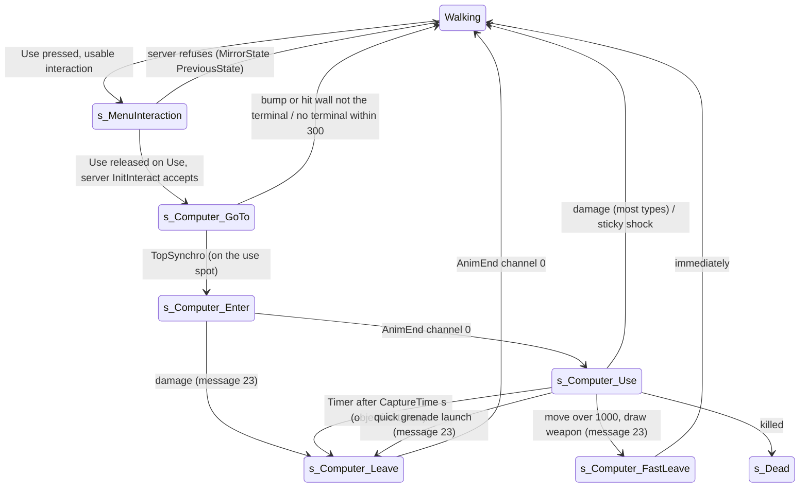
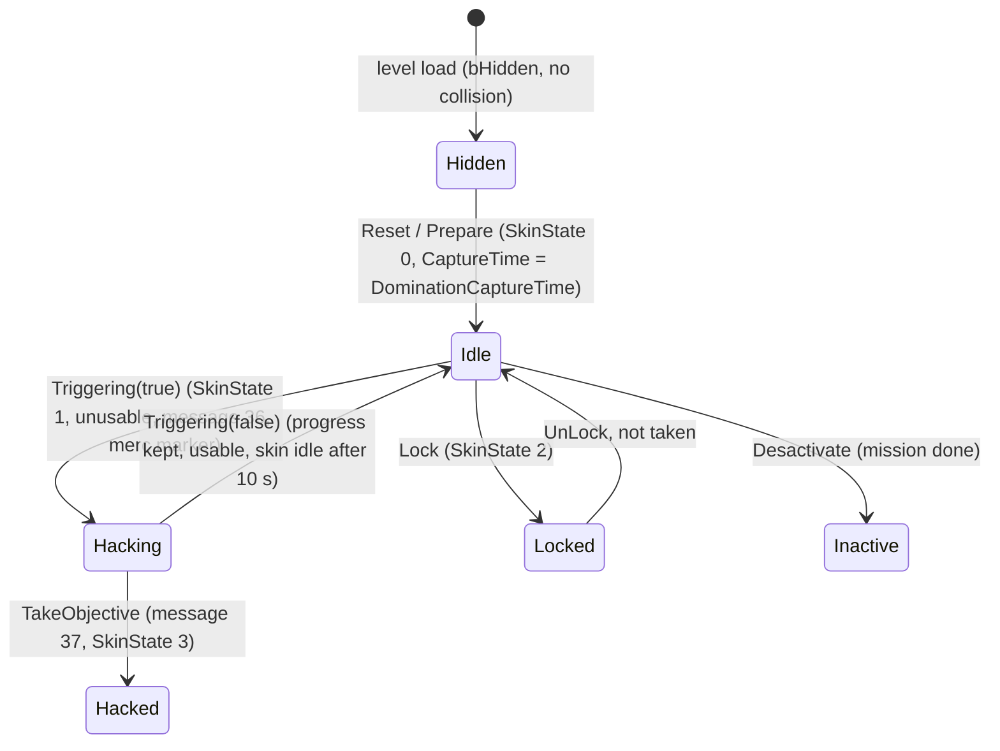

# Terminal hack (SComputerObjectiveTrigger)

Units:
- def:SBase.SComputerObjectiveTrigger, def:SBase.SComputerInteraction
- rep:SBase.SComputerObjectiveTrigger.SkinState, rep:SBase.SComputerObjectiveTrigger.DominationCaptureTime, rep:SBase.SComputerObjectiveTrigger.DeltaCaptureTime, rep:SBase.SComputerObjectiveTrigger.UseRelativeLocation, rep:SBase.SComputerObjectiveTrigger.UseRelativeRotation, rep:SBase.SComputerInteraction.ObjectiveTrigger
- uc:SBase.SComputerObjectiveTrigger:PostBeginPlay, uc:SBase.SComputerObjectiveTrigger:Destroyed, uc:SBase.SComputerObjectiveTrigger:Prepare, uc:SBase.SComputerObjectiveTrigger:Reset, uc:SBase.SComputerObjectiveTrigger:Triggering, uc:SBase.SComputerObjectiveTrigger:Timer, uc:SBase.SComputerObjectiveTrigger:TakeObjective, uc:SBase.SComputerObjectiveTrigger:Lock, uc:SBase.SComputerObjectiveTrigger:UnLock
- uc:SBase.SComputerObjectiveTrigger:s_TemporaryInactive.BeginState, uc:SBase.SComputerObjectiveTrigger:s_TemporaryInactive.EndState, uc:SBase.SComputerObjectiveTrigger:s_TemporaryInactive.Triggering, uc:SBase.SComputerObjectiveTrigger:s_TemporaryInactive.Lock, uc:SBase.SComputerObjectiveTrigger:s_TemporaryInactive.UnLock, uc:SBase.SComputerObjectiveTrigger:s_TemporaryInactive.Reset
- nat:SBase.SComputerObjectiveTrigger.Desactivate, eng:ASComputerObjectiveTrigger::Tick, eng:ASComputerObjectiveTrigger::GetCapturePercent (vtable +0x13c)
- eng:ASHud spy objective markers (capture percent and label; see `messages.md` rule 10)
- uc:SBase.SComputerInteraction:PostBeginPlay, uc:SBase.SComputerInteraction:InitInteract, nat:SBase.SComputerInteraction.CanUse
- uc:SBase.SPlayerController:UseComputer
- uc:SBase.SPlayerController:s_Computer_GoTo.BeginState, uc:SBase.SPlayerController:s_Computer_GoTo.NotifyBump, uc:SBase.SPlayerController:s_Computer_GoTo.NotifyHitWall, uc:SBase.SPlayerController:s_Computer_GoTo.PlayerTick, uc:SBase.SPlayerController:s_Computer_GoTo.TopSynchro, uc:SBase.SPlayerController:s_Computer_GoTo.PlayerMove
- uc:SBase.SPlayerController:s_Computer_Enter.CanBeDropAttacked, uc:SBase.SPlayerController:s_Computer_Enter.BeginState, uc:SBase.SPlayerController:s_Computer_Enter.PawnTakeDamage, uc:SBase.SPlayerController:s_Computer_Enter.AnimEnd, uc:SBase.SPlayerController:s_Computer_Enter.PlayerMove
- uc:SBase.SPlayerController:s_Computer_FastLeave.BeginState
- uc:SBase.SPlayerController:s_Computer_Leave.CanBeDropAttacked, uc:SBase.SPlayerController:s_Computer_Leave.BeginState, uc:SBase.SPlayerController:s_Computer_Leave.PawnTakeDamage, uc:SBase.SPlayerController:s_Computer_Leave.AnimEnd, uc:SBase.SPlayerController:s_Computer_Leave.PlayerMove
- uc:SBase.SPlayerController:s_Computer_Use.CanBeDropAttacked, uc:SBase.SPlayerController:s_Computer_Use.GadgetQuickChoice, uc:SBase.SPlayerController:s_Computer_Use.BeginState, uc:SBase.SPlayerController:s_Computer_Use.EndState, uc:SBase.SPlayerController:s_Computer_Use.Timer, uc:SBase.SPlayerController:s_Computer_Use.PlayerMove, uc:SBase.SPlayerController:s_Computer_Use.PawnTakeDamage

## Purpose

A terminal (a laptop on a desk) is the trigger of a Story objective. A spy opens its interaction menu, picks "Use", is walked onto a fixed use spot in front of it, plays an enter animation and then hacks for `CaptureTime` seconds. Moving, the draw-weapon button or most damage stops the hack; whole seconds already hacked are kept. While a hack runs every player is told, and every merc gets a radar/HUD marker. When the time completes the objective is taken.

## Data

| Field | Type | Default | SteeE | Notes |
|---|---|---|---|---|
| DominationCaptureTime | int | 12 | 10 (all five) | Copied over `CaptureTime` on every reset. Replicated. |
| CaptureTime | int | 5 (inherited) | 5 (unused) | The live remaining hack seconds. Replicated. |
| InteractionDistanceToCenter | int | 39 | default | Forward offset of the interaction cylinder centre. |
| UseRelativeLocation | Vector | (64, 0, 0) | default | Use spot in the terminal's axes (X forward, Y right). Z unused for the spot. Replicated. |
| UseRelativeRotation | Rotator | (0, 32768, 0) | default | Only Yaw is used: the spy faces `Rotation.Yaw + Yaw`. Replicated. |
| fInteractionRadius / fInteractionHeight | float | 50 / 50 | default | Interaction cylinder size. |
| fHackStartTime | float | 0 | | `Level.TimeSeconds` when the current hack started. Server only: not replicated, so it stays 0 on every client. |
| DeltaCaptureTime | float | 0 | | Seconds hacked in the current run. Zeroed by every `Triggering` call (rule 17), advanced only by the server's native tick (rule 31), never advanced on a client. Replicated by the native list while `bActive`, whenever it changed. |
| SkinState | byte | 0 | | 0 idle, 1 being hacked, 2 locked, 3 hacked. Replicated on every change (native list). |
| LocalSkinState | byte | 0 | | Client copy used by the native skin update. |
| SkinTriggering / SkinLocked / SkinHacked | Material | FX_neutre_hack_heat / FX_neutre_locked_heat / FX_hacked | | Screen materials per state. |
| StaticMesh | | SGameplayObjects.neutre.mode_neutralisation | | 63 x 61 x 50 laptop, pivot at its base. |
| bHidden | bool | true | | Hidden until the mission resets it. |
| EMFIntensity | float | 1.0 | | |
| SComputerInteraction: iPriority 10, Description "Use", bInteractInFront true, UsableBy U_SPAWNOFFENSE, AccessDenied "Security activated - Access denied", vRelativePositionForInteraction (55,0,0) (unused by this flow) | | | | |

SteeE terminals (use spot computed as `Location + 64 X`, interaction centre `Location + 39 X`, face yaw `Yaw + 32768`; values here are float approximations, the port computes them with the engine rotation maths):

| Actor | TriggerName | Location | Yaw | Interaction centre | Use spot (X, Y) | Face yaw |
|---|---|---|---|---|---|---|
| SComputerObjectiveTrigger28763 | Laboratory (2nd floor) | (-1850.3, -763.5, -732.0) | 65712 | (-1811.3, -762.8, -732.0) | (-1786.3, -762.4) | 32944 |
| SComputerObjectiveTrigger28762 | Kitchen (1st floor) | (-3078.5, -1236.1, -1053.0) | 16412 | (-3078.6, -1197.1, -1053.0) | (-3078.6, -1172.1) | 49180 |
| SComputerObjectiveTrigger28761 | Lounge (3rd floor) | (-3225.1, -654.7, -412.0) | -16 | (-3186.1, -654.8, -412.0) | (-3161.1, -654.8) | 32752 |
| SComputerObjectiveTrigger28764 | Office (2nd floor) | (-2067.1, 1767.3, -732.0) | -16 | (-2028.1, 1767.2, -732.0) | (-2003.1, 1767.2) | 32752 |
| SComputerObjectiveTrigger28765 | Shop (1st floor) | (-2842.1, 1763.3, -1052.0) | -16 | (-2803.1, 1763.2, -1052.0) | (-2778.1, 1763.2) | 32752 |

No two terminals are within 200 uu of each other.

## Rules

Setup (server):

1. `PostBeginPlay`: `SetCollision(false, false, false)`; get the axes X, Y, Z of `Rotation`; spawn an `SComputerInteraction` owned by the terminal at `Location + X * InteractionDistanceToCenter + Y * UseRelativeLocation.Y + Z * UseRelativeLocation.Z` with the terminal's `Rotation`, ignoring collision, and store it in `InteractionObj`; `DeltaCaptureTime = 0`; `SkinState = 0`; then the parent `PostBeginPlay` (`objective-trigger.md` rule 2). The terminal has no `InteractionClass`, so the generic spawn, priority copy and `bInteractInFront` copy of `SBasicGamePlayObject` do not apply; the interaction keeps its own class defaults.
2. The interaction's own `PostBeginPlay` (`interaction-system.md` rule 3) sizes its cylinder to the terminal's `fInteractionRadius` x `fInteractionHeight` (50 x 50), bases it on the terminal, and copies `UsableBy` from the terminal only if the terminal's is not `U_DEFAULT_USABILITY`. Then `SComputerInteraction.PostBeginPlay` sets `ObjectiveTrigger = Owner`.
3. `Destroyed`: destroy `InteractionObj`, then parent.

Reset and prepare (server, from the mission):

4. `Reset`: parent `Reset` (`objective-trigger.md` rule 6, which calls this class's `Triggering(false)`, rules 15 to 19); then `CaptureTime = DominationCaptureTime`; `bHidden = false`; if `bTriggering`, `Triggering(false)`; `SetCollision(true, true, true)`; `SkinState = 0`.
5. `Prepare`: `bHidden = false`; `SetCollision(true, true, true)`; `SkinState = 0`.
   SteeE: every terminal becomes visible, solid, idle, with `CaptureTime = 10`.

Starting a hack:

6. The spy opens the menu with Use and releases Use with "Use" selected (`interaction-system.md` rules 10 to 15). The client sends `InteractionInit(interaction, sub)`; the server sets `iLastUsedTime = int(TimeSeconds)` and calls `SComputerInteraction.InitInteract`.
7. `InitInteract` (server): if `ObjectiveTrigger.bActive` and not `ObjectiveTrigger.bLocked` and the terminal is not in state `s_RestoreAfterAlarm` (no such state exists in this build, so the test always passes): `ControllerWhoTakesIt = Instigator`; if `CaptureTime == 0` set it to 1; `Instigator.UseComputer()`. Otherwise, if the instigator is in `s_MenuInteraction` and alive, `MirrorState(PreviousState, '', true)` (leave the menu).
8. `UseComputer` (server): if the pawn is an `SPawnAttaque` (spy) with `Health > 0`, `MirrorState('s_Computer_GoTo')` (server enters it and tells the owning client). A merc never starts a terminal hack, even if `UsableBy` were changed.
9. `s_Computer_GoTo` (on the machine that runs the player's input, `IAmOnClient()`): if a weapon is drawn, play the holster transition (`SA_WALK_CR_2Hto0H` crouched or `SA_WALK_ST_2Hto0H`) and set the camera to `ECM_Walking`; then `ChangeEnumAction(SA_REPOS)` (the repositioning move toward `vVandammePos`: 180 uu/s with bUseAdditionnalPhysicsForRepos, so the pawn walks with collision; TopSynchro once within 1 of the target with the yaw matching; execute-action.md case 148, physics-rootmotion-repositioning.md).
10. Every tick in `s_Computer_GoTo` (`PlayerTick`): take the first `SComputerObjectiveTrigger` within 300 uu of the pawn (actor-list order). If none, `ChangeEnumAction(SA_WALK_ST_0H)` and `ChangeState('s_PlayerWalkingSt0H')` (abort). Else set `vVandammePos = Location + X * UseRelativeLocation.X + Y * UseRelativeLocation.Y` with Z replaced by the pawn's Z, and the facing to `vector(Rotation.Yaw + UseRelativeRotation.Yaw)` (pitch and roll of the terminal kept); then the normal `PlayerTick`.
11. Abort while walking to the spot: `NotifyBump(Other)` with anything that is not an `SComputerObjectiveTrigger`, or `NotifyHitWall(Wall)` with any wall that is not one: `ChangeEnumAction(SA_EXIT_REPOS)` and `GotoWaitingState()` (back to the walking state for the current stance and weapon). This is why a spy (radius 35) who does not fit on the use spot only sees the menu and nothing starts (RE+ measured).
12. `TopSynchro` (the repositioning finished) on the input machine: `ChangeState('s_Computer_Enter')`. `PlayerMove` in GoTo, Enter, Leave: no jump, `ZoneHorsCrouch()`, camera rotation update, zero-acceleration move (the pawn does not walk).
13. `s_Computer_Enter` BeginState (both machines): if crouched, `SA_WANTS_TO_UNCROUCH`; `SA_COMPUTER_ENTER`. `AnimEnd(0)`: `SA_COMPUTER_LOOP` and `ChangeState('s_Computer_Use')`. Damage in Enter: if alive `MirrorState('s_Computer_Leave')`; then `BroadcastLocalizedMessage(23)` (always); then the normal damage handling.
14. `s_Computer_Use` BeginState (server only): take the first `SComputerObjectiveTrigger` within 200 uu of the pawn. If found: `SetTimer(CaptureTime, true)` (looping) and `Computer.Triggering(true)`. If none: `SetTimer(3.0, true)` (the timer then only leaves the state, rule 20).

`Triggering(status)` on the terminal (server):

15. If currently triggering and status is false (a hack stops), keep progress:
    `before = CaptureTime`
    `CaptureTime = max(CaptureTime - int(TimeSeconds - fHackStartTime), 1)`
    where `int()` truncates toward zero. If the taker has stats, `Stats.Spy_ObjectiveTimeCaptured += before - CaptureTime`.
16. Parent `Triggering(status)` (`objective-trigger.md` rules 7 to 11: `bTriggering`, objective HUD status, `TriggerTime`, merc radar marker add/remove, `NotifyTriggering`).
17. `DeltaCaptureTime = 0`.
18. If status is true: `fHackStartTime = TimeSeconds`; `InteractionObj.bUsable = false` (nobody else can open it); `SetTimer(0)` (cancels a pending idle-skin timer); `SkinState = 1`; `BroadcastLocalizedMessage(36, obj = self)` to every player ("<TriggerName> : Neutralization in progress").
19. If status is false: if the objective is not taken and `bActive`, `InteractionObj.bUsable = true`; `ControllerWhoTakesIt = None`; if `bActive`, `SetTimer(10.0, false)` whose `Timer()` sets `SkinState = 0` (screen back to idle 10 s after the hack stopped). Then `bTriggering = status`.

Completion:

20. `s_Computer_Use.Timer` (server, first fires `CaptureTime` seconds after rule 14): if the pawn is alive: take the first terminal within 200 uu; if found, `Computer.TakeObjective()` then `Computer.Triggering(false)`; then, unless the controller is in `GameEnded`, `MirrorState('s_Computer_Leave')`.
21. `TakeObjective` (terminal): the base `TakeObjective` (`objective-trigger.md` rules 12 to 16: credit `ControllerWhoTakesIt`, notify the objective, which may end the match); then `BroadcastLocalizedMessage(37, obj = self)` ("<Objective.ObjectiveName> : Neutralized"); `SkinState = 3`; `SetTimer(0)`.
22. `s_Computer_Use.EndState` (both machines): call `Triggering(false)` on every `SComputerObjectiveTrigger` within 200 uu (on a client this call is absorbed); if alive, `SA_COMPUTER_ENTERBACK`.
23. `s_Computer_Leave` BeginState: on the server `Triggering(false)` on the owner of the selected interaction; both machines `SA_COMPUTER_ENTERBACK` and, if crouched, `SA_WANTS_TO_CROUCH`. `AnimEnd(any channel)`: `InteractionPost(selected interaction, selected sub)` (a client-to-server call; the default native `PostInteract` applies), and on the input machine for channel 0 `GotoWaitingState()`. Damage in Leave: if alive `MirrorState('s_PlayerWalkingSt0H')`, then normal damage.

Cancelling:

24. Input cancel (`s_Computer_Use.PlayerMove`, on the input machine every tick): if `|aStrafe| > 1000` or `|aForward| > 1000` (one movement key gives exactly 6000 x GetSpeedMode, at least 2400, so any key press cancels; input.md 1.3) or `bFireMode == 1` (the draw-weapon button, keyboard E), `ChangeState('s_Computer_FastLeave')`, which the client reports to the server. The server applies a reported client state change only when the acknowledgement stamp the client echoes equals the server's own within 0.01 s (the server renews its stamp in `MirrorState` only when the previous one is more than 1 s old), so a client that has not yet seen a recent server-ordered change is ignored.
25. `s_Computer_FastLeave` BeginState: server: `BroadcastLocalizedMessage(23)` ("Neutralization process interrupted") and `Triggering(false)` on the owner of the selected interaction (progress kept, rule 15); input machine: if crouched `SA_WANTS_TO_CROUCH`, `InteractionPost(selected, sub)`, `GotoWaitingState()`. The Use state's EndState (rule 22) also runs.
26. Quick gadget in Use (`GadgetQuickChoice(i)`, spies only, at most once per 2 s after the last quick gadget, gadget slot must exist, and slot 1 is refused while it holds a cloak): select the gadget; if it is a grenade launcher that can quick-launch and has charges (or tutorial), set `bQuickGadgetQuery`, `BroadcastLocalizedMessage(23)`, `ChangeState('s_Computer_Leave')`; if it is a cloak, use it without leaving. With the default keyboard file, left mouse is `Fire | GadgetQuickChoice 0` and right mouse `AltFire | GadgetQuickChoice 1`, and the usual spy loadout has smoke (slot 0) and chaff (slot 1), both quick-launchable (`CanQuickLaunch` true by default), so either mouse button during a hack throws the grenade and ends the hack with progress kept. This is the practical meaning of "firing cancels".
27. Damage in Use (`s_Computer_Use.PawnTakeDamage`, server): first `BroadcastLocalizedMessage(23)` on every call; if already dead return; apply standard damage; then:
    - died: unless explosive and blast-able (then the fatal blast path), or sticky blast: `PlayAnimDeath` and `MirrorState('s_Dead')` if on a base, else `MirrorState('PlayerFallingInerte')` (both skipped if the game ended);
    - `SDamage_Charged`, `SDamage_ElbowShock`: their handlers (other spec), state left;
    - `SDamage_DropAttacked`: `MirrorState('s_FallDropAttacked')`;
    - `SDTStickyShocker`: `MirrorState('s_PlayerWalkingSt0H')` if alive, then shock;
    - any other type: if the pawn's IK type is not PIPH or JCVD and the type is not `SDTBase_NoAnim`: hit animation and `MirrorState('s_PlayerWalkingSt0H')` if alive. With `SDTBase_NoAnim` (the class default of `SDamageVolume`, used by all seven SteeE damage volumes including the molotov fire) the hack continues, but message 23 is still sent on every hit.
    Leaving by any of these runs rule 22 (progress kept).

Locks (alarm only; not reachable in SteeE):

28. `Lock()`: if the objective is taken, return. If `Objective.RemainingTime <= 0`: set it to 1 and `CaptureTime += 1`. If triggering and the taker is a living player: `MirrorState('s_PlayerWalkingSt0H')` on the taker and clear `ControllerWhoTakesIt`. `SetTimer(0)`; `GotoState('s_TemporaryInactive')`; if still triggering `Triggering(false)`; `bLocked = true`. Global `UnLock` does nothing.
29. `s_TemporaryInactive` (this class): BeginState: if triggering, global `Triggering(false)`; `bActive = false`; `bLocked = true`; `SkinState = 2`. EndState: nothing (so `bLocked` stays true until `UnLock`). `Triggering(any)` in this state only kicks the taker out (as in rule 28) and changes nothing else. `Lock` does nothing. `UnLock`: if not taken: `SkinState = 0`, `bActive = true`, `bLocked = false`, `GotoState('s_Initial')`; else `SkinState = 3` and `Desactivate()`. `Reset`: `CaptureTime = DominationCaptureTime`, `Triggering(false)`, `bEMFIsOn = true`. Inherited from the base locked state: `TakeObjective` is ignored.

Native:

30. `SComputerInteraction.CanUse(PC)` (game thunk 0x10AB96F0 shared by all `CanUse`, editor `ASComputerInteraction::execCanUse` 0x111BE210): decides whether the "Use" entry is offered. Expected: `bUsable`, team allowed by `UsableBy`, pawn alive, and probably the trigger's `bActive`/`bLocked`; the `AccessDenied` text suggests a locked terminal is listed with "Security activated - Access denied". To be confirmed.
31. Native tick (game 0x10ABDDD0, the class's Tick slot; the editor's 0x111CF690 only calls `AActor::Tick`), every frame on every machine, after the parent tick (the tick ends if that returns false):
    - Screen skin: if `SkinState != LocalSkinState`, `LocalSkinState = SkinState` and `Skins[1]` becomes None (0), `SkinTriggering` (1), `SkinLocked` (2) or `SkinHacked` (3).
    - Server (`Role == ROLE_Authority`): if `bTriggering && bActive && !bLocked && !Objective.ObjectiveTaken`, `DeltaCaptureTime += DeltaSeconds`. Nothing else adds to it: it is not wrapped at whole seconds, and `CaptureTime` does not change while a run goes on.
    - Client (any other role): no progress maths at all. If `bLocked && bTriggering`, clear the local `bTriggering` (a locked terminal never shows as being hacked). `DeltaCaptureTime` is whatever the server last replicated.
32. Capture percent (game 0x10ABDF80, `ASComputerObjectiveTrigger` vtable +0x13c; other triggers return -1, distance only):
    `percent = trunc((float(DominationCaptureTime - CaptureTime) + DeltaCaptureTime) * 100.0 / DominationCaptureTime)`
    in x87 floats, the division by the int `DominationCaptureTime`, truncated toward zero (`_ftol` 0x10B83AA0). No guard against `DominationCaptureTime == 0`. Not clamped here: it reaches 100 when `DeltaCaptureTime` reaches `CaptureTime`.
33. The spy HUD markers (SHud objective markers, game 0x10AF8C00): for `SHud.LockedObjective` the trigger's percent clamped to 0..99 (call 0x10AF8E9D, constants 0.0 at 0x10C109F8 and 99.0 at 0x10C11378); for an objective entry the highest percent of its triggers, starting from -1 (calls 0x10AF93EF, 0x10AF94F1), clamped the same way before drawing. So the HUD shows 0 to 99 and never 100; the objective is taken (and the marker turns hacked) when it would reach 100.
34. The label (helper 0x10AF8A30, grey 128,128,128 at the marker alpha, centred, 40 px above the marker): with both a distance and a percent (each `>= 0`), the percent `'%i%%'` shows while `trunc(TimeSeconds) mod 4 >= 2` and the distance `'%i %s'` (`trunc(d) * fDistanceUnit`, `StrDistanceUnit`) the rest of the time: two seconds of distance, two of percent, repeating. Without a distance the percent always shows (blank without either). The percent is a whole number with a percent sign, no decimals; nothing on the HUD shows the time left.
35. Over one SteeE hack (`DominationCaptureTime` 10, fresh terminal) the percent is `trunc(10 * t)` at `t` seconds after the server's `Triggering(true)` (about 0.4 s after the Use release, measured): 0, 10, 20 up to 90, then 99 for the last tenth of a second. After a break with 4.6 s hacked (`CaptureTime` 6, `DeltaCaptureTime` 0) it drops from 46 to 40 and counts up again from there (rule 15, the part second is lost). On a client the steps follow the terminal's net updates, so they can lag the server by one update.

36. `Desactivate` (game 0x10ABDEB0, vtable +0x138 of ASComputerObjectiveTrigger, through the shared thunk 0x10AE9C60): when `ControllerWhoTakesIt` is set (alive or not, and not cleared), it gets `MirrorState('s_PlayerWalkingSt0H')` (the event's first parameter is the hardcoded name 0x444, registered as `s_PlayerWalkingSt0H` at 0x1092759E; label, flag and actor empty). Then in `s_TemporaryInactive` (name 0x3C3, or a state below it): `bActive` and `bLocked` cleared, `Triggering(false)`, `bEMFIsOn` cleared, nothing else. Otherwise the objective trigger version (objective-trigger.md rule 21) and `SkinState = 3`. On a completed hack this runs inside `TakeObjective` (rule 21, through `SObjective.NotifyTaken`), so the taker goes to walking first (the Use EndState of rule 22 runs) and `s_Computer_Use.Timer` then sends him on to `s_Computer_Leave` (rule 20). A spy still hacking another terminal of a mission that completes (its other objectives are deactivated) is sent back to walking the same way. REA-checked 2026-10-26.
37. Collision: a shown terminal blocks players (`SetCollision(true, true, true)` in rules 4 and 5). The mesh `SGameplayObjects.mode_neutralisation` has 236 per-poly triangles reaching X 33.19 and two closed simple boxes (X -30.29 to -12.17, Z 8 to 50.2, and X -21.22 to 28.17, Z 0 to 8); `UseSimpleBoxCollision` is the default true. Pawns collide with the simple boxes (UStaticMesh::LineCheck selects the simple tree unless the trace is a shadow trace), which leaves 35.8 uu between the box face and the use spot at X 64, enough for the 35 uu spy. Against the per-poly triangles the spy stops 2.8 uu short and never arrives within 1 uu.

## States

Player controller (the spy):

Terminal:

## Constants

| Name | Value | Unit | Provenance | Source |
|---|---|---|---|---|
| DominationCaptureTime default | 12 | s | decoded | def:SBase.SComputerObjectiveTrigger |
| SteeE DominationCaptureTime | 10 | s | decoded | SteeE terminals |
| InteractionDistanceToCenter | 39 | uu | decoded | def |
| UseRelativeLocation | (64, 0, 0) | uu | decoded | def |
| UseRelativeRotation.Yaw | 32768 | rot units | decoded | def |
| Interaction cylinder | 50 x 50 | uu | decoded | def (fInteractionRadius/Height) |
| GoTo terminal search radius | 300 | uu | decoded | s_Computer_GoTo.PlayerTick |
| Use terminal search radius | 200 | uu | decoded | s_Computer_Use |
| No-terminal fallback timer | 3.0 | s, looping | decoded | s_Computer_Use.BeginState |
| Cancel input threshold | 1000 | input units per axis | decoded | s_Computer_Use.PlayerMove |
| Idle skin delay | 10.0 | s | decoded | Triggering(false) |
| Minimum kept CaptureTime | 1 | s | decoded | Triggering(false) |
| Quick gadget gap | 2.0 | s | decoded | GadgetQuickChoice |
| Use release to progress start | 0.37 to 0.47 | s | measured | RE+ lab-movement L4 |
| Use release to done | DominationCaptureTime + 0.5 to 0.6 | s | measured | RE+ lab-movement L4 (12 s: 12.51 to 12.60) |
| Kept progress after break | whole seconds, no decay for at least 240 s | | measured | RE+ lab-movement L4 |
| Skin and timer reset after break | 9 to 11 s after release | s | measured | RE+ lab-movement L4 (matches 10.0 decoded) |
| Spy collision radius at use spot | 35 | uu | measured | RE+ MapBuilderFacts |
| Terminal simple collision front face | 28.17 | uu (local X) | decoded | mode_neutralisation hull, smcollision |
| Terminal per-poly front | 33.19 | uu (local X) | decoded | mode_neutralisation per-poly, smcollision |
| Messages | 36 start (all), 37 done (all), 23 interrupted (all) | switch | decoded | see messages.md |
| Progress rate | 1 per second of server time | s/s | decoded | game 0x10ABDDD0 (`DeltaCaptureTime += DeltaSeconds`) |
| HUD percent scale | 100.0 | | decoded | game 0x10C109E0, read by 0x10ABDF80 |
| HUD percent clamp | 0 to 99 | percent | decoded | game 0x10C109F8, 0x10C11378 (0x10AF8E9D) |
| Label period | 4 s (2 distance, 2 percent) | s | decoded | game 0x10AF8A30, `trunc(TimeSeconds) & 3 >= 2` |

## Network

- Server: `InitInteract`, `UseComputer`, every `Triggering`, `TakeObjective`, the Use-state timer and `PawnTakeDamage` decisions. `s_Computer_Enter` and `s_Computer_Use` are requested on both machines (the client's `ChangeState` report and the server's own `AnimEnd(0)` on its copy of the enter animation); the server enters `s_Computer_Use` on whichever comes first, and the second request is a transition to the current state, which does not run `BeginState` again (UE2 state rule, core runtime spec). The server timer therefore starts at the earlier of the two. The server's own `AnimEnd(0)` comes after the same clip time as the client's, counted from the tick the server executed SA_COMPUTER_ENTER (the move's arrival), not from the client's start (execute-action.md Network, anim.md rule 2).
- The terminal's native property list sends `SkinState` on every change and `DeltaCaptureTime` while `bActive`, whenever it differs from the last value sent (editor 0x111cf840, game 0x10ABD9F0). The progress is server state: a client never advances `DeltaCaptureTime` and has no `fHackStartTime` (not replicated); its HUD percent comes only from the replicated `DominationCaptureTime`, `CaptureTime` and `DeltaCaptureTime` (rules 31 to 33).
- Owning client (input machine): menu, `s_Computer_GoTo` repositioning, the input cancel test (`PlayerMove` runs where the input is), `InteractionPost`, `GotoWaitingState`. Client state changes reach the server through the reliable `PCChangeServerState`; server changes reach the client through the reliable `PCChangeClientState` (`MirrorState`).
- RPCs: `InteractionInit`, `InteractionPost` reliable client to server; `BroadcastLocalizedMessage` reliable per player; `AddRemoveObjectiveForRadar` and `AddRemoveObjectiveOnClientHud` reliable multicast (flag 0x01000000).
- Replicated terminal fields: base class fields plus `SkinState`, `DominationCaptureTime`, `DeltaCaptureTime`, `UseRelativeLocation`, `UseRelativeRotation` (script block says `bNetInitial` only, but the class is `nativereplication`; `SkinState` visibly changes on clients, so the native list (editor 0x111CF840) must send it on change; confirm). `SComputerInteraction.ObjectiveTrigger` reliable.
- Simulated proxies elsewhere see the hacking spy through the pawn's replicated action (`SA_COMPUTER_*`).

## Edge cases

- Progress is lost only in fractions: each break loses `frac(elapsed)`, and `CaptureTime` never goes below 1, so a hack broken off in its last second still needs 1 s more.
- `InitInteract` turns `CaptureTime == 0` into 1, but never touches `DominationCaptureTime`.
- The Use-state timer is looping and is not cleared when the state is left; later controller states that define `Timer()` without setting their own timer would receive it. The states reachable afterwards in SteeE set their own timer or ignore it; keep the behaviour.
- The timer and the hack flag are independent. If two spies reach `s_Computer_Use` on one terminal (both released Use before either's hack started, which is when the terminal becomes unusable), the second `Triggering(true)` restarts `fHackStartTime`, the taker becomes whoever called `InitInteract` last, the first timer to fire takes the objective, and the second timer later finds `ControllerWhoTakesIt == None`: the base `TakeObjective` does nothing, but message 37 is broadcast again and `SkinState` set to 3. If one of the two leaves first, its `EndState` stops the hack for both, clears the taker, and the other's timer then announces "Neutralized" without taking the objective.
- `EndState` stops every terminal within 200 uu, not only the hacked one.
- The server-side `Triggering(false)` in `s_Computer_FastLeave` and `s_Computer_Leave` uses the server's own menu selection, which can differ from the client's after scrolling (`interaction-system.md` edge cases); the cast then yields None and does nothing, and the Use state's `EndState` stops the hack instead.
- Message 23 is sent by damage even when the damage does not stop the hack (`SDTBase_NoAnim`), and also by the Enter state's damage handler, so mercs can see "interrupted" while the hack continues.
- `s_Computer_Leave.AnimEnd` calls `InteractionPost` for every channel, so it can be sent more than once.
- `s_RestoreAfterAlarm` is tested but does not exist in this build.
- Only `SPawnAttaque` pawns can start the hack (rule 8), whatever `UsableBy` says.

## Evidence

- Decompiled: `local/re-out/uc/SBase/SComputerObjectiveTrigger.uc`, `SComputerInteraction.uc`, `SPlayerController.uc` lines 6671 to 6677 (UseComputer) and 23708 to 24109 (computer states), 1088 to 1220 (MirrorState, ChangeState, PCChangeServerState), 7284 (GotoWaitingState), 7422 (IAmOnClient).
- Defaults: `classdefaults_effective.json` (SComputerObjectiveTrigger, SComputerInteraction), `classdefaults_localized.json`.
- SteeE: terminal exports 28761 to 28765 in `SteeE.sdc`.
- Natives (wave 12b): game 0x10ABDDD0 tick (progress and skin), 0x10ABDF80 percent (vtable +0x13c), 0x10ABD9F0 rep list, 0x10AF8C00 SHud objective markers (percent calls at 0x10AF8E9D, 0x10AF93EF, 0x10AF94F1), 0x10AF8A30 marker label (strings `%i %s` 0x10C437B4, `%i%%` 0x10C437C0). Bit masks at +0x3E4: bActive 2, bTriggering 4, bLocked 8; `Objective` +0x3D0, its `ObjectiveTaken` +0x354 mask 8; `DeltaCaptureTime` +0x400, `DominationCaptureTime` +0x408, `CaptureTime` +0x3DC. Decompiled under `local/re-out/c/actions/game/` (local only).
- Natives: SComputerObjectiveTrigger.Desactivate 1321 (thunk 0x10AE9C60), SComputerInteraction.CanUse 1340 (thunk 0x10AB96F0); editor ASComputerObjectiveTrigger Tick 0x111CF690, execDesactivate 0x111CF720, GetOptimizedRepList 0x111CF840; ASComputerInteraction execCanUse 0x111BE210, GetOptimizedRepList 0x111BE2B0. Vtables (game): ASComputerObjectiveTrigger 0x10BF70E0, ASComputerInteraction 0x10BF6FA0.
- Measured: RE+ `docs/phase4/lab-movement.md` L4 (HackLabD), `docs/MapBuilderFacts.md`, `docs/MapBuilderPatterns.md`.

## Open questions

2. `SComputerInteraction.CanUse` and the shared `CanUse` virtual: exact conditions, and whether a locked terminal is listed with the AccessDenied text. Ghidra 0x111BE210.
5. The repositioning timeout: the native rules in physics-rootmotion-repositioning.md list none (the move ends with TopSynchro or NotifyBump); check whether any script state bounds the approach in time.

### Resolved

1. How `DeltaCaptureTime` advances and which skin slot each state sets. Resolved: the server adds `DeltaSeconds` each tick while the hack runs (not wrapped at whole seconds); clients never touch it; `Skins[1]` per `SkinState`. Rules 31 to 35. Evidence: game 0x10ABDDD0, 0x10ABDF80, 0x10AF8C00, 0x10AF8A30 (wave 12b).

3. The native replication list of the terminal. Resolved: `SkinState` on every change, `DeltaCaptureTime` while active. Data table and Network. Evidence: editor 0x111cf840 (ANSWERS-net rep-objectives 1).
4. What `aStrafe`/`aForward` hold for keyboard input. Resolved: `(BT_Right - BT_Left) x 6000 x GetSpeedMode` and `(BT_Up - BT_Down) x 6000 x GetSpeedMode`, so one key is 2400 to 6000 and always passes the 1000 threshold. Rule 24. Evidence: input.md 1.3 (ANSWERS-actions 4).
5. (part) Repositioning speed and tolerance. Resolved: SA_REPOS sets 180 uu/s with bUseAdditionnalPhysicsForRepos; TopSynchro within 1 with the yaw matching. Rule 9. Evidence: execute-action.md constants, physics-rootmotion-repositioning.md (ANSWERS-actions 18, ANSWERS-physics 27).
6. Whether the server's `AnimEnd(0)` in `s_Computer_Enter` uses the same clip time. Resolved: yes, the same action and frame advance, counted from the tick the server executed it. Network. Evidence: execute-action.md Network, anim.md rule 2 (ANSWERS-actions 17).

## Port notes (wave 12b): HUD stuck at 99%

What is wrong today:
- `src/OpenScct.Game/SBase/SComputerObjectiveTrigger.cs`, `NativeTick` (lines 193 to 207): `if (bTriggering) DeltaCaptureTime = Level.TimeSeconds - fHackStartTime;` runs on every machine. In play the HUD reads the local player's loopback client level (`PlayRoot` listen server plus loopback player; `HudSimReader.ReadObjectives` line 353 calls `HudK.CapturePercent`, `game/Scripts/Hud/HudK.cs` line 112). On that client `fHackStartTime` is 0 (not replicated; `Triggering(true)` runs only on the server), so every client tick overwrites the replicated `DeltaCaptureTime` with the client's whole `Level.TimeSeconds`. With 10 s to hack, any hack started more than 10 s into the level gives `(0 + TimeSeconds) * 100 / 10 >= 100`, clamped to 99: 99% from the first frame to the end. The server copy is right, which is why `TerminalHackTests.Hud_percent_grows_during_a_hack_from_the_kept_progress` (a single authority world) passes.
- The same tick lacks the decoded gates (`bActive`, `!bLocked`, `!Objective.ObjectiveTaken`) and the client rule that clears a local `bTriggering` on a locked terminal (rule 31).
- `HudSimReader.ReadObjectives` gives each trigger its own percent; the original shows an objective's highest trigger percent (rule 33). Same result in SteeE (one terminal per objective), so not the cause.

Change:
1. `SComputerObjectiveTrigger.NativeTick`: on `Role == ROLE_Authority`, `if (bTriggering && bActive && !bLocked && Objective is { ObjectiveTaken: false }) DeltaCaptureTime += DeltaSeconds;` (rule 31, decoded; drop the `TimeSeconds - fHackStartTime` estimate and its Estimated provenance). On any other role, `if (bLocked && bTriggering) bTriggering = false;` and never write `DeltaCaptureTime`. Keep the skin update.
2. `GetHackPercent` and `HudK.CapturePercent` compute the same thing twice; make the HUD call the sim one (unclamped percent from the sim, 0 to 99 clamp at the HUD, rules 32 and 33).

Failing tests first (`tests/OpenScct.Game.Tests/Objectives/TerminalHackTests.cs`):
- `A_client_terminal_keeps_the_replicated_progress`: a terminal with `Role = ROLE_SimulatedProxy`, `bActive`, `bTriggering`, `DominationCaptureTime = CaptureTime = 10`, `DeltaCaptureTime = 2.5` (as received), level time past 100 s; run 0.5 s; expect `DeltaCaptureTime == 2.5` and a percent of 25. Today it reads 99.
- `Server_progress_stops_when_locked_or_taken`: an authority terminal hacked 2 s, then `bLocked = true` (and separately `Objective.ObjectiveTaken = true`), run 2 s more: `DeltaCaptureTime` stays about 2.
- Integration (`tests/OpenScct.Integration.Tests`, a server plus loopback client session as in `SessionTests`): start a hack on a SteeE terminal after 30 s of level time and run 5 s; the client terminal's percent is within one net update of the server's and between 40 and 55.

Proof from real keys: the SteeE play smoke that hacks a terminal (`game/Scripts/Smoke/PlaySmoke.cs`, the hacked check near line 222) walks the spy onto the spot with keys and selects Use; sample the HUD snapshot's terminal percent at 2, 5 and 8 s after the hack starts: about 20, 50 and 80, rising, never 99 before the last second, then the objective taken after 10 s. Take a screenshot about 5 s in during a percent phase of the marker label (`trunc(TimeSeconds) mod 4 >= 2`) and check the label reads a number near 50 followed by `%`, and one in a distance phase showing metres.
